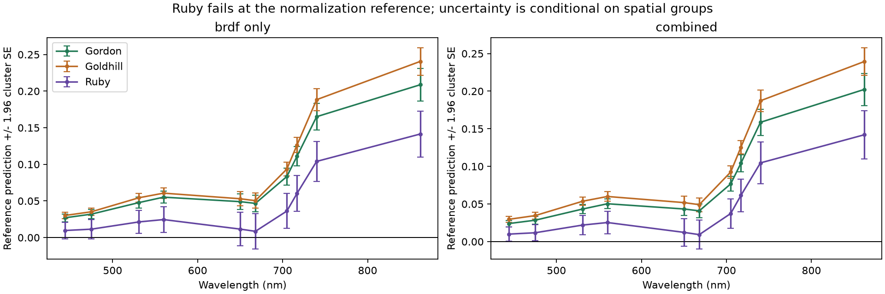
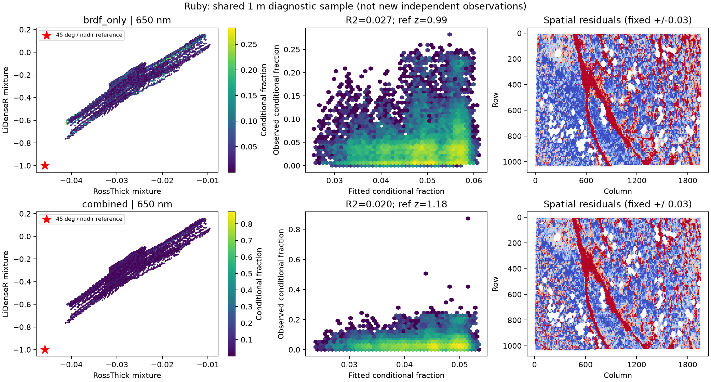
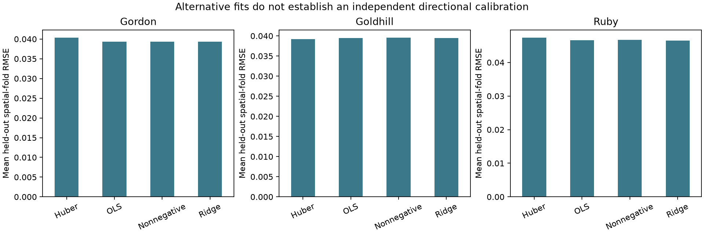
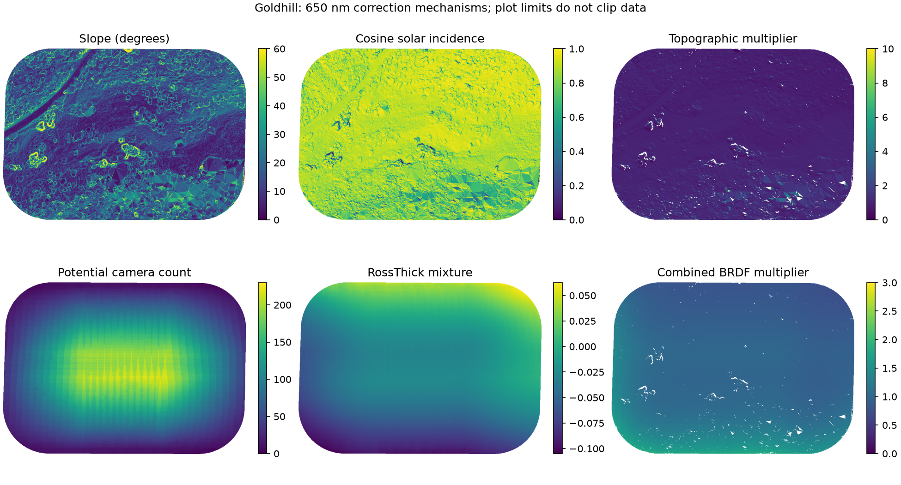
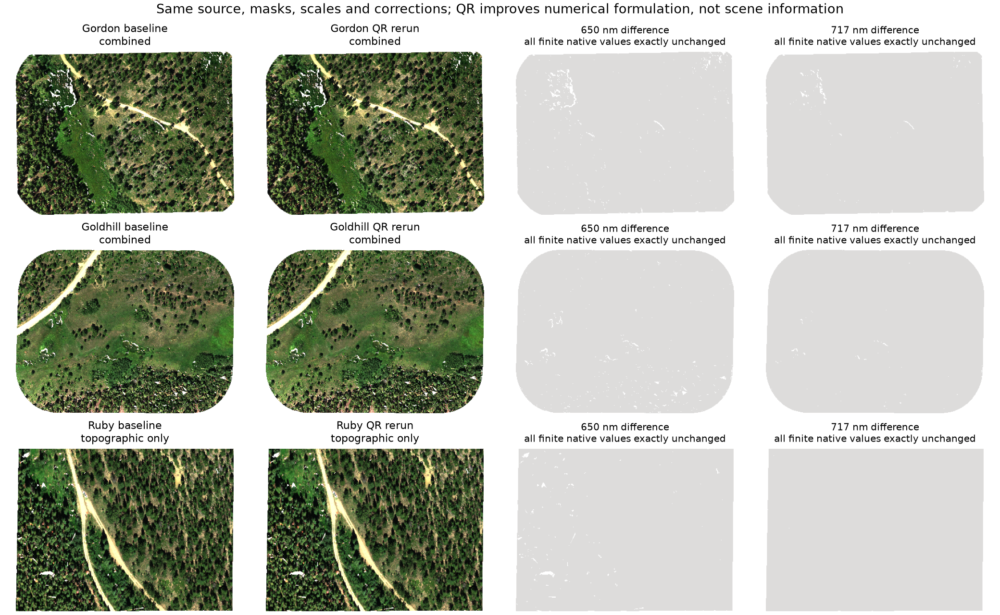

# SpectralBridge: Resolving Three-Site BRDF and Topographic Correction Instability

5 November 2026 · Gordon, Goldhill and Ruby · RC2 scientific debugging

## Executive summary

**The remaining problems are traced, but all three sites cannot yet be declared reliably corrected.** Ruby fails when the model predicts brightness at the standard normalization geometry, not at the geometries represented by the mosaic. Gordon and Goldhill's largest gains originate mainly in topographic correction near a fitted ratio pole, with additional BRDF amplification near the image edge. These are unresolved scientific risks, not validated surface-reflectance changes.

Two targeted software improvements were implemented: a numerically stable QR formulation of spatial-cluster covariance and separate diagnostics for reference versus observed-geometry prediction failures. No acceptance criterion, correction equation, reference angle, calibration gate or default fitting method was weakened. No values were clipped and no identity correction replaced a failed model.

The preserved November 5 baseline was reproduced by fresh execution of its frozen source. All three sites were then rerun using the updated code and the same original imagery, 10 cm fixed-range preparation, camera tables, terrain, geometry and training masks. **All 395,908,190 finite values in the seven accepted experimental GeoTIFFs are exactly unchanged**, with unchanged support and grid metadata. Ruby still rejects BRDF-only and combined processing. The QR change improves numerical formulation; it does not create directional information or remove the tails.

**225 targeted regression tests pass.** Actual NEON BRDF-only and combined corrections remain exactly equal before and after across **7.2 million stored values**, with unchanged masks and accepted ENVI library metadata. The full release suite was not rerun and RC2 release readiness is not established. No release was published or tagged.

| Site | Topographic only | BRDF only | Combined | Largest 650 nm gain in available intended branch |
| --- | --- | --- | --- | --- |
| Gordon | Experimental | Experimental | Experimental | 17.17× combined |
| Goldhill | Experimental | Experimental | Experimental | 21.55× combined |
| Ruby | Experimental | Rejected | Rejected | 6.88× topographic only |

All numbers described as conditional fractions use the **unverified DN/32768 hypothesis**. They are not independently calibrated reflectance.

## 1. Exact baseline and preservation

The reference is [the earlier three-site report](DRONE_CAMERA_RERUN_REPORT.md), its manifests and native products under `archive/local/drone-camera-rerun/2026-11-05/photo_clock_v1/`. Every original/derived input and every baseline correction artifact listed in those manifests was rehashed. The original products were not overwritten.

New large products are under `archive/local/drone-correction-stability/2026-11-05/`:

- `baseline_frozen_v2/`: completed fresh execution of the frozen pre-change source, exactly reproducing all seven prior accepted GeoTIFF arrays and Ruby's two rejections.
- `stable_qr_v1/`: completed fresh execution using the improved covariance and diagnostic code.
- `neon_control/`: bounded real-NEON regression and serialization products.

An initial baseline attempt under `reproduced_baseline/` was interrupted after code editing invalidated live source introspection in the old research adapter. Its partial products are retained but are **not** the completed baseline. The replacement explicitly loads frozen source snapshots and is verified against the original arrays. Subsequent runs completed without changing production calibration globals.

[Verification](provenance/drone-correction-stability/2026-11-05/verification.json) records exact comparisons, unchanged hashes and production-gate rejection. The [new product catalog](provenance/drone-correction-stability/2026-11-05/product_catalog.json) lists the seven accepted experimental TIFFs. Invalid Ruby ENVI fragments and rejected model records remain diagnostics; they are not usable BRDF products.

## 2. Ruby: a supported observed domain and an unsupported reference

BRDF describes how apparent brightness changes with viewing and illumination direction. Here a kernel model is fitted to a single orthomosaic with simulated contributor mixtures, then used to predict brightness at a common **45° solar zenith and nadir view**. The source mosaic does not provide repeated independent views of each target.

The unchanged reference kernel vector is `[1, -0.04586203, -1]` for the shared RossThick/LiDenseR configuration. Ruby's 1 m training sample spans approximately **−0.04125 to −0.00954** in RossThick and **−0.76449 to 0.15710** in LiDenseR. The reference lies outside both intervals. Gordon and Goldhill cover broader kernel ranges, and their reference lies within the componentwise bounds. Being inside such bounds would still not prove empirical support or a physically valid model.



The new native diagnostics isolate the rejection mechanism:

| Ruby branch / band | Reference prediction | Spatial-cluster SE | Prediction / SE | Unresolved predictions at observed geometries |
| --- | ---: | ---: | ---: | ---: |
| BRDF only / 650 nm | 0.011558 | 0.011778 | 0.981 | 0 |
| Combined / 650 nm | 0.012294 | 0.009395 | 1.309 | 0 |

The unchanged check requires positivity beyond roundoff plus 1.96 standard errors. The combined 650 nm lower margin is approximately **−0.00612**. Its design has rank 3 and condition number **464.44**, with **60 spatial groups**. This is not a rank deficiency; it is an uncertain extrapolated normalization reference. All four rejected BRDF-only bands (444, 475, 650, 668 nm) and both rejected combined bands (650, 668 nm) fail at the reference. Their observed-geometry prediction counts are resolved. The previous whole-domain rejection count must not be interpreted as millions of local fit failures.



Ruby's central-candidate zenith spans only **0–3.06°**, compared with about 0–24.58° at Gordon and 0–22.26° at Goldhill. Importantly, individual potential camera rays at all three sites still reach about **28.6°**: the Ruby result is not an all-zero-view placeholder or evidence that every camera was directly overhead. Its clipped footprint and overlapping simulated blends provide much less variation in the mixture kernels. A geometry-only condition number cannot distinguish genuine directionality from spatial changes in vegetation, soil and shadow.

### Model-support controls

The same systematic 1 m training sample, original polygon exclusions, 20 m uncertainty groups, model equations and reference were used at all three sites. Sampled fits are diagnostic approximations; the full native fits determine product acceptance.

Controls include equal spatial-group weighting, Huber/soft-L1 regression, nonnegative coefficient constraints, standardized ridge penalties, linear spatial nuisance terms, five spatial-group holdout folds, raw-defined NDVI strata, displaced-response controls and a mean-kernel reference. None was selected to make Ruby pass.

- Ruby combined 650 nm at the mean sampled kernel has reference about **0.04359 ± 0.00224 SE**, versus the unsupported standard reference. This demonstrates sensitivity to reference extrapolation; it does not authorize changing the shared normalization target.
- Moving Ruby's response 25 m increases the reference prediction/SE ratio from about **0.99 to 3.60**, while R² falls from **0.0267 to 0.00076**. An apparently resolved reference can arise without a useful directional relationship. This is a confounding control, not a permutation significance test.
- Huber does not consistently improve spatially held-out errors: raw 650 nm mean RMSE is **0.03935 → 0.04031** at Gordon, **0.03947 → 0.03924** at Goldhill and **0.04658 → 0.04732** at Ruby. Ridge differences are small; nonnegative coefficient constraints are not a general physical requirement for Ross/Li coefficients. None establishes independent angular calibration.
- Ruby's raw-defined NDVI strata produce different coefficients and reference behavior. This is evidence of scene heterogeneity and sensitivity, not approval to replace the whole-scene model with a selected stratum.



## 3. Coordinate, viewing and solar checks

All camera PhotoIDs retain the prior one-to-one photo binding. Gordon and Ruby use their declared EPSG:26913 coordinates; Goldhill retains the explicit, independently supported EPSG:26913 override of the erroneous EPSG:5070 preamble. The original CSVs remain unchanged. The 10 cm terrain grids and hashes remain aligned; the 25 cm sidecars from the newer parent folder were not substituted.

Solar timing still uses matched-photo midpoint times on **15 August 2023**: Gordon 20:58:39.5, Goldhill 19:53:12.5 and Ruby 18:53:05.5 under an explicit UTC scenario. Ruby's previous manifest date of August 16 is not used. Approximate scene solar zeniths are **35.57°, 27.77° and 26.00°**, respectively.

The camera rotation matrices are proper orthogonal matrices, with maximum orthogonality errors near 1.2×10⁻⁹ and determinants near +1. This validates the numbers, not their camera/world or image-axis convention. The production experiment continues the documented nadir optical-axis and flight-heading footprint scenario. Potential contributors, mosaic blending weights and camera/DEM vertical datum are not independently recovered.

Sensitivity experiments explicitly test:

- Camera height offsets of ±30 m: Ruby's sampled raw red reference remains unresolved (prediction/SE ratios about 1.15 baseline, 1.75 at −30 m and 1.62 at +30 m). These are scenarios, not recovered datum corrections.
- Clock offsets of +6 and +7 hours: some Gordon/Goldhill cases put the sun below the horizon; Ruby gives very low solar elevation and negative reference predictions. There is no evidence-based reason to adopt a different zone just because one scenario passes a numerical check.
- A 90° footprint-axis rotation and both transpose interpretations of the supplied camera rotations with a negative camera-Z optical axis. Ruby remains unsupported in all four sampled baseline/axis/matrix cases (reference prediction/SE about 0.55, 1.39, 0.97 and −0.67). These unselected pose scenarios quantify sensitivity without claiming the convention has been solved. See `pose_sensitivity.json` for their exact sample sizes, conditions and references.
- Independent finite-difference DEM gradients: central slope/aspect differences are modest, with large local tails expected to require investigation of derivative/resampling details. Recomputing illumination from those gradients still gives negative red C estimates at all three sites. This does not demonstrate a common degree/radian or 180° aspect defect, nor prove every terrain pixel correct.

The **camera-to-ground distances and candidate-ray distributions** are preserved in `geometry_and_factor_summary.json`. Sampled candidate-ray median distances are about 124 m, 149 m and 133 m for Gordon, Goldhill and Ruby. These remain conditional on the unverified vertical datum.

## 4. Where the extreme gains originate

SCS+C applies the shared ratio

`topographic_factor = (cos(solar_zenith) * cos(slope) + C) / (cos(incidence) + C)`.

For red 650 nm, the native fitted C values are **−0.16290** at Gordon, **−0.36267** at Goldhill and **−0.28387** at Ruby. Negative empirical offsets move the denominator pole to a positive illumination value. The current policy excludes values crossing the pole over the entire fitted C interval and enforces a 0.001 denominator floor, but finite positive ratios can still be large and imprecise.

| Location of maximum 650 nm intended-branch gain | Raw conditional value | Topographic factor | BRDF factor fitted after topography | Actual gain | Minimum denominator over C interval |
| --- | ---: | ---: | ---: | ---: | ---: |
| Gordon row 1929, col 113 | See trace table | 6.77× | 2.54× | 17.17× | About 0.00198 |
| Goldhill row 2233, col 1858 | 0.031642 | 11.73× | 1.84× | 21.55× | About 0.00101 |
| Ruby row 237, col 205 | 0.002766 | 6.88× | Not available | 6.88× | About 0.00102 |

Exact coordinates, all four stage values, support, slope, aspect, incidence, C interval, camera count, view angles, prediction uncertainty and boundary distance are in [the 140-row traced table](provenance/drone-correction-stability/2026-11-05/traced_extreme_pixels.csv). The table is authoritative for coordinates; maximum-signal and maximum-factor pixels are different observations.

At Goldhill's largest combined factor the slope is **40.55°**, solar-incidence cosine **0.38908**, fitted denominator **0.02641**, and distance to the source boundary **0.2 m**. Gordon's largest combined factor is **0.5 m** from its boundary at slope **41.26°**. BRDF contributes boundary amplification, while the topographic near-pole mechanism also occurs well inside the mosaics.

There are **4,989 Gordon, 13,340 Goldhill and 1,643 Ruby** source pixels with red topographic gain above 5×. Their median boundary distances are about **29.8 m, 30.0 m and 17.2 m**. These are not exclusively seam or edge problems. Their slopes are roughly 37–55°, with illumination near the C-dependent support boundary. The source data do not provide independent cast-shadow or actual mosaic-seam labels; high slope and low illumination are diagnostics, not verified shadow classifications.



Propagating the existing C interval through the ratio gives a broad **6.05–280.60×** topographic factor interval at Goldhill's largest combined-gain pixel, and **3.53–193.66×** at Gordon's. These are transformed model-parameter intervals, not total physical predictive uncertainty or simultaneous coverage guarantees. Their width shows why a positive bounded correction is not necessarily a precise correction.

### Why no new C constraint or cap was imposed

Raw-defined vegetation strata change the sampled topographic C substantially. At Gordon and Ruby the pooled red estimate is negative while all three NDVI-stratum estimates are positive; Goldhill retains negative estimates in its middle and high NDVI groups. This is consistent with ecological/spatial confounding and an inadequate whole-scene illumination relationship. NDVI strata are not homogeneous physical targets, so this does not establish a replacement correction.

Forcing C or every BRDF coefficient positive would change the scientific model; capping the gain would conceal the pole rather than resolve it. No independently validated alternative improved all three sites. The unresolved tails are therefore retained and explicitly classified as potentially harmful model artifacts requiring review, not physically plausible changes certified by numerical acceptance.

## 5. Combined correction and radiometry

The actual order is **topographic correction, BRDF refitting to that corrected response, then BRDF application**. The combined gain equals its topographic factor times its own refitted BRDF factor. It need not equal the product of topographic-only and raw-fitted BRDF-only gains. At Goldhill's maximum, raw-fitted BRDF would contribute about 2.92× whereas the combined refit contributes 1.84×. The measured combined gain is 11.73 × 1.84 ≈ 21.55. This is explained by stage-specific fitting, not evidence of a double application or wrong scale direction.

Original-source fixed-range conversion remains `stored = original_DN * 10000 / 65535`, with zero offset and no image min/max adjustment. The isolated hypothesis decodes it with `conditional = stored * 65535 / (10000 * 32768)`. No band-specific physical offsets are documented. Source NoData, alpha, finite zeros and per-band missing values retain the existing reader and correction contracts.

With a fixed population and common positive response multiplier `a`, OLS coefficients and standard errors scale by `a`, covariance by `a²`, C stays unchanged, and BRDF correction ratios and positivity/SE decisions stay unchanged. The half-scale controls verify this. A mere 0–10K versus fractional convention therefore does not explain these poles or Ruby's uncertain reference. Fixed eligibility thresholds can change the population: Goldhill combined excludes one 650 nm and four 668 nm observations above the current upper bound of 2.

An additive offset is different: for `y = m * incidence + b`, adding `d` changes C to `C + d/m`. A hypothetical +0.005 offset materially changes C in the controls. No offset was applied because none is independently supported. Affine conversions with known per-band scale/offset remain covered by synthetic regression tests. Hypothetical fractions never become verified reflectance through numerical acceptance.

## 6. Implemented improvements

1. **Stable spatial uncertainty mathematics.** `cluster_covariance()` now computes the same finite-cluster sandwich estimator in a thin QR basis, avoiding inversion of `XᵀX` and its squared condition number. Deficient designs raise an explicit error; no pseudoinverse is substituted to force acceptance. A prespecified near-collinear synthetic control has 2.86% relative covariance-matrix error with the old normal-equation implementation versus approximately machine precision with QR against independent SVD influence calculations. That control is outside the accepted BRDF condition range and is not the cause of Ruby's current failure.
2. **Actionable rejection diagnostics.** BRDF model records distinguish unresolved reference prediction from unresolved observed-geometry predictions and retain the exact lower reference margin. The original whole-domain count and acceptance rule are preserved. This directly clarifies Ruby's failure.
3. **Regression contract repair.** The old TIFF checkpoint test expected algorithm version 3 even though the current runtime contract is version 4. The assertion now tests the current contract while retaining checks for old-signature rebuilding and restart reuse. No runtime spatial behavior was changed for that repair.

The QR fit needs one temporary three-column thin-Q array, approximately **160 MB for 6.7 million eligible observations**, for one band at a time. It does not introduce a new pixel table or additional archive reread; current fitting still operates on loaded cubes. Verification and native comparisons use 128-row windows. Products remain independently checkpointed per site; no old products are mutated.

## 7. Before-and-after evidence



The native arrays, support and all spectral values are exactly unchanged. The images above show baseline versus QR rerun with fixed RGB display bounds and red/red-edge difference panels. **Unchanged does not mean safe:** it shows the numerical reformulation preserved the established result. No ecological improvement or reduced artifact claim is made.

Fresh raw/topographic/BRDF/combined RGB, 650 nm and 717 nm comparisons are available for [Gordon](provenance/drone-correction-stability/2026-11-05/figures/gordon_stages.png), [Goldhill](provenance/drone-correction-stability/2026-11-05/figures/goldhill_stages.png) and [Ruby](provenance/drone-correction-stability/2026-11-05/figures/ruby_stages.png). Ruby's rejected panels remain explicitly absent. Plot bounds are only for display; analytical summaries retain all finite values.

Goldhill combined native maxima remain **2.424336 at 650 nm** and **1.771414 at 717 nm**; on shared all-ten-band support they are **1.556842 and 0.689487**. Removing unsupported observations changes the population, so lower common-support extremes do not alone establish improvement. Gordon combined maxima remain **0.949671 and 0.495208**. Ruby's topographic maxima remain **1.021902 and 0.515393**.

The established **302 half-diameter polygon identities** and **200,363 pixel memberships** remain intact. The regenerated 10,360 polygon-band summaries are experimental diagnostics, not an approved spectral library. Spectral structure is preserved exactly relative to the baseline, not independently validated against a physical reference.

## 8. Verification and release implications

- 225 targeted tests pass: shared Ross/Li mathematics, conditioned SCS+C, geometry/camera contracts, radiometry/eligibility, spatial metadata, chunking, drone integration and real entry-point AOP/drone equivalence. New regressions cover QR covariance accuracy/rank failure and separated rejection diagnostics.
- Real NEON: the same 120 × 3000 window and ten nearest native channels give exact before/after stored values for BRDF-only and combined processing, 3.6 million values each. Source data remain unchanged; ENVI serialization and normal library acceptance pass. This is a bounded regression control, not a full NEON archive reprocess or empirical drone calibration.
- Seven updated experimental GeoTIFFs exactly match their ENVI data and original baseline: 395,908,190 finite values, unchanged missing positions, CRS and affines. Source and baseline hashes are unchanged. Approved-library acceptance still rejects every experimental header.
- Geometry is reused from hashed P181 backing data; fresh baseline and updated correction stages were executed, then restart reuse was checked. No giant row-level cache or production upload was introduced.
- Ruff, API/AI freshness, links, strict documentation and final visual/report checks are recorded in `final_checks.json`. The unrelated full release suite and supported-version/artifact gates remain separate; no RC2 tag or version bump occurred.

| Issue | Classification | RC2 implication |
| --- | --- | --- |
| Normal-equation spatial covariance precision | Software numerical weakness; repaired and regression tested | Targeted improvement ready for review |
| Ambiguous whole-domain BRDF rejection count | Diagnostic weakness; repaired without changing guards | Clear reference-versus-local failure reporting |
| Ruby uncertain extrapolated reference | Scientific information/model-support limitation | Combined workflow remains unsupported; no production completion claim |
| Negative-C near-pole tails and spatial/vegetation confounding | Scientifically unresolved, potentially harmful model behavior | Numerical acceptance is insufficient for approval |
| Physical calibration, true contributors, pose/vertical conventions | Unverified upstream provenance and measurement limitations | Approved translation/library and production promotion remain blocked |
| Other source/release failures recorded in P179 | Separate release engineering queue | Full RC2 gates still required; no full-suite-green claim |

The next useful evidence is repeated measurements of the same physical targets at known directions, reliable mosaic-contributor/pose bindings and independently supported calibration/export settings. The unavailable original project/raw-photo archive is not treated as a required action for the user now; absent that evidence, controlled research remains possible, but the present mosaic regressions do not justify a new universal correction or relaxing the reference/uncertainty checks.

## 9. Reproducibility

Compact evidence and scripts: [provenance/drone-correction-stability/2026-11-05](provenance/drone-correction-stability/2026-11-05/). Large local products are excluded from Git. Run from the repository root with the existing scientific environment and preserved P181 inputs/adapter:

```bash
MPLCONFIGDIR=/private/tmp/spectralbridge-mpl OPENBLAS_NUM_THREADS=1 .venv/bin/python provenance/drone-correction-stability/2026-11-05/rerun.py --label baseline_frozen_v2 --baseline
MPLCONFIGDIR=/private/tmp/spectralbridge-mpl OPENBLAS_NUM_THREADS=1 .venv/bin/python provenance/drone-correction-stability/2026-11-05/rerun.py --label stable_qr_v1
MPLCONFIGDIR=/private/tmp/spectralbridge-mpl OPENBLAS_NUM_THREADS=1 .venv/bin/python provenance/drone-correction-stability/2026-11-05/diagnose.py
MPLCONFIGDIR=/private/tmp/spectralbridge-mpl OPENBLAS_NUM_THREADS=1 .venv/bin/python provenance/drone-correction-stability/2026-11-05/topographic_controls.py
MPLCONFIGDIR=/private/tmp/spectralbridge-mpl OPENBLAS_NUM_THREADS=1 .venv/bin/python provenance/drone-correction-stability/2026-11-05/pose_sensitivity.py
MPLCONFIGDIR=/private/tmp/spectralbridge-mpl OPENBLAS_NUM_THREADS=1 .venv/bin/python provenance/drone-correction-stability/2026-11-05/qa_updated.py
MPLCONFIGDIR=/private/tmp/spectralbridge-mpl OPENBLAS_NUM_THREADS=1 .venv/bin/python provenance/drone-correction-stability/2026-11-05/verify.py
MPLCONFIGDIR=/private/tmp/spectralbridge-mpl OPENBLAS_NUM_THREADS=1 .venv/bin/python provenance/drone-correction-stability/2026-11-05/neon_control.py
```

`diagnose.py` writes the original traced values; run `summarize.py` afterward to regenerate the propagated C-interval columns and compact comparison figures. These are explicit local research scripts with frozen source dependencies, not a replacement public pipeline. The baseline snapshots are preserved alongside the new source snapshots. Commands refuse incompatible checkpoints rather than silently overwriting historical products.

## 10. Scientific context

The SCS+C ratio follows [Soenen et al. (2005)](https://doi.org/10.1109/TGRS.2005.852480). The later [Soenen et al. canopy-model study](https://doi.org/10.1080/01431160701311291) discusses confounding between stand properties, terrain and anisotropy, explaining why a whole-scene brightness-versus-illumination regression can require more than algebraic stabilization. [Honkavaara et al. (2018)](https://doi.org/10.3390/rs10020256) studies radiometric adjustment of overlapping UAV image blocks, including illumination/viewing effects. These studies motivate obtaining repeated, geometrically bound observations; they do not validate the present cameras, calibration hypothesis or synthetic mosaic weights.
