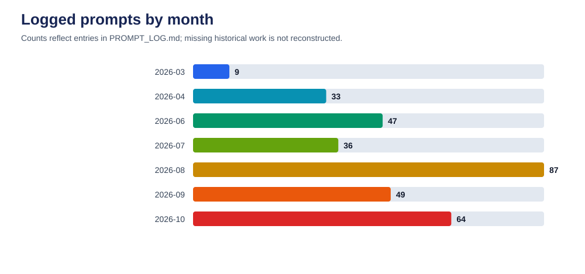
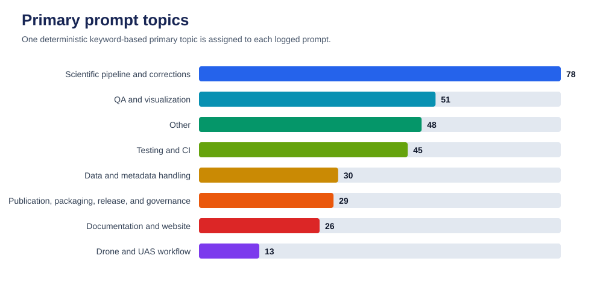
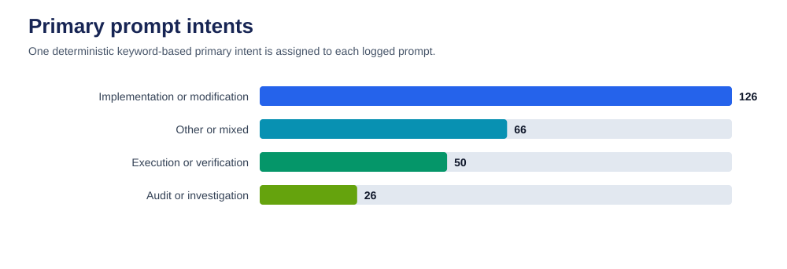
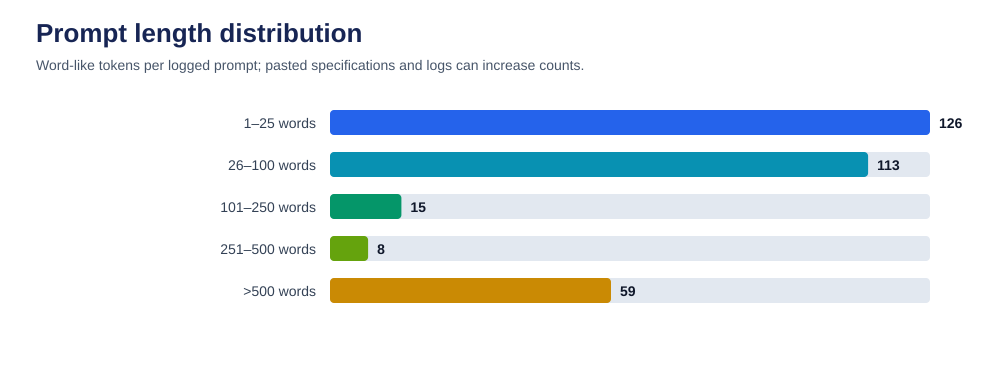
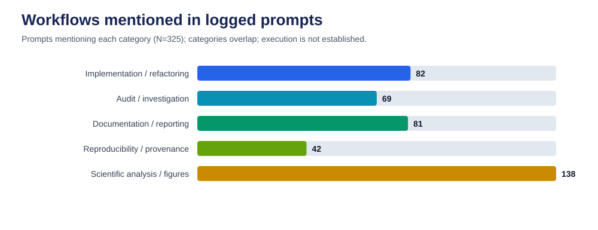
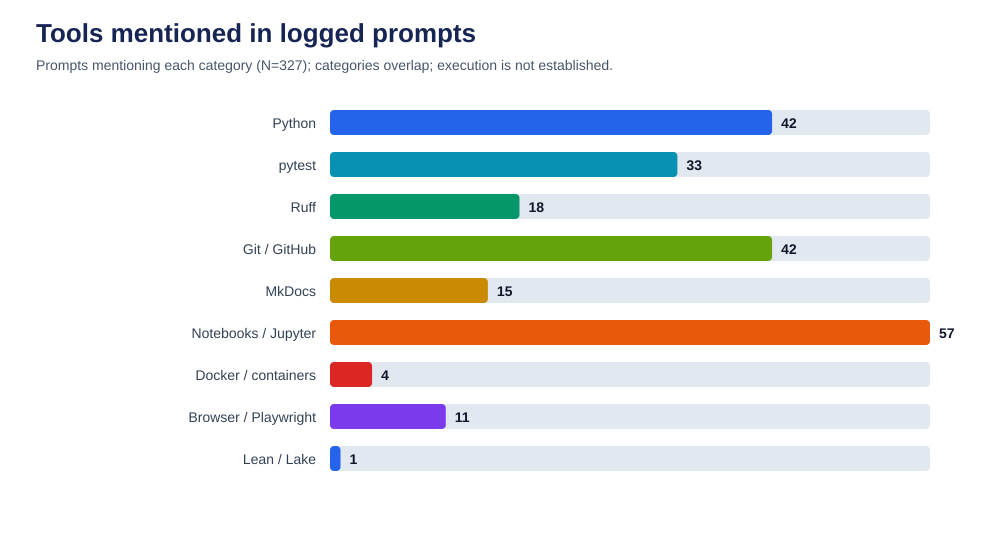
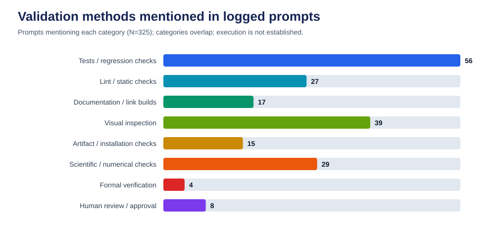

# AI Transparency Statement

> This page is generated from `PROMPT_LOG.md` by `scripts/generate_ai_transparency.py`. It reports the development requests recorded in the repository; it does not measure scientific validity or assign code authorship.

## History and responsibility

Maintainers report that SpectralBridge development began using LLM assistance with **GPT-3.5** and has continued using LLMs since then. When agentic assistants were adopted, the project introduced the repository prompt log. This historical account was supplied by maintainers on 2026-10-19; the log does not establish an early start date, every model used, or complete coverage of subsequent work.

AI assistance is part of the development process. Scientific interpretation and release decisions remain human responsibilities. This statement does not certify that every suggestion received human review; recorded requests for review are not evidence of approval.

## Summary

From 2026-03-21 through 2026-10-19, the log contains **319 prompts** totaling **125,465 words**. The median prompt contains **34 words** and the mean contains **393.3 words**. Under the published keyword rules, the most common primary topic is **Scientific pipeline and corrections**, and the most common request intent is **Implementation or modification**.









## What assistance and methods were discussed

The following figures count **prompts mentioning** each activity, tool or validation method. Each prompt counts at most once within a category and may count in several categories. Bar lengths measure recorded attention, not effort, executed commands or successful checks. All figures use the 319 logged prompts as their denominator.



**Read this as:** the kinds of work users asked assistants to undertake or discussed in their instructions. Implementation and audits can occur in the same prompt.



**Read this as:** named tools in requests, specifications or pasted material. A mention of pytest, for example, does not establish that pytest ran. Tools absent from prompts can still have been used.



**Read this as:** the review and checking methods discussed in the log. These counts do not estimate test pass rates, numerical correctness, successful formal proofs or human sign-off.

To establish what actually happened, inspect the corresponding Git changes, test/CI outputs and dated evidence packets in the [provenance directory](https://github.com/earthlab/spectralbridge/tree/main/provenance). Those records cover particular revisions and experiments; this generator does not treat them as evidence for every prompt. Complete tool-call traces and per-prompt execution outcomes are not recorded in this log.

## Which AI was used

The prompt log declares the AI system used for logged work. Model names are reported only when an entry records them; missing model metadata is not inferred.

| AI system | Logged prompts |
| --- | ---: |
| OpenAI Codex | 282 |
| Cursor Agent | 37 |

| Model metadata | Logged prompts |
| --- | ---: |
| Not recorded | 269 |
| GPT-5 | 36 |
| GPT-5 family (exact deployment identifier not exposed) | 7 |
| GPT-6 | 7 |

Model metadata is recorded for **50 of 319 entries (15.7%)**.

## How AI was used

The logged requests cover implementation and modification, audits and investigations, verification, documentation, QA, pipeline behavior, and publication maintenance. Each entry receives one primary topic and one primary intent through deterministic keyword scoring over the prompt and its logged task label. These labels summarize requests, not completed work; consult Git history, tests, and review records for evidence of outcomes.

## Scope and limitations

- The source log begins after repository development was already underway, so it is not a complete history of AI use.
- It records user prompts, not assistant responses, accepted/rejected suggestions, token usage, elapsed time, or line-level authorship.
- Long prompts may contain pasted logs or specifications; word counts measure prompt text, not effort.
- Mention matching includes negated instructions (for example, “do not run pytest”) and pasted examples. Counts are descriptive text indicators, not semantic judgments. The machine-readable output publishes every matching phrase and includes zero-count categories.
- Topic and intent labels are rule-based approximations based on prompt text and the logged task label. The rules are version-controlled in the generator.
- Legacy entries use the log-level AI-system default. Their model is `Not recorded` unless an entry explicitly provides model metadata.
- Prompts may contain sensitive material. The generated report includes aggregates only and does not reproduce prompt text.

## Reproduce this statement

```bash
python scripts/generate_ai_transparency.py
python scripts/generate_ai_transparency.py --check
```

Machine-readable statistics are available in [`ai-transparency.json`](ai-transparency.json). The source-log SHA-256 recorded there allows a reviewer to verify which prompt-log revision produced this page.
