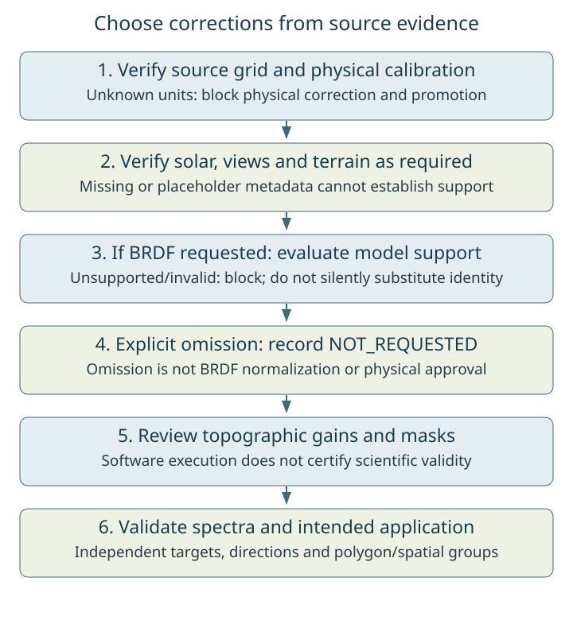

# Choosing Radiometric, Topographic, and BRDF Corrections

Choose corrections from the evidence available for each product. A request flag
is not proof of eligibility, and `VALID` in a model JSON means computational
support checks passed, not independently demonstrated scientific accuracy.
For the three investigated drone mosaics, read the
[current findings](../validation/drone-findings.md) first.

| Requirement | Radiometric calibration | Topographic correction | BRDF normalization |
| --- | --- | --- | --- |
| Verified physical units | Authoritative positive scale, finite offset and provenance | Required before physical calculation | Required before fitting/application |
| Solar geometry | Does not establish units | Valid time/location, zenith/azimuth | Valid illumination geometry and reference policy |
| Viewing geometry | Does not establish units | Not an input to SCS+C | Genuine angular provenance; zero placeholders are insufficient |
| Terrain | Does not establish units | Aligned slope/aspect, units, North convention, source surface and shadows | Required when fitting/applying a combined topographic+BRDF model |
| Rank and conditioning | Not a calibration test | Review the illumination regression separately | Rank 3, at least four eligible observations per populated band/stratum, condition below the precision-based limit |
| Numerical stability | Finite scalar mapping and valid masks | Review C, denominator, gains and lost coverage | Positive finite observed/reference predictions resolved above rounding and uncertainty; no arbitrary factor cap |
| Scientific validation | Panel/irradiance/independent reference and source history | Held-out target/spatial evidence, signal preservation | Held-out directions/targets, suitable reference and application domain |

The last row and the terrain/physical interpretation checks require researcher
review; the software does not automatically certify them. Shared BRDF checks
operate on the encoded design, so correct angle provenance remains essential.



*Current behavior: unknown calibration blocks physical corrections; unsupported
requested BRDF blocks completion. Topographic scientific approval remains a
separate review. The [production plan](../dev/drone-correction-production-plan.md)
proposes richer per-stage preflight reporting; it is not an implemented API.*

## What the current software does

`run_drone_pipeline` defaults to requesting both topo and BRDF. Set choices
explicitly. Missing authoritative radiometry blocks physical topo/BRDF.
Requested unsupported BRDF is reported as scientifically blocked; any retained
topographic-only diagnostic does not authorize translation or approved library
extraction. A campaign normally raises `DronePipelineIncompleteError` when
requested products are incomplete. Its `results` and `drone_qa_summary.json`
retain reasons. `raise_on_incomplete=False` collects partial status; it does not
approve the products. Inspect both `blocked` and `failed` records.

| Recorded BRDF state | Meaning and use |
| --- | --- |
| `VALID` | Shared model checks pass; inspect independent scientific evidence before use |
| `UNSUPPORTED` | Calibration, observations, rank/conditioning or model provenance insufficient; no usable fit |
| `INVALID` | Supported fitting attempted but prediction stability checks fail; no usable fit |
| `NOT_REQUESTED` | User explicitly omitted BRDF; not a successful BRDF normalization |
| `INCOMPLETE` | Correction output has not finished all chunks; not reusable as complete |
| `NOT_APPLICABLE` | Per-band/stratum has no finite source observations; remains nodata, not a fitted band |

A verified calibrated product with explicitly omitted BRDF can enter the library
contract. It still has a directional domain and requires scientific review.
With neither correction requested, the pipeline can preserve storage values;
that does not allow unknown-unit DN into approved physical libraries or translation.
The current `Radiometry` mapping is scalar. Band-specific inverse normalization
is an isolated investigated workflow, **not an implemented ingest option**.

## Example for an independently calibrated mosaic

This is a configuration template, not a runnable calibration of Gordon, Goldhill
or Ruby. It requires the named calibration file and spatially validated inputs.
Use one flight per call when calibration differs.

```python
import json
from pathlib import Path
from spectralbridge import run_drone_pipeline

calibration = json.loads(Path("reviewed_flight_calibration.json").read_text())
results = run_drone_pipeline(
    input_h5_dir="validated_source_flight/",
    output_dir="fresh_calibrated_no_brdf/",
    radiometry=calibration,
    apply_topo=False,   # Review terrain/illumination before enabling.
    apply_brdf=False,   # Explicitly omitted; no fabricated viewing diversity.
    apply_translation=False,
)
print(results["blocked"], results["failed"])
```

`radiometry` must declare `scale`, `offset`, `status="VALID"` and nonempty
calibration `provenance`, using `physical = scale * stored + offset`.
The package checks the record's validity, not the truth of a supplied certificate.
Do not invent a record to pass the gate.

## Drone and NEON require different evidence

NEON directional H5s provide documented calibration and instrument observation
geometry. Check product/revision and correction state to avoid correcting an
already corrected product. Each flight must still satisfy the shared fit gates;
a NEON filename is not approval. Drone orthomosaics may require source-image
calibration/angular adjustment before mosaicking. Neither route's spectral
translation establishes empirical cross-sensor agreement.

Continue with [correction methods](../brdf_topo_algorithm.md),
[drone input preparation](../vignettes/drone-processing.md), and
[library QA](../vignettes/spectral-library.md#drone-library-quality-and-researcher-polygons).

Last updated: 2026-11-02
