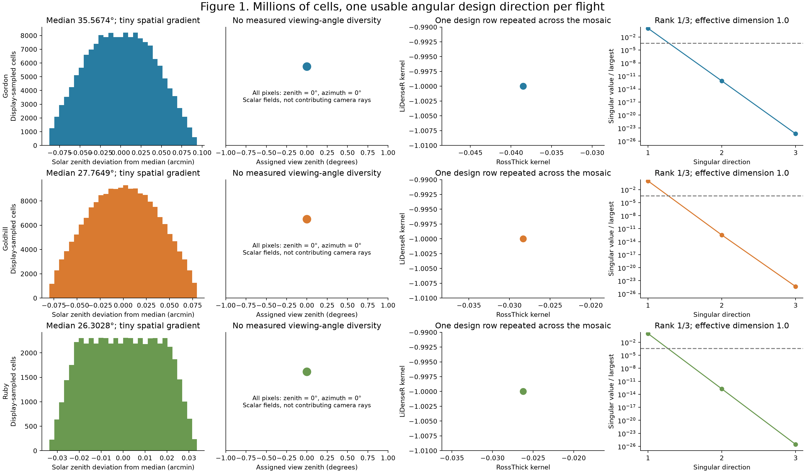
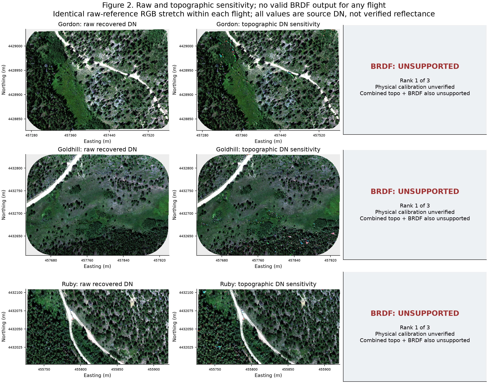
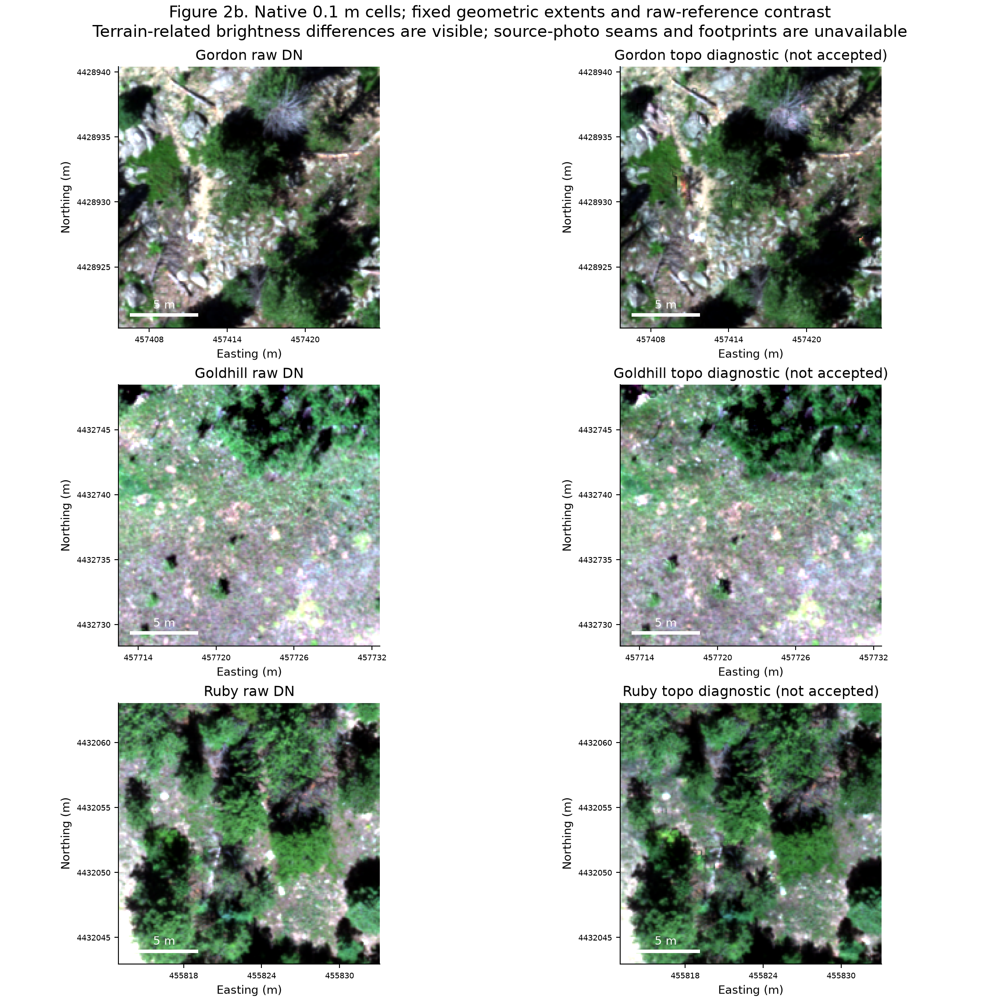
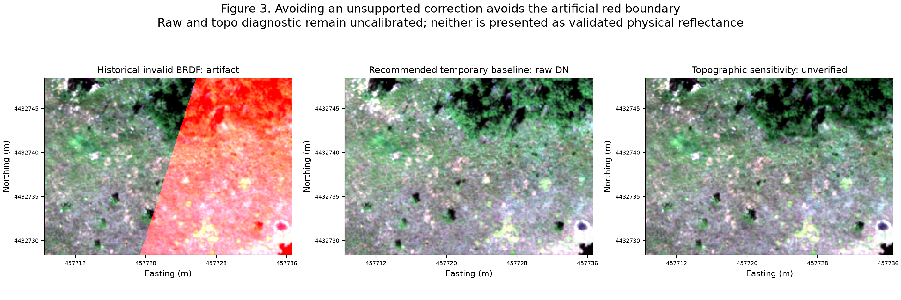
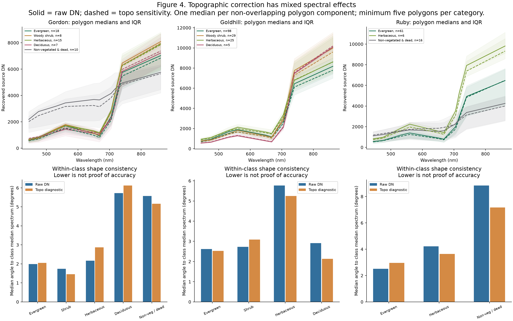
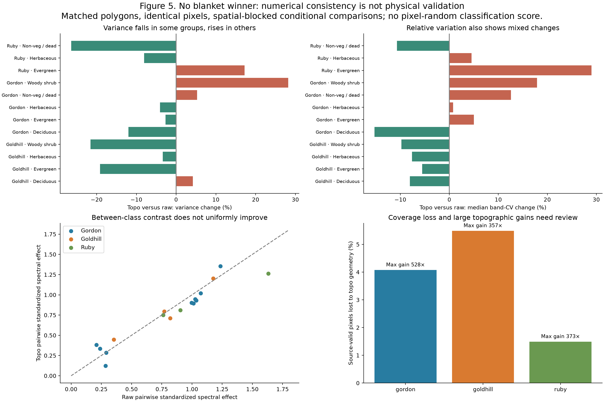
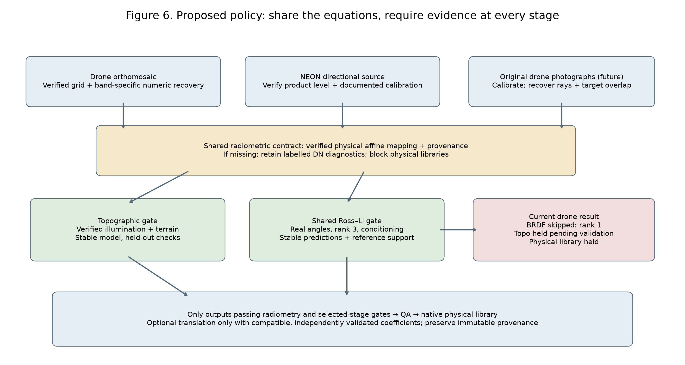

# Drone Radiometric and BRDF Correction: What the Data Actually Support

2026-11-02. Isolated scientific investigation of actual Gordon, Goldhill and Ruby 2023 data. **No production imagery, correction coefficients or spectral libraries modified.**

## Answers and scope

- **Can any of these orthomosaics support the current Ross–Li fit? No.** All three share constant assigned nadir views and a rank-one design under the actual scene-solar RossThick/LiDenseR configuration. Thirty of thirty band models are unsupported, independently of the unresolved physical calibration.
- **What is wrong?** Insufficient encoded observation geometry, unverified geometry provenance and unknown physical calibration. The historical Goldhill numerical instability is a consequence of fitting an unsupported model, not evidence that BRDF is physically absent or that raw drone imagery could never support it.
- **Does topographic correction help?** Mixed descriptive effects, with gains up to 528× and 1.49–5.49% coverage loss. It cannot be accepted solely because RGB looks better or variance decreases. Source illumination/terrain provenance is unverified, so approved topographic and combined branches remain unsupported.
- **Most reliable current workflow?** Preserve spatially validated, explicitly recovered source DN as the numerical baseline, omit unsupported BRDF, and hold physical interpretation until calibration is verified. This is a conservative interim representation, not a proven optimum correction or calibrated spectral library.
- **Libraries without BRDF?** Yes in principle: verified reflectance, supported optional topography, known source geometry, labels and application-domain validation can support useful libraries without BRDF. Directional effects still limit comparisons. The present DN tables support exploratory, qualified within-flight work; they do not yet establish physical or cross-flight reflectance validity.
- **Package direction?** Keep shared equations and radiometry contracts; gate each correction on evidence rather than sensor name. See [proposed implementation plan](drone-correction-production-plan.md). Nothing from that proposal was implemented in production here.

## 1. What information do the mosaics contain?

The inputs are the exact three October 29 spatially repaired working H5s and 10 cm TIFFs. Earlier full checks confirmed 152,672,940 spectral source values and source-grid correspondence across all flights. This study uses the inverse-normalized TIFFs from P160, whose grids/masks match the current TIFFs. It never resamples those pixels.

Actual old producer path: remote inventory/staging → retain spectral bands 1–10 (original band 11 is alpha) → original H5 working copy and spatial repair → ENVI → full-scene SCS+C and saved Ross–Li correction → optional wavelength-matched affine translation → polygon index/extraction → per-flight tables → bulk summaries/QA. Source H5 view angles are scalar zeros, expanded by `NeonCube.get_ancillary`; solar zenith and azimuth are smooth raster grids with no camera/source-observation IDs or generation metadata. Their spatial variation does not establish real multi-angle target observations.

Current source code path: `run_drone_pipeline` → `_prepare_drone_source_working_h5` / `convert_drone_tiff_to_h5` → `NeonCube` → `apply_drone_corrections` → shared `corrections.py` physical boundary, scene SCS+C, validated BRDF fit/application → optional `drone_translation.py` → `polygons.py` extraction and physical-unit Parquet → independent bulk/QA. Unknown TIFF units do not become a valid physical scale. The current pipeline requires solar geometry validation, and the shared physical/model gates block unknown units and unsupported fits; successful historical execution is not approval under those gates.

The source TIFFs store a band-specific min/max normalization. Recovery uses the verified JSON mapping: `DN = band_min + S*(band_max-band_min)/10000`. Goldhill NIR minimum 174 and Ruby offsets 4, 3 and 297 mean a uniform divisor cannot recover all bands. Recovered data are **RECOVERED_SOURCE_DN — PHYSICAL_UNITS_UNVERIFIED**. No 1/10000 or 1/32768 physical calibration is assumed in this study.

## 2. Can the angular information support BRDF?

| Flight | Valid spectral pixels | Distinct stored angle tuples / at 0.01° | Numerical rank | Condition number | Stable rank | Supported / unsupported bands | Pixels passing complete BRDF gates |
| --- | ---: | ---: | ---: | ---: | ---: | ---: | ---: |
| Gordon | 6,153,336 | 165,365 / 2 | 1 / 3 | 2.07e+24 | 1.0 | 0 / 10 | 0% |
| Goldhill | 7,068,376 | 524,548 / 4 | 1 / 3 | 2.22e+24 | 1.0 | 0 / 10 | 0% |
| Ruby | 2,022,614 | 161,188 / 1 | 1 / 3 | 3.56e+25 | 1.0 | 0 / 10 | 0% |

| Flight | Source solar zenith range (°) | Source solar azimuth range (°) | Fitter scene zenith (°) | RossThick | LiDenseR | Full-design singular values |
| --- | ---: | ---: | ---: | ---: | ---: | --- |
| Gordon | 35.565746–35.568989 | 231.401047–231.407623 | 35.567367 | -0.03850305 | -1.00000000 | 3509.4, 2.5739e-09, 1.6951e-21 |
| Goldhill | 27.763430–27.766453 | 204.691360–204.700256 | 27.764940 | -0.02831906 | -1.00000000 | 3760.6, 1.2902e-09, 1.6912e-21 |
| Ruby | 26.302183–26.303320 | 172.646515–172.651733 | 26.302752 | -0.02622867 | -1.00000000 | 2011.6, 3.5192e-10, 5.6516e-23 |

All view zeniths and azimuths are exactly 0°. Signed relative solar-view azimuth is the solar azimuth wrapped into [-180°,180°); complete ranges/distributions are in each flight's angular JSON. Scene-solar replacement and nadir viewing collapse the repaired kernels to one design row per flight. The large counts of exact float32 solar tuples are spatial numeric encodings, not independent view observations. Rounding to 0.01° is solely a descriptive count, never a fitting tolerance.

The matrix is the actual shared `_brdf_design`, evaluated over every finite spectral/angle-valid source pixel, not a sampled rank estimate. Its three singular directions are compared with the unchanged float32 conditioning limit `1/sqrt(eps32)` ≈ 2896.3. Stable rank `sum((s_i/s_max)^2)` equals one: an **effective kernel dimension**, not independent-image sample size. Independent angular sample size cannot be estimated without image IDs and overlap provenance, and is recorded as unknown. Numeric rank alone would not approve a poorly conditioned full-rank matrix. No threshold was relaxed.

Physical 0..2 fit eligibility is **not evaluated** because calibration is unknown. The complete-model passing fraction is zero because angular support fails independently. Each actual current fitter was also exercised in a fresh experimental model directory: it returned UNSUPPORTED on radiometry, with no coefficient arrays. A future calibration would not change the rank-one angular result. No unsupported BRDF branch was applied.

### Could original-image BRDF be recovered?

New authenticated listings inspected Gordon/Ruby exports, Gordon metadata, the field-data and project roots, and relevant nearby drone collections; the previous Goldhill/To_Correct/calibration inventories were reviewed. The six SD-card CSVs contain only filenames, TIFF timestamps and camera software. They have no positions, orientations, intrinsic matrices, target overlap, exposure/radiometric coefficients or panel/DLS values.

Gordon has 6,100 CSV band-file records, Goldhill 6,095 and Ruby 5,210. These are **not counts of independent camera views or ground-target observations**. CSV times are August 15 with no timezone, while all package notes say August 14 (Gordon 14:47, Goldhill 13:41, Ruby 12:42). This unresolved conflict prevents treating the embedded solar grids as validated illumination. GCPs and mission-plan KML do not substitute for calibrated camera pose at exposure. Sky photos do not quantify irradiance stability. Photogrammetric reports and lens calibration do not establish physical radiometric calibration.

Original photographs are referenced at relative `aop/.../RawData/M300/SD1|SD2` paths but were not located in the inspected accessible exports/roots. This bounded search does **not** prove that they are lost or unavailable elsewhere. See `acquisition_metadata_audit.json` for hashes, paths, rows, timestamps and search limits. No original-image BRDF coefficients or stability claims were inferred from photo counts.

Original-image correction remains plausible if the custodian supplies the raw ten-band images, panel certificate/images, DLS and exposure/gain metadata, acquisition timezone, Metashape project or machine-readable intrinsics/extrinsics, DSM and image-to-ground mapping. Reconstruct camera rays to the **same targets** across overlapping images, preserve occlusion/footprints/blend weights, verify illumination stability, and test the target/class-stratified design, conditioning, reference support and held-out predictions before any mosaicking. A blended ortho pixel generally has no single recoverable view without that provenance. We have not demonstrated adequate angular coverage in these original flights.

## 3. Which corrections improve spectral consistency?

The raw branch is recovered DN with validated spatial alignment. Approved topographic-only is UNSUPPORTED because physical calibration and illumination/terrain provenance remain unresolved. For a controlled diagnostic we separately replay the **unchanged existing SCS+C equations** on recovered DN with embedded geometry; this is clearly labelled `topo_diagnostic`, never physical reflectance or a valid production correction. It uses the full-scene historical topographic fit, not pathological historical BRDF coefficients. BRDF-only and combined branches are UNSUPPORTED and have no substituted image.

An additional fitted alternative was **not executed**: no verified panel calibration, invariant targets, matched cross-flight ground polygons or recovered per-photo observations support one. Raw preservation is the selected temporary alternative, already represented by experiment 1. We do not invent gains, flat fields, seam maps or angular diversity to complete an experiment checklist.

Full-flight RGB is display-sampled every sixth cell; native 0.1 m ROIs are rendered without interpolation. RGB is always 650/560/475 nm and each flight uses a single raw-reference 2–98% stretch across raw/topographic panels. Geographic orientation, extent and common masks are identical. Stretches may differ across flights, so image brightness between flights is not a calibration comparison. The illumination/terrain differences and bright outliers are visible. Actual source-photo/flightline seam polygons are unavailable and are not fabricated.

The historical Goldhill BRDF result is displayed **only as an invalid diagnostic** beside raw DN and topographic sensitivity on the same region and equivalent numerical display scale. P160 reproduced all 70,832,700 original values and showed that inverse normalization changes the red boundary metric by just 0.00000501%. The model's factor switches from one to millions where its prediction crosses zero. The current rank gate rejects that model. Avoiding this artifact is not the same as proving raw or topo radiometric accuracy.

### Matched researcher polygons and spectral evaluation

The study independently reprojects the supplied half-diameter GPKG to each source CRS, rasterizes by pixel center, and verifies every selected center against polygon geometry. **301 polygons and 198,309 matched polygon-pixel memberships** are used (Gordon 58 / 31,413; Goldhill 157 / 144,415; Ruby 86 / 22,481). Those pixel membership totals reproduce the prior spatial validation. Raw and topographic spectra use exactly the same valid locations. A single polygon median spectrum is the analysis unit; individual neighbouring pixels are not independent replicates.

Researcher `cover_category` values are retained verbatim. “Non-vegetated & dead” is a cover comparator, not a biological PFT. One lexicographically chosen identity per connected overlapping-polygon component is admitted to independent summary/tests. Categories need at least five retained polygons. Ruby's three woody-shrub polygons are explicitly insufficient for class-level metrics, rather than pooled into another category. Raw library tables are not copied to make a large pixel cache; compact polygon medians and diagnostics back these analyses.

| Flight | Researcher category | Polygons | Mean band-variance change | Median band-CV change | Median class spectral angle: raw → topo (°) |
| --- | --- | ---: | ---: | ---: | ---: |
| Goldhill | Deciduous | 5 | +4.18% | -8.05% | 2.91 → 2.13 |
| Goldhill | Evergreen | 98 | -19.16% | -5.56% | 2.62 → 2.53 |
| Goldhill | Herbaceous | 25 | -3.35% | -7.62% | 5.77 → 5.24 |
| Goldhill | Woody shrub | 29 | -21.53% | -9.77% | 2.73 → 3.08 |
| Gordon | Deciduous | 7 | -12.02% | -15.28% | 5.72 → 6.12 |
| Gordon | Evergreen | 18 | -2.69% | +4.99% | 1.98 → 2.05 |
| Gordon | Herbaceous | 15 | -4.04% | +0.76% | 2.17 → 2.87 |
| Gordon | Non-vegetated & dead | 10 | +5.30% | +12.59% | 5.57 → 5.16 |
| Gordon | Woody shrub | 8 | +28.18% | +17.92% | 1.74 → 1.46 |
| Ruby | Evergreen | 61 | +17.24% | +29.01% | 2.50 → 2.96 |
| Ruby | Herbaceous | 6 | -8.03% | +4.55% | 4.22 → 3.64 |
| Ruby | Non-vegetated & dead | 16 | -26.41% | -10.67% | 8.84 → 7.17 |

Across 12 sufficiently sampled flight/category cells, variance decreases in **8** and increases in **4**; median band CV decreases in **6** and increases in **6**. Class spectral angle decreases in **7** and increases in **5**. For example, Ruby evergreen variance rises about 17% and median CV about 29%; Goldhill evergreen variance falls about 19%. These are changes in numerical dispersion, not estimates of calibration error.

`within_class_metrics.csv` includes within-polygon pixel-angle summaries and polygon brightness/incidence Spearman correlations. `bandwise_class_metrics.csv` gives ten-band means, variances and CVs; `polygon_class_angles.csv` provides the full angle distributions. Numerical angles and indices are not verified physical reflectance metrics. Finite negatives would be retained; these actual common DN branches have none.

Between-class comparisons reuse package `library_analysis.spectral_separability`, one spectrum per identity and conditional permutations within 100 m projected spatial blocks. Pairs need five polygons of each class after retaining mixed blocks. Equal discrete weights represent the ten measured bands; no synthetic continuous hyperspectrum is assumed. With 1,999 seeded permutations, 34 flight/branch/pair tests are supported and 10 are insufficient. Holm correction is recomputed across all 34 supported comparisons. Six pairs per branch have adjusted max-test p<0.05, but these observational associations neither prove classification accuracy nor test improvement caused by correction. Standardized pairwise contrast decreases in 11 of 17 matched pairs and increases in six. There is no uniform separability improvement.

No random pixel split or pixel-derived accuracy score is reported. Polygon grouping reduces leakage but does not guarantee independent adjacent vegetation; conditional exchangeability within 100 m cells is an assumption. Results are descriptive, limited to these observed polygon mixtures and dates. There are zero common GlobalIDs across flights; no matched-target cross-flight harmonization validation is possible here. No variance reduction is equated with removal of illumination error or preservation of true vegetation differences.

### Stability, coverage and indices

| Flight | Common source/topographic pixels | Pixels lost to topo geometry | Maximum topographic factor | Band-pixel gains >10 |
| --- | ---: | ---: | ---: | ---: |
| Gordon | 5,902,515 | 250,821 (4.08%) | 528.41× | 15,984 |
| Goldhill | 6,680,329 | 388,047 (5.49%) | 356.55× | 43,179 |
| Ruby | 1,992,443 | 30,171 (1.49%) | 372.71× | 2,665 |

Topographic mask losses reflect invalid ancillary illumination in the existing formula. The lost pixels are excluded identically from both branch comparisons; source-wide loss is reported rather than hidden. Nonfinite output counts are ten times the corresponding lost-pixel counts and are stored in `numerical_stability.csv`. No new nonfinite values occur on the common valid mask. BRDF invalid predictions are **not evaluated**, because no valid BRDF model is applied; they are not reported as zero. All 30 band fits fail angular support.

Maximum topographic factors of roughly 528×, 357× and 373× are an independent reason to review denominators/fit stability before accepting SCS+C. Per-band factor percentiles and >10/>1000 counts are in `flight_analysis.json`; they are descriptive flags, not universal acceptance limits. No arbitrary cap was applied.

NDVI uses 862/668 nm, NDRE 862/705 nm and GNDVI 862/560 nm. These are wavelength-based choices, with denominator checks. No common-mask numerical index lies outside [-1,1]. Scene NDVI medians raw→topo are Gordon 0.7356→0.7381, Goldhill 0.7167→0.7137, Ruby 0.7476→0.7517. Small shifts or bounded values do not establish physical validity. Exact polygon indices and incidence associations are available in the compact tables; source-photo geometry is missing, so an apparent index pattern cannot be attributed to a particular contributing view angle.

## 4. How should drone processing differ from NEON AOP?

The package should share mathematical implementations and physical-unit contracts, while testing each dataset's eligibility. NEON directional flightline products provide observation geometry from instrument geolocation; the provider ATBD lists orthorectified view azimuth/zenith and other ancillary fields. That differs from the scalar nadir placeholders in these drone H5s. It is not a blanket declaration that every NEON flightline is full rank, calibrated correctly or free of upstream issues.

NEON's documented directional `.001` versus already BRDF/topographically corrected `.002` product distinction must also be checked to avoid double correction. Provider product/version/quality and current model support remain gates. We audited local reader/orchestration contracts and official provider documentation here; we did **not** run a new empirical NEON flightline cohort or claim drone/NEON interchangeability.

Shared code includes `io/neon.py` and `NeonCube` storage/ancillary reading, the explicit affine physical boundary, Ross/Li kernels, scene SCS+C, model diagnostics and physical library/QA requirements. NEON starts from documented H5 calibration and has spectral convolution; drone starts with local TIFF/H5 and optional explicit metadata, skips convolution, and uses wavelength-matched optional translation. Drone translation is a different downstream operation, not a way to repair missing calibration or angular geometry.

## 5. What should change in SpectralBridge?

For all three current flights: preserve the spatial repair; offer explicit band-specific numerical recovery with provenance; require physical calibration evidence; skip unsupported BRDF; hold topographic promotion pending verified illumination/terrain and stable, held-out performance; keep native spectra as the primary representation. Per-photo BRDF is worth a bounded feasibility effort if raw images/calibration/poses can be recovered, not an immediate correction promise.

No existing translated output or packaged historical coefficient set is established as valid by this study. Current translation requires verified physical units and compatible coefficient provenance. Coefficients derived from synthetic common-reference sensor convolutions are descriptive relationships; they need independent drone/target-sensor observations before empirical calibration claims. Recompute or independently verify affected coefficients after choosing the source units and accepted correction sequence.

The historical three-flight native corrected libraries, 12 translated raster/library contributions, and their dependent merged libraries/bulk fits need regeneration or exclusion **after** calibration and policy acceptance, rather than being promoted because the spatial check passes. The dependency boundary is those affected flight contributions and derived fits, not every unrelated NEON library. No such regeneration was performed or authorized as part of this investigation.

The separate [production plan](drone-correction-production-plan.md) specifies preflight, per-stage states, restart fingerprints, unit/geometry/model/QA gates, narrow module targets, regression checks and a staged regeneration decision. No broad refactor is proposed.

## Evidence, reproduction and limitations

Scripts and complete tables: `provenance/drone-brdf-strategy/2026-11-02/`. Run `analyze.py`, `figures.py`, `report.py`, then `make_pdf.py` (bundled Python/reportlab). `--work` selects the isolated large-array directory. Source locations inherit P159/P160 manifests. Authenticated metadata downloads are captured by hashes in `acquisition_metadata_audit.json`; repeat the explicit gocmd paths there if restaging. No remote writes occur.

Source/product SHA-256 before/after checks cover all three working H5s, input/recovered TIFFs, corrected raster/header/model pairs and the polygon file; all match. This local diagnostic loads one flight at a time and writes roughly 1.2 GB of experimental raw/topographic arrays plus compact polygon tables and display samples. Normal bulk analysis is not changed and no ordinary bulk pixel cache is introduced. Large-VM streaming performance, original-photo overlap, calibration accuracy, empirical field error and independent target-sensor transfer were not established.

Earlier investigations: [spatial integrity](drone-spatial-integrity-investigation.md), [radiometry/BRDF audit](../../provenance/radiometry-brdf/2026-10-30/README.md), [numeric scaling](../../provenance/drone-scale-confirmation/2026-10-30/README.md), [Goldhill recovery](drone-radiometric-recovery-experiment.md).

Primary external sources checked 2026-11-02:

- [NEON radiance-to-reflectance ATBD, revision B](https://data.neonscience.org/api/v0/documents/NEON.DOC.001288vB): observation-geometry ancillary inputs; this older ATBD is not a promise about every present product's correction state.
- [NEON bidirectional reflectance tutorial](https://www.neonscience.org/resources/learning-hub/tutorials/neon-brdf-refl-h5-py): directional/bidirectional revision distinction and shared topography/BRDF context.
- [Agisoft MicaSense workflow](https://agisoft.freshdesk.com/support/solutions/articles/31000148780-micasense-rededge-mx-processing-workflow-including-reflectance-calibration-in-agisoft-metashape-pro): panel/DLS calibration, band-sensitivity setting and camera geometry; vendor workflow is not evidence that these projects used it.
