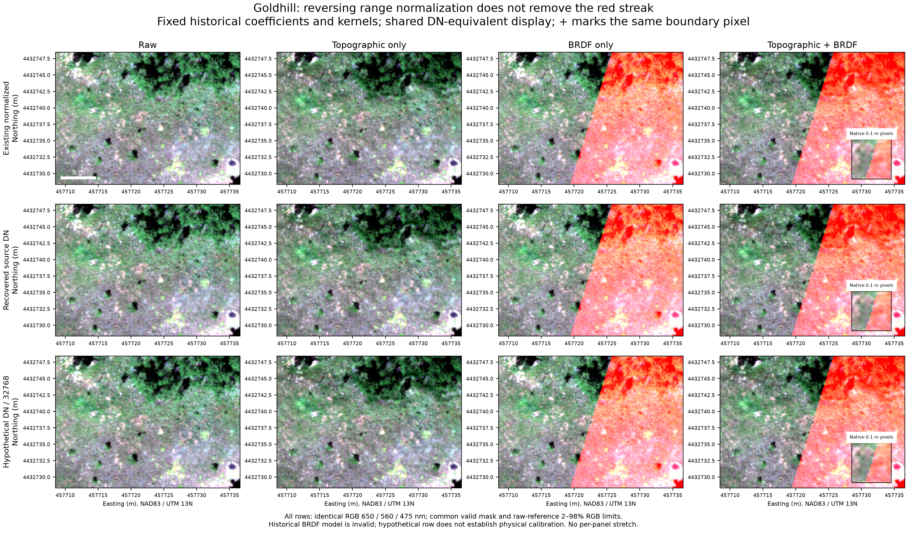
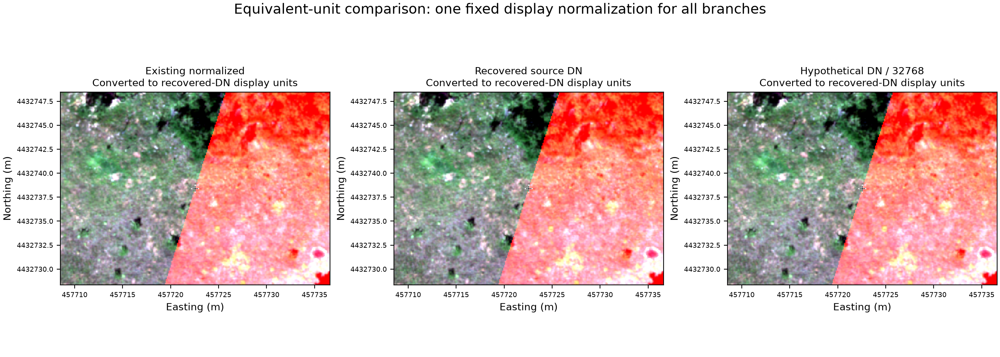
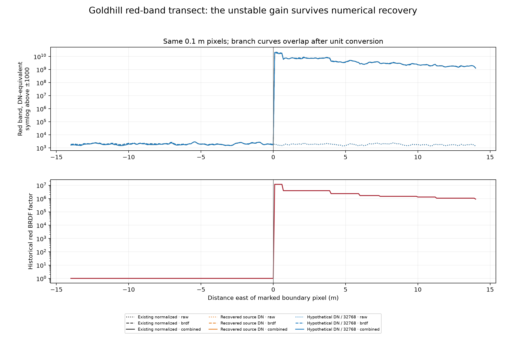
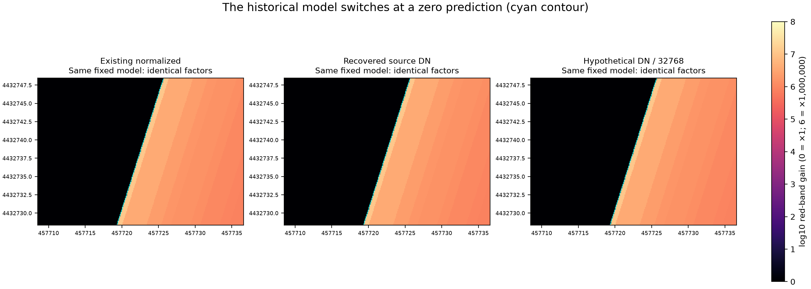
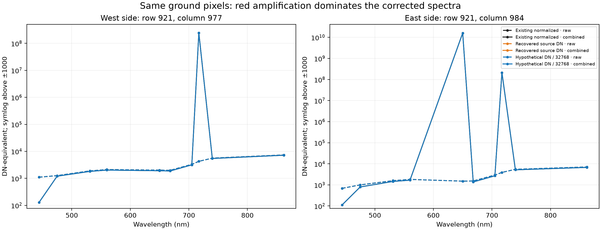
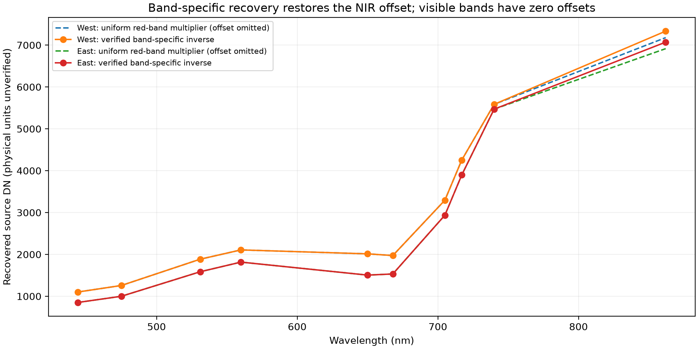

# Goldhill radiometric recovery experiment

Date: 2026-11-02. **Isolated experiment; no production repair or calibrated product approval.**

## Executive summary

Reversing the verified range normalization does **not** remove the Goldhill red streak. Recovered DN and hypothetical DN/32768 retain the same diagonal boundary, historical correction factors and enormous red amplification. The combined red-band boundary metric changes by only **0.00000501%**, consistent with float32 rounding. The recovered topographic-only control has no artificial red boundary.

The baseline exactly reproduces **70,832,700** stored production values and masks (zero mismatches). The saved model is scientifically invalid; replay is explicitly diagnostic. Its coefficients are used only with the exact archived historical equations, whose SHA-256 matches the October 30 investigation. They are never transferred to the repaired Ross/Li equations.

The current validated design has rank **1 of 3**, condition number **2.22e+24**, across **7,068,376** source-valid pixels. All ten band fits are unsupported by the shared angular design. No Goldhill refit was forced and no new neutral coefficients were substituted.

## Original normalization and numerical recovery

For each spectral band, `DN = band_min + S * (band_max - band_min) / 10000`. Extrema are loaded directly from `verified_numeric_mapping.json`; no hand-transcribed recovery coefficients are used. Recovered rasters carry **RECOVERED_SOURCE_DN — PHYSICAL_UNITS_UNVERIFIED**. Floating-point data remain unclipped. The auxiliary/alpha band, band order, source nodata sentinels and masks are retained; CRS, affine, dimensions and 0.1 m resolution match exactly.

The 25 cm paired evidence established the numeric mapping. Applying its inverse to the 10 cm files recovers the pre-normalization numerical representation of those resampled pixels, **not the original native-resolution integer samples**. An independent bilinear warp of each original provides a consistency test, not an exact replay of the unavailable original exporter. Border discrepancies are retained without trimming; these prevent a claim of exact 10 cm export reconstruction.

| Flight | Largest band median absolute error (DN) | Largest absolute error (DN) | Largest round-trip error (normalized units) | Grid / masks |
| --- | ---: | ---: | ---: | --- |
| Gordon | 0.000000 | 19,903.089 | 0.000298 | unchanged |
| Goldhill | 0.146484 | 99.921 | 0.000299 | unchanged |
| Ruby | 0.321289 | 139.869 | 0.000299 | unchanged |

All 30 spectral bands were checked. No new nonfinite pixels were introduced by inverse normalization. Full per-band sample counts, errors and metadata checks are in `radiometric_recovery_validation.json`. Large rare edge residuals, especially Gordon, remain unresolved original-resampling discrepancies; they were not discarded or silently repaired.

## Experimental design

Three branches use actual Goldhill 10 cm imagery: existing normalized data, recovered DN, and **HYPOTHETICAL_METASHAPE_32768** (`recovered DN / 32768`). The last branch is a sensitivity test, not evidence of the original project's calibration settings or absolute reflectance validity.

Each branch has raw, topographic-only, BRDF-only and combined stages. The no-BRDF control is the recovered topographic-only stage. Historical SCS+C is recomputed with unchanged full-scene fitting rules for each branch. Historical BRDF coefficients, kernels (RossThick/LiDenseR, b/r=10, h/b=2), scene-solar policy, fixed 45-degree solar/nadir/zero-relative-azimuth reference, and saved single NDVI stratum are unchanged.

`historical_corrections.py` is a byte-identical archived source module (SHA-256 `839cdf2b7264c5af53902c08994144c776f94f5a59f31dc42bd1574002998a42`). The isolated in-memory adapter supplies existing coefficients and uses scale one solely to replay the historical algorithm on numerical arrays. This bypass exists only in the experiment; recovered DN is never labelled physical in production metadata, and production radiometry contracts are not relaxed. Repaired shared fitting/application requires explicit physical radiometry and validated support.

A single valid-pixel intersection across all branches and stages is used for comparisons: **6,680,329** pixels. The historical topographic stage loses **388,047** of **7,068,376** source-valid pixels because ancillary illumination validity is required. This existing loss is identical in every branch; numerical recovery itself loses none. Source TIFF-to-working-H5 equality is asserted before replay; geographic orientation and the spatial repair are retained, with no resampling during recovery or replay.

## Main visual comparison



Rows share RGB 650/560/475 nm, geographic extent, north-up orientation and the common mask. The plus sign marks the original gain boundary. The 5 m scale bar and NAD83 / UTM 13N coordinates refer to the unchanged source grid. Insets show the same native 0.1 m cells without interpolation. All panels use the same raw-reference 2nd-98th percentile limits **after explicit conversion to recovered-DN display units**; display saturation never alters analysis.

For normalized stage outputs the equivalent display is `DN_equiv = S_stage * band_range/10000 + band_min`; for the hypothetical branch it is `DN_equiv = rho_stage * 32768`. The NIR offset is included. This is a representation comparison, not an assertion that offset recovery commutes with multiplicative correction. No raw DN is displayed against physical-scale numerical limits.



This second figure shows the combined results after the documented equivalent-unit conversion with one shared set of limits. Independent panel stretches are never used.

## Red-band transect and boundary discontinuity



The transect follows row **921** through marked pixel **[921, 980]** at native resolution. The red axis is linear within +/-1000 and logarithmic outside. Curves overlap after unit conversion. The historical gain jumps from one to millions at the same location in all branches.

The ROI is rows 821:1022, columns 840:1121; bounds are exclusive. Selection uses the historical identity-to-gain crossing nearest scene center with vegetation NDVI >0.3 in both adjacent pixels. It precedes all branch comparisons. Across its rows, matched strips sample 3-10 cells from either side of the nearest crossing within 75 columns of the marker: **1,608 fixed pairs**. Absolute discontinuity is median `abs(R_right-R_left)` in DN-equivalent units. Relative discontinuity divides it by the median pooled absolute red value on both sides; it is a defined descriptive contrast, not classification accuracy. The metric is measured on actual heterogeneous vegetation, so raw/topographic differences need not be zero.

| Radiometric branch | Stage | Median absolute red discontinuity (DN-equivalent) | Relative discontinuity |
| --- | --- | ---: | ---: |
| Existing normalized | Raw | 287.294 | 0.163849 |
| Existing normalized | Topo only | 262.750 | 0.157730 |
| Existing normalized | BRDF only | 8,298,835,066.186 | 9.256909 |
| Existing normalized | Combined | 8,018,261,341.825 | 11.063214 |
| Recovered DN | Raw | 287.294 | 0.163849 |
| Recovered DN | Topo only | 262.750 | 0.157730 |
| Recovered DN | BRDF only | 8,298,835,642.281 | 9.256909 |
| Recovered DN | Combined | 8,018,261,743.297 | 11.063214 |
| Hypothetical DN/32768 | Raw | 287.294 | 0.163849 |
| Hypothetical DN/32768 | Topo only | 262.750 | 0.157730 |
| Hypothetical DN/32768 | BRDF only | 8,298,835,642.281 | 9.256909 |
| Hypothetical DN/32768 | Combined | 8,018,261,743.297 | 11.063214 |

Recovered combined versus baseline differs by **0.00000501%**. The largest full-scene relative combined red difference is **2.41e-07**, approximately float32 arithmetic. Absolute roundoff can be large in pathological amplified outputs (up to 124,813 DN-equivalent); small relative differences do not make those values physically meaningful.

## BRDF correction factors and stability



The cyan contour marks zero historical observed-geometry prediction. Fixed coefficients and geometry give the same red factor independently of input magnitude; all three computed output/input ratios confirm this within float32 division rounding. The saved historical NDVI upper-edge behavior leaves one pixel unvisited (factor one) identically across these branches; this is included rather than hidden. It is not the streak mechanism.

Historical red factor quantiles (0/1/50/95/99/100 percent): **[1.0, 1.0, 95469.515625, 838767.875, 3914250.0, 11742750.0]**. There are **2,048,604** nonpositive/invalid prediction locations with the historical factor-one guard. **5,019,771** pixels exceed gain 10 and the same count exceeds 1000. Maximum gain is **11,742,750**. These are full source-valid-grid red-band diagnostics, distinct from the smaller common comparison mask. Invalid predictions do not become nodata in the legacy BRDF stage; its fallback conceals failure.

Validated refitting is unsupported for **10 bands** because all share rank-one angular design. No recovered or hypothetical calibrated refit output exists. The full-rank synthetic control passes through the actual current fit/application API at scales one and two, keeping the same population within 0..2. Both fits are VALID and maximum factor difference is **0.0**. This supports multiplicative invariance when support and eligibility are fixed; it does not validate Goldhill.

## Spectral comparison and mechanism





The red-band inverse is purely multiplicative (minimum zero). With fixed BRDF coefficients, `C = predicted_reference / predicted_observed` depends on geometry and coefficients, not red intensity. Multiplying input by a constant therefore multiplies output by that constant and **does not move or remove the factor discontinuity**. Refitted OLS has the same invariance only if masks, eligibility and acceptance remain identical; an absolute 0..2 eligibility range applied directly to DN violates that premise. We did not disguise such a unit change as an improved fit.

Goldhill band 10 has a 174-DN offset, so a uniform scalar cannot recover the entire spectrum. The raw spectral offset figure isolates that modest NIR difference; visible-band recovery is multiplicative. Recovery restores the documented numerical relationships, not an independent physical calibration.

The previous stage-isolation evidence explains the historical model: only 14 red pixels met the 0..2 fit range, rank was two under the defective historical kernel, and an unsupported reference prediction near 91,740 divided by an observed prediction crossing zero. The guard switched abruptly from one to enormous gains. The repaired kernel removes spurious azimuth dependence at nadir but leaves rank one; no radiometric rescaling creates the missing angular observations.

## Recommendation and decision answers

1. **Can original values be recovered?** The verified inverse recovers source-DN representation of the 10 cm pixels with sub-milliscale normalized round-trip error, unchanged grids/masks and strong interior agreement with original-image resampling. Exact native-pixel or original-export reconstruction is not established; border differences remain.
2. **Does this remove the streak?** No. It remains in historical BRDF-only and combined output; magnitude and factors are effectively unchanged after equivalent-unit conversion. The topographic-only control lacks the artificial boundary.
3. **What causes the remaining streak?** The unsupported historical BRDF model and its zero-crossing prediction/identity guard. Missing angular support remains even with the repaired equations.
4. **What next?** Require verified calibration before physical products. Retain the fail-closed BRDF validation already implemented under P158 and explicitly skip BRDF for unsupported drone mosaics rather than force a fit or cap gains. Topographic-only may be retained as a clearly labelled diagnostic pending separate scientific validation. Per-band inverse normalization may be useful as an explicit provenance-backed ingest option after calibration review, but it is **not the streak fix**. Preserve affected libraries as historical/unapproved; regenerate only after calibrated source conventions and a reviewed correction policy are established. No production changes or library regeneration were performed here.

## Reproduction, preservation and limitations

Run from the repository root:

```bash
MPLCONFIGDIR=/private/tmp/spectralbridge-mpl .venv/bin/python provenance/drone-radiometric-recovery/2026-11-02/run_experiment.py
MPLCONFIGDIR=/private/tmp/spectralbridge-mpl .venv/bin/python provenance/drone-radiometric-recovery/2026-11-02/plot_experiment.py
python3 provenance/drone-radiometric-recovery/2026-11-02/write_report.py
# make_pdf.py uses the bundled Python with reportlab.
```

Downloaded source locations and Data Store origins are in the October 30 scale evidence. Default large outputs: `/private/tmp/goldhill-radiometric-recovery-20261102`; `--work` selects a separate experimental directory. The replay reads actual immutable Goldhill working H5, saved coefficients and corrected ENVI and asserts exact baseline equality. Complete SHA-256 before/after records cover **63** original/product/source files; all are unchanged. Experimental NPY arrays retain the source dimensions and are paired with a spatial sidecar. Recovered TIFFs retain their own full georeferencing.

This is a local full-scene diagnostic using full-memory historical functions; it is not a streaming production implementation or large-VM benchmark. It creates roughly 3.4 GB of branch arrays plus recovered TIFFs. No datastore uploads, original-file modifications, production coefficients, spectral libraries or production code changes occur. Synthetic data are used only for the explicitly separate supported-invariance control; all image and boundary results use real Goldhill imagery. Absolute radiometric calibration and independent empirical validation remain unresolved under P159.

Prior evidence: [scale investigation](../../provenance/drone-scale-confirmation/2026-10-30/README.md), [stage isolation](../../provenance/goldhill-correction-diagnosis/2026-10-30/README.md), [radiometry/BRDF audit](../../provenance/radiometry-brdf/2026-10-30/README.md), [spatial investigation](drone-spatial-integrity-investigation.md). All numerical tables above are derived from this experiment's JSON artifacts.
