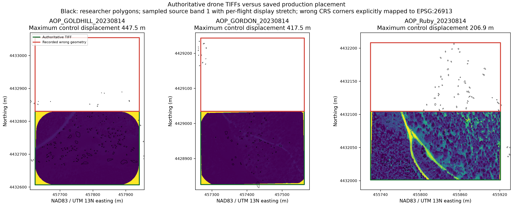
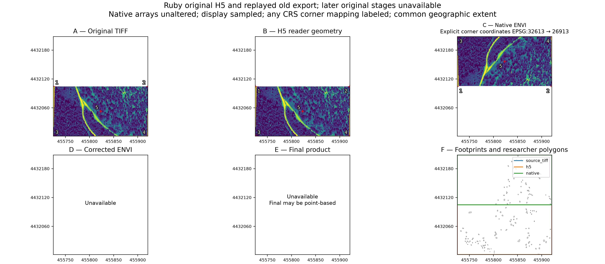
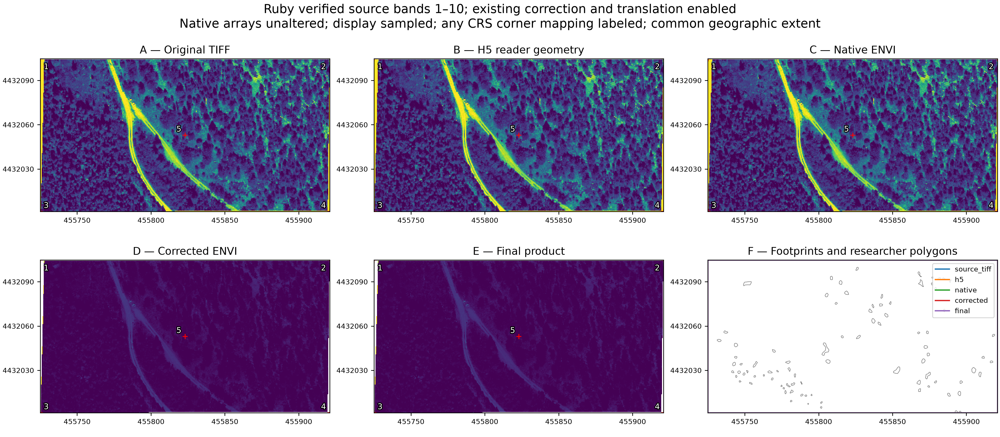

# Drone spatial integrity investigation — 29 October 2026

!!! info "Historical scope; later provenance findings"
    This report records the October 29 spatial investigation. Later work identified
    band 11 as alpha, completed three-flight diagnostics and traced zero-view and
    solar provenance. Use the [current findings](../validation/drone-findings.md)
    and [latest provenance account](photogrammetry-metadata-investigation.md)
    for scientific status. Historical correction/translation completion here is
    not physical calibration or correction approval.


**Confirmed: the Gordon, Goldhill and Ruby H5 arrays retain the source TIFF pixel
order, but their spatial metadata does not.** The old drone exporter propagates
that metadata into geographically reflected ENVI rasters and incorrect polygon
selection. A local repair, independent regression tests, three-flight source
comparison and full Ruby spatial recovery are complete. Historical libraries have
not been replaced, and the recovery is not a declaration of radiometric or field
accuracy.

## A. Problem

The reported map shows Gordon, Goldhill and Ruby raster footprints separated from
researcher polygons. Wrong raster coordinates can attach vegetation labels to
spectra from different ground locations. An overlapping bounding box, successful
extraction, or visually plausible image does not establish correct membership.

The investigation traces TIFF → H5 → native ENVI → corrected ENVI → translated
rasters → polygon index → spectra Parquet → QA. It compares real source files,
saved production geometry, and a controlled replay of the old exporter rather
than inferring an array flip from the screenshot.

## B. Root cause

### The actual source packets

After the user initialized CyVerse authentication, the original TIFF/H5 pairs were
retrieved read-only from the three named packages under:

```text
i:/iplant/home/shared/earthlab/macrosystems/field-data/output/summer-2023-10cm-10k
```

Each `aligned_orthomosaic.tif` is north-up, **EPSG:26913 (NAD83 / UTM 13N)**,
with 0.1 m pixels and 11 bands. Each corresponding
`NEON_D13_NIWO_test_aligned_orthomosaic.h5` has ten bands. Every retained H5 value
matches TIFF bands 1–10 exactly, including NaN locations: **152,672,940 values,
zero mismatches** across the three flights. No array reversal or transpose is
needed to explain the failure. Band 11 remains unclassified; it is not silently
assumed to be a mask or reflectance band.

The H5 `Coordinate_System_String` preserves NAD83, but its `Map_Info` stores:

```text
UTM, 1.000, 1.000, <TIFF corner x>, <TIFF corner y>, 0.100, -0.100,
13, North, WGS-84, units=Meters, 0
```

That is incompatible in three ways:

1. The TIFF's signed affine Y step was stored as an ENVI Y pixel size. ENVI
   interprets **negative map size as a positive geographic row step**. GDAL then
   places increasing rows north of the origin, although the source rows run south.
2. The H5 reader's established reference convention treats those coordinates as
   pixel centers, while the upstream conversion supplied the TIFF corner. This
   introduces a separate half-pixel offset inside `NeonCube`.
3. The map-info datum says WGS84 while the actual WKT and source say NAD83. The
   old writer emits a nonstandard `projection` field but not the standard WKT
   field, so GDAL identifies the old export as **EPSG:32613**, not EPSG:26913.

The upstream conversion's source code is not identified, so no unverified
function name is assigned to that writing error. Its exact malformed fields are
confirmed directly in all three downloaded H5s.

### Where the package propagates the defect

In `src/spectralbridge/io/neon.py`, `_shift_map_info_for_window()` computes
`yres = -abs(pixel_y)` and applies the legacy half-pixel center convention.
`NeonCube.build_envi_header()` then supplies the unadapted H5 map-info list.
Before repair, `export_h5_to_envi()` in `src/spectralbridge/pipelines/drone.py`
passed that list directly to `EnviWriter`. The resulting native ENVI is already
geographically reflected. Correction and translation preserve that wrong header;
polygon extraction subsequently uses its affine via rasterio.

A replay using the original Ruby H5 and the pre-repair header-writing behavior
produces **the same positive Y step and EPSG:32613 recorded in saved production
QA**. This is a replay, not a retrieved historical corrected raster. Its pixel
values still exactly match the TIFF; only their geographic placement is wrong.
The first confirmed defective artifact is the upstream H5 metadata; the first
package raster export turns that ambiguity into the observed reflected placement.

### Additional confirmed defects repaired

The package's own `_build_drone_tiff_map_info()` was not used by those H5-backed
runs, but independently had defects: taking absolute steps silently discarded
south-up/west-going orientation, rotation/shear was ignored, and three-decimal
serialization lost precision. Its TIFF-derived corner coordinates also lacked a
marker distinguishing them from legacy NEON center coordinates.

The two ENVI parsers split WKT on commas as a list, breaking non-UTM CRS retention
through translation. Restart helpers reused polygon products by existence even
when raster geometry changed. Campaign completion reuse could bypass spatial
preflight altogether. Production restart testing also exposed unnecessary
rewriting of already enriched polygon tables.

## C. Evidence

The [three-flight source comparison](https://github.com/earthlab/spectralbridge/blob/main/provenance/drone-spatial-integrity/2026-10-29/production_source_comparison.json)
records hashes, dimensions, full affines, CRSs, five control coordinates and band
values, exact array comparisons, and per-polygon membership counts. Wrong-product
coordinates are explicitly transformed into the source CRS for displacement.
Reported decimals describe numerical comparisons under that CRS operation, not
independently established absolute geolocation accuracy.

| Flight | Width × height | Values compared, bands 1–10 | Maximum control-point displacement | Source polygon-index pixels | Legacy replay index pixels | Same pixel and same polygon |
| --- | --- | --- | --- | --- | --- | --- |
| Goldhill | 3165 × 2238 | 70,832,700 | 447.4999 m | 144,749 | 2,494 | 115 |
| Gordon | 2948 × 2088 | 61,554,240 | 417.4999 m | 32,930 | 2,399 | 0 |
| Ruby | 1960 × 1035 | 20,286,000 | 206.8999 m | 22,684 | 9,514 | 0 |

All value comparisons have zero mismatches. Index counts include NoData locations;
finite-source selection counts are recorded separately. These are independently
rasterized source versus recorded-geometry comparisons, **not counts read from
unavailable historical polygon Parquets**. Researcher polygons are explicitly
reprojected into each raster CRS before membership is evaluated. One empty
reference geometry is ignored without renumbering or changing the original file.



Source band 1 is displayed with a per-flight percentile stretch only for viewing.
Red outlines use the saved erroneous geometry, with corner coordinates explicitly
mapped to NAD83 for comparison; no image is resampled or flipped.



The original H5 reader has **0.07071 m / 0.7071 pixel** diagonal offset. The old
native export has maximum displacement **206.8999 m / 2068.9989 pixels**. Its
mean/median and signed coordinate differences are retained in the
[before comparison](https://github.com/earthlab/spectralbridge/blob/main/provenance/drone-spatial-integrity/2026-10-29/ruby_before/discrepancies.json)
and control CSV. Missing historical corrected/final stages are explicitly blank.



The repaired Ruby working H5, native ENVI, corrected ENVI and final translated
raster have **zero maximum, mean and median control displacement**, zero
pixel-unit displacement, and the same affine and CRS as the authoritative TIFF.
Source → H5 and source → native ENVI each preserve all **20,286,000 retained-band
values exactly**. No display alignment operation contributes to those metrics.

The [after comparison](https://github.com/earthlab/spectralbridge/blob/main/provenance/drone-spatial-integrity/2026-10-29/ruby_after/discrepancies.json)
contains coordinate/label/value checks for **22,481 extracted rows**:
zero coordinate mismatches, zero wrong polygon memberships, zero changed
`GlobalID`/cover-category associations, zero duplicate pixels, and zero spectral
mismatches across **224,810 values** compared with the corrected raster.
Expected finite corrected-pixel membership matches exactly. Corrected values are
not incorrectly compared with uncorrected TIFF radiometry.

The explicitly [synthetic diagnostic](https://github.com/earthlab/spectralbridge/blob/main/provenance/drone-spatial-integrity/2026-10-29/synthetic/spatial_diagnostic.png)
remains as a regression control, separate from this real-source evidence.
The earlier saved-metadata-only figure and unassigned downloaded H5 inspection
are retained as preliminary evidence, not substitutes for the paired sources.

## D. Repair

- Accept east-right, north-up, axis-aligned TIFFs in a valid projected CRS;
  preserve 17-significant-digit coordinates and resolutions. Reject south-up,
  west-going, rotated and sheared transforms instead of silently discarding them.
- Mark newly converted TIFF H5 coordinate groups with
  `spatial_reference_convention=envi_corner_v1`. Only that explicit marker opts
  into corner interpretation, including sliced windows. Default NEON reader
  behavior stays unchanged.
- Build drone native and corrected ENVI map info from the cube's established
  corner transform using ENVI reference pixel `(1,1)`. This preserves valid legacy
  H5 reader identity without changing NEON exports.
- Reject conflicting signed H5 map sizes, rotation, UTM zones and datum/CRS
  declarations before staging or export reuse. Do not repair a malformed upstream
  H5 by relabeling its coordinates or flipping its arrays.
- Write standard `coordinate system string` WKT and preserve it as an opaque
  scalar through both header parsers and translation.
- Refresh per-flight extracted and merged products when their corrected raster
  or polygon backing changes. Refresh translated polygon selection too. Reuse
  already complete enrichment when backing inputs are unchanged.

No correction formula, coefficient, response function, wavelength definition,
brightness behavior, or NEON export convention was changed. The source files
and remote collections were read-only throughout.

### The original 11-band input is handled explicitly

The existing TIFF input contract expects ten reflectance channels with the
specified spectral metadata. The original files have an unexplained eleventh
channel. The package therefore does **not** automatically drop it.

For the Ruby validation experiment only,
`recover_ruby_validation.py` first proves full exact correspondence of TIFF
bands 1–10 with the historical H5, then creates a separate declared ten-band
reference TIFF. It preserves the original affine, CRS, NaNs and band order and
leaves band 11 and the originals untouched. It also verifies that original view
angles are constant before passing their measured scalar values. Original slope
and aspect sidecars are referenced, not edited. This is a documented spatial
recovery experiment; full scientific promotion still requires the sensor/band
and acquisition-time provenance described below.

## E. Scientific impact

**This is not only a plotting problem.** The affected affine drives
`_build_polygon_pixel_index_for_raster()`, which rasterizes polygons and attaches
their attributes to spectra. Replaying the recorded placement demonstrates that
none of the selected Ruby or Gordon pixel-and-polygon pairs agree with the
source-grid selection. Goldhill retains only 115 of 2,494 index pairs.

Any polygon library or analysis actually derived from these recorded erroneous
products requires regeneration from spatially validated sources. Do not preserve
old labels merely because their coordinates fall inside some polygon on the wrong
map. Trace source paths, flight IDs and hashes through merged tables and PFT
analyses before declaring their scope affected. **NEON-only analyses are not
implicated by this drone-only finding.**

A separately archived upstream `reflectance_corrected_flipped` Ruby product has
the correct NAD83 affine. Its sampled forward band-1 pattern correlation with the
source is 0.99948, versus 0.01013 after reversing rows. Those descriptive pattern
checks do not prove lossless radiometry or field accuracy; that artifact also
contains finite values at original NoData locations. Its filename alone does not
establish a flip. In particular, a library derived from that different, spatially
corrected upstream product must not be declared affected solely because a later
SpectralBridge H5-backed export was wrong. The separate assessment is retained in
`upstream_corrected_artifact.json`.

The exact screenshot-run Parquet files and corrected rasters were not retrieved.
The remote `spectralbridge-2023-2024/flight_outputs` collection contains the named
flight directories but their listings exposed only `qa_publication`
subdirectories. The downloaded local `drone_merged.parquet` contains a different
flight, MRS1, so it cannot certify these three historical tables. Historical input
hashes are also unavailable; current downloaded source hashes are retained.

### NoData and scientific QA are separate from the spatial repair

Ruby has 5,986 band-1 source NoData pixels; those locations are unchanged through
H5/native ENVI. The existing correction additionally excludes **30,171 pixels**
whose original slope/aspect geometry is missing, corresponding to **301,710 band
values**. An independent check against the original terrain TIFFs finds **zero
mask discrepancies** from the established finite-reflectance/finite-terrain
policy. No original NoData value becomes finite. Within polygons, this policy
reduces the source index from 22,684 to 22,481 retained spectra; all 22,481 retained
memberships agree exactly. No compensating spatial mask or interpolation was added.

The enabled correction changes radiometry as expected; four existing configured translation
plans then reproduce their recorded affine equations with **zero finite-value or
mask mismatches across 36,514,800 checked values**. Every translated raster keeps
the original NAD83 CRS and affine.

Execution and QA rendering complete, while scientific QA remains **caution**.
The existing manifest assigns Ruby **2023-08-16 18:53:18 UTC**, whereas its package
name says **2023-08-14**. The run uses the existing manifest behavior, not a guessed
new time. These outputs demonstrate spatial/arithmetic conformance, not verified
physical correction efficacy, abundance accuracy or readiness for scientific
promotion. Missing terrain coverage and the eleventh-band identity also remain
visible provenance/quality gates.

## F. Validation

`tests/test_drone_spatial_integrity.py` uses independent affine/rasterio/shapely
calculations with asymmetric pixel patterns. It covers northern/southern WGS84
UTM, NAD83 UTM and Albers; non-square pixels; nonzero origins; full precision;
NoData including NaN; multiband identity; ancillary alignment; H5 windows;
corner/legacy-center references; unsupported orientation/rotation/shear;
boundary extraction; correction/translation wiring; campaign preflight;
old-checkpoint invalidation; changed-grid refresh including translated/merged
tables; unchanged-run reuse; array-flip detection; explicit band correspondence;
and explicit radiometric references for table validation.

The original 12-case regression module ran before production edits: **11 failed,
one passed**. Those failures demonstrated coordinate/precision errors, silent
affine loss, wrong boundary membership, conflicting H5 acceptance and stale TIFF
cache version. Later-added tests were not all run against the original code.

The final compatibility command and exact count are recorded in
[validation.json](https://github.com/earthlab/spectralbridge/blob/main/provenance/drone-spatial-integrity/2026-10-29/validation.json).
It includes existing drone pipeline/production, translation/registry, NEON
cube/legacy and ENVI parser tests, plus the new spatial tests. Ruff, documentation
links, whitespace and generated AI-transparency freshness are checked separately.

The final ordered source-mode check passes **195 tests**. An earlier custom
combined ordering put the legacy Parquet-export dependency-shim tests before the
installed-smoke library test and exposed a `pyarrow.lib` test-state error. The
same tests pass in isolation and in the final ordering; this existing order
sensitivity is recorded as a maintenance follow-up, without unrelated cleanup.
No wheel/sdist was built or published, and Python 3.10/3.11 release-matrix gates
were not run in this Python 3.12 workspace.

Actual Ruby products are reused on a second unchanged run, including H5, native
and corrected images, all translated images and polygon tables. The
[restart record](https://github.com/earthlab/spectralbridge/blob/main/provenance/drone-spatial-integrity/2026-10-29/ruby_restart.json)
records identical modification times. Full-pixel radiometric/mask conformance is
recorded in
[ruby_full_pixel_validation.json](https://github.com/earthlab/spectralbridge/blob/main/provenance/drone-spatial-integrity/2026-10-29/ruby_full_pixel_validation.json).

## G. Production recovery

### Cache invalidation

TIFF working-stage algorithm **2 → 3** and native drone export **1 → 2** invalidate
known old spatial products. Changed working-H5 fingerprints invalidate native
exports; changed native image/header fingerprints invalidate correction. The
per-flight `spatial_dependencies.stage.json` ties extraction to corrected
image/header and polygon fingerprints and is committed after successful work.
Dependent indexes, spectra, translations' polygon tables, CSVs and affected
merges are refreshed; unrelated source data and NEON stages are untouched.

Campaign readiness checks available working-H5 geometry, export revision,
TIFF-stage revision and corrected-raster orientation. A completion checkpoint
cannot bypass known spatial conflicts. An invalid H5 fails explicitly rather
than receiving an assumed flip or automatic spatial relabeling.

### Retrieve original sources

Use an authenticated platform client through the existing launcher. The local
Mac client for this investigation is temporary:

```bash
GOCMD_BINARY=/private/tmp/spectralbridge-gocmd/gocmd ./gocmd ls \
  i:/iplant/home/shared/earthlab/macrosystems/field-data/output/summer-2023-10cm-10k/AOP-Ruby-08-14-23-ExportPackage
```

The verified original filenames are `aligned_orthomosaic.tif` and
`NEON_D13_NIWO_test_aligned_orthomosaic.h5`, with `aligned_slope.tif` and
`aligned_aspect.tif` as terrain sidecars. Gordon and Goldhill use the corresponding
named package directories. Download records and hashes identify the exact files;
never substitute a TIFF exported from the suspect H5 as the authority.

### Reproduce this investigation without changing production

From the repository root, with the downloaded source package directories under
`/private/tmp/spectralbridge-drone-production`:

```bash
MPLCONFIGDIR=/private/tmp/spectralbridge-mpl .venv/bin/python \
  provenance/drone-spatial-integrity/2026-10-29/analyze_production_sources.py \
  --sources /private/tmp/spectralbridge-drone-production \
  --saved-qa /Users/tuff/Downloads/drone_qa_summary.json \
  --polygons Datasets/niwot_aop_polygons_2023_12_8_23_analysis_ready_half_diam.gpkg \
  --output provenance/drone-spatial-integrity/2026-10-29

MPLCONFIGDIR=/private/tmp/spectralbridge-mpl .venv/bin/python \
  provenance/drone-spatial-integrity/2026-10-29/recover_ruby_validation.py \
  --sources /private/tmp/spectralbridge-drone-production \
  --workspace /private/tmp/spectralbridge-ruby-recovery \
  --evidence provenance/drone-spatial-integrity/2026-10-29 \
  --polygons Datasets/niwot_aop_polygons_2023_12_8_23_analysis_ready_half_diam.gpkg
```

This runs the existing correction and all four translation plans, then checks
restart reuse. It writes only the separate validation workspace and evidence
packet. The explicit band-selection and date caveats above remain in force.
Do not run a generic ten-band conversion on the original eleven-band TIFF and
silently discard its extra channel.

For a fresh diagnostic of this recovered flight, set the known local roots:

```bash
SOURCE_PACKAGE=/private/tmp/spectralbridge-drone-production/AOP-Ruby-08-14-23-ExportPackage
FLIGHT_DIR=/private/tmp/spectralbridge-ruby-recovery/outputs/AOP_Ruby_20230814
FLIGHT_ID=AOP_Ruby_20230814
MPLCONFIGDIR=/private/tmp/spectralbridge-mpl .venv/bin/python \
  scripts/diagnose_drone_spatial_integrity.py \
  --source-tiff "$SOURCE_PACKAGE/aligned_orthomosaic.tif" \
  --source-bands 1,2,3,4,5,6,7,8,9,10 \
  --h5 "$FLIGHT_DIR/${FLIGHT_ID}__working.h5" \
  --native "$FLIGHT_DIR/${FLIGHT_ID}__envi.img" \
  --corrected "$FLIGHT_DIR/${FLIGHT_ID}__corrected.img" \
  --final "$FLIGHT_DIR/${FLIGHT_ID}__landsat_like_landsat_oli_translated_envi.img" \
  --polygons Datasets/niwot_aop_polygons_2023_12_8_23_analysis_ready_half_diam.gpkg \
  --id-column GlobalID \
  --parquet "$FLIGHT_DIR/${FLIGHT_ID}__polygons.parquet" \
  --parquet-value-raster "$FLIGHT_DIR/${FLIGHT_ID}__corrected.img" \
  --output artifacts/drone_spatial_integrity/ruby_recheck --label "Ruby recovery"
```

`--source-bands` declares a measured correspondence; the diagnostic never infers
it. `--parquet-value-raster` distinguishes expected corrected radiometry from
source values even when a legacy table prefix says `raw`. Exit 2 marks missing
required stage/source evidence; exit 1 marks measured discrepancies. An exit 0
covers supplied checks, not scientific approval.

### Replace affected analytical contributions only after review

Preserve old outputs and their provenance. Confirm band identity, acquisition
time and ancillary coverage; then rebuild each affected flight from its verified
supported input into a new root. Validate its index and retained spectra against
the original TIFF, including identifiers and labels. Replace only that flight's
contribution to merged libraries, and rerun analyses whose lineage includes it.
Rebuild corresponding QA and compact bulk checkpoints whose source fingerprints
changed. Do not merge a few recovered flights and label that a complete campaign.
No upload, remote deletion, historical-table rewrite or publication was performed.

## H. Remaining limitations

- Historical corrected rasters, extracted tables and the exact screenshot run
  were not retrieved. The old behavior is reconstructed from original sources and
  matching saved QA geometry. Historical source-byte hashes remain unavailable.
- Only Ruby was run through full repaired correction/translation/extraction and
  restart. Gordon/Goldhill have exhaustive source-array and independently
  rasterized selection comparisons, not full corrected recovery runs.
- Band 11 is unclassified; the ten-band audit derivative is explicit and separate.
  The package does not auto-trim malformed or unknown spectral inputs.
- Package versus manifest acquisition dates disagree. Existing solar behavior was
  retained; physical correction efficacy is not independently established.
- Original terrain sidecars have missing coverage. Its existing correction mask is
  accounted for exactly, but no missing terrain was filled or invented.
- South-up, west-going, rotated/sheared and geographic-CRS TIFFs fail explicitly.
  Positive H5 map sizes alone are not proof of correspondence with an original
  TIFF: users still need source-aware validation for upstream conversions.
- The source/diagnostic comparisons use bounded rows, compact counts and sampled
  plots. No production pixel-scale cache or copied campaign archive is committed.
