# Goldhill Topographic Correction: A Conditional Reflectance Experiment

November 3, 2026. **HYPOTHETICAL_UNVERIFIED** calibration; isolated P171 experiment.

## 1. Goldhill Topographic Correction: A Conditional Reflectance Experiment

November 3, 2026. A controlled, isolated test of SCS+C under the supported-but-unverified DN/32768 hypothesis. Raw candidate reflectance remains the primary scientific representation.

| Finding | Evidence |
| --- | --- |
| Calibration | HYPOTHETICAL_UNVERIFIED; not VALID or VERIFIED |
| Numerical finding | Common positive scaling leaves all ten fitted C values and factors unchanged. |
| Instability | Historical and current red factors reach 309.9168; eligibility/Huber alone do not eliminate poles. |
| Stabilization | Uncertainty/domain exclusions reduce maximum red factor to 6.9901 without clipping;98.96% of raw footprint retained. |
| Identification | Common-support balanced accuracy: raw 68.3%, stabilized 65.2%. No established improvement. |
| Decision | Use correction branches for diagnostic experiments only; no production deployment or official spectral library. |

- No BRDF correction, source overwrite, production registry change, VALID calibration record or datastore write.

## 2. The hypothesis changes units, not the evidence

S=DN x 10000/65535 is the fixed numerical derivative. Under the candidate convention, R=S x 0.0001999969482421875, offset 0. Values are candidate fractional reflectance.

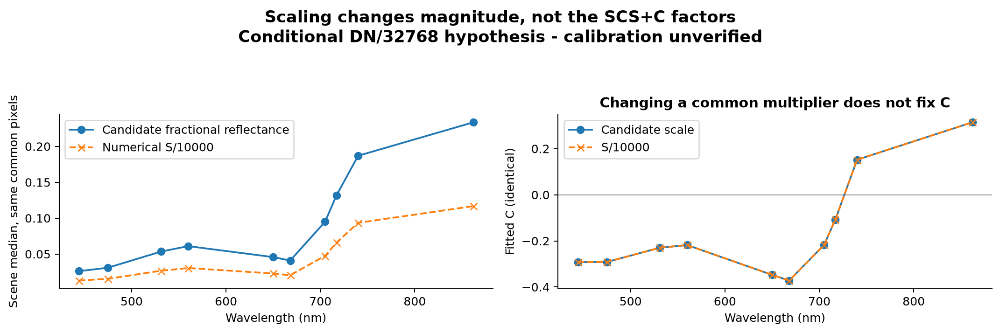

Exact multiplier 0.0001999969482421875; no offset. All ten fitted C values are identical at the tested scales. Spectral shape alone cannot verify calibration.

- The derivative is 2238 x 3165, ten optical bands,10 cm,EPSG 26913. Wavelengths 444/475/531/560/650/668/705/717/740/862 nm; source internal alpha-derived mask preserved exactly.
- The production Radiometry gate still rejects this hypothesis. The isolated subclass calls the existing Radiometry._affine kernel; functions retain their actual scientific bytecode in a separate namespace. Conversion occurs once into calculations and inverse once into storage.
- Exhaustive prior UInt 16 arithmetic and this all-ten-band source comparison support numerical consistency, not absolute calibration. Original SHA-256:00df553e63285dde6dad4b02f2ad399bf813b8591dc93e912a007c3cddf9e954.

## 3. Geometry is aligned; its source history is not fully certified

The recovered original photo tags support August 15,2023;5650 camera IDs join uniquely. Matched times span 19:42:38-20:03:47, midpoint 19:53:12.5. The inherited time 19:53:07 differs by 5.5 seconds.

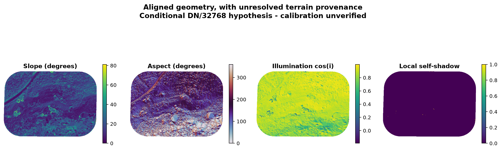

North is up on the common 10 cm grid; images sampled every sixth cell. Self-shadow means cos(i)<=0, not a complete cast/canopy-shadow mask. Terrain resampling does not create new independent detail.

- Of 6,683,944 raw pixels,6,678,404 have finite usable inherited geometry;5,540 are unavailable and 1,087 have local cos(i)<=0.
- MicaSense documentation specifies camera tags as UTC, supporting the UTC interpretation. The exported three-column CSV does not independently prove clock accuracy/time zone. No pixel contributor-time map is available.
- Slope/aspect are converted from degrees once. No evidence here establishes a radians/degrees bug in SCS+C. Terrain surface, execution provenance, true/grid North, interpolation and cast/canopy shadows remain separate uncertainties.

## 4. Time sensitivity is a scenario test, not a choice by appearance

The existing package solar function was used at scene center for six explicit timing cases; the main branches retain the inherited spatial solar grids. UTC start/end bracket available camera times.

Solar geometry uses the existing approximate UTC package function at scene center for sensitivity. Local-time interpretation puts the sun near the horizon and can trigger neutral fallbacks; that is not evidence of successful correction. No case was selected for looking better.

- UTC flight span changes zenith from 27.01 to 28.70 degrees; refitted maximum red factors remain about 300-323.
- Treating 19:53 as local MDT implies 01:53 UTC next day and zenith 89.56 degrees. Its factor 1 fallback reflects unsupported numerator/denominator signs, not a physically demonstrated correction.
- The midday UTC interpretation is favored by timestamp evidence and manufacturer convention, not by prettier corrected maps. Approximate solar calculations do not establish authoritative per-photo illumination.

## 5. Terrain resolution and North conventions need explicit provenance

Delivered terrain rasters allow a bounded cross-check, not identification of the actual historical generating surface.

| Finding | Evidence |
| --- | --- |
| Available DTM | 0.553 m cells; diagnostic median slope difference vs inherited-0.81 degrees |
| Available DEM | 0.338 m cells; diagnostic median slope difference+1.10 degrees |
| Aligned elevation | 0.1 m cells; diagnostic median slope difference+0.26 degrees |
| Grid convergence | -0.318 degrees at scene center; both aspect-sign sensitivities retained in terrain_audit.json |
| Intended legacy process | Available R source: ground-classified 0.25 m TIN, slope/aspect in degrees, then scalar bilinear resampling. Exact execution/source link unresolved. |

- Diagnostic gradients assume delivered elevation values are metres; they do not silently replace the correction terrain.10 cm resampling does not establish 10 cm independent terrain detail.
- Aspect is circular: scalar bilinear interpolation across 0/360 can be problematic. This is a provenance risk, not a demonstrated cause of this red pole. Local back-facing incidence is not a complete shadow mask.

## 6. Why historical SCS+C became unstable

SCS+C multiplies each band by [cos(solar zenith)cos(slope)+C]/[cos(i)+C], with C=intercept/slope of the reflectance-illumination regression.

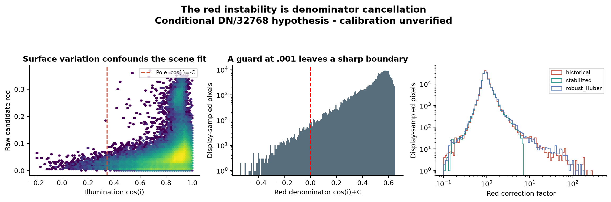

At row 1178,col 1533, cos(i)=0.3482566 and C=-0.3472517 leave denominator 0.00100496 and factor 309.9168. Positive illumination does not prevent cancellation. Huber moves the pole; it does not remove it.

- At native row 1178,column 1533: slope 41.891 degrees, illumination 0.3482566, red C=-0.3472517, denominator 0.001004964 and gain 309.91684. Historical red has 11,305 pixels above 10 x on its native support.
- This is an interior pole induced by a negative fitted intercept relative to slope. It is not limited to terrain shadows or invalid source alpha, and the candidate multiplier cannot remove it.
- The existing .001 denominator guard returns raw values for invalid ratios, leaving a sharp transition just above the threshold. Current and historical functions agree; no new implementation error is required to explain the behavior.

## 7. What was stabilized, and what was only diagnosed

The predeclared experimental rule treats uncertain or extrapolated observations as unsupported; it does not force factors into a desired numerical range.

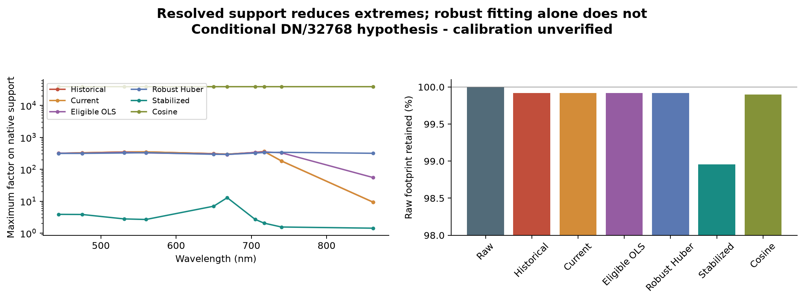

Native supports are shown separately. Stabilized coverage is 98.96% of raw, including existing geometry losses; no gain was capped. The cosine alternative is numerically extreme near local self-shadow and is not recommended.

- Eligible fitting: finite source/geometry, cos(i)>0, slope>5 degrees, all evaluated polygon pixels plus 2 m buffer excluded. No reflectance threshold was invented; missing quality flags prevent certifying cloud/canopy-shadow exclusions.
- OLS C uncertainty:399 spatial 20 m-block bootstrap draws from a deterministic 1-in 17 eligible sample. Application requires observed fit-domain illumination and positive numerator/denominator throughout the 95% C interval, denominator>.001. This is an experimental uncertainty rule, not a universal physical threshold.
- Huber epsilon 1.35,alpha 0 on the same eligible sample is a robust-fit comparison. It still produces about 296 x maximum red gain. Unconstrained OLS/Huber negative C remains empirical, not a measured diffuse-irradiance component.
- The already-implemented cosine alternative has a maximum red factor 38,965 x on native support; it is retained as an established diagnostic and rejected for full-footprint use.

## 8. Visual appearance cannot certify reflectance

Raw, historical, current, robust, stabilized and cosine branches all use the same source/grid/bands, and no branch includes BRDF.

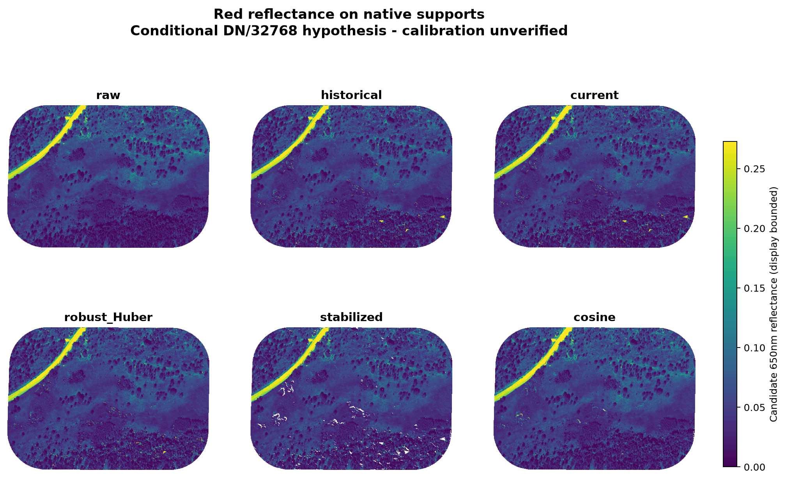

Identical grid, north up, every sixth cell. Common raw 99 th percentile controls display only; analytical extremes are retained. White is unsupported/missing. Candidate calibration remains unverified.

- Maps use shared display bounds only; full numerical tails, negative values and R>1 frequencies remain in scene_statistics.json. Historical native red reaches 16.45; stabilized native red still reaches 1.72. Neither is independently validated physical truth.
- The main comparison uses 6,614,170 common pixels. Historical red has 2020 native pixels above 1; stabilized has 13, raw has 0. No negative values occur in these red branches. The stabilized mask removes 69,774 raw pixels including 5,540 missing-geometry cells.

## 9. Signed changes and the locations of extreme gains

Correction differences are evaluated on the same grid, without fabricating missing observations.

Signed differences are candidate reflectance on stabilized support;99 th-percentile display bounds do not alter measurements. Right: sampled positions with historical red gain>10;star marks actual native maximum at row 1178,column 1533. The threshold 10 is descriptive only, not the eligibility rule.

- The difference maps show band-specific changes; shared spatial support is required for comparisons. The historical red maximum is marked at its actual native row/column.
- Display bounds are independent of analysis. Large ratios are counted and mapped; no clipping or value replacement is used in the stabilized branch.

## 10. Unsupported pixels are a scientific result

Pole-adjacent observations cannot be rescued merely by making the output finite.

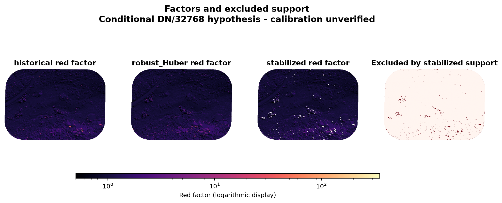

Display factor limits 0.5-350 do not clip analysis. Pole-adjacent regions become unsupported; the rule does not make new measurements. Unsupported boundaries can create selection bias and are tested using identical common pixels.

- The stabilized support retains 98.96% of the raw footprint; all 157 previously analyzed identities remain, but common memberships fall from 144,406 to 142,656.
- The reused package index contains 158 candidate identities; one additional Woody shrub polygon has no valid raw observations. The evaluated class totals remain 98 Evergreen,29 Woody shrub,25 Herbaceous,5 Deciduous. No label was changed.
- Native support and common support answer different questions. Do not substitute rejected pixels with raw data and describe that hybrid as a completed physical correction.

## 11. How the spectra change

All branches are evaluated using exactly matched polygon pixels and the same ten native MicaSense bands.

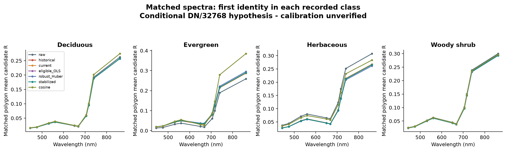

One outcome-blind lexicographic polygon per class, on identical common pixels. Curves are ten discrete optical bands, not a continuous hyperspectral measurement. Representative curves cannot establish physical accuracy.

- Common scaling preserves spectral shape, NDVI, spectral angles and CV; absolute values, residuals, variance, Euclidean distances and thresholds atR=1 depend on scale.
- Actual shared SCS+C C values were identical at candidate scale and S/10000. Applying through stored-space and decoded-space calls agrees to Float 32 precision; the standardized classifier produces identical predictions under equivalent common scaling.
- Band-specific SCS+C factors can change spectral shape and red-edge/NIR-red relationships. Detailed native/common distributions, negative and above-one counts, spectral angles and red-edge reversals are retained for all branches.

## 12. Within-polygon consistency is mixed

Absolute variance, relative variability and spectral angle must be interpreted together.

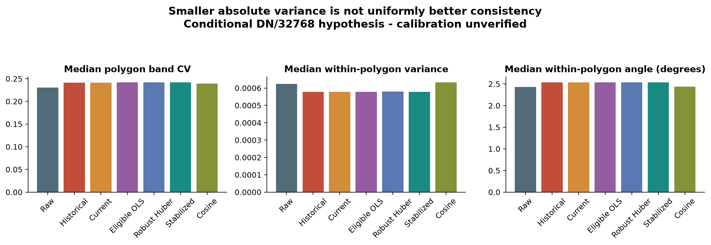

All 157 polygons use the same 142,656 common memberships. Compare CV and spectral angles alongside absolute variance: multiplicative dimming can lower variance without improving relative spectral consistency.

- Median polygon band CV rises from 0.2304 raw to 0.2416 stabilized; median within-polygon angle rises from 2.434 to 2.539 degrees.
- Median mean-band variance falls from 0.0006247 to 0.0005783, but lower absolute variance alone does not establish cleaner spectra.
- The result does not support a blanket statement that stabilized SCS+C improves within-polygon spectral consistency. PFT-specific variability and changes in spectral relationships are available in compact tables.

## 13. Illumination dependence is reduced, with ecological ambiguity

Across 157 polygon means, partial associations control recorded class and a linear spatial plane. This is a descriptive control, not causal separation of topography from vegetation.

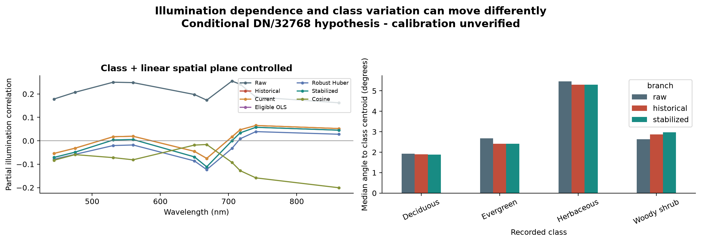

Partial associations control recorded class and a linear spatial plane across independent polygon means. Spatial autocorrelation/nonlinear vegetation structure remain. Reducing correlation alone does not establish more accurate reflectance.

- Red partial illumination correlation changes from+0.198 raw to-0.069 stabilized; NIR changes from+0.162 to+0.045.
- Residual slope/aspect/illumination associations, whole-scene and class/spatial-controlled results are retained. A linear spatial plane cannot remove all spatial autocorrelation or genuine vegetation-habitat relationships.
- A weak or sign-reversed relationship after correction can indicate overcorrection. No invariant target or independent radiometer is available to establish improved physical accuracy.

## 14. PFT identification does not establish a correction benefit

Package evaluate_identifiability: fixed 3 polygon-disjoint folds, training-only feature scaling, fixed C=1, no PFT-based correction tuning and no pixel-level leakage.

Package classifier uses polygon-disjoint 3 fold validation, training-only scaling and fixed C=1. Intervals bootstrap fixed out-of-fold predictions by class/identity; they exclude model/coefficient/site uncertainty. Only 5 deciduous polygons: one changed prediction shifts balanced accuracy by 5 points.

- Raw common-support balanced accuracy=68.30%; stabilized=65.20%. Paired change=-3.10 points,95%interval[-14.16,+5.53]points;26 predictions change.
- Uncertainty uses 1,999 class-stratified whole-polygon draws of fixed out-of-fold predictions. It omits training-set/model/coefficient uncertainty, nearby-polygon dependence and site/year transfer. Five deciduous identities make class recall particularly unstable.
- Eligible/robust/stabilized fits exclude all evaluation polygons and 2 m buffer, so no test-polygon reflectance enters those coefficient fits. Historical/current scene-wide fits are explicitly transductive baselines, not evidence of held-out calibration performance.

## 15. Separability is not uniformly improved

Package spectral_separability uses 499 permutations, polygon identities and equal discrete-band integration weights. Pairwise distances, overlap, angles and Holm-adjusted evidence are retained.

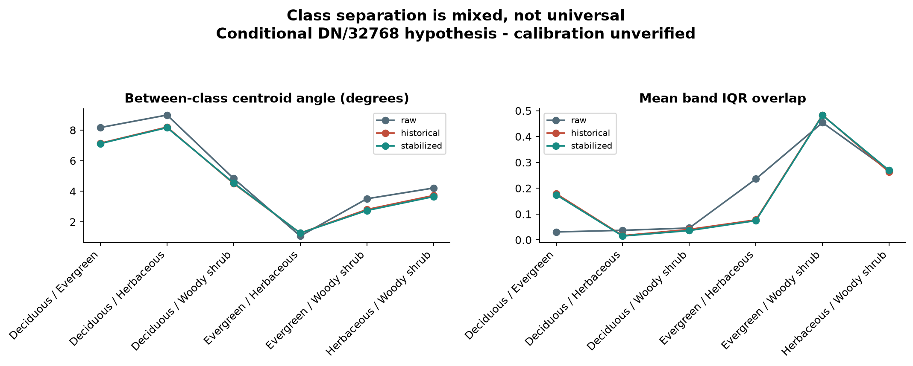

Distances, overlap and permutation evidence are descriptive of one labeled flight. Package spectral_separability uses 499 permutations, independent polygon units and equal discrete-band weights; significance within a branch does not test a correction gain.

- Raw has 5/6 class pairs with Holm-adjusted NPC p<0.05; stabilized has 4/6. Between-class angular separation and within-class spread change by pair. A significant class difference within a branch does not test whether correction improved it.
- These are exploratory multiple-branch comparisons. There is no independent ecological ground truth establishing that reduced illumination correlation or a particular classifier score preserves all genuine vegetation variation.

## 16. Why the earlier 71.7% must not be carried forward unchanged

The earlier P 169 analysis used polygon means and its original support. That historical score is reproduced exactly; the raw native benchmark remains 66.83%.

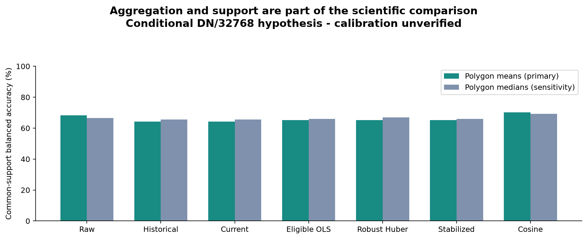

Means reproduce the earlier P 169 aggregation; medians are a sensitivity analysis, not selected for a better score. Native-support contrasts and the old 71.7% historical score use different masks and cannot be attributed solely to correction.

- Primary comparisons here also use means for compatibility. Polygon medians are retained as a sensitivity analysis, not selected based on a better score. On common support, the median analysis also does not establish a stabilized correction gain.
- With the original support, raw 66.83%versus historical 71.71%can be reproduced. Restricting both to the new common support yields raw 68.30%and historical 64.20%. A benefit that depends on rejected pole-adjacent observations cannot justify production use.
- No nested tuning was needed: correction rules, Huber epsilon, classifier C, folds and seeds were fixed. These data do not choose a new production algorithm.

## 17. Direct scientific decisions: arithmetic and stability

No physical-calibration promotion follows from successful numerical tests.

| Finding | Evidence |
| --- | --- |
| 1. Numerically consistent candidate reflectance? | Yes, conditional on DN/32768. Ten-band affine conversion/masks and precision verified; calibration not verified. |
| 2. Scale-invariant SCS+C? | Yes at the tested scales and masks; C and factors unchanged. An absolute near-zero-slope tolerance can break invariance in other regimes. |
| 3. Cause of historical extremes? | Negative fitted C cancels positive illumination near the .001 guard. Uncertain/confounded regression, not the common radiometric multiplier. |
| 4. Preventable instability? | Resolved-domain/uncertainty exclusions prevent these near-pole outputs without clipping; better fitting/Huber alone does not. |
| 5. Less illumination dependence? | Yes descriptively, with weak negative residual red correlation; not independent physical validation. |
| 6. Spectral relationships preserved? | Not uniformly: band-dependent factors alter shape; no absolute reference certifies improvement. |

## 18. Direct scientific decisions: information and deployment

Keep raw candidate reflectance as the baseline. Retain explicit refusal/support masks in experimental outputs.

| Finding | Evidence |
| --- | --- |
| 7. Better within-polygon consistency? | Not overall: lower absolute variance, but higher CV and spectral angle. |
| 8. Better PFT separability? | Mixed class-pair effects; no general or independently validated gain. |
| 9. Better PFT identification? | No established gain on matched support; stabilized 65.2%versus raw 68.3%, paired interval spans zero. |
| 10. Experimental use? | Yes for explicitly conditional diagnostic sensitivity analysis; raw remains primary for ecological interpretation. |
| 11. Production readiness? | No. Verify calibration, timing/terrain/shadows and North/contributor provenance; independent targets and spatial/site-held-out evaluation are needed. |

- Recommended production improvements are a separate future change: explicit per-band coefficient/support uncertainty, denominator-domain checks, non-neutral unsupported reporting and held-out scientific validation. Do not deploy this experimental mask as a universal rule.

## 19. Methodological basis and evidence boundaries

The literature supports SCS+C/C formulations, attention to illumination/terrain/shadows and empirical coefficient-population sensitivity. It does not validate this exact Goldhill uncertainty rule.

| Finding | Evidence |
| --- | --- |
| Soenen,Peddle&Coburn(2005) | SCS+C, IEEE TGRS 43:2169-2175. https://doi.org/10.1109/TGRS.2005.852480 |
| Slope-classified SCS+C study(2017) | Slope-stratified SCS+C study. https://www.mdpi.com/2220-9964/6/9/287 |
| Evaluation/intercomparison study(2021) | Evaluation/intercomparison; excludes flat/cloud/cast-shadow regions from regression. https://www.mdpi.com/2072-4292/13/20/4120 |
| Richter,Kellenberger&Kaufmann(2009) | Comparison of topographic corrections. https://www.mdpi.com/2072-4292/1/3/184 |
| Kaneetal.(2008) | Interpretation and topographic compensation of conifer canopy self-shadowing. https://doi.org/10.1016/j.rse.2008.06.001 |
| MicaSense calibrated Metashape units | https://support.micasense.com/hc/en-us/articles/1500012483982-Analyzing-MicaSense-data-processed-with-Agisoft-Metashape |

- The new 95%block-bootstrap positivity/domain mask is an explicitly experimental statistical eligibility rule motivated by resolved model predictions and avoidance of extrapolation. It is not a published universal physical criterion.
- Clock convention: MicaSense panel documentation states UTC image metadata: https://support.micasense.com/hc/en-us/articles/115000765514-Use-of-Calibrated-Reflectance-Panels-For-MicaSense-Data . A nonnegative diffuse-term constraint was considered but not imposed: forcing C>=0 would change the empirical model without evidence and would not verify calibration. Robust fitting was actually evaluated instead.

## 20. Reproducibility and preservation

Revision2444902440a48453ed14855473d3250020ba8bb3. Scientific environment: existing repository.venv; seeds 20261103. Report rendering uses bundled ReportLab.

| Finding | Evidence |
| --- | --- |
| Execution | experiment.py -> geometry_audit.py -> analyze.py -> median_sensitivity.py -> additional_checks.py -> figures.py -> write_report.py -> make_pdf.py -> verify.py |
| Primary data | Original/fixed TIFF hashes, geometry and polygon index paths are in input_manifest.json. All historical P 169 products/code were hashed before and after; no writes. |
| Adapter | HypothesisRadiometry calls Radiometry._affine. FunctionType copies namespace require_radiometry binding only; production globals unchanged; scientific function bytecode identical. Production require_valid still rejects hypothesis. |
| Storage | Seven 10-band Float 32 arrays are isolated under /private/tmp/goldhill-conditional-topographic-20261103 (~2 GB). No ordinary bulk pixel-Parquet cache or official spectral library. Compact tables/masks/figures/scripts remain in dated provenance. |
| Verification | Targeted synthetic unit/contract/integration checks, source hashes, decode once, orientation/band/mask checks, identical CV memberships, no clipping/no BRDF/no VALID promotion; see verification.json. |

- Scripts expose stage progress and process corrections in 128-row chunks. This is a bounded single-flight research experiment, not a large-VM streaming benchmark or a change to normal pipeline restart contracts.

## Per-band fitted C audit

| nm | Historical/current C | Eligible OLS C | Huber C |
| --- | ---: | ---: | ---: |
| 444 | -0.291810334 | -0.311274439 | -0.318792939 |
| 475 | -0.291211098 | -0.310003340 | -0.318858504 |
| 531 | -0.229571119 | -0.250685364 | -0.280627131 |
| 560 | -0.218093336 | -0.240173832 | -0.271017909 |
| 650 | -0.347251654 | -0.362845063 | -0.371562421 |
| 668 | -0.371890754 | -0.386653751 | -0.390170872 |
| 705 | -0.217696145 | -0.242720142 | -0.281039745 |
| 717 | -0.107003689 | -0.139740497 | -0.190545052 |
| 740 | 0.152019620 | 0.103608616 | 0.009656286 |
| 862 | 0.314187229 | 0.255021363 | 0.137237340 |

All coefficients, sample counts, residuals and fit diagnostics: [regression_diagnostics.json](https://github.com/earthlab/spectralbridge/blob/bb3da46/provenance/goldhill-conditional-topographic/2026-11-03/regression_diagnostics.json). Native/common per-band distribution counts: [scene_statistics.json](https://github.com/earthlab/spectralbridge/blob/bb3da46/provenance/goldhill-conditional-topographic/2026-11-03/scene_statistics.json). Pairwise statistical evidence: [separability_pairs.csv](https://github.com/earthlab/spectralbridge/blob/bb3da46/provenance/goldhill-conditional-topographic/2026-11-03/separability_pairs.csv). Machine summary: [scientific_summary.json](https://github.com/earthlab/spectralbridge/blob/bb3da46/provenance/goldhill-conditional-topographic/2026-11-03/scientific_summary.json).
