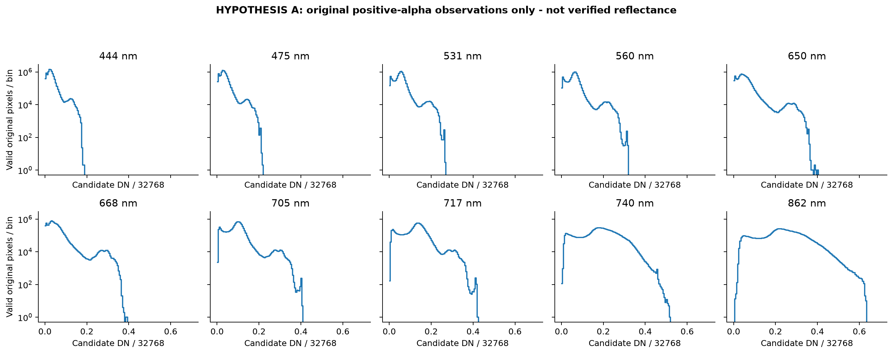
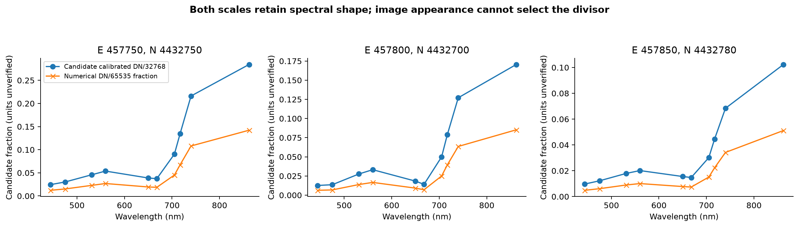
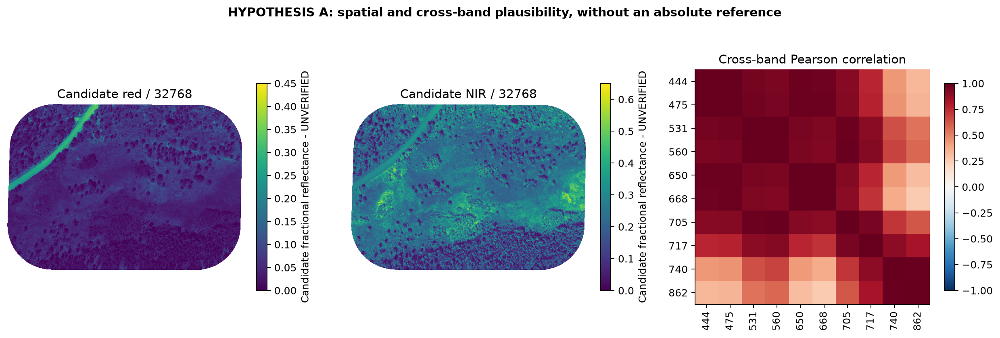

# Goldhill MicaSense calibration and scaling determination

**November 3, 2026. Outcome: SUPPORTED BUT UNVERIFIED.** DN/32,768 is the best-supported documented candidate for this Metashape multispectral orthomosaic. **The available Goldhill records do not establish that reflectance calibration was applied to the exported file.** Its production physical-unit status therefore remains **UNSUPPORTED**. This is a bounded evidence determination, not a claim that Goldhill is known to be uncalibrated.

The user requested proceeding without the difficult-to-obtain original project/raw-photo archive. The following checks use the existing original TIFF, processing report, complete accessible export/metadata directories, source sidecars/catalogue metadata, photo-time exports, and manufacturer documentation. No source pixels, scaling defaults, production pipeline or calibration records were changed. All candidate values/figures below are hypotheses, not a new physical raster.

## A. What the official documentation establishes

| Question | Documented answer and scope |
| --- | --- |
| What does 32,768 mean? | For calibrated Metashape UInt16 reflectance maps, `R = DN/32768`; values may extend almost to 2 rather than being clipped at 1. MicaSense explicitly discusses the Dual 10-band system. [Analyzing MicaSense data processed with Agisoft Metashape](https://support.micasense.com/hc/en-us/articles/1500012483982-Analyzing-MicaSense-data-processed-with-Agisoft-Metashape) |
| Must calibration be performed? | Agisoft requires the explicit Calibrate Reflectance operation with panel and/or sun-sensor information. Before building the orthomosaic, calibration results must be enabled through Normalize band sensitivity for each sensor. A disabled flag exports default colors instead. [MicaSense RedEdge MX processing workflow including Reflectance Calibration](https://agisoft.freshdesk.com/support/solutions/articles/31000148780-micasense-rededge-mx-processing-workflow-including-reflectance-calibration-in-agisoft-metashape-pro) |
| Do export settings matter? | Raster Transform=None preserves source channels; Index Value exports calculator expressions; Index Colors exports rendered colors. A `/32768` calculator expression already exported as float must not be divided again. The actual Goldhill choices are not recovered. [MicaSense RedEdge MX processing workflow including Reflectance Calibration](https://agisoft.freshdesk.com/support/solutions/articles/31000148780-micasense-rededge-mx-processing-workflow-including-reflectance-calibration-in-agisoft-metashape-pro) |
| Does this cover ten bands? | The Dual workflow imports all ten bands together and instructs calibration before orthomosaic creation. The same divisor is applicable to each calibrated optical band, conditional on its own calibration/enable state. It is not applied to the alpha band. [How to add MicaSense RedEdge MX Dual data properly](https://agisoft.freshdesk.com/support/solutions/articles/31000161029-how-to-add-micasense-rededge-mx-dual-data-properly) |
| Is the convention compatible with version 1.8.3? | The MX tutorial covers 1.7.x onward. The 1.8 manual documents the calibration operation, while the divisor is explicit in the manufacturer article and Agisoft's earlier support reply. Thus this is not a convention introduced only in 2026. [Metashape Professional 1.8 manual](https://www.agisoft.com/pdf/metashape-pro_1_8_en.pdf) (printed pp. 106–107), [Agisoft technical-support reply on calibrated orthomosaic normalization](https://www.agisoft.com/forum/index.php?topic=10038.0) |
| Are both panel and DLS mandatory? | Agisoft permits panel and/or sun-sensor calibration modes. MicaSense recommends panel-only for clear stable lighting and both for overcast conditions. Neither possession of a panel nor an irradiance tag proves use in the exported mosaic. [Using Panels and/or DLS in Post-Processing](https://support.micasense.com/hc/en-us/articles/360025336894-Using-Panels-and-or-DLS-in-Post-Processing) |
| What do raw camera coefficients provide? | Factory coefficients, exposure, gain, black level and vignetting enter a **radiance** model, not a complete reflectance proof. The raw model normalizes 16-bit camera pixels by **65,536**, which is a separate operation from the calibrated-orthomosaic divisor. [Radiometric Calibration Model for MicaSense Sensors](https://support.micasense.com/hc/en-us/articles/115000351194-Radiometric-Calibration-Model-for-MicaSense-Sensors) |
| What supplies absolute reflectance? | A panel workflow derives a per-band radiance-to-reflectance factor from the certified panel value and its measured radiance; saturated panel observations are unsuitable. These source-specific measurements are not recovered for Goldhill. [Use of Calibrated Reflectance Panels For MicaSense Data](https://support.micasense.com/hc/en-us/articles/115000765514-Use-of-Calibrated-Reflectance-Panels-For-MicaSense-Data) |
| Does Atlas prove Goldhill's units? | Atlas specifies the same calibrated divisor for its own delivered product. Goldhill is a Metashape export, so that separate service's contract does not certify this file. [What are the units of the Atlas GeoTIFF output?](https://support.micasense.com/hc/en-us/articles/215460518-What-are-the-units-of-the-Atlas-GeoTIFF-output) |
| Must a TIFF contain a calibration certificate? | The reviewed references do not prescribe a universally mandatory GeoTIFF tag proving the operation was applied. Absence of such a tag is inconclusive. Project/processing/export evidence is needed. |

The ten-band import caveat is corroborated by [Process MicaSense sensor data in Agisoft Metashape](https://support.micasense.com/hc/en-us/articles/360002693373-Process-MicaSense-sensor-data-in-Agisoft-Metashape); separate Red/Blue rig imports can affect processing. The Altum workflow's thermal exception is irrelevant to Goldhill's ten optical channels ([MicaSense Altum processing workflow including Reflectance Calibration](https://agisoft.freshdesk.com/support/solutions/articles/31000148381-micasense-altum-processing-workflow-including-reflectance-calibration-in-agisoft-metashape-professi)). No dependence of the 32,768 convention on a particular RedEdge-M serial number is documented; dependence on **applied processing and export representation** is the decisive condition.

## B. What is established for Goldhill

The original source is:

`/iplant/home/shared/earthlab/macrosystems/field-data/uas-packages/AOP-GOLDHILL-08-14-23-ExportPackage/AOP-GOLDHILL-08-14-23_ORTHO.tif`

Its SHA-256 is `00df553e63285dde6dad4b02f2ad399bf813b8591dc93e912a007c3cddf9e954`. It has ten UInt16 spectral bands plus declared alpha, EPSG:26913, approximately 8.44 cm cells. The fixed-10K derivative preserves the documented numerical transform and source-validity treatment. [Prior source inventory](goldhill-original-source-investigation.md).

**Directly recovered:** the associated 19-page processing report identifies RedEdge-M dual-band camera names, focal length/pixel dimensions and Metashape Professional **1.8.3 build 14331**. Pages 2–13 contain initial/geometric camera information and coefficient/correlation tables; “Precalibrated: Yes” is not an attestation that Calibrate Reflectance ran. Pages 17–19 list alignment, reconstruction and system parameters. The report does not record the required per-sensor radiometric enable state, completed reflectance-calibration operation or orthomosaic export transform.

**TIFF and sidecars:** direct inspection of all 18 original classic-TIFF IFD entries finds spatial/raster/tile/alpha metadata, with no XMP/EXIF, ImageDescription, software/time or applied-calibration declaration. GDAL reports identity scale and zero offset, no physical band-unit declaration. The auxiliary XMLs supply image statistics/histograms, not panel values or an applied-calibration record. Catalogue AVUs supply UUID/file-type information, not reflectance provenance. These absences **do not prove calibration was omitted**. [IFD evidence](../../provenance/goldhill-micasense-calibration/2026-11-03/original_tiff_ifd.json), [catalogue evidence](../../provenance/goldhill-micasense-calibration/2026-11-03/source_avu.txt).

**Complete accessible package search:** both canonical and upstream Goldhill export roots and their Metadata subdirectories were inspected, including AOP-underflight-meta and SkyPhotos. The former contains GCP/area files; SkyPhotos is empty in both inspected copies. No Metashape `.psx/.psz/.files` project, calibration-session log, panel certificate/measurement, per-band normalization settings or export configuration was found there. Broader bounded archive/calibration root inventories are retained; this is not a claim to have searched every user's private storage. [Listings](../../provenance/goldhill-micasense-calibration/2026-11-03/goldhill_nested_and_samples.txt).

**Chronology:** 6,095 original-photo metadata rows preserve only `TIFFTAG_DATETIME`, `TIFFTAG_SOFTWARE`, and `filename`; all are dated August 15, 2023 with firmware text v7.3.2. All 5,650 supplied band-specific camera poses join uniquely to these records, spanning 565 positions. Their midpoint is 5.5 seconds from the inherited scene solar timestamp. MicaSense documents UTC for its camera metadata, supporting the timestamp interpretation, but time/pose recovery does not establish radiometric calibration. No panel frames can be identified merely by counting unmatched filenames. [Photo-time reconciliation](../../provenance/goldhill-end-to-end/2026-11-03/photo_time_reconciliation.json).

## C. Original-photo evidence: availability rather than assumed absence

The retained filenames point to relative paths such as `aop/AOP-GOLDHILL-08-14-23/RawData/M300/SD1/...` and SD2. That prefix has not been resolved to an accessible full original-photo collection. At the user's direction, this investigation proceeds without requiring the project/raw archive. The original Goldhill photograph bytes and their full XMP/EXIF were **not available for inspection**; the three-column CSV is not a substitute for those tags.

| Required item | Goldhill availability |
| --- | --- |
| Camera family / firmware | RedEdge-M camera names in processing report; v7.3.2 in timestamp CSVs |
| Band wavelengths / optical rig | Ten named optical channels in report; inherited working-H5 wavelengths/FWHM; no new per-photo certification |
| Camera serial number | Not established from retained Goldhill records |
| Factory radiometric coefficients | Not recovered; no claim they are absent from the original photos |
| Exposure time and gain | Not retained in the three-column Goldhill CSV |
| Black level / vignette parameters | Not recovered for Goldhill |
| DLS serial / irradiance measurements | Not recovered for Goldhill |
| Panel-image tags / certificate / measured radiance | Not recovered for Goldhill |
| Applied Metashape calibration and enabled bands | Not established by either poses, timestamp CSVs or lens-calibration tables |

A bounded sample from the separately accessible `macrosystems/calibration/blue/SYNC0034SET/000/IMG_0000_6.tif` was inspected (2.5 MB, not a full archive). It contains camera serial, exposure, ISO, black level, factory radiometric/vignette coefficients and DLS irradiance tags. **It is dated September 15, 2021, not Goldhill's August 15, 2023 acquisition** and is rejected as Goldhill calibration evidence. Its coefficients or panel factors are not transferred. Matching camera model/firmware or a reused `IMG_0000` basename does not establish source identity. [Actual sample metadata](../../provenance/goldhill-micasense-calibration/2026-11-03/representative_camera_control.json).

## D. Three-hypothesis determination

| Hypothesis | Supporting evidence | Contrary/limiting evidence | Missing discriminator | Confidence / disposition |
| --- | --- | --- | --- | --- |
| A: calibrated `DN/32768` | Official documented Metashape/MicaSense convention; compatible software family/version and ten optical bands; valid-alpha spectra numerically plausible | No direct contradictory calibration record found; matching format/range and plausible spectra are not proof | Applied operation, all-ten enable states and unchanged calibrated export linked to this TIFF | **Leading documented candidate; SUPPORTED BUT UNVERIFIED** |
| B: another physical scale/offset | Export transforms can change representation in principle | No alternative source-specific physical encoding is documented; `/65535` is only a numerical comparison | A documented different raster transform or authoritative source calibration relation | **No supported alternative physical mapping found** |
| C: uncalibrated numerical export | Official software permits default-color output when calibration is absent/disabled; same UInt16 format is possible | No record establishes that Goldhill actually used that mode; absence of provenance is not evidence of omission | Applied-calibration/export state | **Still possible; neither confirmed nor excluded** |

**Overall outcome: SUPPORTED BUT UNVERIFIED.** This describes the status of A as a candidate. It does **not** promote a production Radiometry record to VALID. Absolute encoding is not identifiable from shape-only statistics: a common positive multiplier preserves correlations, spectral angles and ratio indices. The available evidence therefore cannot uniquely distinguish A from an otherwise plausible unknown scale without a direct processing record or independent absolute reference.

## E. Quantitative candidate checks on actual valid pixels

All **9,377,010 original positive-alpha pixels per band** were evaluated. The 537,552 transparent 65,535 pixels in each band are excluded, so they do not become apparent 200% observations.

**The following values are candidate reflectance under A only.**

| nm | Observed DN range | Candidate mean R | Candidate median R | Candidate 99th percentile | Candidate maximum R | R > 1 pixels |
| --- | --- | --- | --- | --- | --- | --- |
| 444 | 0–6197 | 0.029002 | 0.025909 | 0.124329 | 0.189117 | 0 |
| 475 | 0–7197 | 0.034122 | 0.030762 | 0.143921 | 0.219635 | 0 |
| 531 | 0–8688 | 0.052456 | 0.053162 | 0.188446 | 0.265137 | 0 |
| 560 | 0–10420 | 0.059314 | 0.060760 | 0.215424 | 0.317993 | 0 |
| 650 | 0–13214 | 0.052297 | 0.045410 | 0.272614 | 0.403259 | 0 |
| 668 | 0–12941 | 0.049692 | 0.040588 | 0.279599 | 0.394928 | 0 |
| 705 | 0–13301 | 0.090138 | 0.094635 | 0.288605 | 0.405914 | 0 |
| 717 | 0–13818 | 0.122134 | 0.131134 | 0.296906 | 0.421692 | 0 |
| 740 | 0–16940 | 0.180979 | 0.186371 | 0.351288 | 0.516968 | 0 |
| 862 | 174–20805 | 0.229642 | 0.232910 | 0.446808 | 0.634918 | 0 |

The sampled red-edge/NIR behavior is consistent with vegetation mixed with other scene cover: sample median NDVI is 0.694595. But using DN/65,535 instead gives the same indices: maximum NDVI difference is 2.22e-16, and cross-band correlation difference is 6.44e-15. These numerical differences are roundoff, not an independent calibration test. The maps reveal no absolute-reference information that resolves the divisor. No matched certified panel measurement or independently calibrated contemporaneous reference was recovered; the older NEON reference used in preceding software tests is not Goldhill 2023 ground truth.

### Exact composition and precision

For the current derivative, `S = DN × 10000/65535`. **If A is verified**, its correct physical mapping is

`R = a × S + b`, with **`a = 65535/(32768×10000) = 0.0001999969482421875`**, **`b = 0`**.

That is **1.999969482421875 times** the naive `S/10000` interpretation. This algebra is exact and independent of whether the calibration hypothesis is true. Examples: DN 0→R 0; DN 16,384→R 0.5; DN 32,768→R 1; DN 65,535→R 1.999969482421875. The last value is a numerical code example, not a retained observed Goldhill endpoint.

All **65,536 possible UInt16 codes** were checked, with maximum Float32 composition error **1.1920929e-07** candidate R, and fixed-encoding inverse error **0.00390625 DN**; every integer code recovers after rounding. A separate actual-data test compares division before alpha-aware bilinear resampling against the candidate multiplier applied to the existing derivative, across all ten bands. Its results are [recorded separately](../../provenance/goldhill-micasense-calibration/2026-11-03/derivative_candidate_precision.json); no physical raster was written. These checks verify arithmetic, not applied calibration.

## F. Implementation recommendation and stopping decision

**Now:** preserve the fixed-10K TIFF, source alpha/masks and UNVERIFIED calibration metadata. Do not silently divide it by 10,000 or attach a VALID physical multiplier. The native original remains authoritative. No production code/default/scale was changed in this task.

**If source-specific evidence verifies A:** prefer **option 1**, retaining the existing fixed-10K derivative and declaring the exact multiplier above during ingestion. The existing shared affine interface already supports it; no new mathematical conversion code is needed. Metadata should identify the original/output hashes, Metashape version, completed panel/DLS mode, all-ten normalization state, export transform/dtype, wavelength identities, masks/NoData, verified status and evidence record. Fitting, application, translation and extraction then decode through the same contract once, consistent with NEON's fractional physical representation.

**Option 3** is also valid after verification: original stored UInt16 uses `a=1/32768`, `b=0`; retain declared alpha and explicitly resample to the needed 10 cm grid. It changes the source/grid workflow and offers no reason to discard the already checked derivative. **Option 2**, a separate float physical raster, adds data and another stage without improving calibration evidence. If a physical ×10,000 raster were wanted, its formula would be `T=DN×10000/32768` with decoder `R=T/10000`; values above 10,000 must remain valid when R>1, rather than being clipped to fill a nominal interval.

**Validation before promotion:** known-code divisor and round-trip tests; Float32/no-double-decode checks; zero versus NoData/alpha/saturation distinctions; exact per-band identity and enable-state audit; all-ten source/derivative consistency; independent panel/reference assessment when available. This task's synthetic shared-interface tests and exhaustive/actual-data algebra checks are retained. Calibration would still not supply the missing per-pixel viewing/contributor geometry or validate the historical correction model.

### The smallest additional evidence, without recovering the whole archive

A complete raw-photo archive is **not required merely to verify an already calibrated export's encoding**. The smallest practical resolving artifact is a source-linked processing/export audit from the original operator: identify this TIFF by SHA-256, show successful Calibrate Reflectance with its actual panel/sun-sensor inputs, confirm Normalize band sensitivity enabled for **all ten** sensors at mosaic generation, and confirm native calibrated UInt16 export without an additional raster transform. A short log/settings export or focused screenshots plus the source-linked export record can supply this; a checked checkbox alone or a generic statement that Metashape was used cannot.

That record verifies the **applied units/encoding**; absolute calibration accuracy is a separate question requiring panel/reference QA. A project containing the relevant sensor calibration and exported-asset identity would be stronger, but it is not the only acceptable route. Metadata-only EXIF/XMP exports from one representative Goldhill image per band could recover factory/exposure/DLS details without transferring image pixels; those details would enable radiance/irradiance auditing but still would not prove that the existing mosaic used them.

**Final answer:** the available original Goldhill evidence and official documentation establish the correct **conditional** DN/32,768 conversion, but **do not establish its application to this source**. A is supported but unverified; B has no documented alternative; C remains possible. Proceeding without the missing files is feasible for explicitly labeled numerical hypothesis/sensitivity work, while physical-unit certification remains unresolved. The investigation ends at this evidence boundary rather than treating plausible vegetation spectra as a calibration certificate.

## Reproducibility

The [evidence folder](../../provenance/goldhill-micasense-calibration/2026-11-03/results.json) contains all-ten native statistics, exact-code/derivative precision checks, representative spectra, the rejected non-Goldhill camera control, complete bounded listings, TIFF IFD evidence, [primary-source references](../../provenance/goldhill-micasense-calibration/2026-11-03/documentation_manifest.json), scripts, tests and [verification](../../provenance/goldhill-micasense-calibration/2026-11-03/verification.json). Existing imagery and production code hashes are checked before/after. No production imagery, physical calibration record or spectral library was created or overwritten.
