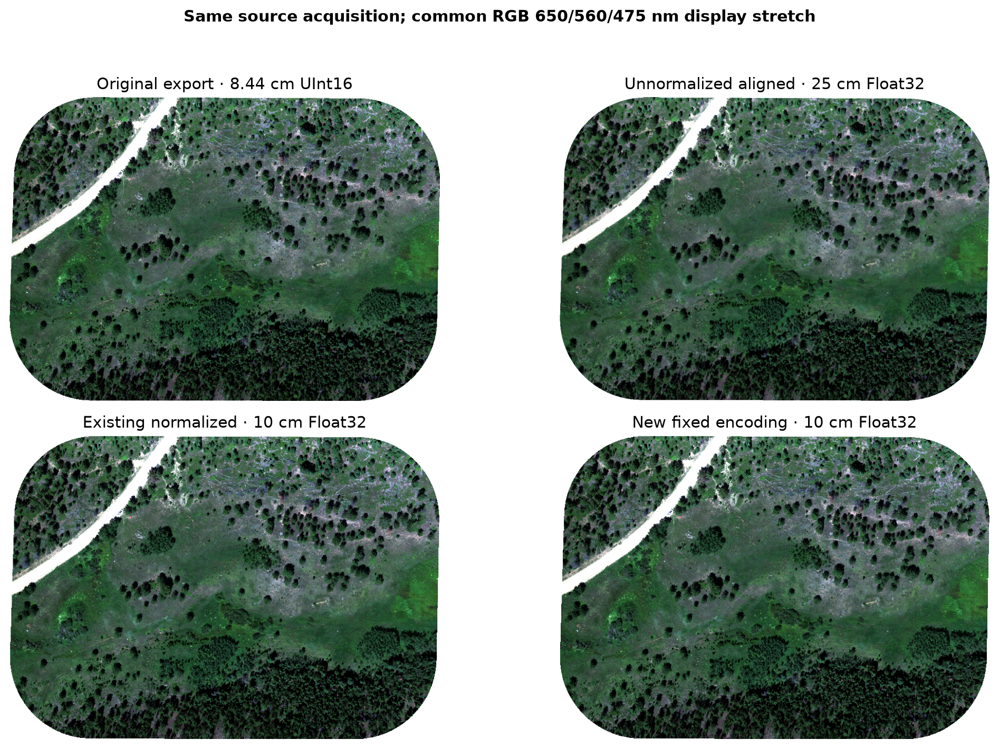
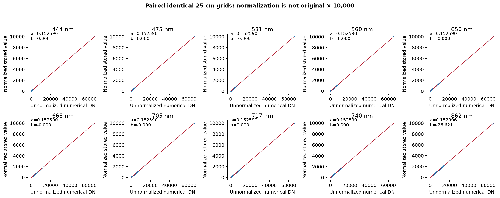
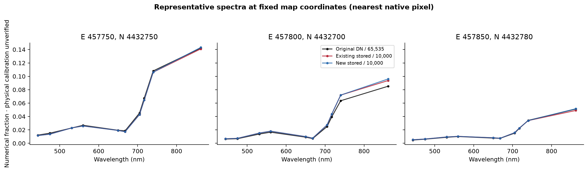
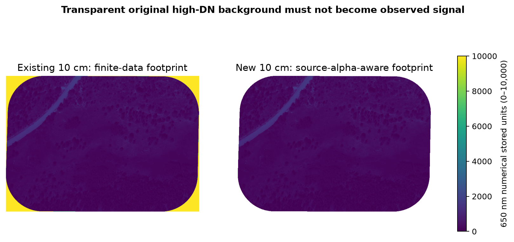

# Goldhill original-source investigation

**November 3, 2026 — read-only source investigation, plus the subsequently authorized separate 10 cm/10K derivative.** Sources and production pipeline code are unchanged.

## Recommendation and delivered file

Use the original `uas-packages` orthomosaic as the preserved starting point for a fresh, documented numerical derivative. It has the native approximately **8.44 cm** grid and a declared alpha footprint. Its physical reflectance calibration is **still unverified**; “original” and a UInt16 dtype do not establish calibrated reflectance.

Following the user's additional instruction, a new processing TIFF was created at:

`/private/tmp/p168-goldhill-sources/derived_10cm_10k/goldhill_10cm_fixed_10k.tif`

It is **3,165 × 2,238 pixels, 10 spectral bands, Float32, EPSG:26913, 10 cm**, using the existing 10 cm grid for alignment. Its encoding is **`S = DN × 10000 / 65535`**, with **zero offset, no per-band minimum subtraction, no clipping and no integer rounding**. Bilinear interpolation excludes original transparent samples; a nearest-source-alpha footprint and finite-data checks define an internal GDAL mask. There are **6,683,944 valid target pixels**. NaN is NoData. The [full derivative record](../../provenance/goldhill-original-source/2026-11-03/derivative_radiometry.json) includes source/output SHA-256, grid, masks, range and processing parameters.

“0–10,000” is the fixed encoding range, **not a requirement to force each observed band's endpoints to 0 and 10,000**. The actual new red range is 0.0071473182–1890.0892; 862 nm is 47.300144–3139.8311. Stretching those observations to fill the range would reintroduce the operation the user asked to avoid. The sidecar explicitly marks physical calibration UNVERIFIED; it must not be replaced with an invented physical multiplier.

## Located source versions

The actual store is CyVerse iRODS, accessed with the existing authenticated `/private/tmp/spectralbridge-gocmd/gocmd`. Live listings of the field-data root, output root, all relevant Goldhill collections and original metadata are retained in the [evidence folder](../../provenance/goldhill-original-source/2026-11-03/datastore_candidate_listings.txt). Directory modification times and owners identify storage records, not proven processing dates/authors. No entire raw-photo archive was downloaded.

| TIFF candidate | Bytes | Width × height | Pixel size m | Total / spectral bands | Type | NoData |
| --- | ---: | --- | ---: | --- | --- | --- |
| Original export | 307,376,470 | 3747 × 2646 | 0.0844275 | 11 / 10 | uint16 | None |
| Upstream aligned | 24,933,344 | 1266 × 895 | 0.25 | 11 / 10 | uint16 | None |
| Output-root aligned | 50,809,794 | 1266 × 895 | 0.25 | 11 / 10 | float32 | NaN |
| Summer unnormalized | 50,809,794 | 1266 × 895 | 0.25 | 11 / 10 | float32 | NaN |
| Summer normalized | 50,790,552 | 1266 × 895 | 0.25 | 11 / 10 | float32 | NaN |
| Existing 10 cm | 315,281,983 | 3165 × 2238 | 0.1 | 11 / 10 | float32 | NaN |
| Georeferenced-to-RGB branch | 284,504,806 | 3168 × 2245 | 0.100089159 | 10 / 10 | float32 | -9999.0 |
| New fixed encoding | 203,818,167 | 3165 × 2238 | 0.1 | 10 / 10 | float32 | NaN |

All eight TIFFs declare EPSG:26913. Full affine transforms, bounds, GDAL scales/offsets, band units/descriptions, metadata namespaces, masks and exact native per-band statistics are in [results.json](../../provenance/goldhill-original-source/2026-11-03/results.json). The delivered source TIFFs report identity GDAL scales and zero offsets, with no band-unit calibration certificate. The original has a declared eleventh alpha band; 11-band derivatives have lost that declaration. The new file has ten spectral bands and a separate internal mask.

Complete locations:

- **Original export:** `/iplant/home/shared/earthlab/macrosystems/field-data/uas-packages/AOP-GOLDHILL-08-14-23-ExportPackage/AOP-GOLDHILL-08-14-23_ORTHO.tif`
- **Upstream aligned:** `/iplant/home/shared/earthlab/macrosystems/field-data/To_Correct/macrosystems/AOP-GOLDHILL-08-14-23-ExportPackage/aligned_orthomosaic.tif`
- **Output-root aligned:** `/iplant/home/shared/earthlab/macrosystems/field-data/output/AOP-GOLDHILL-08-14-23-ExportPackage/aligned_orthomosaic.tif`
- **Summer unnormalized:** `/iplant/home/shared/earthlab/macrosystems/field-data/output/summer-2023/AOP-GOLDHILL-08-14-23-ExportPackage/aligned_orthomosaic.tif`
- **Summer normalized:** `/iplant/home/shared/earthlab/macrosystems/field-data/output/summer-2023-rescale/AOP-GOLDHILL-08-14-23-ExportPackage/aligned_orthomosaic.tif`
- **Existing 10 cm:** `/iplant/home/shared/earthlab/macrosystems/field-data/output/summer-2023-10cm-10k/AOP-GOLDHILL-08-14-23-ExportPackage/aligned_orthomosaic.tif`
- **Georeferenced-to-RGB branch:** `/iplant/home/shared/earthlab/macrosystems/field-data/output/summer-2023_aop_underflight_georef_to_rgb/goldhill_aop_underflight_georef_to_rgb.tif`
- **New fixed encoding:** `/private/tmp/p168-goldhill-sources/derived_10cm_10k/goldhill_10cm_fixed_10k.tif`

An additional original-named TIFF exists in `.../field-data/To_Correct/macrosystems/AOP-GOLDHILL-08-14-23-ExportPackage/AOP-GOLDHILL-08-14-23_ORTHO.tif` (307,376,470 bytes). That duplicate was listed but not downloaded; its identity is not established by equal size alone. Upstream sidecars and the original `Metadata/Metadata.txt` were retrieved separately, preserving the source files. Sidecars contain approximate histograms/statistics, not a documented physical calibration.

Two 25 cm H5s were also freshly retrieved: `NEON_D13_NIWO_test_aligned_orthomosaic.h5` in **both** `summer-2023` and `summer-2023-rescale` Goldhill packages. Each is 86,133,200 bytes, shape **895 × 1,266 × 10**; their hashes differ, and **every finite value in all ten bands matches its neighboring TIFF exactly**. These are genuinely unnormalized and normalized versions, not identical copied H5s. Reflectance datasets have no calibration attributes. Complete H5 schema/scalar metadata, NoData behavior and identities are in [h5_source_audit.json](../../provenance/goldhill-original-source/2026-11-03/h5_source_audit.json).

The live 10 cm collection also contains a 538,348,400-byte H5. This task reuses the previously restored repaired-grid working H5 locally rather than downloading that archived H5 again. Its ten-band finite values and missingness match the freshly downloaded 10 cm TIFF exactly; nonfinite TIFF entries remain missing in the restored H5 (NaN and/or declared sentinel semantics), not observations. It is a derived working copy, not the original photogrammetry export.

## What “rescale” actually did

There are two independent operations. The original approximately 8.44 cm image was **spatially resampled** into a 25 cm float grid and into the 10 cm grid. Separately, a **radiometric numerical encoding** maps original-type DN to 0–10,000.

The two 25 cm float files share **exactly the same grid**, allowing a direct comparison of all corresponding pixels. The output-root and `summer-2023` unnormalized float files have identical values. Across all bands, the normalized file follows:

`S = (DN − minimum_band) × 10000 / (65535 − minimum_band)`.

| nm | Fitted numerical multiplier | Fitted numerical offset | Maximum error vs source-extrema equation |
| --- | ---: | ---: | ---: |
| 444 | 0.152590219 | 2.1084361e-09 | 0.00076883714 |
| 475 | 0.152590219 | 1.0775125e-08 | 0.00076526081 |
| 531 | 0.152590219 | -1.4438228e-10 | 0.00077062531 |
| 560 | 0.152590219 | -6.4389951e-09 | 0.00076593137 |
| 650 | 0.152590219 | -3.3105607e-09 | 0.00077412714 |
| 668 | 0.152590219 | -1.9497293e-09 | 0.00076451574 |
| 705 | 0.152590219 | -3.686614e-08 | 0.00077010376 |
| 717 | 0.152590219 | 1.2370037e-08 | 0.00078038572 |
| 740 | 0.152590219 | 8.8652996e-10 | 0.00077368009 |
| 862 | 0.1529964352 | -26.62138 | 0.0007727067 |

The maximum paired discrepancy is **0.000780386 stored units**, consistent with Float32 precision. The 862 nm original minimum is **174**, producing a numerical offset approximately **−26.6214**; other band minima are zero. Thus **`rescaled = original × 10000` is rejected**. Full fitted slopes/intercepts, R², residuals, ratios with zero-denominator exclusions, differences, means and exact quantiles are recorded for every band in results.json.

The 25 cm UInt16 `To_Correct/.../aligned_orthomosaic.tif` is a separate derivative, not merely the float file rounded to integers. Even on the same declared grid it differs substantially (red full-grid fit R² about 0.0335). Testing nearest, bilinear and average interpolation, with/without alpha, did not reproduce it exactly. Its processing history is unresolved; it is not preferred simply because it is unscaled.

The existing normalized 10 cm TIFF is strongly consistent with original→bilinear resampling→the same normalization: independent red-band RMSE is approximately **0.2194** stored units, versus **112.63** for nearest-neighbor and **13.01** for average without masking. This is an independent numerical hypothesis test, **not an exact replay of the unavailable historical exporter**. The source and destination grids/CRS establish spatial correspondence; the original and derivatives show the same scene, not evidence of a different acquisition.

The separate `georef_to_rgb` branch uses a different approximately **10.0089 cm** grid and ten Float32 bands. It too has numerical extrema 0–10,000. Its red relationship to a simple geospatial warp of the original is weaker (R² approximately **0.799**, fitted RMSE **937** stored units). Additional registration/processing is involved; neither its filename nor range establishes better radiometry or physical calibration. Do not substitute it without its registration/export provenance.

The exact historical normalization/interpolation code was not recovered in tracked notebook source or earlier repository-history investigations. The observed all-band full-raster maximum equals UInt16 maximum, so the files alone cannot distinguish a fixed-type maximum from an observed-maximum implementation. The numerical equation is verified; exact implementation, clipping history and radiometric calibration are unresolved. The original export is UInt16; float derivatives retain non-integer values, demonstrating interpolation/numerical conversion rather than simple integer copying. Missing original photo-processing settings cannot be reconstructed from GDAL identity scales.



*Figure 1. Uncorrected source versions; identical original-derived 2–98% display limits after inverse numerical encoding. Display clipping does not change analyses. Existing finite background is deliberately visible; the new copy honors source alpha.*



*Figure 2. Scatter displays use deterministic subsets; fits and residuals use every finite pair. The 862 nm intercept is approximately −26.62 stored units.*

## Transparent background changes the interpretation

The original has **9,377,010 positive-alpha observations** and **537,552 transparent pixels**. In **every spectral band**, all 537,552 occurrences of **65,535 lie outside positive alpha**; none is an observed saturated measurement. Actual positive-alpha red maximum is **13,214**, and 862 nm maximum is **20,805**. Counts at an endpoint therefore cannot be labeled sensor saturation or clipping rates; no independent sensor-quality flag was supplied. Full endpoint counts and measured versus background subsets are in [mask_and_encoding_audit.json](../../provenance/goldhill-original-source/2026-11-03/mask_and_encoding_audit.json).

The historical float resampling retained that high-valued background without a declared alpha interpretation. The independent red interpolation test reproduces the old 10 cm values closely **only when transparent samples are left in the interpolation**. On the new valid support, **3,244 old red pixels exceed the original observed maximum after the same numerical scaling**; old values there reach 7467.063, while the source-alpha-aware new red maximum is 1890.089. This is evidence of background contamination, not new bright physical observations.

Removing the minimum adjustment alone cannot fix that boundary mixing. The new derivative explicitly fixes both numerical encoding and source-validity handling. It has 6,683,944 valid pixels, versus the historical finite-H5 footprint of 7,068,376 and the earlier recovered-alpha diagnostic footprint of 6,692,436. These masks use different interpolation/support rules and should not be treated as interchangeable. Same-grid NoData agreement counts and exclusive-valid counts are recorded per comparison. No production mask was rewritten.



*Figure 3. Point coordinates in EPSG:26913. Different native footprints/interpolation prevent exact pixel equivalence; none of the plotted fractions is certified physical reflectance.*



*Figure 4. Shared numerical limits show the difference between finite stored background and the original valid observation mask. No BRDF/topographic correction applied.*

## Existing pipeline and scientific status

The active notebook downloads `.../output/summer-2023-10cm-10k` and historically discovers its `NEON_D13_NIWO_test_aligned_orthomosaic.h5`. Source cells and exact input settings are retained in [notebook_source_references.json](../../provenance/goldhill-original-source/2026-11-03/notebook_source_references.json). The documented chain is:

**Original orthomosaic → external resampling/normalization → TIFF/H5 ingestion → source-derived ENVI → topographic correction → BRDF correction → target-band products → physical spectral tables/libraries.**

The archived TIFF/H5 converter supplied zero sensor views; those are placeholders, not recovered rays. The new camera CSV supplies 565 positions and band-specific rotation matrices, but its stated CRS conflicts with the coordinate values and the TIFF, and camera→orthomosaic contributor/blending information remains unresolved. No camera rays or replacement angles are invented here.

Current package fitting/application use the explicit shared contract **`physical = a × stored + b`**, decoding before physical eligibility/correction and inverse encoding on native output. Native-band translation and physical Parquet extraction use the same converter; physical output metadata replaces the inherited storage encoding. Unknown drone calibration fails explicitly. This task changed **no production pipeline code**, defaults or existing outputs.

Both old and new numerical encodings can enter that contract **once original physical calibration is known**. If original `R = c × DN + d`, the new file requires `R = (c × 65535/10000) × S + d`. The old minimum-adjusted file would require a band-specific multiplier **and offset** composed with its inverse. Until `c,d` are established from source calibration, neither numerical range is proof of physical reflectance. A source-correct numerical encoding is useful preparation, not a completed calibration.

The new copy preserves ten-band numerical ratios under one common multiplier and avoids the additional NIR minimum shift. Bilinear 10 cm resampling mixes neighboring observations and cannot be reversed to native pixels; the original remains authoritative. It is the recommended **preprocessing** source under the user's requested fixed encoding, pending calibration and geometry validation for physical correction.

Historical Goldhill corrected imagery, libraries and PFT signatures require fresh versioned regeneration after the previously established calibration/BRDF failures are resolved. The new mask and encoding additionally warrant restarting from the preserved original for that regeneration. Merely replacing raster metadata cannot remove interpolated background contamination or repair old fitted coefficients. No historical production products were regenerated or overwritten here.

## Reproduce and verify

```bash
# After retrieving the original and the existing 10 cm grid template:
python provenance/goldhill-original-source/2026-11-03/create_fixed_10k.py \
  /path/to/AOP-GOLDHILL-08-14-23_ORTHO.tif \
  /path/to/existing_10cm/aligned_orthomosaic.tif \
  /path/to/fresh/goldhill_10cm_fixed_10k.tif
```

The creator refuses an existing destination. Processing holds one source and destination band at a time, plus spatial masks; it does not allocate a full ten-band output cube. Source datasets are read-only. Two synthetic contract cases independently verify zero retention, nonzero-minimum preservation, transparent-background exclusion, 5→10 cm interpolation, mask propagation and refusal to overwrite. Real-data comparisons/figures use actual sources; synthetic checks do not imply empirical physical calibration.

The [verification record](../../provenance/goldhill-original-source/2026-11-03/verification.json) records protected hashes, derivative properties, test results and unchanged production code. Four PNG/SVG figures were visually checked. No datastore upload, release, metadata rewrite of original sources or production rerun occurred. Missing physical calibration, exact export script, original raw-photo settings and usable per-pixel viewing/contributor geometry remain explicit dependencies. The [P167 radiometric report](../reports/RADIOMETRIC_SCALING_VALIDATION.md) and [photogrammetry investigation](photogrammetry-metadata-investigation.md) provide the preceding evidence boundaries; this investigation adds a fresh source inventory and the transparent-65,535 finding.
