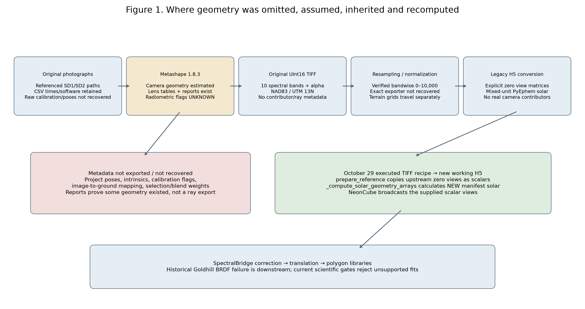
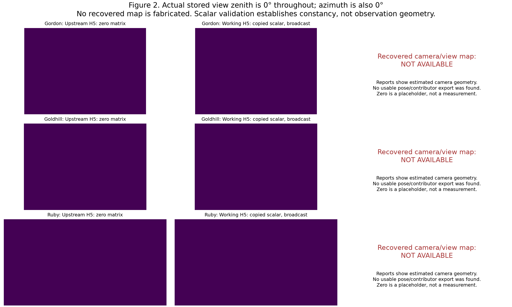
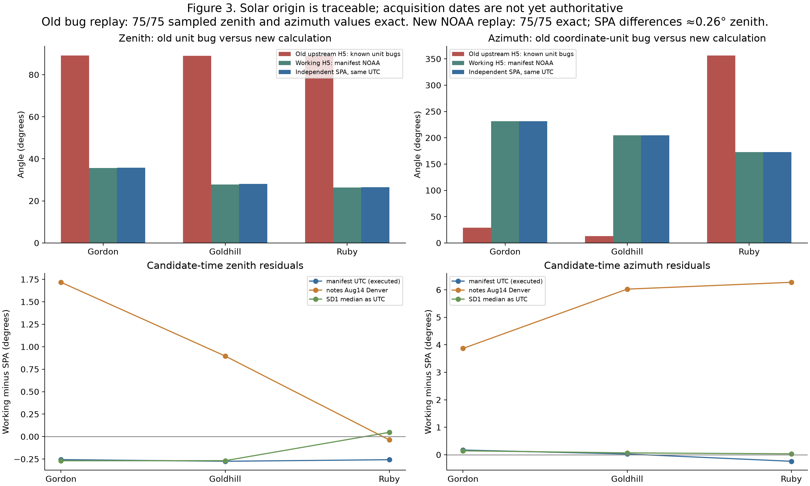
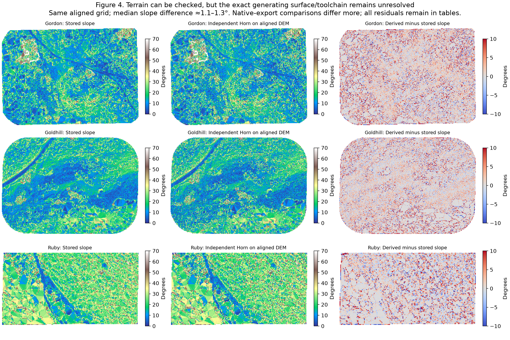
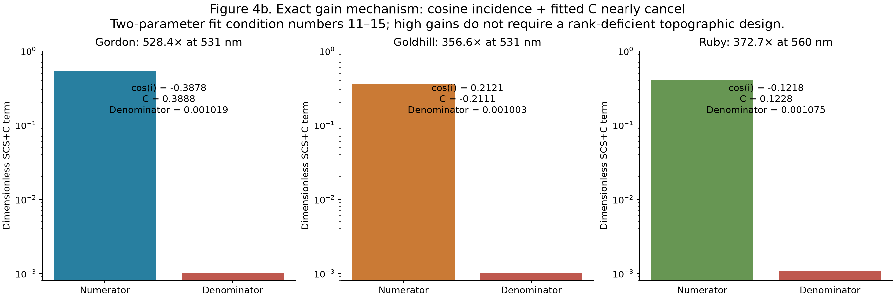
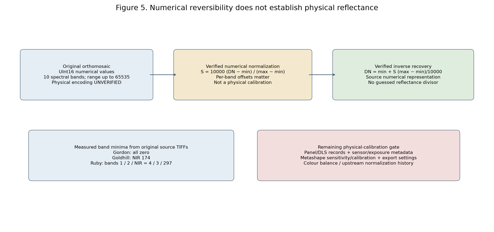
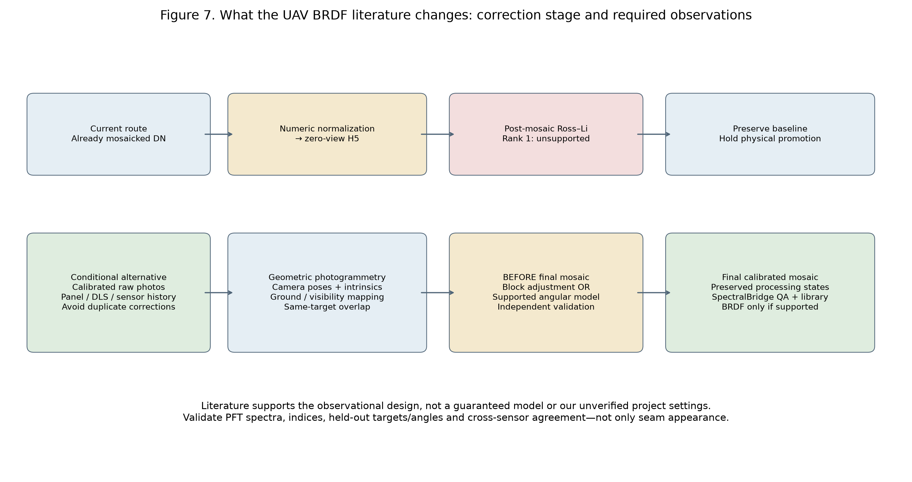
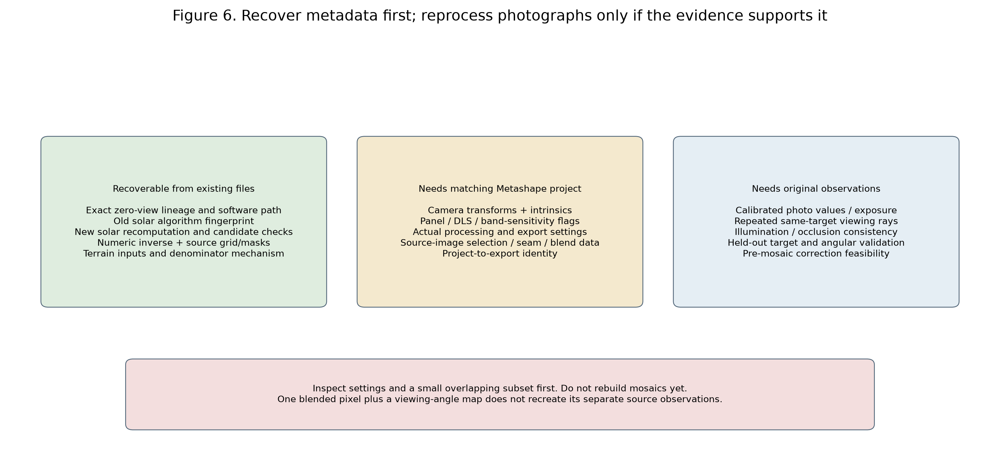

# Where Did the Drone Geometry Go? Tracing Photogrammetry Metadata into SpectralBridge

2026-11-02. **Read-only provenance and recovery investigation.** Includes the additional UAV BRDF literature request in this same report. No production files, algorithms, coefficients, orthomosaics or libraries were changed.

## Executive findings and corrections to the earlier account

1. **Some geometric information demonstrably existed during photogrammetry.** The three processing reports identify Agisoft Metashape Professional 1.8.3 build 14331 and contain aligned-camera, lens-calibration and estimated-location information. That establishes photogrammetric estimation, not availability of a usable camera-pose/contributor export or a physical reflectance calibration.
2. **The zero views are deliberate placeholders in the archived converter.** `tiff_to_h5` in `drone_cor_sup/utils.py` at Git snapshot `94ef270` explicitly creates zero sensor-angle matrices. The October 29 executed `prepare_reference` recipe copies their constant values into scalar options, `convert_drone_tiff_to_h5` writes them, and `NeonCube.get_ancillary` broadcasts them. The current writer defaults are None, not zero, and the reader does not invent missing view angles. A snapshot author or storage owner is not identified as the original executor.
3. **The upstream and rebuilt solar grids are different.** Archived PyEphem code reproduces all 75 checked old zenith and azimuth values **bit-for-bit** when replayed with its coordinate and altitude unit errors. The working H5s instead explicitly record `solar_geometry_source=manifest_computed`; the actual manifest/NOAA calculation reproduces all 75 new checked values exactly. This corrects P161's incomplete solar-origin account; rank-one BRDF, masks and spectral results do not change.
4. **The rebuilt solar angles are plausible approximations at the executed timestamps, not validated acquisition geometry.** Independent pvlib SPA differs by about 0.26–0.27° in zenith at those times. August 14 notes conflict with August 15 CSV timestamps; Ruby's executed manifest is August **16**. UTC/Denver conversion does not reconcile these dates.
5. **High SCS+C gains are exact denominator cancellation.** The full prior topographic numerical outputs replay exactly for all 30 bands. Their two-parameter fitting matrices have modest condition numbers 11–15, but `cos(i)+C` approaches 0.001. Gordon/Ruby's worst cases have negative cosine incidence; Goldhill's positive incidence cancels a negative fitted C. Unknown terrain provenance remains separate; large gains alone do not prove a degree/radian error.
6. **Absolute radiometry and duplicate upstream corrections remain unresolved.** UInt16, lens “precalibration”, Mosaic blending or smooth colours do not establish panel/DLS calibration. No matching project flags or raw calibration records were found. Original-image block/angular correction is a literature-supported possibility, not a demonstrated capability of these stored mosaics.

## 1. Processing history: documented evidence versus reconstruction



| Stage | Inputs → outputs | Spatial / radiometric / geometry operations | Evidence and confidence |
| --- | --- | --- | --- |
| Acquisition | M300 SD1/SD2 photos → image metadata CSVs | Raw camera/image geometry and exposure could exist in originals, but six CSVs preserve only filename, TIFF time and camera software | CSV snapshots are observed; original files and timezone not recovered. Software v7.3.2 is camera-tag information, not the photogrammetry version |
| Photogrammetry | Overlapping photographs → aligned cameras, calibration, cloud/mesh/DEM, orthomosaic | Metashape 1.8.3 estimates camera geometry; reports give geometric calibration and terrain products | Reports prove recorded project states. Gordon/Ruby record Mosaic blending and DEM surface; Goldhill's supplied report does not list an orthomosaic task. No project settings export recovered |
| Original orthomosaic export | Project ortho → UInt16 ten-band TIFF plus alpha | Project-to-export crop/resolution/settings history unresolved; original TIFFs preserve NAD83 UTM13 and north-up grids | Report ortho dimensions differ from some final TIFFs; Ruby is explicitly CLIPPED. Do not treat report reconstruction settings as a verified exact final-export recipe |
| Terrain generation | LAS / DEM / classified DTM → aligned elevation, slope, aspect | Available R code intends ground classification and 0.25 m TIN, degree slope/aspect, then scalar bilinear resampling | The configured script and matching-named outputs exist, but no signed execution log/settings link establishes exact terrain provenance |
| Numeric preprocessing | Original UInt16 → 25 cm / rescaled / current 10 cm TIFF | Band-specific original-extrema map to 0–10,000 is numerically verified. Independent 10 cm export replay is not exact, including known border residuals | P159/P160 measured original/base/rescale/current evidence; exact normalizer/export code not located |
| Upstream TIFF → H5 | Current TIFF/terrain and computed angles → `NEON_D13_NIWO_test_aligned_orthomosaic.h5` | First ten bands; explicit zero view matrices; legacy map-info defects; mixed-unit solar calculation | Archived code matches schema and exact solar fingerprint; no per-file run log proves one named notebook or human executor |
| October 29 reconstruction | Ten-band verified TIFF recipe → new working H5 → ENVI | Copies upstream zero views as scalar inputs, preserves spectral values and repaired grid, recomputes NOAA solar from bundled manifest. Path_Length becomes an array of ones | Executed `reprocess.py`, pipeline audits, source recipes, code snapshot/patch and working-H5 group attributes; this is more than a code-only possibility |
| Corrections and libraries | Native ENVI → historical SCS+C/BRDF → translation and polygon tables | Historical unverified-scale correction and unsupported model created Goldhill artifact; later validation gates reject such fits | Exact previous ablations/replays and P158–P161 audits. Spatial success is not calibration or correction approval; libraries remain historical/unapproved |

The current implementation still shares physical radiometry and correction functions between NEON and drone routes, with distinct source contracts. It does not create real drone views merely by using NEON-compatible field names. No Metashape pose/contributor dataset was found entering the inspected TIFF/H5 conversion. Whether it was deliberately omitted at export, remains in a project, or exists elsewhere cannot be resolved without the original project identity.

### Bounded source search

New read-only inventories cover original export packages, upstream To_Correct packages/metadata, the exact Goldhill 10 cm source collection, shared processing roots `Drone_topo_corr`, `Topo_Corr`, `cross-sensor-cal`, and the earlier diagnostics run. P161's shared-root and relevant project inventories were reused. No matching `.psx/.psz/.files`, camera export, seam/contributor map or panel/DLS record was located in those inspected collections or repository history. Unrelated Table Mountain projects are not evidence for these flights. Relative `aop/.../RawData/M300/SD1|SD2` and historical local `data_set2` locations remain unresolved; no entire raw-photo collection was downloaded.

`source_inventory.json` records bounded remote object paths/sizes/storage metadata and local SHA-256 hashes. Unretrieved remote objects have explicit null hashes, not invented checksums. Object owner/mtime do not establish processing authorship/date. Reports, small terrain exports, paired aligned elevation and four open research papers were downloaded/read; current and original source rasters remain unchanged.

## 2. Viewing geometry: what was replaced, and by what?



Archived `tiff_to_h5` contains:

```python
sensor_zenith_data = np.zeros(img_shape)
sensor_azimuth_data = np.zeros(img_shape)
```

Its schema and malformed map-info formula are consistent with the upstream H5s; related notebooks retain executed cell counters and explicitly describe zero as nadir. The earliest recovered copy is the April 23, 2025 snapshot, not a proven original creation date. `code_evidence.json` preserves the exact function excerpts, blob hash and history. We do not infer execution for a specific flight solely from the presence of a notebook.

The October 29 chain is directly documented: `prepare_reference` reads every source view matrix in strips, checks finite constancy, writes its two constants into `source_recipe.json`, and returns `tiff_sensor_zenith_deg` / `tiff_sensor_azimuth_deg`. The TIFF bridge receives those explicit values and writes scalar H5 datasets. `NeonCube.get_ancillary` expands scalars to the image shape; missing geometry raises an error. The helper's “validated finite scalar” check proves constancy and numeric finiteness, not physical viewing validity.

Thus no evidence supports blaming a Metashape zero-view export or an automatic NEON-schema default. The algorithmic placeholder lineage is identifiable. The identity of the original human executor is not established by Git authorship, notebook counters, or Data Store ownership.

Reports show that camera positions and lens models were estimated. Aligned-camera exterior geometry is needed by photogrammetry, but its machine-readable transforms and image/ground associations are not present in our inspected TIFF/H5s. Geometric lens “precalibration” is not radiometric calibration. A camera-location illustration or table does not recover the precision and conventions required to trace all rays to vegetation targets.

## 3. Solar geometry: exact lineage and independent verification



The archived `get_computed_azimuth_zenith` assigns numeric degree-valued latitude/longitude to PyEphem Observer properties, whose numeric angles are radians, and calculates `zen = 90 - sun.alt` even though `sun.alt` is radians. Its converted `alt` variable is not used. Replaying these two errors with the source-grid coordinates and recorded timestamps reproduces all sampled old arrays exactly, including old zeniths near 89° and the anomalous azimuths. The evidence is a strong numerical/code fingerprint; it does not identify the exact historical runtime version or human execution.

The rebuilt working metadata states `manifest_computed` and the actual datetime. The source function `_compute_solar_geometry_arrays` computes a NOAA fractional-year approximation at each **pixel-center latitude/longitude**, but uses **one timestamp per mosaic**. It does not use per-photo times, terrain elevation, atmospheric refraction or source-image contributions. Metadata attributes and executable reconstruction prove this origin; the earlier statement that solar generation provenance was absent was incomplete because it omitted Metadata-group attributes.

| Flight | Executed UTC | Working zenith / azimuth (°) | Independent SPA zenith / azimuth (°) | Working minus SPA (°) |
| --- | --- | ---: | ---: | ---: |
| Gordon | 2023-08-15T20:58:39+00:00 | 35.5674 / 231.4043 | 35.8237 / 231.2322 | -0.2563 / +0.1721 |
| Goldhill | 2023-08-15T19:53:07+00:00 | 27.7649 / 204.6958 | 28.0396 / 204.6683 | -0.2747 / +0.0276 |
| Ruby | 2023-08-16T18:53:18+00:00 | 26.3028 / 172.6491 | 26.5599 / 172.8856 | -0.2572 / -0.2365 |

pvlib 0.16.1 NREL SPA was evaluated independently with zero pressure and altitude zero to compare geometric angles; PyEphem 4.2.1 was isolated for historical replay. Neither library was installed into the project environment. The new NOAA arrays reproduce exactly at 25 dispersed source-grid cells per flight. “Exact” refers to numerical replay, not verified observation truth.

The six CSV timestamp spans are about 30.1 minutes for Gordon, 28.7 minutes for Goldhill and 24.9 minutes for Ruby, but these are band-file timestamp spans, not independently verified image exposure/flight intervals. Notes state August 14 (14:47 / 13:41 / 12:42); CSVs state August 15 without timezone; executed manifest is August 15 for Gordon/Goldhill and August 16 for Ruby. Converting the CSV evening times from UTC to Denver leaves August 15. Treating them as Denver wall times changes the UTC date/time but does not make the observed notes agree. A timezone conversion alone does not resolve the discrepancy.

`solar_candidate_comparison.csv` retains note times interpreted as UTC and Denver, both card-median times under both interpretations, executed manifest times and a date sensitivity. Similar solar angles on neighbouring dates cannot establish which date is correct. A source flight log and raw EXIF/XMP are still needed, especially for Ruby. Current angles are plausible and unit-consistent at their configured timestamps, but those timestamps are not authoritative acquisition proof.

## 4. Terrain metadata and the SCS+C extremes



Original exports include DEMs/DTMs and LAS files. Metashape reports specify Gordon's reported DEM from tie points and Goldhill's from a mesh; Ruby's supplied DEM section omits its source. These project snapshots do not establish the exact generating surface for every exported/aligned file. The file names “DEM” or “DTM” alone do not prove canopy versus bare-earth content or vertical datum.

A newly inspected, non-placeholder `dsm_to_slope_aspect.R` explicitly configures clipped LAS ground classification, a 0.25 m TIN terrain model, slope/aspect in **degrees**, and subsequent bilinear resampling. An earlier R alignment template also derives slopes before resampling. These show intended operations and clockwise-North aspect convention. Presence of the scripts and matching output names is not proof that their exact parameters were executed for each of the current 10 cm products. Scalar bilinear aspect interpolation can mix across North; the exact processing history must be recovered before assigning that mechanism to all observed differences.

All current slope/aspect TIFF values match the working H5 exactly. Their CRS/dimensions align with the input spectral grid, with only the previously documented coordinate-rounding allowance. Source TIFF angle units are not labelled. SpectralBridge treats them as degrees and converts once to radians before `calc_cosine_i`; solar azimuth is clockwise from true North. Horn terrain aspect is referenced to projected grid North, so the convention/convergence must be handled explicitly in any definitive reconstruction.

The exact paired `aligned_dem.tif` files were retrieved, and independent Horn 3×3 derivatives were calculated without modifying them. This is a source-supported diagnostic, not a proposed production correction. It distinguishes the reconstruction candidate from the stored terrain; it is not asserted to reproduce the unknown terra settings or derivative order.

| Flight | Aligned DEM resolution (m) | Median absolute slope difference | Median circular aspect difference |
| --- | ---: | ---: | ---: |
| Gordon | [0.09999999999999605, 0.0999999999999108] | 1.257° | 5.728° |
| Goldhill | [0.1, 0.09999999999991677] | 1.140° | 5.142° |
| Ruby | [0.1, 0.1] | 1.163° | 3.326° |

Native DEM/DTM-before-bilinear candidates differ more. Full 1st/median/99th/extreme errors and masks remain in `validation.json`; no large residuals were trimmed. Near-flat aspect, interpolation, surface/version choice and derivative-before/after-resampling all affect these comparisons. They do not establish one simple unit mismatch or justify silently replacing metadata.



| Flight | Worst band (nm) | Gain | cos(i) | C | Denominator | Formal SE(C) | Two-term design condition |
| --- | ---: | ---: | ---: | ---: | ---: | ---: | ---: |
| Gordon | 531 | 528.41× | -0.387761 | +0.388781 | 0.001019 | 0.006448 | 11.03 |
| Goldhill | 531 | 356.55× | +0.212128 | -0.211125 | 0.001003 | 0.001072 | 14.75 |
| Ruby | 560 | 372.71× | -0.121753 | +0.122828 | 0.001075 | 0.005403 | 12.13 |

The existing numerical SCS+C formula is `factor = (cos(solar_zenith)*cos(slope)+C)/(cos(i)+C)`, with a historical neutral guard below denominator 0.001. The worst allowed positive denominators lie just above that guard. All 30 source-DN band fits/application outputs are replayed exactly against P161's arrays. This shows the cause of those gains: numerator/denominator cancellation, weak empirical response relationships and some back-facing illumination. It does not require a rank-deficient topographic design. Formal pixel-OLS SE(C) is comparable to or larger than the extreme denominator, and assumes independent residuals; spatial correlation makes it an optimistic diagnostic, not an uncertainty certification. Goldhill's worst band has a negative C; Gordon/Ruby's worst cases have positive C offsetting negative cosine incidence.

Actual terrain provenance, canopy/ground choice, shadows and the acquisition-time convention could affect the fitted coefficients. This experiment does not certify those inputs, nor claim metadata errors alone caused the gains. No gain cap, angle replacement, algorithm change or corrected product was introduced.

## 5. Radiometric provenance and upstream operation states



The original TIFFs are UInt16 with identity TIFF scales/offsets and no verified physical-unit metadata. The Metashape reports describe ten-band UInt16 colour storage, which does not establish calibrated reflectance. Original values were later transformed independently by band into 0–10,000; that numerical mapping and its inverse are verified by P159/P160, including nonzero offsets and unresolved 10 cm border residuals. The exact normalizing exporter is still not identified.

The documented vendor 32768 encoding would be relevant only if the actual project used its calibrated reflectance/sensitivity/export conventions. We have not recovered that evidence. A “Mosaic” blending mode records mosaicking; it is **not** proof of exposure correction, radiometric block adjustment, colour balancing, panel calibration or BRDF normalization. Gordon/Ruby report snapshots list Mosaic mode; Goldhill's report does not contain the ortho settings. Some final TIFF dimensions differ from report rasters, further limiting exact settings attribution.

| Operation | Photogrammetry state | SpectralBridge evidence | Duplication conclusion |
| --- | --- | --- | --- |
| Reflectance panel calibration | UNKNOWN | No separate verified equivalent operation demonstrated in the audited run | NOT_ESTABLISHED; cannot exclude upstream execution |
| Downwelling irradiance correction | UNKNOWN | No separate verified equivalent operation demonstrated in the audited run | NOT_ESTABLISHED; cannot exclude upstream execution |
| Exposure/gain normalization | UNKNOWN | No separate verified equivalent operation demonstrated in the audited run | NOT_ESTABLISHED; cannot exclude upstream execution |
| Lens vignetting correction | UNKNOWN | No separate verified equivalent operation demonstrated in the audited run | NOT_ESTABLISHED; cannot exclude upstream execution |
| Camera-specific radiometric calibration | UNKNOWN | No separate verified equivalent operation demonstrated in the audited run | NOT_ESTABLISHED; cannot exclude upstream execution |
| Brightness/color balancing | UNKNOWN | No separate verified equivalent operation demonstrated in the audited run | NOT_ESTABLISHED; cannot exclude upstream execution |
| Radiometric block adjustment | UNKNOWN | No separate verified equivalent operation demonstrated in the audited run | NOT_ESTABLISHED; cannot exclude upstream execution |
| BRDF/angular normalization | UNKNOWN | Historical BRDF applied; invalid model diagnosed | NOT_ESTABLISHED; cannot exclude upstream execution |
| Orthomosaic Mosaic blending | ENABLED in Gordon/Ruby report snapshots; Goldhill ortho setting UNKNOWN | No orthomosaic reconstruction in the three-flight run | Not a proof of brightness/color balancing or physical reflectance |

No duplicate upstream/downstream BRDF or radiometric calibration has been demonstrated. Because the upstream flags are unknown, duplication cannot be excluded. SpectralBridge demonstrably applied its own historical SCS+C and unsupported BRDF, but this does not establish that Metashape had or had not already normalized angular effects. Separate visually balanced imagery from physically calibrated reflectance. Physical conversion requires actual calibration coefficients, band sensitivity, exposure/DLS/panel provenance and export/colour-operation records, potentially differing by band and flight.

## What the UAV BRDF Literature Tells Us About Our Pipeline

The four named papers were retrieved as complete publisher/author PDFs and their methods read, not just abstracts. Bibliographic identities, DOI, source hashes and method sections are retained in `literature.json` and `source_inventory.json`.

| Paper | Verified method | Implication for our actual files |
| --- | --- | --- |
| [Honkavaara and Khoramshahi (2018)](https://doi.org/10.3390/rs10020256) | Calibrated sensor images, camera model/DSM-projected repeated radiometric tie points and reference panels enter a weighted joint adjustment of per-image relative gains, absolute reflectance transformation and empirical Walthall anisotropy terms. Model selection/weights depend on illumination and object conditions; outputs follow adjustment. | Need calibrated original images, per-image camera/visibility geometry, panels or justified irradiance constraints and sufficient supported observations; an uncalibrated mosaic or generic overlap count is insufficient. Their Walthall formulation is not our LiDenseR implementation. |
| [Crucil, Zhang, Pauly and Van Oost (2022)](https://doi.org/10.3390/rs14030537) | Uses bundle-adjusted orientation, camera intrinsics and sun geometry to form per-image relative angles and ANIF normalization before final Pix4D orthomosaics. Training deliberately selects flat homogeneous bare soil; manufacturer radiometric/vignette/black-level processing is handled before corrected imagery enters the final mosaic stage, with separate validation. | Recover camera orientation/intrinsics and input calibration before applying an angular model. Preserve processing flags to avoid rerunning upstream radiometric operations. Do not transfer a bare-soil ANIF model to shrub/tree PFTs without validation. |
| [Ahn, Kim, Lim, Jin, Kim and Choi (2025)](https://doi.org/10.3390/rs17010151) | Separates irradiance, vignetting and BRDF using calibrated reference instrumentation, a reference tarp and purpose-designed dome/vignette flights; derives image filters and evaluates separate validation mosaics and overlap settings. It is a DJI M3M-specific field workflow, not proof that any Metashape mosaic already received BRDF correction. | Inventory raw calibration, irradiance and upstream filter settings. Cleaner seams do not establish PFT reflectance accuracy, and their calibrated directional acquisition cannot be assumed for our mapping flights. |
| [Cao et al. (2023)](https://doi.org/10.3390/rs15205000) | Designs target-centred hemispheric multi-angle acquisition, reconstructs camera/sun geometry and uses reference-panel observations before comparing M-Walthall, RPV and RTLSR models. Their experimental model ranking is domain-specific and RTLSR uses LiSparseR, not a general endorsement of LiDenseR. | Require same-target repeated observations and assess actual angular conditioning; overlapping mapping photos or a spatial angle map alone do not establish identifiability. Do not choose RPV or another model merely because it performed best there. |



These studies support a **conditional pre-final-mosaic investigation**: retain original calibrated observations and geometric photogrammetry, map the same targets into overlapping images, then estimate supported image-level radiometric and/or angular effects before final mosaicking. This can follow geometric alignment; “before orthomosaic” does not mean before camera bundle adjustment. They do not establish that Metashape ran any such correction in our projects, that our ordinary mapping overlap covers enough angles, or that a particular model should replace Ross–Li.

Honkavaara/Khoramshahi's joint adjustment separates absolute panel calibration, relative image effects and empirical anisotropy under specified constraints. Crucil et al.'s ANIF work explicitly uses homogeneous flat bare soil and adjusts the radiometric-processing sequence before corrected imagery enters the mosaic stage. Ahn et al. use specially designed calibration/validation flights and instruments; a clean seam is not independent PFT accuracy. Cao et al. use planned same-target multi-angle observations and compare several models; their model ranking is not universal. None justifies fitting coefficients to an uncalibrated rank-one H5 or inventing per-pixel rays.

### Our three candidate strategies

| Strategy | Available | Missing / assumptions | Actual feasibility and validation |
| --- | --- | --- | --- |
| A. Existing post-ortho Ross–Li | Repaired grid, DN, zero placeholders, configured solar | Genuine angular observations, verified calibration, valid rank/conditioning | **Unsupported for these three files.** No relaxed threshold or new algorithm; prior full-scene result preserved |
| B. Original-image radiometric block adjustment | Reports prove alignment and geometric calibration existed; raw paths referenced | Calibrated original images, per-image camera/ground visibility, radiometric tie points, panel/irradiance constraints and separability of illumination versus scene effects | **Potential, not demonstrated.** Recover project/settings then a bounded overlap subset; test independent targets and preserved spectra before selecting a model |
| C. Original-image angular correction | Geometry could be derived from a matching project and terrain | Actual repeated same-target observations, sufficient angular coverage, calibrated/stable illumination, occlusion checks and supported reference domain | **Potential, not demonstrated.** Test identifiability/held-out directions; Ross–Li, RPV or ANIF must each earn support rather than inherit a literature ranking |

### PFT and cross-sensor implications

The goal is preserved biological spectra, not uniform colour. A flexible image gain or homogeneous-surface angular model could suppress genuine PFT/species/structure differences when vegetation varies with illumination or viewing geometry. Use the existing validated researcher polygons as identities, keep photo/target and polygon/spatial groups intact across training and testing, and compare calibrated per-band bias, spectral angles, indices, within-PFT dispersion and between-PFT structure on independent targets/angles. Preserve non-vegetated/dead as a separate cover comparator. Lower variance alone is not calibration proof; camera observations of the same polygon must not become independent held-out replicates.

For cross-flight/NEON comparisons, first verify physical units, actual footprint/date/phenology and correction state, then use matched independent observations. Synthetic common-reference translations and cleaner mosaics do not establish empirical transferability. No new PFT analysis was duplicated here; P161's 301-polygon results remain evidence of mixed numerical effects, not upstream calibration truth.

### Two distinct artifact questions

- **Confirmed downstream failure:** Goldhill's extreme red streak originates in historical SpectralBridge BRDF. P156/P160 stage ablation and exact replay establish this; rescaling does not remove it. The literature does not reassign it to Metashape.
- **Unresolved upstream variation:** Raw mosaics contain spatial/spectral variation and may contain smaller illumination or mosaicking discontinuities. Raw neighbouring-pixel differences cannot distinguish terrain, vegetation, shadow or camera seam causes without contributor/pose/irradiance evidence or controlled invariant targets. No new upstream-seam causal claim is made.

## 6. Metadata provenance matrix and recovery decisions



| Metadata | Original source | Photogrammetry | TIFF | H5 | Status |
| --- | --- | --- | --- | --- | --- |
| Camera position | Raw GNSS not recovered | ESTIMATED: report camera-location figures and alignment | MISSING | MISSING | MISSING_FOR_RECOVERY |
| Camera orientation | Raw attitude not recovered | ESTIMATED: aligned cameras; Yaw/Pitch/Roll convention documented | MISSING | MISSING | MISSING_FOR_RECOVERY |
| Camera intrinsics / lens | Original sensor records unavailable | DERIVED/GEOMETRIC: numerical calibration tables in reports | MISSING | MISSING | PARTLY_RECOVERABLE |
| Camera timestamps | RECORDED in six SD CSV snapshots; timezone unverified | UNKNOWN per exposure/project | Not preserved in inspected ortho tags | Single manifest datetime; not per-observation | UNVERIFIED |
| View zenith | Can derive only from rays/ground, not recovered | Camera geometry implies possible ray reconstruction | MISSING | PLACEHOLDER: old matrix 0; working scalar 0 | PLACEHOLDER |
| View azimuth | Can derive only from rays/ground, not recovered | No per-pixel contributor export found | MISSING | PLACEHOLDER: old matrix 0; working scalar 0 | PLACEHOLDER |
| Solar zenith | Date/time/position records conflict | UNKNOWN: not established as Metashape output | MISSING in inspected input ortho metadata | DERIVED: old mixed-unit PyEphem bug; working NOAA manifest calculation | DERIVED_UNVERIFIED_TIME |
| Solar azimuth | Date/time/position records conflict | UNKNOWN | MISSING | DERIVED: old coordinate-unit bug; working NOAA calculation | DERIVED_UNVERIFIED_TIME |
| Source-image contributors / blend weights | Original overlapping images referenced, not found | Gordon/Ruby report Mosaic blending; Goldhill ortho settings absent | MISSING | MISSING | MISSING_FOR_RECOVERY |
| DEM / elevation | LAS and native DEM/DTM exports present | DERIVED: Gordon tie points; Goldhill mesh; Ruby DEM source unlisted | PRESENT: exact target aligned_dem now retrieved | Elevation absent as named field; Path_Length is not elevation | DERIVED_SOURCE_UNVERIFIED |
| Slope | Derived terrain, exact source surface not established | Not a required photogrammetry export in inspected reports | PRESENT aligned_slope; degree-unit R scripts | PRESENT; exact TIFF equality | DERIVED_PARTLY_VERIFIED |
| Aspect | Derived terrain, exact source surface unverified | UNKNOWN | PRESENT; scripts specify clockwise North degrees and scalar bilinear resampling | PRESENT; exact TIFF equality | DERIVED_PARTLY_VERIFIED |
| Illumination / cosine incidence | Requires credible terrain and acquisition geometry | UNKNOWN | No authoritative solar/illumination raster metadata | DERIVED by calc_cosine_i, degree-to-radian boundary | DERIVED_UNVERIFIED_INPUTS |
| Path length | No actual camera-ground distances recovered | Potentially derivable from rays/project | Not a measured spectral band | Working bridge writes array of ones | PLACEHOLDER |
| Reflectance-panel calibration | Panel images/certificate not located | UNKNOWN enabled/disabled | No physical unit/certificate | UNVERIFIED | UNVERIFIED |
| DLS / irradiance | Original raw EXIF/XMP not located | UNKNOWN enabled/disabled | Not retained in inspected tags | MISSING | UNVERIFIED |
| Exposure / gain / vignette | Raw camera radiometric metadata not recovered | UNKNOWN applied/settings | Not retained as original-image parameters | MISSING | UNVERIFIED |
| UInt16 physical encoding | Original files UInt16, minima/maxima recorded | 10-band UInt16 in reports; physical semantics UNKNOWN | Identity TIFF scales/offsets; no physical units | Scale_Factor=1 on working bridge is not calibration | UNVERIFIED |
| Numeric min/max normalization | Verified original-extrema mapping | Not established as Metashape operation | DERIVED: per-band S to 0..10000 | Same spectral numbers, later inverse recoverable | NUMERIC_MAPPING_VERIFIED |
| Spatial reference / orientation | NAD83 UTM13 exports | EPSG26913 in reports | North-up source transform | Old signed size/datum/corner defects; working TIFF-corner repair | SPATIAL_VERIFIED |
| Researcher labels / library provenance | Researcher polygons with IDs/categories | Not a photogrammetric radiometric validation | External polygon dataset | Extracted by fixed spatial memberships | PRESERVED_NOT_RADIOMETRIC_TRUTH |

`metadata_provenance_matrix.json/.csv` retain exact evidence references beyond this display table. Measured source-camera values are not asserted where only CSV snapshots, reports or placeholders exist.

### Recovery without rebuilding mosaics

Existing files already support numeric inversion, source-grid validation, current solar recomputation at explicitly chosen times, exact placeholder lineage and terrain diagnostics. **Authoritative solar geometry and physical encoding may be recoverable as sidecar metadata without rebuilding an ortho**, once their missing source records are supplied.

Camera/view recovery for an existing mosaic needs the matching project's transforms/intrinsics and its source-image selection or blending information. Contributor-specific rays and weights should remain separate; a blend does not automatically have one physical view. Even a recovered effective angle map does not restore repeated source observations of the same target from a single blended pixel. Pre-mosaic fitting generally needs the original calibrated photographs or retained per-image radiometric observations. No camera reconstruction or physical calibration experiment was performed because those prerequisites were not established.

### Prioritized next step and minimal implementation proposal

1. Obtain the matching Metashape project **with complete .files references**, task/settings export and original-image references. First inspect metadata, not a complete new photogrammetric run. Export camera/sensor/chunk transforms, coordinate/height conventions and the exact project-to-TIFF identity.
2. Recover panel certificate/images, DLS/exposure/sensor records, Normalize band sensitivity and all colour/radiometric/angular settings. Resolve absolute units and whether anything would be duplicated before applying a new correction.
3. Resolve actual dates/timezones, especially Ruby, with raw EXIF/XMP and flight logs. Record per-photo timing and the mosaic time policy; distinguish grid versus true North and terrain surface/version.
4. Add a small **read-only metadata preflight/sidecar exporter** using existing H5/TIFF readers and project version-aware inspection. Preserve observational/derived/placeholder flags, source hashes, calibration equations and correction-operation state. Do not interpret missing flags as false, default zeros as measured, or automate scientific repairs.
5. Only if a calibrated overlapping subset and trustworthy poses/terrain exist, test same-target rays, visibility, angular conditioning and held-out predictions before deciding among no-extra-BRDF, pre-mosaic block adjustment or an angular model. Reprocessing original photographs is conditional, not the first action. No orthomosaics or libraries are regenerated here.

The smallest defensible immediate change is metadata recovery and explicit eligibility reporting, while retaining the existing fail-closed BRDF behavior. Shared scientific equations can remain; drone correction policy may differ from NEON because the observation evidence differs. No broad refactor or speculative correction implementation is warranted.

## Reproduction, source preservation and remaining limits

Run the new `validate.py`, `terrain_extensions.py`, `build_records.py`, `figures.py`, `report.py` and `make_pdf.py` scripts in that order. Scientific analysis uses the repository virtual environment; pvlib/ephem are isolated under `/private/tmp/photogrammetry-metadata-20261102/python-libs`. PDF generation uses the bundled reportlab Python. `preservation.json` records source/product hashes before/after. Original reports, original/upstream H5s, working H5s, source TIFFs and terrain are read-only.

The independent Horn comparison and exact replay diagnose existing inputs; neither produces a corrected raster. All full raw-image processing, calibration recovery, source-camera ray reconstruction, seam attribution, new BRDF methods and library regeneration remain unperformed because actual prerequisite records are missing. The archive search is bounded, not a declaration that projects never existed or are lost.

Source code/history and bibliographic statements distinguish observed execution from plausible reconstruction. Previous P161/P160 numerical analyses are preserved. A correction notice in P161's Markdown points here; its first PDF remains historical. This report is the single integrated P162 investigation, including the user's literature addition.
