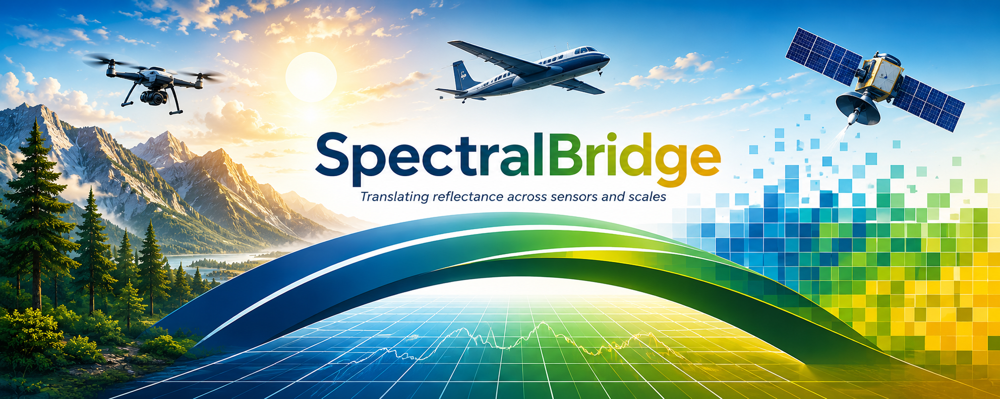

---
hide:
  - toc
---

  

  <section class="sb-hero">
    

      
NEON flightlines · drone imagery · bulk analysis

      <h1 id="spectralbridge">Same place.Many views.</h1>
      
Different sensors see the same landscape differently.

      
SpectralBridge prepares observations of reflected light for comparison. Reflectance describes how a surface returns incoming light under stated conditions. The software records processing choices and checks so you can inspect what changed and decide what the observations support.

      

        <a class="sb-button sb-button--primary" href="concepts/measurements/">Understand the measurements</a>
        <a class="sb-button sb-button--secondary" href="getting-started/">Run the first example</a>
      

    

    

      
      
Common framework. Sensor-specific treatment.

    

  </section>

  <section class="sb-manifesto">
    
Why it exists

    <h2>One landscape, different measurements.</h2>
    
NEON airborne instruments record reflected light across many narrow wavelength ranges. Drones such as those carrying MicaSense cameras provide fine local observations. Landsat satellites observe wider areas with larger ground footprints. SpectralBridge gives these systems a common framework while treating each according to how it was collected. Configured Landsat-like bands do not prove agreement with Landsat observations; aligning or aggregating ground footprints remains a separate scientific decision.

    
SpectralBridge applies configured corrections, constructs sensor-like wavelength bands from NEON observations, and compares completed products. Drone observations follow their own preparation path. The software preserves the meaning of each measurement and records the choices needed to review it.

  </section>

  <section class="sb-section sb-section--routes">
    

      
Choose your way in

      <h2>Choose the pipeline for your inputs.</h2>
    

    

      <a class="sb-route-card sb-route-card--yellow" href="vignettes/full-pipeline/">
        01
        <h3>NEON flightlines</h3>
        
Prepare detailed airborne spectra, apply configured corrections, construct sensor-like bands, and inspect outputs.

        <strong>Run the NEON vignette →</strong>
      </a>
      <a class="sb-route-card sb-route-card--teal" href="vignettes/drone-processing/">
        02
        <h3>Drone imagery</h3>
        
Prepare supported local imagery while retaining the drone observation’s identity and its own correction path.

        <strong>Run the drone vignette →</strong>
      </a>
      <a class="sb-route-card sb-route-card--paper" href="vignettes/bulk-analysis/">
        03
        <h3>Bulk analysis</h3>
        
Compare completed products across flightlines and sites; inspect how relationships and uncertainties vary.

        <strong>Run the bulk vignette →</strong>
      </a>
    

  </section>

  

    
Explore the technical figures

  <section class="sb-science-story" aria-labelledby="sb-science-story-title">
    

      
The system at a glance

      <h2 id="sb-science-story-title">Three technical views. Read them one at a time.</h2>
      
The original scientific figure is separated into enlarged panels here. The plots, wavelength ranges, processing stages, and translation relationships remain unchanged; the surrounding text provides a readable path through them.

    

    <article class="sb-science-panel">
      

        01 / Observing systems
        <h3>Measure at three scales.</h3>
        
NEON airborne imaging spectroscopy, MicaSense UAS observations, and Landsat Collection 2 NBAR each sample reflectance differently. The first panel keeps their spectral ranges and sampling patterns visible together.

        <a href="concepts/why-calibration/">Why cross-sensor calibration matters →</a>
      

      

        <figure class="sb-science-panel__figure">
          <a href="images/homepage/spectralbridge-technical-overview.png" aria-label="Open the complete technical overview at full resolution">
            <svg viewBox="15 140 460 760" role="img" aria-labelledby="sb-sensors-title sb-sensors-desc" xmlns:xlink="http://www.w3.org/1999/xlink">
              <title id="sb-sensors-title">NEON, MicaSense, and Landsat observing systems</title>
              <desc id="sb-sensors-desc">The supplied technical panel comparing an airborne hyperspectral sensor, a multispectral research drone, and Landsat Collection 2 with their wavelength ranges and schematic reflectance plots.</desc>
              <image xlink:href="images/homepage/spectralbridge-technical-overview.png" width="1536" height="1024"></image>
            </svg>
          </a>
          <figcaption>Enlarged from the supplied technical figure. Open for the full-resolution overview.</figcaption>
        </figure>
      

    </article>

    <article class="sb-science-panel sb-science-panel--reverse">
      

        02 / Processing chain
        <h3>Correct before you compare.</h3>
        
The supplied processing diagram is a conceptual view. In the current package, NEON hyperspectral products use spectral convolution, while drone products use optional post-correction affine translation. Bulk analysis estimates and reviews the relationships from completed products.

        <a href="vignettes/full-pipeline/">Walk through the full pipeline →</a>
      

      

        <figure class="sb-science-panel__figure">
          <a href="images/homepage/spectralbridge-technical-overview.png" aria-label="Open the complete technical overview at full resolution">
            <svg viewBox="490 140 506 760" role="img" aria-labelledby="sb-pipeline-title sb-pipeline-desc" xmlns:xlink="http://www.w3.org/1999/xlink">
              <title id="sb-pipeline-title">SpectralBridge processing and calibration pipeline</title>
              <desc id="sb-pipeline-desc">The supplied technical panel showing input reflectance, topographic correction, BRDF correction, spectral convolution with sensor response functions, and empirical calibration.</desc>
              <image xlink:href="images/homepage/spectralbridge-technical-overview.png" width="1536" height="1024"></image>
            </svg>
          </a>
          <figcaption>The source figure is a conceptual research diagram. Its calibration labels do not certify independent sensor agreement; current drone and NEON processing routes differ.</figcaption>
        </figure>
      

    </article>

    <article class="sb-science-panel">
      

        03 / Translation network
        <h3>Use NEON as the hyperspectral anchor.</h3>
        
Matched MicaSense and Landsat products generated from the same corrected NEON source support diagnostic regressions. Actual Landsat comparison is a separate, optional validation step; a strong synthetic fit alone does not prove sensor interchangeability.

        <a href="vignettes/sensor-harmonization/">Inspect sensor harmonization →</a>
      

      

        <figure class="sb-science-panel__figure">
          <a href="images/homepage/spectralbridge-technical-overview.png" aria-label="Open the complete technical overview at full resolution">
            <svg viewBox="1010 140 510 760" role="img" aria-labelledby="sb-network-title sb-network-desc" xmlns:xlink="http://www.w3.org/1999/xlink">
              <title id="sb-network-title">Conceptual comparison network among NEON, MicaSense, and Landsat</title>
              <desc id="sb-network-desc">The supplied technical sensor triangle showing translation relationships among NEON hyperspectral, MicaSense UAS multispectral, and Landsat Collection 2 NBAR observations.</desc>
              <image xlink:href="images/homepage/spectralbridge-technical-overview.png" width="1536" height="1024"></image>
            </svg>
          </a>
          <figcaption>The translation diagram is enlarged without simplifying its pairwise relationships.</figcaption>
        </figure>
      

    </article>

    <ul class="sb-science-principles" aria-label="SpectralBridge workflow principles">
      <li><strong>Deterministic</strong>Fixed inputs and configuration</li>
      <li><strong>Restartable</strong>Reuse validated products</li>
      <li><strong>Versioned</strong>Record software and parameters</li>
      <li><strong>Provenance tracked</strong>Inputs, models, and outputs</li>
      <li><strong>Open evidence</strong>Inspect sources and gaps</li>
    </ul>
  </section>

  

  <section class="sb-section sb-section--workflow">
    

      
The NEON processing path

      <h2>Source observations in. Traceable products out.</h2>
      
The five steps below describe the individual-flightline NEON workflow. Drone and bulk follow their own linked vignettes above.

    

    

      
01Acquire

      
02Correct

      
03Harmonize

      
04Tabulate

      
05Review QA

    

  </section>

  <section class="sb-evidence">
    

      
Evidence, not mystery

      <h2>Every transformation should leave a trail.</h2>
    

    

      
Validation campaigns record input variation, expected behavior, observed diagnostics, runtime, provenance, and failures. QA panels turn those records into something scientists can inspect.

      <a href="validation/evidence-hierarchy/">Distinguish tests, QA and independent validation →</a>
    

  </section>

  <section class="sb-resume-strip">
    
Already halfway there?

    <h2>Carry on from the files you have.</h2>
    
Individual-flightline processing validates existing artifacts and resumes at the first missing or invalid stage.

    <a class="sb-button sb-button--ink" href="vignettes/carry-on-wayward-son/">Carry On My Wayward Son →</a>
  </section>

  <section class="sb-cta">
    

      
Ready when you are

      <h2>Translate reflectance across sensors and scales.</h2>
    

    

        <a class="sb-button sb-button--primary" href="vignettes/">Choose a pipeline</a>
      <a class="sb-button sb-button--secondary" href="reference/">Read the reference</a>
    

  </section>

