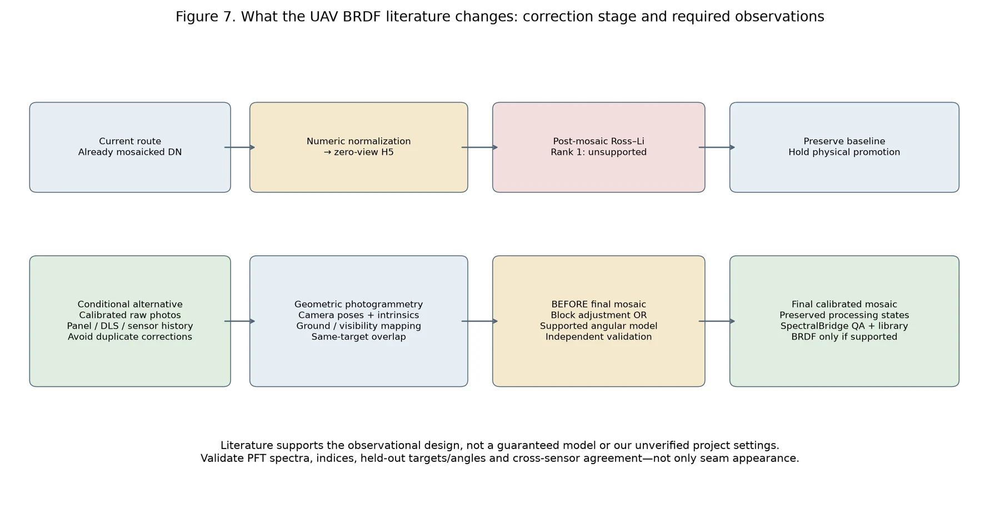

# Literature and scientific-method sources

The [technical supplement bibliography](../validation/supplement.md#references)
contains authoritative DOI/publisher/source links for the cited methods and
neighboring software. Scientific-method credit and implementation lineage are
separate; consult [method/source provenance](../hytools_manuscript_guidance.md)
and the repository's `HYTOOLS_PROVENANCE.md` for the latter.

Third-party reading PDFs are not needed by the website build. They have been
preserved in an ignored local `archive/literature/` collection, outside public
documentation and package distributions. Some files contain Creative Commons
notices; others show reserved-rights or institutional-use notices. This cleanup
does not certify redistribution rights from a filename or download location.

The [per-file review record](https://github.com/earthlab/spectralbridge/blob/main/provenance/cleanup/2026-10-12/literature-review.json)
records checksums, inspected rights notices and candidate DOI identifiers. Some
identifiers occur in references rather than the article header; maintainers must
verify the precise article/source and applicable terms before public redistribution.
Use authoritative publisher links in the bibliography in the meantime.

## UAV radiometry and directional correction

These full-text methods were checked during the
[photogrammetry provenance investigation](../dev/photogrammetry-metadata-investigation.md).
They describe methodological possibilities, not established settings or validated
corrections for Gordon, Goldhill or Ruby.

| Study and verified publication | Where correction occurs and required evidence | Limit for our application |
| --- | --- | --- |
| Honkavaara, E. & Khoramshahi, E. (2018). *Radiometric Correction of Close-Range Spectral Image Blocks Captured Using an Unmanned Aerial Vehicle with a Radiometric Block Adjustment*. Remote Sensing **10**(2), 256. [DOI: 10.3390/rs10020256](https://doi.org/10.3390/rs10020256) | Before output mosaics: calibrated images, camera/DSM visibility, repeated radiometric tie points and panels; joint weighted image gains, absolute transform and Walthall anisotropy | Image effects and angular effects need constraints; not the package's LiDenseR formulation |
| Crucil, G., Zhang, H., Pauly, K. & Van Oost, K. (2022). *A Semi-Empirical Anisotropy Correction Model for UAS-Based Multispectral Images of Bare Soil*. Remote Sensing **14**(3), 537. [DOI: 10.3390/rs14030537](https://doi.org/10.3390/rs14030537) | Calibrated/vignette/black-level-corrected images and adjusted camera/sun geometry support ANIF before final Pix4D mosaicking | Homogeneous flat bare-soil training is not automatically applicable to heterogeneous vegetation PFTs |
| Ahn, H., Kim, C., Lim, S., Jin, C., Kim, J. & Choi, C. (2025). *Minimizing Seam Lines in UAV Multispectral Image Mosaics Utilizing Irradiance, Vignette, and BRDF*. Remote Sensing **17**(1), 151. [DOI: 10.3390/rs17010151](https://doi.org/10.3390/rs17010151) | Reference tarp/irradiance instrumentation and dedicated BRDF, vignette and validation flights support image filters before mosaics | DJI M3M-specific calibrated acquisition; seam reduction does not demonstrate biological accuracy |
| Cao, H. et al. (2023). *The Method of Multi-Angle Remote Sensing Observation Based on Unmanned Aerial Vehicles and the Validation of BRDF*. Remote Sensing **15**(20), 5000. [DOI: 10.3390/rs15205000](https://doi.org/10.3390/rs15205000) | Planned same-target hemispheric observations, panels and reconstructed geometry support M-Walthall, RPV and RTLSR comparisons | Domain-specific model rankings; overlap alone does not establish identifiability; their LiSparseR is not LiDenseR |

*Conceptual comparison, not an implemented alternative. Recover calibrated
original observations, camera geometry and actual upstream operation flags before
selecting a method. Separate physical calibration, relative image balancing and
directional normalization; visually uniform imagery may suppress biological
spectral differences.*

Radiometric block adjustment estimates relative image effects jointly with
reference/anisotropy terms under a constrained observation design. Original-image
angular methods preserve repeated target measurements before mosaicking.
Irradiance and vignetting address different effects and require their own sensor
records. Empirical post-mosaic correction is possible only when its physical
units, geometry and validation design support it; our current rank-one files do
not support the existing Ross–Li fit. No published method has been validated on
these flights. See the [three-strategy comparison](../dev/photogrammetry-metadata-investigation.md#our-three-candidate-strategies).

Last updated: 2026-11-02
