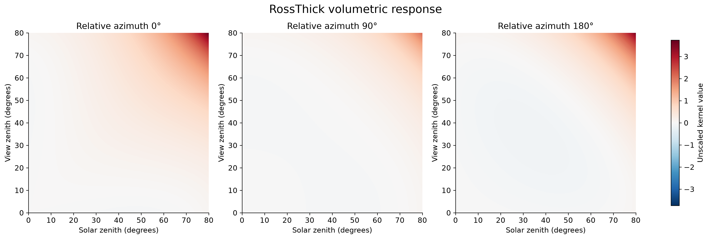
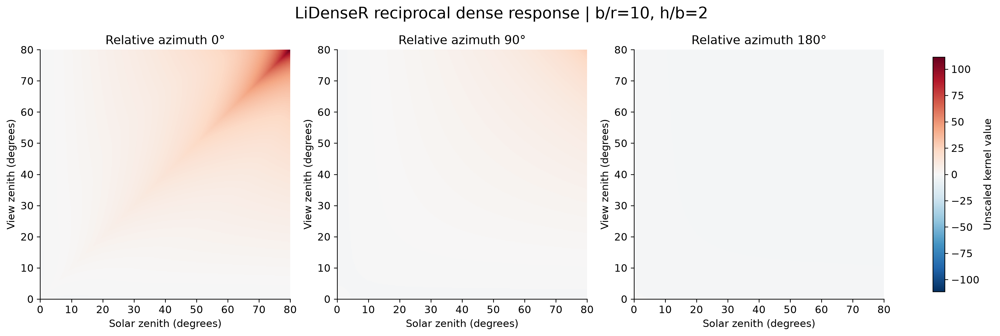
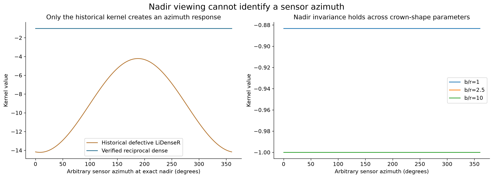
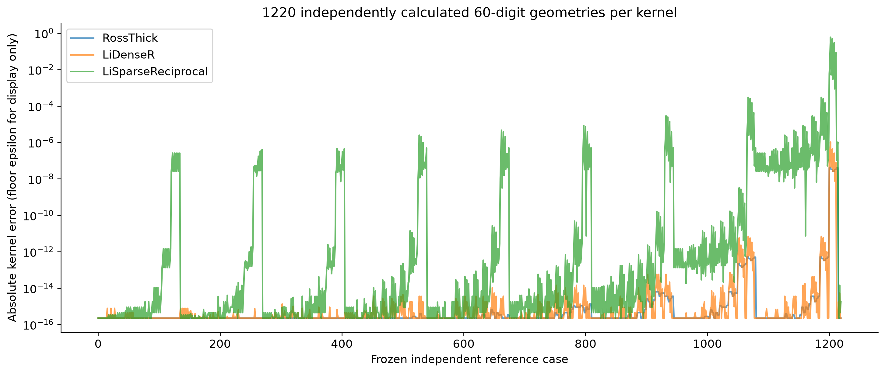
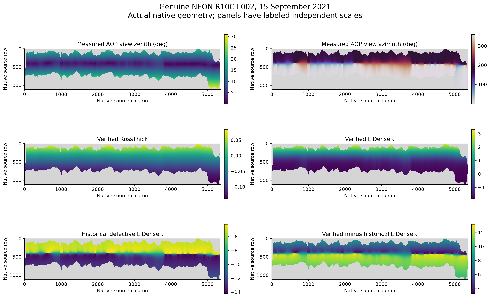
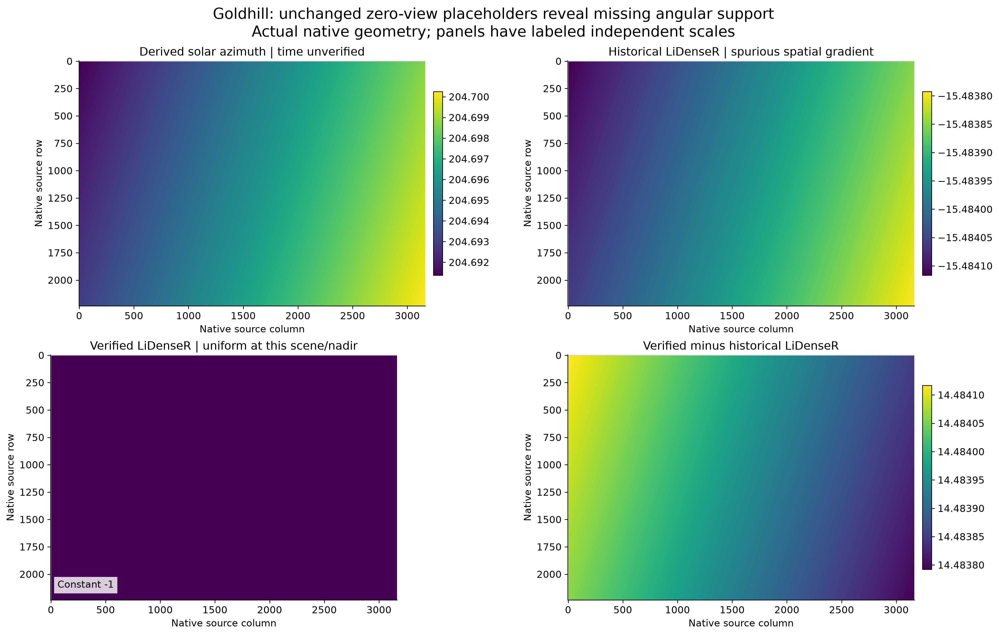
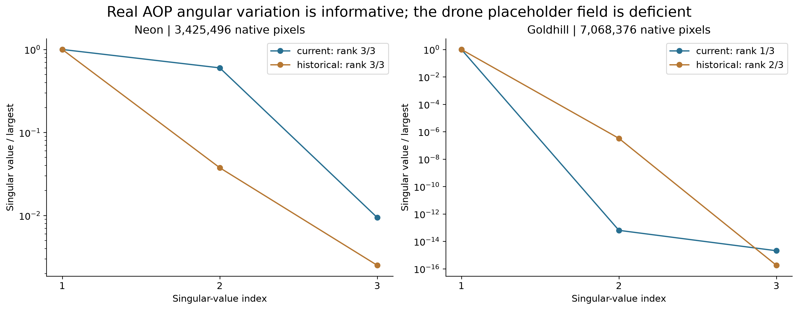
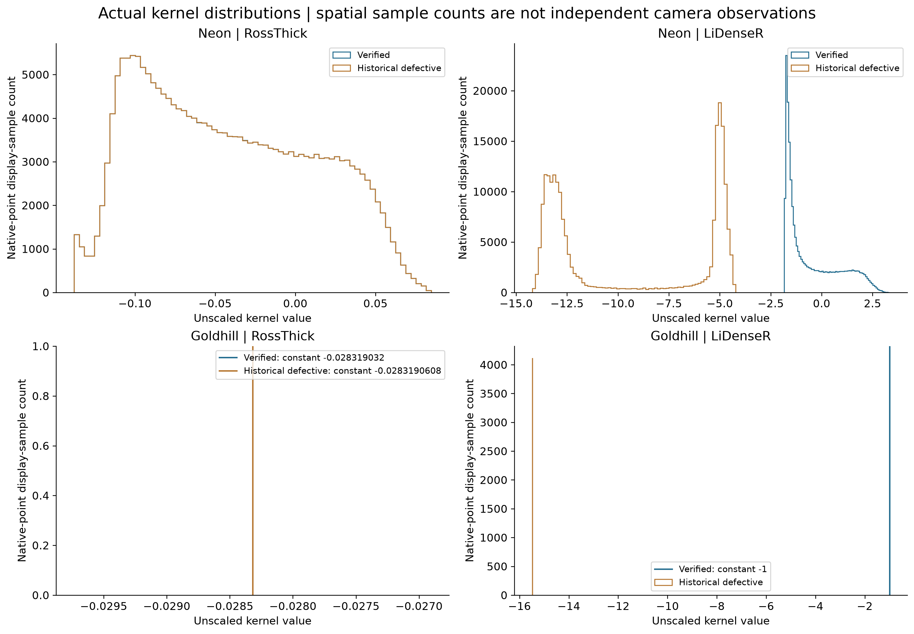

# BRDF mathematical validation

2026-11-03 · SpectralBridge P166 · Scientific software correction; no production reprocessing

## Finding and scope

The shared production **LiDenseR equation had already been repaired on October 30**.
This audit independently verifies that equation, keeps the reciprocal dense and
sparse variants distinct, and repairs remaining numerical/interface problems.
Both NEON AOP and drone processing use the same canonical functions. Real NEON
geometry has rank **3/3**, whereas Goldhill's zero-view placeholders have rank
**1/3**. Correct mathematics exposes the missing drone information; it does not
supply that information or validate a correction.

This change adds float64 scalar/vector/raster broadcasting, explicit invalid
geometry, stable coincident/grazing calculations and a kernel-mathematics version
that blocks incompatible coefficients and correction-stage reuse. It changes no
radiometric scale, fitting eligibility threshold, reference geometry, angular
conditioning requirement, crown-parameter default or production source file.

## Audit before modification

The [pre-edit inventory](../../provenance/brdf-mathematical-validation/2026-11-03/pre_edit_inventory.json)
records repository revision and implementation hashes. A
[pre-audit source snapshot](../../provenance/brdf-mathematical-validation/2026-11-03/pre_audit_corrections.py)
preserves the immediately preceding implementation. The canonical module is
`src/spectralbridge/corrections.py`; `src/cross_sensor_cal` compatibility imports
forward to the supported package. Generated `build/lib` code is stale build
output, not another scientific authority. The deprecated HyTools adapter builds
external HyTools configurations; it is not either canonical processing route.
Its dependency/version-specific behavior is not approved by this audit.

| Operation | NEON AOP | Drone |
|---|---|---|
| Fit entry | `brdf_topo.build_correction_parameters_dict` | `drone.apply_drone_corrections` |
| Shared fit | `corrections.fit_and_save_brdf_model` | Same function |
| Application | `brdf_topo.apply_brdf_topo_core` → `corrections.apply_brdf_correct` | `corrections.apply_brdf_correct` |
| Observed prediction | `_brdf_design` → canonical kernel helpers | Same helpers |
| Reference prediction | `_reference_design` → canonical kernel helpers | Same helpers |
| Explicit production configuration | RossThick, LiDenseR, b/r=10, h/b=2, scene solar zenith | Same configuration |

The direct helper/config default remains LiSparseReciprocal with b/r=1 and
pixel solar zenith. This is an explicit configuration difference, not different
sensor-specific mathematics. The b/r=10 production setting is retained for
compatibility; verifying its equation does **not** establish its empirical
suitability for every canopy. Neither pipeline is declared equivalent to the
complete FlexBRDF workflow.

The historical October 26 implementation is isolated in
[historical_corrections.py](../../provenance/drone-radiometric-recovery/2026-11-02/historical_corrections.py).
It is never substituted into production. Its saved coefficients and Goldhill
replay remain unchanged.

## Verified equations and conventions

Angles are **radians** at the kernel interface. Zeniths are polar angles in
`[0, π/2)`, not signed scan angles. Sun and sensor azimuths describe directions
from the surface toward each and use the same reference frame. Relative azimuth
is their difference; zero denotes backscatter/coincident azimuth. Equivalent
finite wraps are accepted. At exact nadir the corresponding azimuth is arbitrary
and cannot change either kernel. Negative zenith, horizon/below-horizon,
nonfinite geometry and nonfinite calculated kernels produce **NaN**; invalid
crown parameters raise an error. Invalid geometry is excluded from designs and
propagated as output nodata rather than becoming a neutral kernel.

### RossThick

With phase angle ξ,

\[
\cos\xi=\cos\theta_s\cos\theta_v+
\sin\theta_s\sin\theta_v\cos\phi,
\qquad
K_{RT}=\frac{(\pi/2-\xi)\cos\xi+\sin\xi}
{\cos\theta_s+\cos\theta_v}-\frac{\pi}{4}.
\]

This is the zero-at-double-nadir RossThick normalization, with no additional
hotspot factor or division by π. Roujean et al. established the kernel-driven
framework; the normalized RossThick form is cross-checked against Wanner's
published equation attribution, the MODIS ATBD Eq. 38 and the independent C++
implementation. [Roujean et al. (1992)](https://doi.org/10.1029/92JD01411),
[Wanner et al. (1995)](https://doi.org/10.1029/95JD02371),
[MODIS ATBD, Section V-A](https://lpdaac.usgs.gov/documents/97/MCD43_ATBD.pdf).



*Controlled angular response, not measured imagery. All three panels share a
scale. At double nadir the kernel is zero; coincident nonzero directions need
not have zero kernel value.*

### Reciprocal dense and sparse geometry

Let θ′=atan[(b/r)tan θ], u=tan θs′, v=tan θv′,
S=sec θs′+sec θv′, and ξ′ be the phase angle formed from transformed zeniths.

\[
D^2=u^2+v^2-2uv\cos\phi,\quad
c=\min\left(1,\frac{(h/b)\sqrt{D^2+(uv\sin\phi)^2}}{S}\right),
\quad t=\arccos c,\quad O=\frac{(t-\sin t\cos t)S}{\pi}.
\]

For valid upper-hemisphere geometry and positive crown parameters, c is
nonnegative. Saturation at one is the geometric **no-overlap boundary**, not an
empirical gain cap. The two supported reciprocal kernels are

\[
K_{LDR}=\frac{(1+\cos\xi')\sec\theta_s'\sec\theta_v'}{S-O}-2,
\]

\[
K_{LSR}=O-S+\tfrac12(1+\cos\xi')\sec\theta_s'\sec\theta_v'.
\]

The dense form explicitly follows Zhang et al. Eq. 5, with shared transformed
geometry in Eqs. 6–11. The sparse form follows MODIS ATBD Eqs. 39–44. These are
**not interchangeable**. Wanner's original nonreciprocal LiDense has only the
view secant in its numerator; its reciprocal extension includes both secants.
The implemented dense kernel is not obtained by multiplying the sparse kernel
by cosines. [Zhang et al. (2018)](https://doi.org/10.3390/rs10030437),
[MODIS ATBD](https://lpdaac.usgs.gov/documents/97/MCD43_ATBD.pdf).

MODIS operational Ross–Li work uses the sparse reciprocal variant; citing
MODIS does not by itself identify or validate a dense-kernel implementation.
[Lucht et al. (2000)](https://doi.org/10.1109/36.841980),
[Schaaf et al. (2002)](https://doi.org/10.1016/S0034-4257(02)00091-3).



*LiDenseR with the retained production parameters b/r=10 and h/b=2. This verifies
the response of that configured model, not the physical appropriateness of those
parameters for these flightlines.*

## Historical errors and numerical repairs

The October 26 geometric code used relative-azimuth cosine where a transformed
phase dependence was required; used an incorrect overlap distance/angle
construction; treated b/r as an output multiplier; and implemented dense behavior
through an incorrect sparse-like expression and cosine multiplication. Its
spurious dependence on arbitrary azimuth at nadir manufactured angular variation.
The October 30 repaired dense equation removed those mathematical errors.

Before this follow-up, the repaired helpers still required equal-shaped 2-D
arrays and rounded inputs/outputs to float32. RossThick also replaced nonfinite
results by zero. That can disguise missing geometry as an apparently valid
kernel. The current helpers broadcast in float64 and preserve invalid geometry
as NaN. The topographic angle validator and SCS+C equations are unchanged.

Two algebraically equivalent stabilizations preserve the published model:

- D is evaluated with a hypot/half-angle form to avoid subtracting nearly equal
  terms for coincident directions; transformed secants use `hypot(1,b/r*tan θ)`.
- `t−sin(t)cos(t)` uses its cubic-through-septic expansion for very small t;
  omitted terms there are below double precision. `1+cos ξ′` is evaluated as
  half the squared norm of the sum of two unit direction vectors, retaining its
  small value for opposite grazing rays. Cosine bounds address analytic domains
  and rounding; no correction factor is capped.



*Controlled nadir geometry exposes the old false azimuth response. The verified
kernel remains constant for each crown-shape setting. A constant curve does not
provide three independent angular predictors.*

## Independent numerical evidence

The frozen [reference fixture](../../tests/data/brdf/published_equation_references.json)
contains **1,220 cases per kernel**, calculated from scalar published equations
with **60-digit mpmath arithmetic**, without importing SpectralBridge. Cases
include zeniths 0°, 5°, 10°, 30°, 45°, 60°, 80°, 89° and 89.999°; relative azimuths
0°, 45°, 90°, 135° and 180°; crown shapes 1, 2.5 and 10; additional overlap,
near-coincident and tiny-angle cases; and positive height variants.

The independent DIRSIG SDK 1.2.5 C++ source is also compiled and executed for
740 cases through 80°. Its **nonreciprocal** dense output is explicitly converted
as `(K_LD+2)sec θs′−2`; calling it reciprocal without this conversion would be a
variant error. Maximum discrepancies against the 60-digit references are
2.66e−15 for RossThick and 1.49e−9 for converted dense. The latter includes
near-coincident geometries where the external source's direct squared-distance
subtraction loses precision. Its source URL/hash and conversion are frozen in
the fixture; it is a cross-check, not an infallible oracle.
[DIRSIG source](https://dirsig-gitlab.cis.rit.edu/dirsig_public/dirsig-sdk/-/blob/1.2.5/lib/brdf/RossLi.cpp).

<!-- numerical-validation:start -->
| Kernel | Maximum absolute error through 80° | Maximum error / (1 + absolute reference), all cases |
|---|---:|---:|
| RossThick | 2.66e-15 | 9.02e-13 |
| LiDenseR | 5.68e-14 | 9.02e-13 |
| LiSparseReciprocal | 2.27e-12 | 2.91e-12 |
<!-- numerical-validation:end -->

The largest absolute discrepancies occur near grazing where the kernels diverge.
For example the sparse reference reaches approximately 3.28e11 at 89.999° in both
directions, φ=0, b/r=10; its 0.592 absolute difference is about 1.8e−12 relative,
not a half-unit error on an order-one response. Tests use `atol=3e−12` and
`rtol=3e−12` ordinarily, relaxing relative tolerance to `2e−9` above 89° to account
for conditioning with rounded binary64 input angles. Analytic boundary,
reciprocity, wrapping, scalar/vector/raster and NaN-mask tests are separate from
these reference vectors. Near-grazing mathematical support does not establish
physical model accuracy; the ATBD cautions about very large zenith angles.



*The epsilon plot floor is display-only. Full unmodified errors and worst-case
geometries are in the machine-readable independent reference results.*

## Genuine NEON AOP geometry

The unchanged archived R10C L002 flightline from **15 September 2021** has shape
1115×5351×426. Source metadata identify to-sensor azimuth in degrees from north,
zenith measured from nadir, and scene solar zenith 37.412113°. Geometry diagnostics
retain **3,425,496** valid native pixels. Actual sensor zenith spans
0.004755°–31.007185°. Full-population min/max/mean/standard deviation are recorded
for every angular and kernel field.



*Kernel variation follows the actual cross-track viewing geometry. Scene solar
is constant, and view azimuth switches sides of the flightline. Independent,
labeled panel scales expose both historical errors and the corrected response;
gray is invalid source geometry. Display samples use native stride 4; metrics
use every retained native pixel. Coordinates are native row/column, not a
claim of surveyed geographic accuracy.*

The corrected dense kernel spans −1.845498 to 3.370746. The largest absolute
difference from the October 26 kernel is **13.205364**, at native row 420,
column 4292. The corrected design's singular values are approximately
2753.3461, 1653.0634 and 26.0289: **rank 3**, condition **105.7804**. The historical
design is also rank 3 but condition about 397.49; rank alone does not establish
correct mathematics. Neither successful execution nor rank 3 validates a fit
across heterogeneous surfaces as an empirical reflectance calibration.

## Goldhill regression and rejection

On the unchanged Goldhill H5, **7,068,376** finite-source/native geometry pixels
are evaluated using the configured scene solar zenith and original zero-view
placeholders. This retains the historical finite-H5 support, including the
known distinction from positive-source-alpha support; it changes no masks.
The corrected RossThick and LiDenseR fields are constant; dense is exactly −1
for this configured scene/shape/nadir geometry. Sweeping arbitrary nadir azimuth
adds **zero** dense-kernel variation. The historical dense field spans
−15.48411655 to −15.48379230 and contributes a false second design direction.



*Solar azimuth is derived at an unverified time, not measured camera geometry.
Narrow historical color scales expose a small artificial gradient; they do not
make that gradient independent directional information. The current constant
map has a single-value legend.*

Full native QR/SVD gives corrected **rank 1/3**, historical **rank 2/3**. Rank-
deficient condition numbers are mathematically infinite (JSON null plus explicit
status); small trailing floating-point singular values are recorded as roundoff,
not recovered observations. Streaming QR and monolithic SVD can give different
roundoff tails while agreeing on rank and rejection.

A separately labeled mathematical control combines sampled actual Goldhill
geometry with a **synthetic constant signal**, never a claimed Goldhill
calibration. All **10/10** band fits are rejected as unsupported rank-one fits;
no coefficients are emitted. The real drone calibration remains unverified and
is independently blocked by the pre-existing radiometry gate. Historical
coefficients are neither changed nor made valid by the new kernels. Removing
an artificial gradient is not a successful BRDF calibration.





*Histograms use explicitly sampled native pixels; complete native distributions
are summarized by min/max/mean/standard deviation in the evidence JSON. Constant
Goldhill fields use single-value lines. Spatial counts do not establish
independent camera observations.*

The focused regression set passes **201 distinct tests**, including independent
mathematical properties, real-interface compatibility, chunking, drone/NEON
restart behavior, model-version rejection, radiometry contracts and source
provenance. The four protected real-data/model/historical-code hashes are
unchanged. All eight figure pairs were visually reviewed.

## Compatibility, preservation and reproducibility

`BRDF_KERNEL_MATH_VERSION = ross-li-reciprocal-f64-v1` is persisted in model JSON,
coefficient-cache signatures, completed ENVI headers and drone correction-stage
fingerprints. Unversioned or mismatched models cannot be applied or reused by
the fitter. NEON and drone correction drivers reject incompatible completed
correction-stage products and preserve their bytes, directing new calculations
to a fresh output directory. No coefficients or existing imagery are upgraded
by adding a label. Unrelated topographic-only cache signatures are unchanged.

Public kernel function signatures and broadcast output shapes are documented;
return precision changes from float32 to float64. Pipeline raster output remains
float32. Explicit `LiDenseR`, `li_dense_r`, `LiSparseReciprocal` and `LiSparseR`
identify reciprocal variants. Ambiguous `li_dense`/`li_sparse` are rejected
because their external meanings can be nonreciprocal. No nonreciprocal kernel
is silently substituted. Historical scripts import the pinned historical module
and remain reproducible independently of these production APIs.

The [evidence directory](../../provenance/brdf-mathematical-validation/2026-11-03/)
contains scripts, source/model preservation hashes, compact geometry displays,
reference results, figure pairs and validation records. Geometry is evaluated in
128-row windows; designs are reduced with tall-skinny QR then SVD, avoiding
pixel-scale tables or normal-equation rank estimates. Float64 kernel/design
arrays use twice the storage of float32 arrays (24 bytes/pixel for the three-
column design instead of 12); this does not redesign the pre-existing full-scene
production fitting algorithm. No production products or libraries were regenerated.

Reproduce using the repository scientific environment:

```bash
MPLCONFIGDIR=/private/tmp/spectralbridge-mpl OPENBLAS_NUM_THREADS=1 \
  .venv/bin/python provenance/brdf-mathematical-validation/2026-11-03/evaluate_geometry.py
MPLCONFIGDIR=/private/tmp/spectralbridge-mpl OPENBLAS_NUM_THREADS=1 \
  .venv/bin/python provenance/brdf-mathematical-validation/2026-11-03/figures.py
.venv/bin/python provenance/brdf-mathematical-validation/2026-11-03/write_report.py
```

Reference regeneration additionally requires mpmath and the pinned external C++
source at `/private/tmp/p166_RossLi.cpp`; the generated fixture itself has no such
runtime/test dependency. Source URLs, hashes and compiler method are in
`generate_references.py` and the reference fixture. The archived NEON H5 and
Goldhill external H5 must be present at the recorded paths and identities.

Source access is documented honestly: Roujean's local PDF, the NASA ATBD,
Schaaf's author-hosted PDF, Zhang's publisher PDF text and pinned implementation
sources were consulted. Wanner's publication record is accessible, but its full
publisher PDF was blocked; Lucht's author PDF retrieval failed certificate
validation. Their foundational attribution is not misrepresented as an extracted
numerical table. The explicit reciprocal dense equation is verified against
Zhang and independently evaluated; the sparse and Ross forms are cross-checked
against the accessible NASA ATBD and independent implementations.

Remaining limitations are empirical, not a reason to accept unsupported fitting:
missing drone calibration, camera-to-target contributors and timing remain
unresolved; crown parameters require domain evidence; NEON angular rank does not
prove cross-surface calibration. Later radiometric eligibility work must retain
these verified equations, reference geometry and angular rejection gates.
