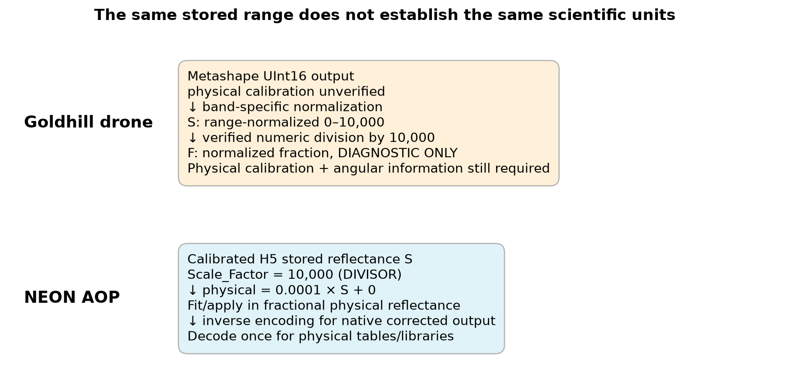
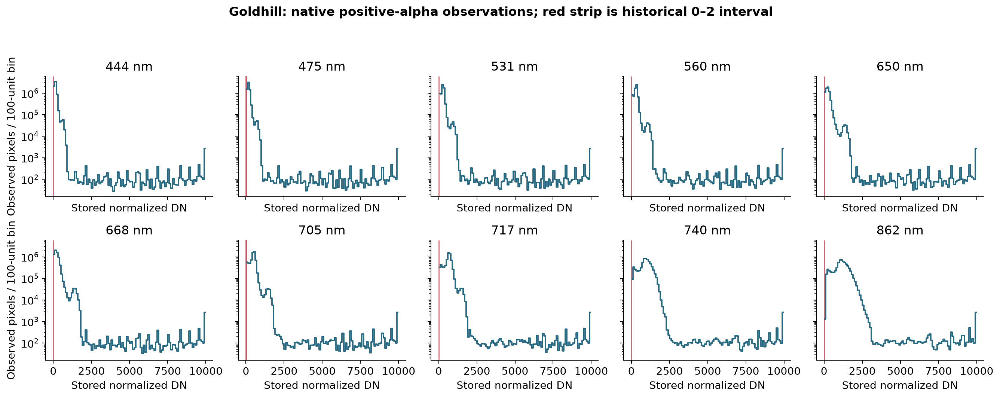
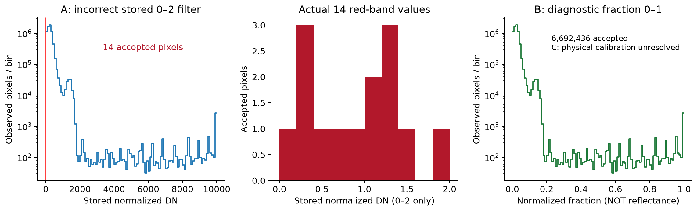
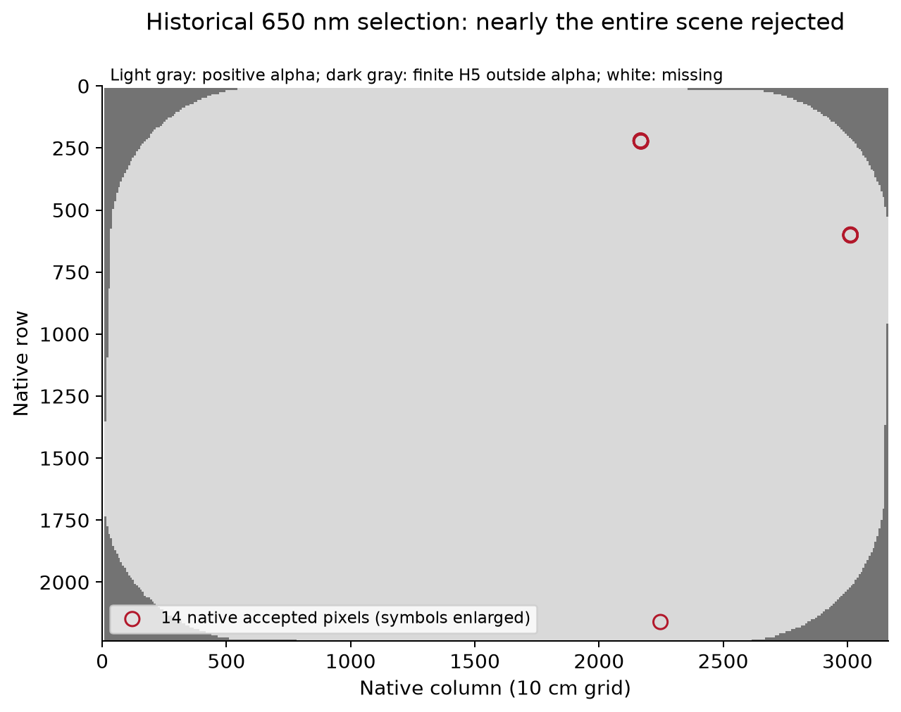
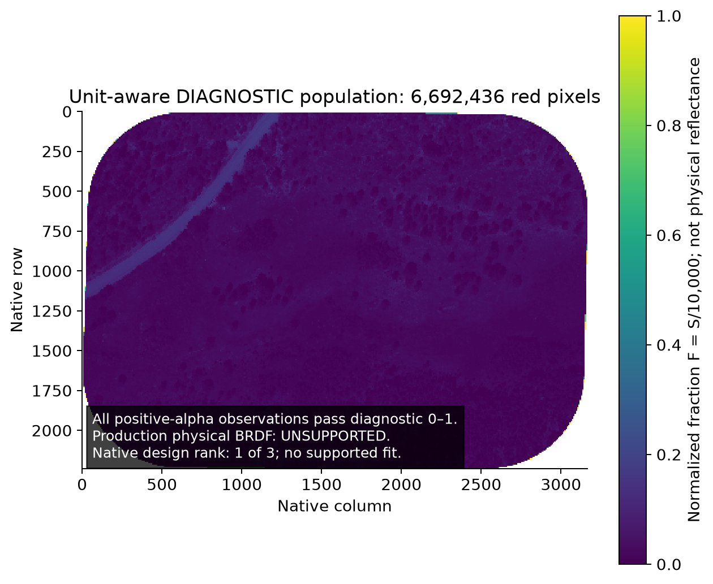
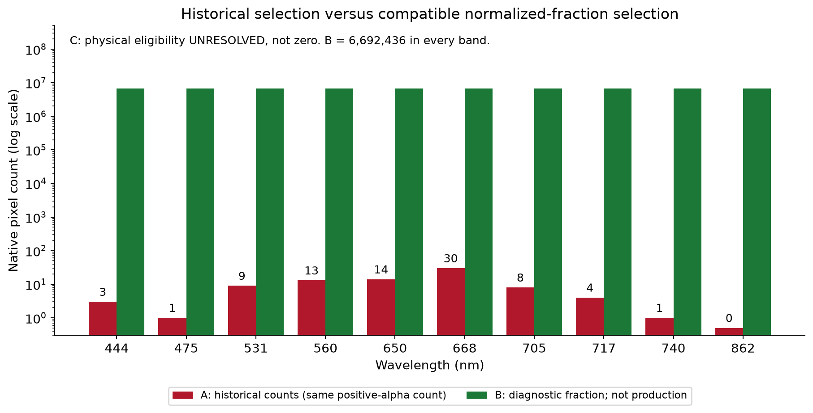
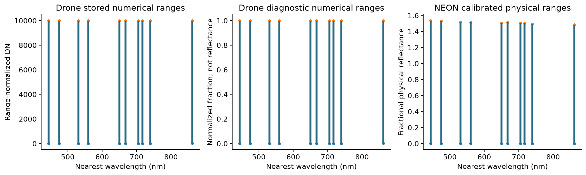

# Radiometric scaling and BRDF eligibility validation

Date: November 3, 2026. Scope: P167, following the separate [BRDF mathematical validation](BRDF_MATHEMATICAL_VALIDATION.md). No production raster, source H5, historical coefficient file or spectral library was overwritten.

## Findings

Goldhill and NEON share a stored range near 0–10,000, but the available evidence establishes different meanings. NEON stores calibrated reflectance with a documented divisor. Goldhill stores independently range-normalized numerical measurements; its physical calibration remains unverified. A division by 10,000 recovers a **normalized fraction**, not proof of reflectance.

The unchanged historical fitter reproduces all ten requested Goldhill counts and every saved coefficient array exactly. At 650 nm, it accepted **14 of 6,692,436 positive-alpha observations**—0.0002092%—because it applied the physical-looking interval 0–2 directly to normalized stored values. The diagnostic interval 0–1 after numerical division accepts all **6,692,436** observations in each band. These are **not production-eligible physical BRDF measurements**. Physical case C is unresolved, and the genuine zero-view scene still has angular design rank **1 of 3**, supporting **zero** three-parameter scene fits.

*Figure 1. Encoding chains; Goldhill physical calibration is unresolved.*

## Source evidence and processing chain

The audit used the original Goldhill UInt16 TIFF, a paired unnormalized/normalized 25 cm TIFF grid, the restored repaired-grid working H5, a recovered source-DN raster with documented alpha lineage, unchanged October 26 correction code, saved production coefficients, and a genuine archived NEON R10C L002 flightline from September 15, 2021. Paths and SHA-256 identities are in [results.json](../../provenance/radiometric-scaling-validation/2026-11-03/results.json). All **eight protected inputs** match their pre-analysis hashes afterward.

| Stage | Goldhill numerical meaning / range | NEON numerical meaning / range |
| --- | --- | --- |
| Sensor acquisition → photogrammetry | Raw capture calibration, exposure/DLS/panel use and exact project settings unavailable; do not infer from TIFF dtype | Official AOP reflectance product calibration precedes package ingestion |
| Original delivered orthomosaic | UInt16 Metashape numerical output, 10 spectral bands plus declared alpha; spectral extrema 0–65,535 except 862 nm minimum 174; physical units unverified | H5 Int16 calibrated scaled reflectance; Scale_Factor=10,000 **divisor**, NoData=−9,999, zero physical offset |
| Unnormalized 25 cm derivative | Float32 numerical source-DN values; resampling gives fractional DN | No corresponding step in this audit |
| Normalized 25 cm derivative | Float32, band-specific normalization below; paired observed range within 0–10,000 | No corresponding step |
| Delivered 10 cm / working H5 | Float32 normalized DN; source support 7,068,376 finite pixels; spectral ranges in results.json; H5 Scale_Factor=1 does not certify calibration | H5 stored data retained; selected valid source range 0–15,356, not clipped to nominal 10,000 |
| Historical BRDF fit | Stored S treated as unitless (scale=1), threshold 0≤S≤2; 0–30 samples/band | Historical behavior depends on source-reader/calibration revision; this task does not certify all archived NEON products |
| Current fit/topographic/BRDF application | Require documented physical affine calibration; unverified Goldhill blocked before fit; B is separate diagnostic only | Decode physical=0.0001S before physical thresholds/corrections; selected physical range 0–1.5356 |
| Native corrected ENVI | No new Goldhill production correction; historical outputs retained as unsupported evidence | Apply in physical units, inverse encode to source storage units once, persist same affine contract |
| Drone target products / spectral extraction | Validated native-band translation decodes selected source band with its own affine parameters and emits fractional physical output; unverified input rejected | Stored-space convolution preserves common zero-offset scaling; physical tables/libraries decode once and retain provenance |

The 10 cm normalized source TIFF itself was not freshly available in this audit. The restored H5/native cached arrays and recovered alpha lineage are the previously verified P164/P165 copies; no independent exact replay of the upstream 10 cm exporter is claimed. Resampling changes spatial mixtures, not the evidence for physical calibration.

### Verified numerical mapping, with its limits

For each band the paired 25 cm files satisfy

`S = 10000 × (DN − minimum_band) / (65535 − minimum_band)`.

| nm | Original minimum | Original maximum | DN→S multiplier | DN→S offset | Maximum paired S error |
| --- | --- | --- | --- | --- | --- |
| 444 | 0 | 65535 | 0.152590218967 | -0 | 0.00076883714 |
| 475 | 0 | 65535 | 0.152590218967 | -0 | 0.00076526081 |
| 531 | 0 | 65535 | 0.152590218967 | -0 | 0.00077062531 |
| 560 | 0 | 65535 | 0.152590218967 | -0 | 0.00076593137 |
| 650 | 0 | 65535 | 0.152590218967 | -0 | 0.00077412714 |
| 668 | 0 | 65535 | 0.152590218967 | -0 | 0.00076451574 |
| 705 | 0 | 65535 | 0.152590218967 | -0 | 0.00077010376 |
| 717 | 0 | 65535 | 0.152590218967 | -0 | 0.00078038572 |
| 740 | 0 | 65535 | 0.152590218967 | -0 | 0.00077368009 |
| 862 | 174 | 65535 | 0.152996435183 | -26.6213797219 | 0.0007727067 |

The largest fresh paired discrepancy is **0.000780386 stored units**, consistent with float32 export precision. The 862 nm normalization introduces a real negative numerical intercept; all other observed minima are zero. The inverse is `DN = minimum_band + S × (65535 − minimum_band)/10000`. It reconstructs floating-point source numerical values within encoding precision; it cannot undo spatial resampling or restore raw camera calibration.

The authoritative normalization/export code was **not recovered**. A search of current tracked Python and notebook source cells returned no authoritative implementation ([search record](../../provenance/radiometric-scaling-validation/2026-11-03/normalization_code_search.json)); earlier provenance searches likewise did not recover the conversion project. Because all observed maxima equal 65,535, these files **cannot distinguish observed-maximum normalization from a fixed UInt16-maximum convention**. The equation is source-verified; its exact originating command is unresolved.

Agisoft documents reflectance calibration using panel/sun metadata and configurable band-sensitivity normalization. That capability does not establish which options were applied to this specific project. Missing evidence includes the actual Metashape processing/export settings and calibration state, camera/exposure/radiometric metadata and applied coefficients, reflectance-panel observations/values, DLS/irradiance use, and the normalization script/parameters. A 32,768 divider or a 10,000 physical divider cannot be invented from the range. See the [project metadata investigation](../dev/photogrammetry-metadata-investigation.md) for recovered versus missing records.

*Figure 2. All ten actual band distributions; footprint counts are native, not stride estimates.*

## Historical filter and three separate cases

The unchanged `fit_and_save_brdf_model` in the preserved October 26 module first multiplies by the cube's scale_factor (Goldhill: 1), then, per band and optional NDVI bin, selects finite values with `rho_min=0` and `rho_max=2`. The names and NEON context establish a fractional-reflectance intent; the original choice of the upper limit 2 has no recovered universal scientific justification. It remains a configurable screening policy, not a calibration or saturation detector. No policy bound was changed here.

The historical implementation uses one interval for every band. It does not independently recognize source alpha, saturation or sensor-quality flags. Fewer than three samples retain neutral coefficients; the other seven fits reproduce the saved coefficients exactly despite insufficient independent geometry. [The actual unchanged-fitter replay](../../provenance/radiometric-scaling-validation/2026-11-03/results.json) records least-squares populations **3, 9, 13, 14, 30, 8, 4**, preserving all source code and saved coefficients.

| Wavelength nm | A: historical finite-H5 count | A: same positive-alpha support | B: diagnostic normalized fraction 0–1 | C: verified physical reflectance |
| --- | --- | --- | --- | --- |
| 444 | 3 | 3 | 6,692,436 | Unresolved |
| 475 | 1 | 1 | 6,692,436 | Unresolved |
| 531 | 9 | 9 | 6,692,436 | Unresolved |
| 560 | 13 | 13 | 6,692,436 | Unresolved |
| 650 | 14 | 14 | 6,692,436 | Unresolved |
| 668 | 30 | 30 | 6,692,436 | Unresolved |
| 705 | 8 | 8 | 6,692,436 | Unresolved |
| 717 | 4 | 4 | 6,692,436 | Unresolved |
| 740 | 1 | 1 | 6,692,436 | Unresolved |
| 862 | 0 | 0 | 6,692,436 | Unresolved |

**A:** input S is normalized DN. Global finite red range is 0.00717195–10,000. Numerical transform was effectively identity, incorrectly used as physical conversion. Eligible values are the actual tiny 0–2 tail, recorded individually in results.json. Most observed pixels are excluded solely by incompatible units, not missingness.

**B:** input F=S/10,000 has diagnostic scale 0.0001 and offset 0. Its physical-calibration status remains UNVERIFIED. On the positive-alpha footprint, every band is finite, non-NoData and within 0–1; no above-one/negative exclusions occur. Red diagnostic quantiles (minimum, 1%, median, 99%, maximum) are 7.1719489e-07, 0.0016787419, 0.022755005, 0.14023375, 1. Compared on the same source support, B adds **6,692,422** red observations. It supplies no missing geometry or physical calibration.

**C:** physical scale and offset are unknown. Input physical range, physical eligibility, eligible-value distributions and physical accepted-pixel map are **NOT_EVALUATED / UNRESOLVED**, not zero. B is not substituted for C. The real-data [current shared fitter control](../../provenance/radiometric-scaling-validation/2026-11-03/physical_fit_gate.json) rejects typed normalized-DN radiometry explicitly and emits **no coefficient arrays**.

*Figure 3. The 650 nm unit mismatch; B is diagnostic and cannot replace physical case C.*

### Population accounting

| Population or requirement | Native Goldhill count / outcome |
| --- | --- |
| Total grid: 2,238 × 3,165 | 7,083,270 pixels |
| Historical finite, non-NoData H5 footprint | 7,068,376 |
| Positive source alpha, reconstructed from documented original lineage | 6,692,436 |
| Finite H5 outside positive alpha | 375,940; excluded from diagnostic B |
| Within alpha and passing finite/NoData checks | 6,692,436 in every band |
| Additional saturation/sensor-quality screening | Unresolved: no independent declared flags supplied; do not interpret all UInt16 maxima as documented saturation |
| Historical radiometric red selection | 14 |
| B diagnostic normalized red selection | 6,692,436 |
| C physical-radiometry eligibility / production fitting population | Not evaluated; missing physical calibration |
| Independent angular support | Scene design rank 1, 3 parameters required; zero supported scene fits |

Independent angular support is a property of the design, not a count of millions of independent observations. The [P166 native-grid geometry audit](BRDF_MATHEMATICAL_VALIDATION.md) supplies that rank evidence. No geometry, reference angle, rank threshold or conditioning requirement changed during this task.

*Figure 4. Native accepted coordinates, enlarged symbols; contextual image decimated 8× without altering counts.*

*Figure 5. Actual red normalized fraction; no physical calibration, corrected image or invented geometry.*

Markers in Figure 4 are enlarged; several of the 14 adjacent native pixels overlap as symbols. The stored distributions/counts use all native observations. Contextual maps alone are decimated eightfold for display; the accepted coordinates are native and are not strided away.

*Figure 6. Zero at 862 nm is explicitly labeled; a half-count-height placeholder only locates that label on a log axis.*

## Shared explicit contract and repaired boundaries

`Radiometry` uses `physical = a × stored + b` and inverse `(physical − b)/a`. It accepts scalar or per-band positive finite multipliers and finite offsets. Encoding categories explicitly distinguish raw DN, range-normalized DN, scaled physical reflectance, fractional physical reflectance and unknown units. A metadata-only unverified record can survive ingestion; correction, physical export and fitting require a valid physical declaration. Legacy four-argument records retain their existing meaning as explicit calibration declarations, not magnitude-based inferences.

The record carries source/stored units, canonical multiplier direction versus source divisor, provenance/status, declared numerical range, NoData, documented saturation and source-mask information. Missing quality information is reported as unavailable. Source attributes and explicit records with conflicting NoData/mask declarations fail rather than silently choosing one. ENVI stores the full JSON contract plus checked human-readable affine fields. A newly decoded physical product replaces the inherited storage contract with identity; it cannot silently decode a second time.

The TIFF bridge now excludes a **declared** alpha band from spectral bands, persists its footprint, preserves valid numerical zero and honors per-band NoData/GDAL validity. It does not guess an unnamed extra band is alpha. Working-H5 cache version 4 prevents reuse of TIFF conversions lacking this contract; old source files are preserved. H5 mask declarations are shape/window/value checked before being applied, including chunk reads. A legacy H5 that lost alpha cannot reconstruct it without source provenance; this repair does not alter the restored Goldhill H5.

The common fitter first decodes physical values, then applies the unchanged 0–2 interval and geometry/stratum masks, with separate source-valid and pre-geometry radiometric counts. Decode preserves legitimate finite negatives and zeros unless explicitly NoData/saturated; the fit's nonnegative selection remains a separate policy. No value clipping or gain caps were added. Fit and application compare the complete radiometry record and use the same physical conversion.

Native drone band selection supplies its source-band index for vector calibrations. Parquet extraction uses the same shared converter, including offsets and declared quality semantics. Stored-space cross-band convolution now explicitly rejects nonuniform per-band calibration or nonzero offsets **before writing outputs**: those mappings do not commute with ordinary stored-space convolution/brightness operations. A validated fractional-physical input is required for that route. Common NEON multiplier 0.0001, offset 0 remains supported. The retained legacy standalone resampler and old magnitude/scale-only utilities are not promoted as calibration interfaces; the canonical audited fitter does not call them.

## NEON validation and numerical consistency

NEON documents Data_Ignore_Value=−9,999 and a Scale_Factor storage **divisor**. The actual R10C source carries 10,000, zero physical offset and nominal valid range 0–10,000. The latter is metadata, not a clip: selected stored maxima reach 15,356, corresponding to physical 1.5356. No undocumented saturation test was inferred from that exceedance.

| Actual nearest NEON nm | Valid stored range | Decoded physical range | Passing current physical 0–2 |
| --- | --- | --- | --- |
| 441.789 | 0–15356 | 0–1.5356 | 3,425,496 |
| 476.857 | 0–15294 | 0–1.5294 | 3,425,496 |
| 531.965 | 0–15179 | 0–1.5179 | 3,425,496 |
| 562.024 | 0–15125 | 0–1.5125 | 3,425,496 |
| 652.201 | 0–15048 | 0–1.5048 | 3,425,496 |
| 667.231 | 0–15130 | 0–1.513 | 3,425,496 |
| 707.309 | 0–15046 | 0–1.5046 | 3,425,496 |
| 717.329 | 0–15013 | 0–1.5013 | 3,425,496 |
| 742.378 | 0–14915 | 0–1.4915 | 3,425,496 |
| 862.614 | 0–14850 | 0–1.485 | 3,425,496 |

All **34,254,960** selected NEON observations (10 bands × 3,425,496 valid pixels) were compared in 128-row windows. New finite decoded values are **bit-identical** to the previous documented float32 multiplier path. Maximum error against independent float64 `stored/10000` is **9.67025757e-08 physical units**. Stored→physical→stored maximum error is **0.0009765625 DN**, far below the half-DN precision needed to recover an integer sample. This native selected-band source contains no finite negative values; preservation of legitimate negatives is established by explicit synthetic tests, not claimed as an observed NEON event.

*Figure 7. Whole native selected-band ranges; NEON is 10 nearest source wavelengths, not an empirical sensor calibration comparison.*

Regression tests separately verify per-band offsets/inverses, divisor direction, NoData/saturation versus legitimate zero/negative data, alpha/window masks, immutable source bytes, identity-output metadata replacement, unsupported units, and rejection before noncommuting convolution. A controlled full-rank synthetic fit confirms that multiplying all responses by a common positive constant scales the fitted coefficients proportionally and preserves correction ratios with fixed eligibility/geometry. Adding a physical response offset generally changes those ratios. A separate offset-bearing **storage encoding**, correctly decoded before fitting/application, matches the equivalent physical-input correction. These controls establish arithmetic behavior; they do not empirically calibrate Goldhill.

## Existing products and regeneration requirements

| Product | Evidence and disposition |
| --- | --- |
| Saved Goldhill BRDF coefficients | Confirmed unit-mismatched selection and unsupported geometry; retained unchanged, not reusable as validated coefficients |
| Goldhill corrected imagery and correction factors | Historical reconstruction in P165 confirms material red/717 nm artifacts and prediction-denominator failure. Unit mismatch affects selected responses/coefficients; geometry defects also contribute. This task does not attribute every artifact solely to scaling |
| Other drone flightlines | Gordon/Ruby normalization evidence exists, so same encoding class requires source-specific review. No new corrected production raster is generated or certified here |
| NEON corrected imagery | Current documented divisor path verified numerically. Products made with raw-attribute multiplication, double decoding, unknown provenance or incompatible math remain potentially affected; review model/header/source revision individually. No blanket claim that every old NEON output is affected or valid |
| Spectral libraries, PFT signatures and derived analyses | Confirmed Goldhill historical correction distortions propagate to extracted signatures (P165). Any library derived from unsupported corrected products requires review, even if labels/polygon geometry are correct. Other downstream impacts depend on actual lineage |
| Radiometric metadata | Old identity scales/0–10,000 ranges do not certify physical drone reflectance. Typed unverified contracts prevent that silent promotion; production metadata bytes were not rewritten |

Regeneration requires authoritative physical drone calibration and original normalization/export provenance, documented source footprint/quality semantics, genuine per-observation camera/view contributions and timestamps, scientifically identifiable angular support or an independently justified external model, then fresh versioned outputs and downstream library review. Neither more selected pixels nor high numerical R² supplies those missing requirements. October 30 already introduced physical conversion before current fitting thresholds; this task closes typed-encoding, masks, per-band affine and output-metadata gaps rather than claiming that ordering was newly invented today.

## Reproducibility and verification

The evidence folder contains [analysis](../../provenance/radiometric-scaling-validation/2026-11-03/analyze.py), [actual results](../../provenance/radiometric-scaling-validation/2026-11-03/results.json), [unit-gate control](../../provenance/radiometric-scaling-validation/2026-11-03/validate_unit_gate.py), [figure generator](../../provenance/radiometric-scaling-validation/2026-11-03/figures.py), [manifest](../../provenance/radiometric-scaling-validation/2026-11-03/figure_manifest.json), unchanged historical replay coefficients and pre-edit radiometry snapshot. The first historical replay intentionally refuses an occupied diagnostic directory; reuse its recorded evidence or select a fresh diagnostic directory instead of overwriting. Temporary source paths must be restored from their recorded datastore provenance to rerun on another machine.

The focused P167 regression evidence contains **233 distinct tests**; final pass/failure counts and kernel-AST preservation are recorded in [verification.json](../../provenance/radiometric-scaling-validation/2026-11-03/verification.json). P166 separately records its 201-test mathematical/compatibility validation. All seven figure pairs were visually checked; no production imagery/library was regenerated. Bounded source reads and small sufficient summaries avoid persistent pixel-scale caches. Conversion uses bounded temporary masks; the existing scene fitter still requires loaded scene arrays, and this task does not claim a streaming-fitter redesign.

## References

- [NEON reflectance H5 tutorial](https://www.neonscience.org/resources/learning-hub/tutorials/neon-refl-h5-py): documented divisor and NoData semantics.
- [Agisoft MicaSense/Altum processing workflow](https://agisoft.freshdesk.com/support/solutions/articles/31000148381-micasense-altum-processing-workflow-including-reflectance-calibration-in-agisoft-metashape-professi): calibration options; not proof of this project's settings.
- [Agisoft Metashape Professional manual](https://www.agisoft.com/pdf/metashape-pro_2_1_en.pdf): software capability reference; the recovered project used an earlier version, so this manual does not reconstruct its actual configuration.
- Source-specific [numeric mapping](../../provenance/drone-scale-confirmation/2026-10-30/verified_numeric_mapping.json), [historical artifact report](../../provenance/brdf-artifact-anatomy/2026-11-03/report.md), and [BRDF mathematics report](BRDF_MATHEMATICAL_VALIDATION.md).
