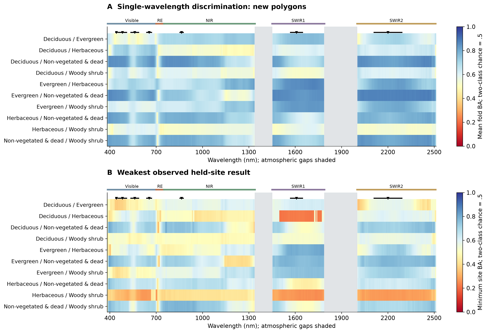

# Where do researcher categories differ, and can those differences predict?

The current [three-question validation](index.md#three-distinct-scientific-questions)
adds matched random/temporal recognition and same-candidate abundance controls.
The latter removes the larger-library NEON ridge advantage when reduced to the
exact 15 MESMA parents. Treat the preceding numerical snapshot below as a
preserved companion, with this new capacity limitation.

The sole primary grouping is the five recorded [researcher categories](labels.md).
Statistical difference, recognition and fractional abundance are separate tasks.

## Whole-spectrum and individual-wavelength evidence

Existing exact-acquisition-history tests compare whole polygon/year curves
within site/year cohorts. Labels move as synchronized curves inside eligible
mixed blocks, preserving wavelength covariance. Maximum and integrated evidence
combine into an NPC test; Holm controls the declared pair/cohort family.
All forty supported researcher-category comparisons are retained as evidence,
with varying effect magnitudes rather than forty identical biological effects.

The new atlas derives wavelength-wise evidence from the saved null maxima:
maximum-statistic correction across coordinates, then Bonferroni across forty
pair/cohort contrasts. These full-cohort descriptive tests are **not used to
select features for predictive tests**. Atmospheric gaps remain disconnected.
A statistically supported coordinate may still predict individual polygons poorly.

## Single-wavelength discrimination and transfer

A prespecified balanced-prior univariate discriminant learns its direction and
threshold from training identities only. It measures held-out balanced accuracy,
AUC, sensitivity and specificity for every category pair and usable coordinate.
It is a particular predictive rule, not an upper bound on all information in a
channel. Site/year values, sign consistency, rank dependence and the weakest
observed-site score stay visible rather than disappearing into one average.

## Complementary spectral measurements

An orthogonal residual selector searches for complementary label information.
Every inner group fold refits selection; inner balanced accuracy chooses logistic
regularization. Outer new-polygon and entire-site tests remain untouched.
Budgets are 1,2,3,5,7,10,20,50,100 and all supported coordinates, plus synthetic
OLI. Independent top-coordinate ranking is not called an optimal sensor design.

--8<-- "docs/spectral-library/_researcher_information.md"

[Versioned atlas, numerical products and methodology](https://github.com/earthlab/spectralbridge/tree/main/provenance/researcher-pft-information/2026-10-15/v1)
contains class recall/precision/specificity, full confusion matrices and explicit
year-transfer support. Complete NIWO paired histories are held out together;
reused later annotations remain a temporal-interpretation limitation.

*The same prespecified single-wavelength rule can recognize sampled identities and fail at an entire held-out site. The map is predictive performance, not a p-value or a claim about every possible nonlinear rule.*
