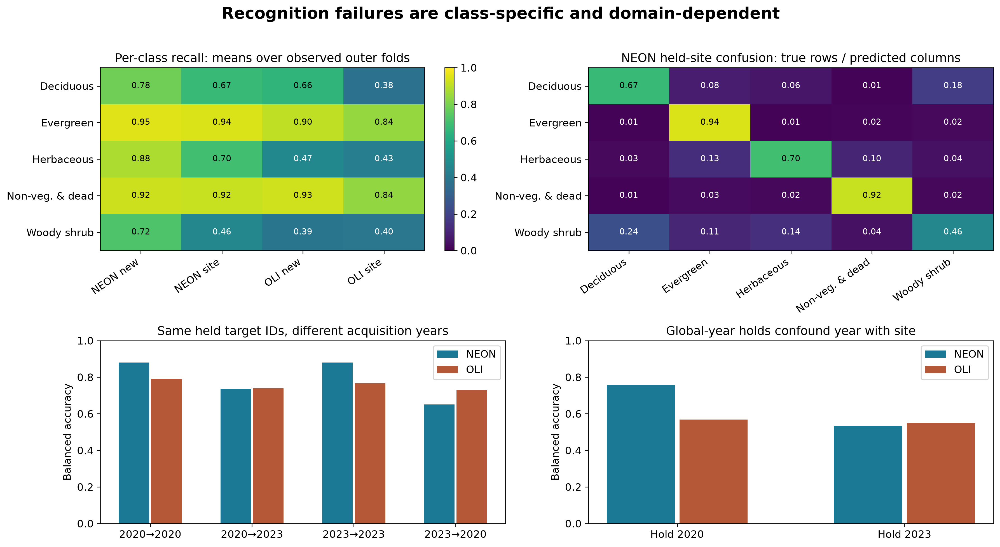
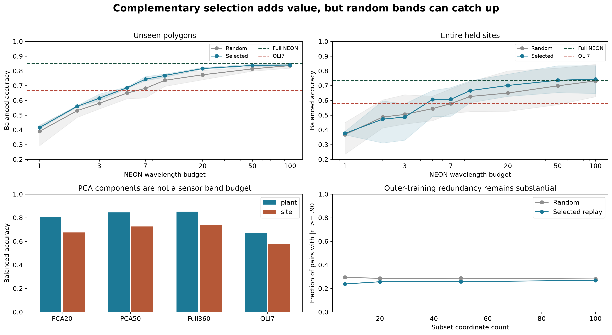

# Identifiability: can unseen observations be recognized?

Here **identifiability** means predictive recognition of a held-out labelled
observation. Mathematical identifiability of mixture fractions is a different
injectivity question, explained on the [mathematics page](mathematical-guarantees.md).

## Scientific result

Full-NEON five-category mean balanced accuracy is **85.2% for unseen polygons**
and **73.8% for held sites**. Balanced accuracy averages category recalls, so a
common category does not dominate the headline. Splits keep entire GlobalID
histories out of training. Labels refer to recorded polygon footprints, not
verified pure material or independent annual biological truth.



**What you see:** class-specific recognition, a normalized confusion matrix and
paired/global-year evaluations.
**What to notice:** Woody shrub held-site NEON recall averages **46.3%**; Evergreen
and background transfer more reliably. Paired temporal directions behave differently.
**What it means:** the average hides important class and domain failures.
**What it does not mean:** three sites or retrospectively reused annotations prove
transfer to arbitrary regions or annual biological change. Global-year targets
also change site composition; they do not isolate time alone.

## How much spectral information is needed?



**What you see:** selected complementary coordinates against five fixed matched
random paths, with PCA/full-spectrum comparisons.
**What to notice:** at 20 coordinates held-site BA is **70.1% selected versus 65.0%
random**. Small subsets do not always win; the gap narrows at large budgets.
**What it means:** complementary measurements add conditional moderate-budget value.
**What it does not mean:** the selector finds universally optimal bands, the envelopes
are confidence intervals, or PCA observes only its number of output components.
PCA uses all input coordinates; preprocessing and selection use training data only.

## Run this analysis with SpectralBridge

```python
import numpy as np
from spectralbridge.library_analysis import evaluate_identifiability, evaluate_feature_budget
rng = np.random.default_rng(2)
labels = np.repeat(['A', 'B'], 18)
spectra = rng.normal(size=(36, 6)) + (labels == 'B')[:, None]
identities = np.arange(36)
result = evaluate_identifiability(spectra, labels, identities, folds=3, inner_folds=2)
curve = evaluate_feature_budget(
    spectra, labels, np.arange(500., 506.), identities,
    budgets=(1, 3), random_replicates=2, folds=3, inner_folds=2,
)
print(result['class_metrics'])
print(curve['curve'])
```

Pass `domains=site_codes` (or years) to hold out each supplied domain and purge all
its identities globally. Every target class must occur in training. Insufficient
inner grouped support raises an informative error; supply a single prespecified
`regularization=(1.,)` only when tuning is intentionally unnecessary.

The output retains predictions, class-ordered scores, confusion, outer row/identity
memberships, inner memberships, hyperparameters and fitted pipelines. Metrics give
each identity equal total weight within a fold; fitting uses supplied rows, so
aggregate or balance excessive repeated histories before fitting. Probabilities
are classifier scores, not calibrated ecological uncertainty. Feature budgets are
prespecified experimental settings, not chosen using the outer scores. Random
paths are fixed, label-independent and nested across budgets.

[Canonical primary scores](https://github.com/earthlab/spectralbridge/blob/main/provenance/researcher-pft-information/2026-10-15/v1/tables/complementary_feature_performance.csv),
[class recall](https://github.com/earthlab/spectralbridge/blob/main/provenance/researcher-pft-information/2026-10-15/v1/tables/class_specific_transfer.csv)
and [new controls](https://github.com/earthlab/spectralbridge/blob/main/provenance/researcher-evidence/2026-10-16/v1/tables/recognition_control_summary.csv)
retain the exact values and fold scope.
