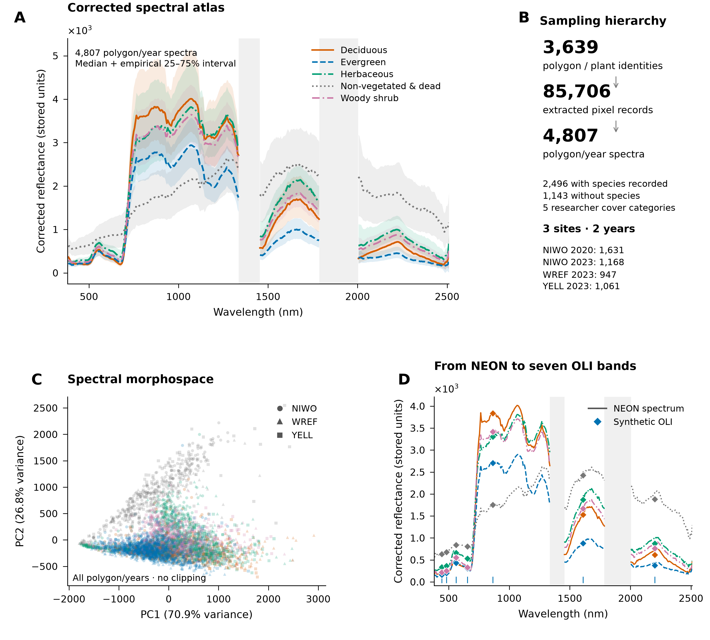

# What is the SpectralBridge spectral library?

A spectral library links wavelength-dependent reflectance to observations and
their provenance. SpectralBridge reads a supplied polygon-extraction Parquet in
place, preserves identities, and produces compact summaries rather than another
pixel cache. Its original purpose remains reproducible NEON and drone processing
and comparison across sensors and scales.

## From measurements to ecological questions

NEON / supported drone inputs<b aria-hidden="true">→</b>Correction and QA<b aria-hidden="true">→</b>Polygon spectral library<b aria-hidden="true">→</b>Biological variation<b aria-hidden="true">→</b>Sensor translation and independent comparison<b aria-hidden="true">→</b>Experimental mixture readiness

These are optional linked analyses, not mandatory pipeline stages. A researcher
may stop at a corrected raster or a library summary. Sensor translation does not
supply independent validation, and mixture readiness is a further research question.

## What does one spectrum represent?

Pixels are reduced to wavelength-wise medians for each polygon/plant within a
flight/source observation. Repeated observations receive equal weight when
forming a plant or polygon/year median. Site and acquisition year come from
source identities, not an unrelated folder date. Repeated years retain the same
GlobalID; they are not independent new plants. Pixel counts affect precision and
heterogeneity, but do not become biological replicate counts.

Metadata include source table/image, flight, polygon identity, GlobalID,
species, cover labels and available site/year/shade annotations. Completeness
varies; missing labels are retained as missing, not guessed. Read the
[class systems](labels.md) before grouping observations.

--8<-- "docs/spectral-library/_snapshot.md"

## A view of the empirical library

*The supplied library contains substantial within-category variation and organized,
overlapping spectral structure. Shading around category medians is the empirical
25–75% interval, not a confidence band. Atmospheric gaps stay disconnected. PCA
includes every polygon/year observation; its first two axes explain 70.9% and
26.8% of wavelength-weighted variance. Diamonds show synthetic OLI values from
the same observations. Library reflectance remains in stored units because
absolute scaling is unresolved.*

[Figure methods and panel sources](https://github.com/earthlab/spectralbridge/blob/main/provenance/publication-figures/2026-10-14/FIGURE_SOURCE_AUDIT.md)
· [Reproducible Python source](https://github.com/earthlab/spectralbridge/tree/main/examples/publication_figures)
· [Numerical and visual validation](https://github.com/earthlab/spectralbridge/blob/main/provenance/publication-figures/2026-10-14/FIGURE_VALIDATION.md)

## Choose an analysis

- [Inspect an existing library](../vignettes/spectral-library.md): stable public preflight and compact summaries.
- [Build an empirical atlas](atlas.md): native grids, atmospheric gaps, site/year aggregation and variability.
- [Ask whether groups differ](biological-variation.md): conditional whole-spectrum comparisons and their limits.
- [Check sensor information retention](sensor-transfer.md): paired NEON versus synthetic OLI.
- [Compare with real Landsat](../validation/landsat-pilot.md): a separate, single next-day pilot.
- [Assess mixture readiness](mesma-readiness.md): experimental endmember and fraction diagnostics.

These results support questions about the sampled library. They do not establish
novel-species classification, regional abundance maps, causal PFT mechanisms or
universal sensor calibration. See [evidence levels](../validation/scientific-validation.md)
and the [API maturity map](../api/scientific-analysis.md).
