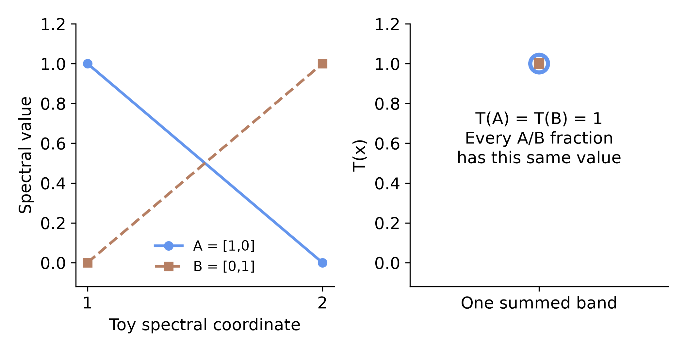

# What the mathematics guarantees

A proof answers a precise conditional question. It does not certify physical
calibration, field biology or every execution of a Python algorithm.
The [formal verification layer](https://github.com/earthlab/spectralbridge/tree/main/formal)
is separate from production execution; advanced readers can inspect the
[checked status matrix](https://github.com/earthlab/spectralbridge/blob/main/formal/PROOF_STATUS.md)
and [illustrated report](https://github.com/earthlab/spectralbridge/blob/main/formal/report/SpectralBridge_Formal_Verification_Explained.pdf).

## Preserving a mixture equation

For an ideal mixture, `y = Σ fᵢ xᵢ`. For the **same fixed linear transformation**
T on the target and every reference, `T(y) = Σ fᵢ T(xᵢ)`.

**In plain language:** transforming a weighted sum gives the weighted sum of
the transformed components, with the same weights. Fixed convolution coefficients
and fixed bandwise multipliers have this property on common finite support.

For an affine map `A(x) = T(x) + b`, mixture preservation also holds when
`Σ fᵢ = 1` (or the offset defect vanishes).

**In plain language:** a shared additive offset is applied once to either side
when the mixture fractions sum to one. Different spatial gains, scene-fitted
parameters, changing masks, clipping or hierarchical medians require separate
justification. The proof does not make the complete data-dependent pipeline linear.

## Preserving composition does not preserve identifiability



**What you see:** distinct hyperspectral component vectors and their reduced observations.
**What to notice:** two distinct components map to the same measurement; mixtures
still obey the transformed weighted-sum equation.
**What it means:** algebraic preservation can coexist with lost inverse information.
**What it does not mean:** every reduced sensor or restricted library is ambiguous.
A lower-dimensional map is noninjective on the full space, but a particular
restricted generating simplex can remain identifiable.

The proved example uses A=(1,0), B=(0,1) and T(x)=x₁+x₂. Both components map to 1.
Every A/B mixture also maps to 1: no inverse rule can distinguish their weights
from that measurement alone. A fixed linear map cannot restore distinctions that
were already absent.

## Solvers answer different questions

| Method / claim | What is established | What is not established |
|---|---|---|
| Ideal FCLS | Convex objective; a minimizer exists, unique under transformed-library identifiability; known-parent recovery under stated assumptions | Every finite-tolerance Python execution or correct real biological references |
| Finite MESMA | Tolerance-aware selection bound over admitted finite candidates | Unrestricted exact optimization over all possible materials |
| Near-fit ambiguity | Restricted near-set inclusion/monotonicity; explicit counterexamples to unique composition from exact fit | Exhaustive physical uncertainty |
| Ridge | With fixed preprocessing and positive penalty, a unique centered coefficient minimizer per output column | Unique physical inverse or universal superiority to MESMA |
| Euclidean simplex projection | Valid fractions; unique projection; idempotence; no farther from a feasible truth in Euclidean error | Added spectral information, biological truth, or full formal equivalence of the Python sorting routine for every floating input |

The exact-real theorems are **PROVED**, conditional on their explicit hypotheses.
The finite rational/Python examples are **NUMERICALLY CHECKED**. Observed recognition
and fraction scores are **EMPIRICALLY SUPPORTED within the stated sampled design**.
These statuses must not be exchanged.

## The assumption ladder


**What you see:** mathematics → implementation → sensor physics → spectral library
→ biological representation → field abundance.
**What to notice:** each level needs evidence that the preceding proof cannot supply.
**What it means:** proofs and observations complement each other.
**What it does not mean:** passing one level automatically validates the next.

| Level | Current status and evidence |
|---|---|
| Mathematics | **PROVED / CONDITIONAL:** fixed linear/affine preservation, information-loss counterexamples and ideal inference results |
| Implementation | **NUMERICALLY CHECKED:** conformance fixtures; full floating-point equivalence remains unproved and audited discrepancies remain queued |
| Sensor physics | **CONDITIONAL:** same-source response/translation arithmetic is not independent cross-platform calibration |
| Spectral library | **EMPIRICALLY SUPPORTED / CONDITIONAL:** sampled labels and held-domain experiments; adequacy for new targets is not guaranteed |
| Biological representation | **CONDITIONAL / NOT ESTABLISHED:** recorded categories do not prove pure materials, annual biological truth or correct physical mixing |
| Field abundance | **NOT ESTABLISHED:** independent contemporaneous fractional-cover validation is missing |

The [implementation audit](https://github.com/earthlab/spectralbridge/blob/main/formal/IMPLEMENTATION_AUDIT.md)
includes reproduced axis-inference and overlapping extraction-window defects.
Their historical scientific impact is **not yet established**; source lineage must
be audited before regenerating results. No production fixes are part of this
package/documentation expansion.

## Run this analysis with SpectralBridge

```python
from spectralbridge.library_analysis import project_simplex, candidate_ambiguity
print(project_simplex([-2., 1., .8]))  # [0., .6, .4]: valid geometry
alternative = candidate_ambiguity(
    [[1., 0., 0.], [0., .5, .5]], [0., 0.], tolerance=.01,
    class_order=['C', 'A', 'B'],
)
print(alternative['ranges'])  # exact fit can coexist with different fractions
```

The proof does not tell us that every abundance estimate is true. It tells us
precisely what must be true for an abundance estimate to have the interpretation
we give it.
