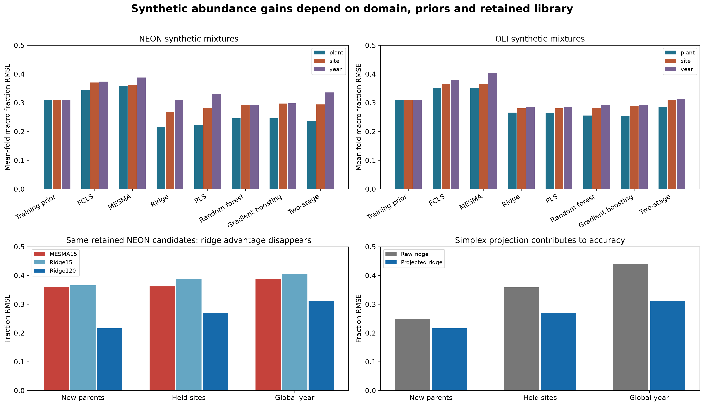
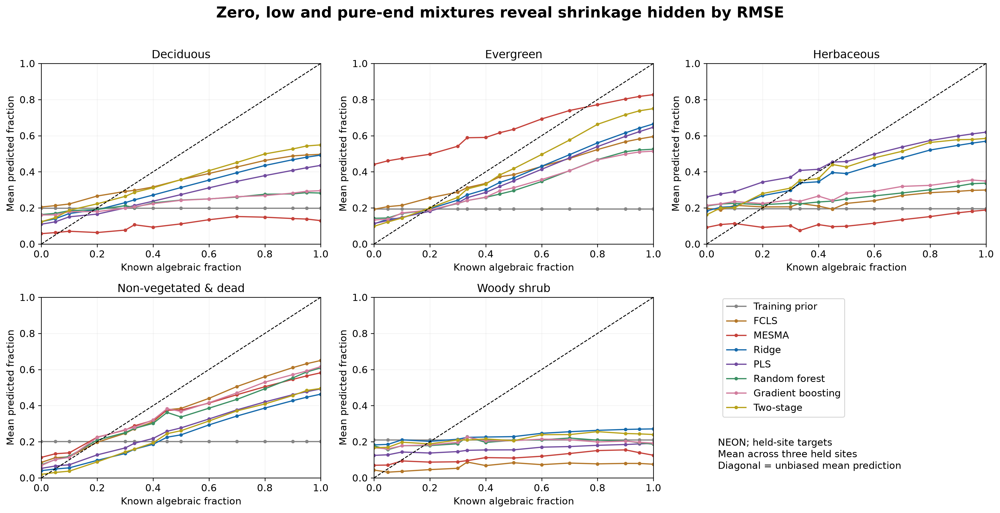
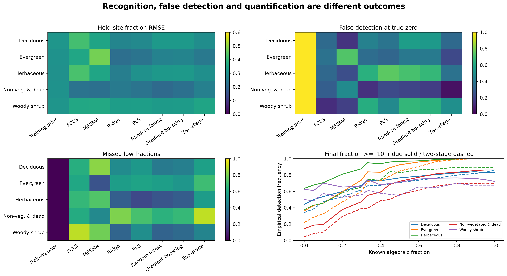
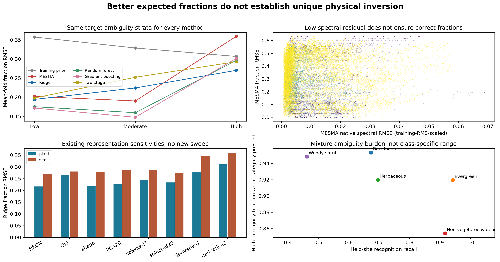

# Can researcher-category fractions be estimated reliably?

The current [three-question validation](index.md#three-distinct-scientific-questions)
adds matched random/temporal recognition and same-candidate abundance controls.
The latter removes the larger-library NEON ridge advantage when reduced to the
exact 15 MESMA parents. Treat the preceding numerical snapshot below as a
preserved companion, with this new capacity limitation.


!!! warning "Controlled synthetic benchmark, not field abundance validation"
    Exact mixture weights are known because observed polygon spectra are mixed
    algebraically. They are not independently measured biological cover fractions.

The canonical benchmark uses only Deciduous, Evergreen, Herbaceous,
Non-vegetated & dead, and Woody shrub. All methods receive identical mixtures
and independent parent roles. No GlobalID appears in both training and test,
even through another year or acquisition.

## Competing approaches

Compare finite-tolerance FCLS, existing EAR-candidate MESMA, regularized multi-output ridge,
PLS, random forest, gradient boosting, and a presence-then-conditional-abundance
model. Supervised predictions are projected onto nonnegative, sum-one fractions.
Hyperparameters and detection cutoffs use separate training/tuning parent sets.
Automatic row-level boosting validation is disabled. Synthetic rows sharing
parents do not become independent biological replication.

The primary experiment has 24 training parent bundles (120 independent IDs),
eight tuning bundles (40 IDs) and up to twelve test bundles (60 IDs). Every bundle
contains one distinct parent per researcher category. Curves include zero and
low fractions; all related mixtures stay together in uncertainty calculations.
Training-diversity sensitivity, spectral shape, disconnected derivatives, PCA,
PLS and selected coordinates are reported separately from the primary models.

## What distinguishes a good fit from the right fractions?

MESMA near-solution fraction ranges identify candidate-library ambiguity at a
stated training-scaled tolerance. All methods are stratified on the same target
ambiguity categories. A common class-mean reconstruction diagnostic permits
comparison across methods; native MESMA residuals are retained separately.
Known-parent oracle controls test the solver under the idealized linear model.
An oracle is unavailable in deployment and does not validate material purity.

Model improvements within a synthetic distribution must also survive held-site
and temporal targets. Bias, class RMSE/MAE, low-abundance error, false detections,
calibration and detection curves matter more than an isolated average RMSE.
Bootstrap intervals resample parent bundles, not dependent fraction levels.

## The remaining validity gate

Even a successful synthetic model does not establish unique physical inversion
or field-cover accuracy. Recorded cover categories can be mixed materials;
units/purity, balanced independent domains and independently measured complete
fractional cover remain essential. A small residual is not membership evidence.

[Final versioned benchmark, figures and report](https://github.com/earthlab/spectralbridge/tree/main/provenance/researcher-pft-information/2026-10-15/v1)
retains positive, failed and inconclusive experiments with their exact scope.

## Current matched-library result

The controlled chain is **known synthetic mixtures → FCLS / MESMA / ridge →
fraction estimates → error and ambiguity**. The known-parent FCLS oracle is
nearly exact (maximum saved fraction RMSE approximately 3.9e-13); deployment
usually lacks those true generating references.

| NEON synthetic target | Ridge120 | MESMA15 | Matched Ridge15 | No-spectrum prior |
|---|---:|---:|---:|---:|
| New parents | 0.216 | 0.359 | 0.365 | 0.309 |
| Held site | 0.269 | 0.362 | 0.387 | 0.309 |
| Global year | 0.311 | 0.388 | 0.405 | 0.309 |

Values are mean-fold macro fraction RMSE (lower is better). **Ridge120's gain
is lost when restricted to the exact 15 MESMA candidates in NEON.** Do not claim
intrinsic ridge superiority. Library representation and retained spectral diversity
matter; the control also changes bundle count and priors, and does not isolate
one cause. Global-year ridge fails the prior on average. Paired-year tests and
class-specific errors remain necessary; changing site composition confounds global
year with geography.



**What you see:** main model errors, matched-parent fairness, projection and oracle controls.
**What to notice:** the larger-library gain is conditional; global-year and matched15
comparisons expose failures hidden by the main average.
**What it means:** representation, priors and domain shift constrain conclusions.
**What it does not mean:** any method recovers field cover or is intrinsically superior.

### Detection and quantification need separate checks



**What you see:** predicted versus known algebraic category fractions.
**What to notice:** absent classes can receive positive fractions and high fractions shrink.
**What it means:** average RMSE can conceal systematic calibration error.
**What it does not mean:** synthetic pure endpoints are verified pure biological materials.



**What you see:** class errors and thresholded detection behavior.
**What to notice:** false positives and low-fraction misses trade off, particularly
for hard categories; the comparison cutoff is 0.10.
**What it means:** detection of presence and quantification conditional on presence
are separate performance questions.
**What it does not mean:** 0.10 is an independently validated field detection limit.

### Ambiguity is a separate question

MESMA asks which evaluated mixture reconstructs the spectrum well. Ridge asks
what fractions are predicted given the training distribution. Ambiguity asks
whether substantially different candidate fractions fit almost as well.



**What you see:** synthetic error and residual patterns across near-fit ambiguity.
**What to notice:** better expected fraction prediction can coexist with alternative
compositions; the moderate stratum can favor MESMA.
**What it means:** reconstruction, prediction and uniqueness are different objectives.
**What it does not mean:** evaluated candidate ranges at additive RMSE tolerance
0.01 exhaust all feasible or physical uncertainty. The historical diagnostic retained
one solution per class set; the public API can retain each explicit evaluated model.
Neither enumerates a continuum of all feasible fractions. Different candidate
models can yield identical fractions; counts include those redundant solutions,
while fraction ranges show whether their compositions actually differ.

## Run this analysis with SpectralBridge

```python
import numpy as np
from spectralbridge.library_analysis import (
    generate_mixtures, constrained_unmixing, fit_mesma,
    fit_ridge_fractions, fraction_diagnostics, evaluate_library_size,
)
endmembers = np.eye(3)
labels = np.array(['A', 'B', 'C'])
training = generate_mixtures(endmembers, labels, ['trainA', 'trainB', 'trainC'])
target = generate_mixtures(endmembers + .01, labels, ['testA', 'testB', 'testC'])
oracle = constrained_unmixing(target['spectra'], endmembers + .01)
mesma = fit_mesma(target['spectra'], endmembers, labels, max_components=3)
ridge = fit_ridge_fractions(training['spectra'], training['truth'], alphas=(.01,))
prediction = ridge.predict(target['spectra'])
errors = fraction_diagnostics(target['truth'], prediction['projected_prediction'])
print(errors['per_class'])
print(mesma['ambiguity'][0]['ranges'])
```

These invented parents teach the API; they are not an independent validation
experiment. FCLS is limited to 12 references; MESMA enforces explicit model budgets
and returns selected IDs, component/category fractions, reconstruction, residuals,
all evaluated model solutions and numerical tolerances. Candidate restrictions
use tuples of library row indices. Ordering is explicit through `class_order=`
and `endmember_ids=`. Raw ridge and projected fractions remain separately accessible.

For tuning several ridge alphas, supply independent **parent-connected bundles**
as `groups=`; no generating parent may cross a tuning boundary. Mixtures that
share a parent cannot be made independent by giving each mixture a different ID.
Bootstrap uncertainty also needs those independent bundles. The API retains
preprocessing parameters and tuning memberships.

Use `evaluate_library_size(spectra, labels, identities, sizes=(...), ...)` to
compare random, class-balanced random and training-standardized farthest-point
selection under identical outer targets and a fixed classifier. It returns selected
identities, coverage distances and predictive scores. Unsupported class coverage
is reported explicitly. This capacity diagnostic is separate from the historical
ridge/MESMA comparison and does not retroactively isolate its confounders.

[Source abundance summaries](https://github.com/earthlab/spectralbridge/blob/main/provenance/researcher-evidence/2026-10-16/v1/tables/abundance_domain_summary.csv),
[matched15 results](https://github.com/earthlab/spectralbridge/blob/main/provenance/researcher-evidence/2026-10-16/v1/tables/same_candidate_ridge.csv)
and [oracle controls](https://github.com/earthlab/spectralbridge/blob/main/provenance/researcher-pft-information/2026-10-15/v1/tables/oracle_solver_controls.csv)
preserve the exact values. Independent field fraction truth is still missing.

## Exhaustive search of the supplied 603-member library

A separate fixed-library experiment extends the selected-endmember diagnostics
with all **16,918,447** one-, two- and three-category combinations, evaluated for
all **360 unchanged synthetic targets** (6,090,640,920 target–model evaluations).
Each category contributes at most one reference to a candidate. This experiment
uses the supplied seven-band undarkened OLI representation and does not replace
the preceding broader method-comparison benchmark.

The analysis-only streaming runner is recorded in
[`provenance/endmember-quality/2026-10-19/exhaustive-v1`](https://github.com/earthlab/spectralbridge/tree/main/provenance/endmember-quality/2026-10-19/exhaustive-v1).
It evaluates fixed-size batches, checkpoints compact winners by category set,
rejects incompatible restart inputs/code, and applies the existing numerical
rank/interior/improvement thresholds. Raising the eager enumeration budget in
`mixtures.fit_models` is not a bounded-memory way to run this experiment.

Interpret reconstruction RMSE and known-fraction RMSE separately. Removing
candidate screening guarantees access to the shortlisted feasible models;
it does not guarantee better fractions. The same synthetic targets, dense and
sparsity-matched fraction priors, and known-parent oracle are retained for
comparison. Whole-bundle paired resampling respects shared generating parents.
Near-category-set counts summarize one best interior solution per category set,
not all possible abundance ranges.

Although target parent IDs are absent from the candidate library, selection used
the whole archive. This remains an **internal synthetic diagnostic**, not
selection-blind validation or independently measured field PFT-cover accuracy.

In this fixed-library experiment, mean spectral reconstruction RMSE fell from
0.003721 to 0.000792 (78.7%), while pooled PFT fraction RMSE changed from 0.3215
(screened three-per-category) to 0.3336 (exhaustive). Fraction error improved for
156 targets and worsened for 203, with one effectively unchanged. The paired
whole-bundle bootstrap range for exhaustive minus screened fraction RMSE was
[-0.0055, +0.0289]; only eight bundles were available. Thus full search resolved
the screening question for this benchmark but did not demonstrate improved
fraction recovery. See the packet's illustrated report and compact comparison
tables for category errors, priors, ambiguity and numerical verification.
