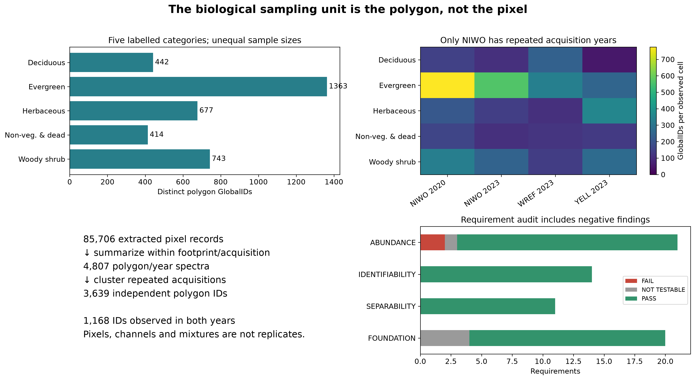

# From spectra to ecological inference

**Difference → identity → quantity → uniqueness → field validation.**
Each arrow requires additional evidence. A spectral difference can be real while
an unseen observation is difficult to recognize. Useful predictions of synthetic
fractions can coexist with alternative compositions that fit almost equally well.

The current groups are the recorded researcher `cover_category` labels:
**Deciduous, Evergreen, Herbaceous, Non-vegetated & dead, and Woody shrub**.
The background/dead category is a recorded comparator, not a biological plant
functional type. Species-derived historical groupings are not the primary results.

## What was tested, and what was found?

| Question | Current evidence | What remains unestablished |
|---|---|---|
| [Difference](separability.md) | All 10 category pairs differ in the 4 acquisition-matched cohorts (40 supported contrasts) | Universal differences across regions, correct physical units or causal mechanisms |
| [Identity](identifiability.md) | Full-NEON mean balanced accuracy: **85.2% unseen polygons**, **73.8% held sites** | Dependable recognition in arbitrary regions/years; Woody shrub is particularly difficult |
| [Information retention](sensor-transfer.md) | Synthetic OLI recognition is **66.8% / 57.7%** under the same two evaluation types | Independent actual Landsat performance or calibration |
| [Quantity](mesma-readiness.md) | Ridge120 synthetic fraction RMSE: **0.216 / 0.269** for new parents / held sites | Field fractional cover; intrinsic superiority over MESMA |
| [Uniqueness](mesma-readiness.md#ambiguity-is-a-separate-question) | Alternative evaluated candidate fractions can fit nearly equally well | Exhaustive physical uncertainty or a unique biological inverse |
| Field validation | Independent contemporaneous fractional-cover truth is missing | Operational field abundance accuracy |

Scores are conditional mean-fold summaries, not deployment guarantees or
confidence intervals. The library was extensively explored before this structured
reanalysis; it is not an independently preregistered confirmation.



**What you see:** category support, spectra and the study's validity gates.
**What to notice:** the sampling unit is an independent polygon identity, with
repeated acquisitions and only four site/year cells.
**What it means:** the library supports controlled comparisons with explicit domain limits.
**What it does not mean:** pixels, repeated years or generated mixtures are new
independent biological samples; category labels do not certify material purity.

## The abundance fairness result changes the interpretation

The larger Ridge120 model improves expected synthetic fraction error relative
to the 15-candidate MESMA configuration. Restrict ridge to the **same 15 retained
parents**, and the original NEON advantage disappears: new-parent RMSE becomes
0.365 versus MESMA 0.359; held-site RMSE becomes 0.387 versus 0.362.
This does not establish that ridge is intrinsically superior to MESMA.
**Library representation and retained spectral diversity matter.** Capacity,
training bundles and priors change together, so the control does not isolate a
single causal mechanism. Global-year ridge also fails the no-spectrum prior on average.

## What exhaustive endmember searching adds

The supplied 603-member synthetic OLI reference library was searched over all
16,918,447 permitted one-to-three-category combinations for each of 360 fixed
synthetic targets. Mean spectral RMSE fell from 0.003721 to 0.000792, while pooled
PFT fraction RMSE changed from 0.3215 to 0.3336. Fraction error improved for 156
targets and worsened for 203, with one effectively unchanged. The paired
eight-bundle uncertainty range includes no aggregate difference.

**Better spectral reconstruction does not guarantee better compositional
recovery.** Candidate screening does not explain away this benchmark result;
it is not a universal MESMA failure or proof that all physical inversions are
impossible. Selection used the whole library, so this remains an internal
synthetic test, not field-cover validation. See the
[experiment and numerical checks](mesma-readiness.md#exhaustive-search-of-the-supplied-603-member-library)
and [versioned report](https://github.com/earthlab/spectralbridge/tree/main/provenance/endmember-quality/2026-10-19/exhaustive-v1).

## What the mathematics adds

[Fixed linear and appropriate affine transformations preserve an ideal mixture
equation](mathematical-guarantees.md). They can still lose information needed to
recover its weights. A unique fitted ridge prediction is not a unique physical
inverse. A valid simplex fraction vector is not evidence of correct biology.
Formal proofs clarify hypotheses; numerical checks and independent observations
test whether the implementation and world meet them.

## Run these methods on your own library

From a source checkout, install the analytics extra for the generic numerical API:

```bash
python -m pip install -e '.[analytics]'
```

These functions are part of this checkout; a containing PyPI release has not
been verified. Start with the
[API contracts](../api/scientific-analysis.md#reusable-library-analysis-methods)
and [offline teaching example](https://github.com/earthlab/spectralbridge/blob/main/examples/spectral_library_methods.py).
The example connects separability, recognition, feature budgets, paired
representations, mixtures, FCLS/MESMA/ridge, ambiguity, errors and library capacity
using invented data. Numerical API stability is distinct from ecological validity.

## Evidence and next observations

The [canonical evidence packet](https://github.com/earthlab/spectralbridge/tree/main/provenance/researcher-evidence/2026-10-16/v1)
contains the claim registry, random/PCA controls, matched15 comparison, source
identities and adversarial checks. Its
[numerical companion](https://github.com/earthlab/spectralbridge/tree/main/provenance/researcher-pft-information/2026-10-15/v1)
contains the primary recognition scores and synthetic benchmark.
[Figure source hashes](integration-figure-sources.json) identify the reused artwork.
Collect independent aligned field fractions, verify units and purity, add sites
crossed with years, and reannotate repeated observations contemporaneously.
More mixtures from the same parents cannot supply those observations.
