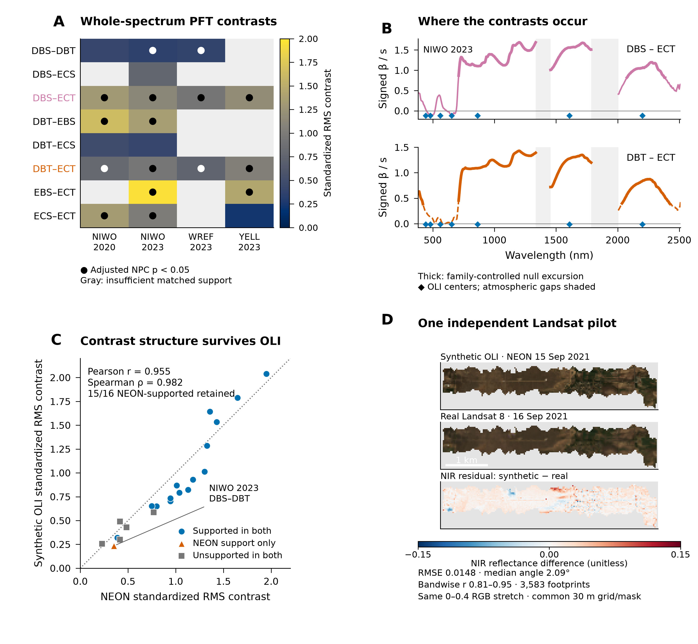

# Does ecological spectral structure survive fewer bands?

Corrected NEON imaging spectroscopy can be reduced to synthetic seven-band
Landsat OLI-like representations. The paired experiment uses identical
polygon/year memberships and acquisition-history blocks in both representations.
**Synthetic OLI is derived from NEON; it is not independent Landsat validation.**

*Strong and weak ecological contrasts remain visible together. The scatter
summarizes all 21 eligible inferred-PFT comparisons; 15 of 16 NEON-supported
comparisons retain support in synthetic OLI. The final panel uses a separate real
R10C acquisition pair, not satellite observations of these exact library polygons.*

[Open the information-retention figure at full resolution](../images/spectral-library/figure-2.png) · [Panel sources and statistics](https://github.com/earthlab/spectralbridge/blob/main/provenance/publication-figures/2026-10-14/FIGURE_SOURCE_AUDIT.md)
· [Reproducible figure code](https://github.com/earthlab/spectralbridge/tree/main/examples/publication_figures)
· [Complete sensor analysis](https://github.com/earthlab/spectralbridge/tree/main/provenance/sensor-pft-transfer/2026-10-14)

## What is retained?

Effect rankings are closely aligned (Spearman 0.982; Pearson 0.955 across the fixed
21 dependent comparisons). Some magnitudes compress; the median inferred-PFT
OLI/NEON effect ratio is 0.824. These are representation-specific separation
ratios, **not literal percentages of all ecological information**. NEON uses
quadrature over disconnected wavelength segments; OLI uses equal channel weights.
The different metrics, coverage and spectral averaging all matter.

--8<-- "docs/spectral-library/_transfer.md"

NIWO 2023 DBS–DBT loses borderline support: adjusted NPC p changes from 0.045 to
0.855, with effect ratio 0.665. Membership is identical, so sample loss does not
explain it. This does not demonstrate an intrinsically hyperspectral-only
mechanism. All five previously unsupported inferred comparisons stay unsupported.

## Wavelengths and sensor support

Repeated DBS–ECT and DBT–ECT excursions occur in the audited NIR/SWIR regions.
OLI samples broad SWIR structure but lacks channels centered near the cited
955–1030 and 1140–1335 nm intervals. Channel support is not a causal physiological
attribution. Thick curve segments in the figure are family-controlled maximum
null excursions, not effect confidence bands or every possible source of NPC
support.

Stored MicaSense coordinate provenance is unresolved (five-band fallback plus
padding in the source export). Its physical transfer branch remains blocked;
complete numerical values do not validate band identity. No guessed coordinates
or MicaSense effect-retention results are presented.

For reusable processing, start with [target-band weighting](../vignettes/sensor-harmonization.md).
For actual independent observations, use the [real-Landsat workflow](../validation/landsat-pilot.md).
