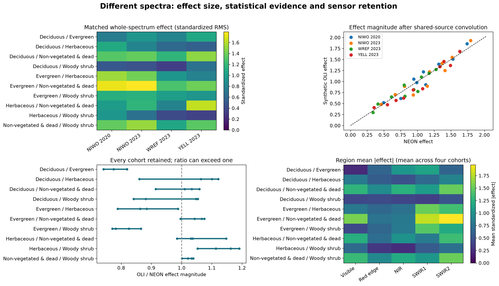
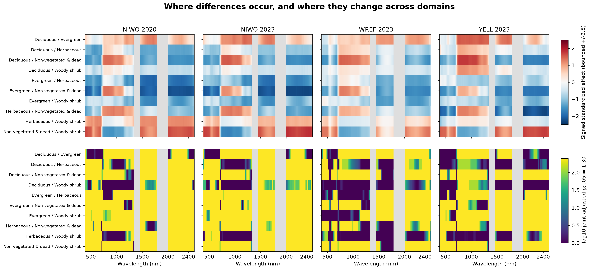

# Separability: where do labelled spectra differ?

## Scientific result

All **ten researcher-category pairs** show whole-spectrum differences in the
observed acquisition-matched cohorts. Four supported cohorts give forty pair/cohort
contrasts; the largest adjusted whole-spectrum p-value is 0.004 in the
[canonical pair-support table](https://github.com/earthlab/spectralbridge/blob/main/provenance/researcher-evidence/2026-10-16/v1/tables/pair_support_and_evidence.csv).
Labels move as whole curves within eligible exact-acquisition-history blocks.
Conditional exchangeability is required; nearby distinct polygons can still be correlated.



**What you see:** pairwise standardized spectral differences and sensor retention.
**What to notice:** strength and retention vary among pairs and domains.
**What it means:** all pairs differ in these matched sampled cohorts.
**What it does not mean:** significance measures recognition accuracy, purity or abundance.
An OLI standardized effect ratio above one can reflect reduced within-class variation.



**What you see:** signed effects above and adjusted evidence below, with masked gaps.
**What to notice:** broad regions carry evidence, but direction and magnitude vary.
The figure's signed effect is the displayed first category minus the second;
the generic API explicitly uses second minus first.
**What it means:** spectral covariance and domain context matter when interpreting coordinates.
**What it does not mean:** adjacent channels are independent confirmations, the map
is a confidence interval, or descriptive full-cohort effects can select predictive
features using held-out targets.

## Run this analysis with SpectralBridge

```python
import numpy as np
from spectralbridge.library_analysis import spectral_separability
rng = np.random.default_rng(2)
labels = np.repeat(['group A', 'group B'], 20)
spectra = rng.normal(size=(40, 6)) + (labels == 'group B')[:, None]
result = spectral_separability(
    spectra, labels, np.arange(500., 506.), groups=np.arange(40),
    permutations=99, regions={'visible example': (500, 505)},
)
print(result['pairs'][['first', 'second', 'p_max_holm', 'p_npc_holm']])
```

Supply true independent identities, not pixel-row IDs. Repeated identity curves
are averaged only when labels and exchangeability blocks are constant. Use
`blocks=` for the justified randomization strata. Strictly increasing wavelengths,
common units and a boolean support `mask=` are required; explicitly mask atmospheric
gaps for real spectra. Default missing-value behavior rejects nonfinite supported
values; `missing='drop_columns'` removes incomplete columns before aggregation.

The API reuses the audited binary statistic kernel. Permutations are synchronized
across wavelengths **within each pair**. Coordinate maxima control that pair's
spectral family; Bonferroni then controls the declared pairs. Whole-spectrum max,
integrated, energy, FPCA and combined NPC p-values receive Holm correction across
pairs separately for each method. This generic call does not automatically recreate
the study's forty-contrast cohort family: callers running additional cohorts must
declare and adjust that larger family. Region summaries are descriptive integrated
effects, not additional unadjusted significance tests.

[Next: can unseen observations be recognized?](identifiability.md)
