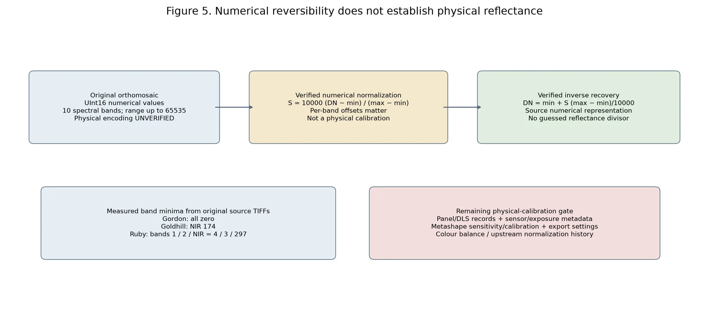
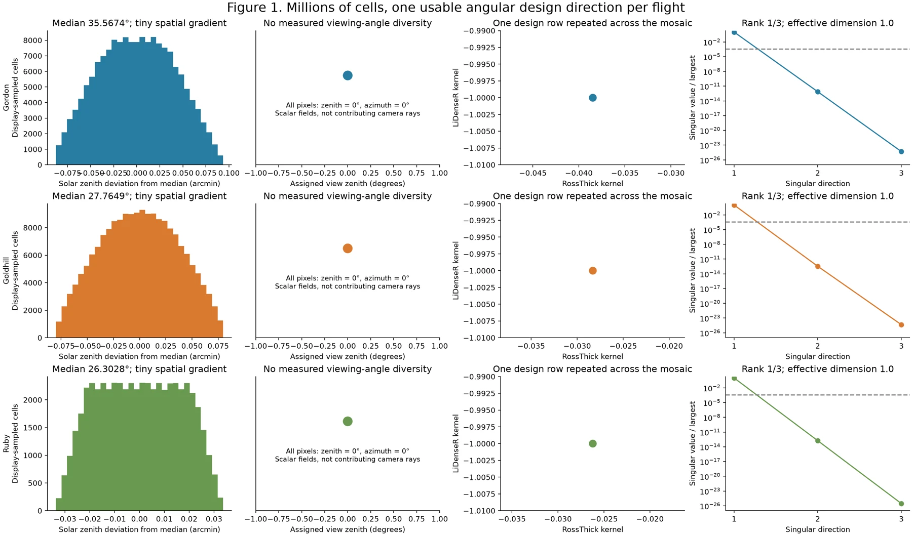
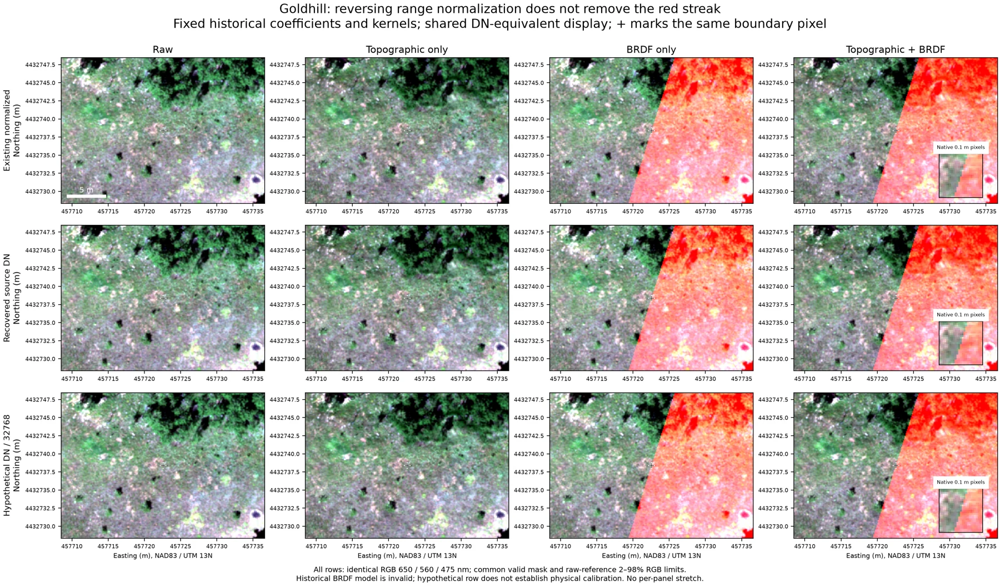
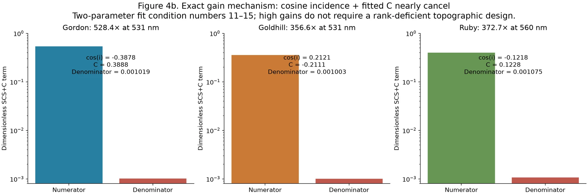

# Drone Processing: Validation Findings and Current Limitations

The October–November 2026 investigations examined **Gordon, Goldhill and Ruby
2023** products. Spatial repairs are validated against their source TIFFs;
physical calibration remains unverified. RC2 engineering now includes conditional
rank-three viewing reconstructions and numerically supported SCS+C domains;
independent physical correction efficacy is not established. These findings
are scoped to the inspected products and their descendants, not every drone
flight or unrelated NEON library.

| Component | Current scientific status |
| --- | --- |
| Spatial alignment | **Validated** for repaired source products; not independent field geolocation accuracy |
| Numerical DN recovery | **Validated** inverse encoding; clean Goldhill source uses alpha-aware 10 cm resampling and zero-offset 10K encoding |
| Physical reflectance calibration | **Unverified**; original calibration/export records missing |
| Historical zero-view BRDF | **Unsupported**: rank 1 of 3; corrected filtering alone cannot repair angular support |
| Reconstructed Goldhill BRDF | **Experimental**: four assumed designs achieve numerical rank 3; true contributors remain unverified |
| Conditioned topographic + BRDF | **Experimental** native products with explicit unsupported illumination; no independent physical approval |
| Spectral libraries | Historical/unapproved; qualified exploratory use only pending validation |

Here, **validated** means demonstrated within the stated evidence boundary;
**unsupported** means required conditions fail; **unverified** means evidence is
insufficient; **experimental** means investigated without production approval;
**planned** describes functionality not yet implemented. A software `VALID`
status is narrower than independent scientific validation.

## RC2 completed engineering

The [integrated reliability investigation](../dev/drone-integrated-reliability.md)
produced seven native experimental Goldhill products, retained both correction
stages, and added spatial fitting/uncertainty controls and conditioned SCS+C.
The native 717 nm combined maximum changes from 63.51 to 1.78, but the shared
all-band support maxima are 0.655 and 0.689: support rejection explains much of
the native decrease. Paired ecological comparisons do not demonstrate a gain.

These are completed conditional experiments. Remaining physical calibration,
contributor geometry and independent validation are scientific scope limitations,
not release-blocking software defects. Gordon and Ruby retain their documented
source/geometry limitations; no views were fabricated for them.

## 1. Spatial integrity

A raster can look plausible while its coordinates attach spectra to the wrong
vegetation. The original H5s retained the TIFF arrays but mixed signed row size,
center/corner references and NAD83/WGS84 declarations. The old ENVI exports were
geographically reflected. Source TIFFs are north-up NAD83 / UTM zone 13N at 0.1 m.
Repairs preserve that grid and validate polygon membership; they do not establish
radiometric accuracy. Follow the [source-alignment check](../vignettes/drone-processing.md#check-spatial-correspondence-before-extraction).

## 2. Radiometric calibration

The stored 0–10,000 range comes from **band-specific min/max normalization**,
not demonstrated reflectance multiplied by 10,000. Original maxima are 65,535;
Goldhill NIR has minimum 174, while Ruby bands 1, 2 and 10 have minima 4, 3 and
297. Gordon minima are zero. The inverse restores a numerical source-DN
representation, not calibrated reflectance or native-resolution camera samples.
The exact normalizing exporter remains unidentified.

*Verified numerical mapping, unverified physical units. Neither a divisor of
10,000 nor 32,768 is authorized by these ranges. See the
[scaling evidence](https://github.com/earthlab/spectralbridge/blob/main/provenance/drone-scale-confirmation/2026-10-30/README.md)
and [radiometric methods](../vignettes/drone-processing.md#numerical-scaling-is-not-physical-calibration).*

## 3. BRDF identifiability and the Goldhill artifact

BRDF describes how the signal changes with illumination and viewing direction.
The current three-parameter RossThick/LiDenseR fit needs independent information
for all three terms. Assigned zero view angles plus scene solar zenith give a
rank-one design in each mosaic; millions of pixels cannot replace missing
viewing diversity.

| Flight | Angular design rank | Supported bands |
| --- | --- | --- |
| Gordon | 1 / 3 | 0 / 10 |
| Goldhill | 1 / 3 | 0 / 10 |
| Ruby | 1 / 3 | 0 / 10 |

*Full-scene diagnostic under the current kernel configuration. The fine spatial
variation in solar angles is not repeated multi-angle observation of a target.
[Angular investigation](../dev/drone-brdf-identifiability-investigation.md).*

Goldhill's extreme red streak was introduced by the historical SpectralBridge
BRDF stage. Stage isolation and exact numerical replay locate the failure:
an unsupported model's observed prediction crossed zero, switching from a
neutral factor to enormous amplification. Reversing normalization did not remove
it. The current gates reject unsupported fits and invalid predictions.

*Historical-model replay for diagnosis only; BRDF panels are invalid scientific
products. Rows compare normalized, recovered-DN and hypothetical DN/32768
representations using common equivalent-DN display limits and the same grid/mask.
The hypothetical divisor is not a calibration. [Experiment and full captions](../dev/drone-radiometric-recovery-experiment.md).*

## 4. Topographic correction

SCS+C adjusts illumination using slope, aspect and solar geometry. The isolated
source-DN diagnostic produced the following maxima and source-valid coverage loss:

| Flight | Maximum diagnostic gain | Coverage loss |
| --- | ---: | ---: |
| Gordon | 528× | 4.08% |
| Goldhill | 357× | 5.49% |
| Ruby | 373× | 1.49% |

*Experimental source-DN replay, not physical correction approval. Very small
positive `cos(i) + C` denominators explain the extreme gains. Terrain provenance,
illumination and fit uncertainty still require review.
[Mechanism and uncertainty](../dev/photogrammetry-metadata-investigation.md#4-terrain-metadata-and-the-scsc-extremes).*

The existing denominator guard does not guarantee safe gains. Polygon-level
spectral consistency and separability changed in mixed directions; no blanket
approval or arbitrary gain cap follows. See [methods](../brdf_topo_algorithm.md).

## 5. Spectral library implications

The matched diagnostic used **301 researcher polygons and 198,309 polygon-pixel
memberships**. These are not independent plant observations. Within-category
variance fell in 8 of 12 sufficiently sampled flight/category groups, but rose in
four; coefficient of variation improved in six and worsened in six. No consistent
separability improvement or cross-flight reflectance harmonization was established.

Historical corrected and translated libraries from these flights remain
unapproved. Preserve their identities and review every dependent merged table,
translation fit and analysis. Regenerate affected contributions only after source
calibration and correction policy are established. Do not declare unrelated NEON
libraries affected. See [library validation](../vignettes/spectral-library.md#drone-library-quality-and-researcher-polygons).

## 6. Current recommendations

1. Preserve originals and repaired spatial provenance; verify alignment before extraction.
2. Keep recovered values labelled source DN until calibration is established.
3. Explicitly omit unsupported BRDF; do not relabel a failed requested fit as success.
4. Hold topographic promotion pending physical inputs, stability and independent validation.
5. Recover the matching Metashape project with complete `.files`, task/export settings,
   camera transforms/intrinsics/contributors, panel/DLS/exposure records and actual timestamps.
6. Inspect a small calibrated overlapping-photo subset before deciding on photo reprocessing.
   Existing calibrated orthomosaics may be useful without additional BRDF if their
   directional domain is suitable; these three have not yet established that calibration.

Metashape reports prove camera geometry was estimated. The archived TIFF-to-H5
converter deliberately created zero-view matrices; the October 29 rebuild copied
those constants into scalar view fields and recomputed solar grids from the
manifest. The original solar grids replay mixed degree/radian errors; new solar
calculations are traceable but acquisition dates remain disputed. The matching
machine-readable project and radiometric settings have not been recovered.
**No duplicate upstream correction is established; it cannot yet be excluded.**

Published UAV methods often work on original overlapping images before mosaicking.
A final selected/blended pixel does not retain its separate source measurements.
See [photogrammetry and literature context](../vignettes/drone-processing.md#photogrammetry-and-directional-information)
and [Choosing Radiometric, Topographic, and BRDF Corrections](../concepts/correction-eligibility.md).

## Technical reports and reproducibility

Read the most recent provenance account when earlier reports differ:

- [October 29 spatial integrity](../dev/drone-spatial-integrity-investigation.md).
- [October 30 AOP/drone radiometry and BRDF audit](https://github.com/earthlab/spectralbridge/blob/main/provenance/radiometry-brdf/2026-10-30/README.md).
- [October 30 numerical scaling confirmation](https://github.com/earthlab/spectralbridge/blob/main/provenance/drone-scale-confirmation/2026-10-30/README.md).
- [November 2 radiometric recovery experiment](../dev/drone-radiometric-recovery-experiment.md).
- [November 2 BRDF strategy and polygon evaluation](../dev/drone-brdf-identifiability-investigation.md).
- [Correction production plan — planned, not implemented](../dev/drone-correction-production-plan.md).
- [Latest photogrammetry provenance and literature investigation](../dev/photogrammetry-metadata-investigation.md).
- [Evidence map and documentation verification](https://github.com/earthlab/spectralbridge/tree/main/provenance/drone-docs-integration/2026-11-02).

Last updated: 2026-11-04
