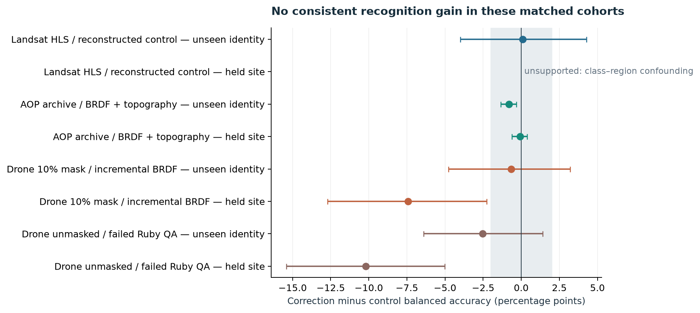
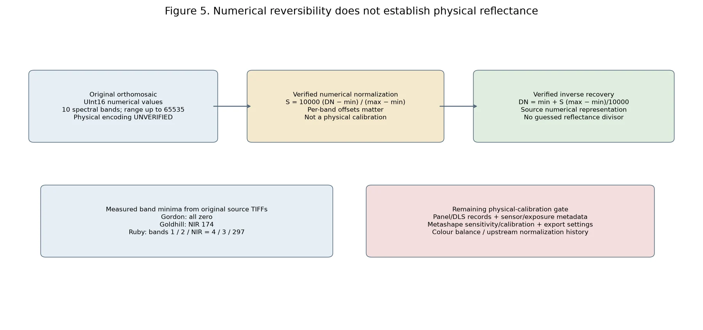
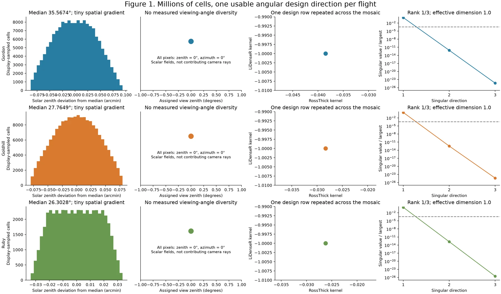
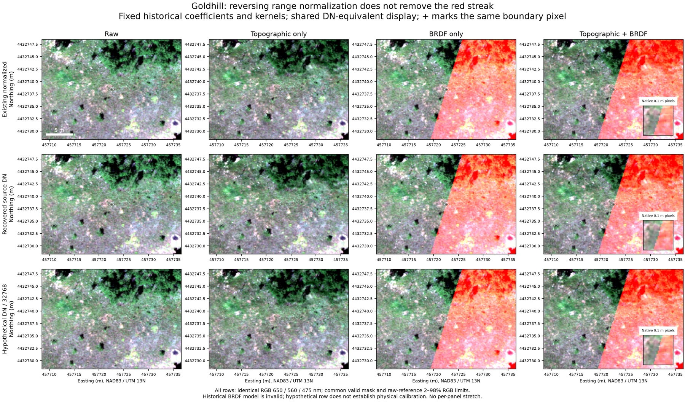
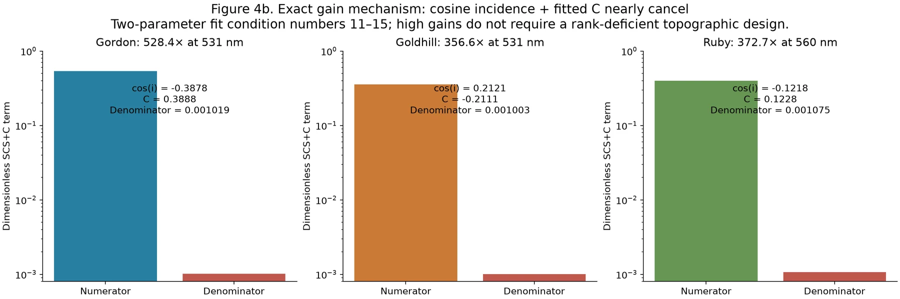

# Drone Processing: Validation Findings and Current Limitations

The October–November 2026 investigations examined **Gordon, Goldhill and Ruby
2023** products. Spatial repairs are validated against their source TIFFs;
physical reflectance remains unverified and correction efficacy is task-dependent. The newer camera-position/10% runs are documented first; earlier failure records are retained below. These findings
are scoped to the inspected products and their descendants, not every drone
flight or unrelated NEON library.

| Component | Current scientific status |
| --- | --- |
| Spatial alignment | **Validated** for repaired source products; not independent field geolocation accuracy |
| Numerical DN recovery | **Validated** numeric mapping, with unresolved 10 cm resampling border differences |
| Physical reflectance calibration | **Unverified**; original calibration/export records missing |
| BRDF model support | Camera-position +10% combined models: **10/10 native bands** at all three sites; earlier zero-view designs remain unsupported |
| Topographic correction | **Experimental**, conditioned fits supported in the recorded reruns; not independent physical validation |
| Spectral libraries | Historical/unapproved; qualified exploratory use only pending validation |

Here, **validated** means demonstrated within the stated evidence boundary;
**unsupported** means required conditions fail; **unverified** means evidence is
insufficient; **experimental** means investigated without production approval;
**planned** describes functionality not yet implemented. A software `VALID`
status is narrower than independent scientific validation.

## Camera-position correction and translation update — 20 November 2026

The newer Gordon, Goldhill and Ruby runs use the **November 5 camera-position
stability branch**, not the November 13 brightness baseline. Camera-position-
derived mosaic viewing geometry replaces the earlier zero-view placeholders.
This does not recover each original photograph's contribution to a blended
orthomosaic or constitute repeated multi-angle observations of the same target.
The original photographs were not all reprocessed. Numerical model support and
physical calibration remain separate questions.

### Correction and shade-mask checks

The experimental order is declared radiometry → conditioned SCS+C topographic
correction → combined BRDF correction → five-band affine translation. Field
polygons and a 2 m buffer are excluded from correction fitting; spatial groups
are retained for uncertainty. The frozen relative-visible **10% shade rule**
excludes dark pixels from both model fitting and the application domain, then
refits the corrections. Its actual scene retention varies with the source and
geometry masks; it is not a guarantee of exactly 10% loss in every polygon.
It is an image-based exclusion, not independently observed shade truth.

| Check | Recorded criterion / diagnostic | Meaning of a pass |
| --- | --- | --- |
| Source and geometry | Matching native grid, source/ancillary fingerprints, finite supported camera/solar/terrain geometry; no invented zero-angle diversity | The stated input/model is numerically usable, not contributor-perfect geometry |
| Topographic model | Full-rank conditioned illumination fit, spatial-cluster covariance and bounded C interval; saved policy uses z = 1.96, at least four clusters, fitting slopes ≥5°, fractional fit range 0–2 and denominator floor 0.001 | Supported fitted illumination correction under this experimental radiometry/policy |
| BRDF model | Stable rank-three angular fit; spatial-cluster sandwich uncertainty; predicted reflectance positive above its uncertainty at observed and reference geometries | A resolved numerical normalization, not calibrated ground reflectance |
| Application | Saved model/mask identity, source NoData and exclusions retained, finite outputs, native georeferencing and complete populated bands | Correct application to the declared domain |
| Translation | Wavelength-based source mapping, physical-unit registry, affine direction, all output pixel arithmetic, grid/mask preservation, source hashes and restart identity | Consistent application of an existing relationship, not independent sensor agreement |
| Delivery | ENVI image/header/metadata paired; SHA-256 source checks and full remote readback | The delivered bytes match the local products, not scientific approval |

Uncertainty uses spatial clusters rather than counting neighbouring pixels as
independent observations. A bounded parameter interval and a positive prediction
are necessary checks, not a sufficient demonstration of correction efficacy.

| Site | Unmasked combined valid native bands | 10% combined valid native bands | 10% BRDF-only valid native bands |
| --- | ---: | ---: | ---: |
| Gordon | 10/10 | 10/10 | 10/10 |
| Goldhill | 10/10 | 10/10 | 10/10 |
| Ruby | 8/10 | 10/10 | 9/10 |

Ruby's combined 668 nm band passes narrowly: reference prediction 0.019286,
standard error 0.009823 and lower uncertainty margin about 0.0000322. The
BRDF-only masked branch still fails one band. “All three pass” refers to the
**masked topographic-plus-BRDF models**, not every processing branch. Model
support remains conditional; scientific status stays `EXPERIMENTAL` and source
radiometry stays `HYPOTHETICAL_UNVERIFIED`.

[Download full per-variant model support](recent-evidence/drone_model_support.csv).
The earlier rank-one and artifact findings below remain valid for their original
zero-view products; they do not describe the newer camera-derived fits.

### Keep the reflectance scales explicit

Use `physical = scale × stored + offset` exactly once at each boundary.
The archived source-DN interpretation places approximately 200% at 65,535;
that interpretation is a **conditional calibration hypothesis**, not a general
MicaSense convention inferred from its integer range.

| Boundary | Recorded convention in this run |
| --- | --- |
| Historical prepared native values → fractions | Decoder **65535 / (10000 × 32768) = 0.0001999969482421875**, zero offset; includes the preceding numerical recovery/scaling |
| AOP training values → fractional coefficients | All 72 training headers confirm a 10,000 divisor; slopes unchanged, intercepts/ranges/RMSE divided by 10,000 in a separately audited registry |
| Translation | The same target = slope × source + intercept affine in fractional units, with wavelength-verified source/target bands |
| Delivered translated ENVI | Stored fractional reflectance × **1,000**; decoder **0.001**, zero offset; NaN NoData |

Do not divide the prepared native values by 65,535 again or apply their earlier
radiometric scaling twice. Do not feed ×1,000 output values to fractional
coefficients without decoding. Finite negative corrected values are retained;
changing storage scale is not scientific calibration.

The translation registry derives MicaSense-like and Landsat-like relationships
from the **same corrected AOP reference**. This is diagnostic spectral-response
translation, not independent empirical drone-to-Landsat calibration. The
historical packaged registry was not silently replaced or relabelled with new
units. The translated drone products have five target channels; no missing SWIR
bands are synthesized. OLI and OLI-2 targets retain distinct registry identities.

### ENVI delivery and the unmasked null

Three sites × two targets yield six ENVI image/header pairs per variant, with
JSON sidecars and scale, band mapping, model/mask identity and experimental
status embedded in metadata. Example filenames are:

```text
ruby_20230814_micasense_translated_to_oli_envi.img
ruby_20230814_micasense_translated_to_oli_envi.hdr
ruby_20230814_micasense_translated_to_oli2_envi.img
ruby_20230814_micasense_translated_to_oli2_envi.hdr
ruby_20230814_unmasked_null_micasense_translated_to_oli2_envi.img
ruby_20230814_unmasked_null_micasense_translated_to_oli2_envi.hdr
```

The same patterns apply to Gordon and Goldhill. The separate CyVerse collections
are under `/iplant/home/shared/earthlab/macrosystems/field-data/output/spectralbridge_processed/`:

- `gordon_goldhill_ruby_micasense_landsat_translations_20261119_v1` — 10% masked, refitted translations.
- `gordon_goldhill_ruby_micasense_landsat_unmasked_null_20261119_v1` — unmasked diagnostic translations.

Access depends on datastore permissions. Both uploads were checked by full
SHA-256 remote readback; the upload manifests retain per-file results. The
unmasked Ruby null intentionally retains failed BRDF QA. Its explicit research
exception does not convert `INVALID` to `VALID` or waive the ordinary approved-
library guard. Native backing rasters and the full research archive remain
separate from the translated delivery; uploaded does not mean approved.

## Did masking reduce PFT information?

The paired translated-stage study uses **300 of 302 original field polygons**
across the three sites. Two have no complete paired output. The primary analysis
uses the exact same complete five-band pixels in both arms before polygon
medians; retained-pixel and OLI-versus-OLI-2 comparisons are sensitivities.

For OLI-2 shared pixels, held-site balanced accuracy is **36.4% unmasked versus
38.1% masked**; unseen-polygon accuracy is **61.5% versus 60.5%**. Fixed paired
folds, training-only preprocessing, site-blocked whole-polygon NPC and paired
changes are retained. No paired loss survives the declared multiplicity
adjustment. Three sites limit whole-site inference; nonsignificance is not
proof of equivalence or that masking cannot harm another population.

The experiment changes **refitted corrections and coverage together**. It is not
a causal mask-only ablation. Do not infer information gain merely from a
reduction in variance or compare these scores to a different cohort/protocol.
See the [four-page mask-comparison report](../downloads/drone-shade-mask-comparison.pdf)
and [all recognition-change estimates](recent-evidence/drone_mask_identifiability_change.csv).

## Does BRDF improve the result?

A separate retrospective benefit audit compares matched stages with fixed
five-band, identity-grouped recognition and held-site evaluation. For drone,
**topographic-only versus topographic + BRDF within the 10% variant** isolates
incremental BRDF conditional on that mask and topographic fit. It is a different
question from masked-versus-unmasked combined processing.



| Contrast | Evaluation | Balanced accuracy, control → corrected |
| --- | --- | ---: |
| Drone 10%: same topo fit, add BRDF | Held site | 45.60% → 38.18% |
| AOP archive: raw → BRDF + topography | Held site | 46.92% → 46.83% |
| HLS: same-grid reconstructed pre-NBAR → NBAR | Unseen patch, five bands | 94.24% → 94.33% |

The drone estimate is a **−7.42 percentage-point** change, primarily in the
non-vegetated/dead class. Its conditional paired 95% interval is −12.70 to −2.28
points, but the full-family adjusted identity-swap p-value is 0.0917 and adjusted
whole-site evidence is inconclusive. Intervals condition on fitted models;
three sites and unverified radiometry prevent a universal harm claim.

The AOP archive contrast bundles topography with BRDF, so it is not BRDF-only.
Its same-day repeat-view median improvement is approximately zero. A separate
real-angle R10C BRDF-only control excludes 180 of 900 20 m blocks from fitting;
all ten native bands pass QA, but the already weak held-block angular association
does not decrease. Neither test supplies absolute reflectance ground truth.

HLS uses its supplied angles, exact target-solar metadata and pinned official
RTLS c-factors to reconstruct a pre-NBAR control on the **same grid and cells**.
That inverse retains original quantization limits and cannot recover original
Collection 2 inputs, clipping, atmosphere or resampling. It does not test a
multi-date temporal-normalization benefit. Keep operational HLS NBAR; this small,
region-confounded snapshot does not justify undoing HLS processing.

The evidence does **not show a consistent large PFT recognition gain** from
these delivered correction stages. It does not show that BRDF physics is
unnecessary. Numerical QA, physical accuracy, repeat-view consistency and PFT
recognition are distinct endpoints. Scientist-hours and matched full-pipeline
resource costs were not measured, so no numerical labour-return estimate is
claimed. Require independent benefit for the intended endpoint before more
correction tuning; do not tune tests to obtain more significant contrasts.

[Read the nine-page BRDF audit](../downloads/brdf-benefit-report.pdf),
[recognition estimates and uncertainty](recent-evidence/brdf_identifiability.csv)
and [source/checksum snapshot](recent-evidence/manifest.json).
Figure 4's seven-band HLS LOPO values and its older drone cohort are not replaced
with this audit's five-band/five-fold results.

---

## Earlier investigation history (through 2 November 2026)

The following findings concern the earlier zero-view/source-DN products. They
remain part of the evidence chain, rather than being silently rewritten as
results of the camera-position rerun.

## 1. Spatial integrity

A raster can look plausible while its coordinates attach spectra to the wrong
vegetation. The original H5s retained the TIFF arrays but mixed signed row size,
center/corner references and NAD83/WGS84 declarations. The old ENVI exports were
geographically reflected. Source TIFFs are north-up NAD83 / UTM zone 13N at 0.1 m.
Repairs preserve that grid and validate polygon membership; they do not establish
radiometric accuracy. Follow the [source-alignment check](../vignettes/drone-processing.md#check-spatial-correspondence-before-extraction).

## 2. Radiometric calibration

The stored 0–10,000 range comes from **band-specific min/max normalization**,
not demonstrated reflectance multiplied by 10,000. Original maxima are 65,535;
Goldhill NIR has minimum 174, while Ruby bands 1, 2 and 10 have minima 4, 3 and
297. Gordon minima are zero. The inverse restores a numerical source-DN
representation, not calibrated reflectance or native-resolution camera samples.
The exact normalizing exporter remains unidentified.



*Verified numerical mapping, unverified physical units. Neither a divisor of
10,000 nor 32,768 is authorized by these ranges. See the
[scaling evidence](https://github.com/earthlab/spectralbridge/blob/main/provenance/drone-scale-confirmation/2026-10-30/README.md)
and [radiometric methods](../vignettes/drone-processing.md#numerical-scaling-is-not-physical-calibration).*

## 3. BRDF identifiability and the Goldhill artifact

BRDF describes how the signal changes with illumination and viewing direction.
The current three-parameter RossThick/LiDenseR fit needs independent information
for all three terms. Assigned zero view angles plus scene solar zenith give a
rank-one design in each mosaic; millions of pixels cannot replace missing
viewing diversity.

| Flight | Angular design rank | Supported bands |
| --- | --- | --- |
| Gordon | 1 / 3 | 0 / 10 |
| Goldhill | 1 / 3 | 0 / 10 |
| Ruby | 1 / 3 | 0 / 10 |



*Full-scene diagnostic under the current kernel configuration. The fine spatial
variation in solar angles is not repeated multi-angle observation of a target.
[Angular investigation](../dev/drone-brdf-identifiability-investigation.md).*

Goldhill's extreme red streak was introduced by the historical SpectralBridge
BRDF stage. Stage isolation and exact numerical replay locate the failure:
an unsupported model's observed prediction crossed zero, switching from a
neutral factor to enormous amplification. Reversing normalization did not remove
it. The current gates reject unsupported fits and invalid predictions.



*Historical-model replay for diagnosis only; BRDF panels are invalid scientific
products. Rows compare normalized, recovered-DN and hypothetical DN/32768
representations using common equivalent-DN display limits and the same grid/mask.
The hypothetical divisor is not a calibration. [Experiment and full captions](../dev/drone-radiometric-recovery-experiment.md).*

## 4. Topographic correction

SCS+C adjusts illumination using slope, aspect and solar geometry. The isolated
source-DN diagnostic produced the following maxima and source-valid coverage loss:

| Flight | Maximum diagnostic gain | Coverage loss |
| --- | ---: | ---: |
| Gordon | 528× | 4.08% |
| Goldhill | 357× | 5.49% |
| Ruby | 373× | 1.49% |



*Experimental source-DN replay, not physical correction approval. Very small
positive `cos(i) + C` denominators explain the extreme gains. Terrain provenance,
illumination and fit uncertainty still require review.
[Mechanism and uncertainty](../dev/photogrammetry-metadata-investigation.md#4-terrain-metadata-and-the-scsc-extremes).*

The existing denominator guard does not guarantee safe gains. Polygon-level
spectral consistency and separability changed in mixed directions; no blanket
approval or arbitrary gain cap follows. See [methods](../brdf_topo_algorithm.md).

## 5. Spectral library implications

The matched diagnostic used **301 researcher polygons and 198,309 polygon-pixel
memberships**. These are not independent plant observations. Within-category
variance fell in 8 of 12 sufficiently sampled flight/category groups, but rose in
four; coefficient of variation improved in six and worsened in six. No consistent
separability improvement or cross-flight reflectance harmonization was established.

Historical corrected and translated libraries from these flights remain
unapproved. Preserve their identities and review every dependent merged table,
translation fit and analysis. Regenerate affected contributions only after source
calibration and correction policy are established. Do not declare unrelated NEON
libraries affected. See [library validation](../vignettes/spectral-library.md#drone-library-quality-and-researcher-polygons).

## 6. Current recommendations

1. Preserve originals and repaired spatial provenance; verify alignment before extraction.
2. Keep recovered values labelled source DN until calibration is established.
3. Explicitly omit unsupported BRDF; do not relabel a failed requested fit as success.
4. Hold topographic promotion pending physical inputs, stability and independent validation.
5. Recover the matching Metashape project with complete `.files`, task/export settings,
   camera transforms/intrinsics/contributors, panel/DLS/exposure records and actual timestamps.
6. Inspect a small calibrated overlapping-photo subset before deciding on photo reprocessing.
   Existing calibrated orthomosaics may be useful without additional BRDF if their
   directional domain is suitable; these three have not yet established that calibration.

Metashape reports prove camera geometry was estimated. The archived TIFF-to-H5
converter deliberately created zero-view matrices; the October 29 rebuild copied
those constants into scalar view fields and recomputed solar grids from the
manifest. The original solar grids replay mixed degree/radian errors; new solar
calculations are traceable but acquisition dates remain disputed. At that historical checkpoint the matching complete project and radiometric settings
had not been recovered. The later camera-position geometry does not establish
original contributor images or authoritative radiometric settings.
**No duplicate upstream correction is established; it cannot yet be excluded.**

Published UAV methods often work on original overlapping images before mosaicking.
A final selected/blended pixel does not retain its separate source measurements.
See [photogrammetry and literature context](../vignettes/drone-processing.md#photogrammetry-and-directional-information)
and [Choosing Radiometric, Topographic, and BRDF Corrections](../concepts/correction-eligibility.md).

## Technical reports and reproducibility

Read the most recent provenance account when earlier reports differ:

- [October 29 spatial integrity](../dev/drone-spatial-integrity-investigation.md).
- [October 30 AOP/drone radiometry and BRDF audit](https://github.com/earthlab/spectralbridge/blob/main/provenance/radiometry-brdf/2026-10-30/README.md).
- [October 30 numerical scaling confirmation](https://github.com/earthlab/spectralbridge/blob/main/provenance/drone-scale-confirmation/2026-10-30/README.md).
- [November 2 radiometric recovery experiment](../dev/drone-radiometric-recovery-experiment.md).
- [November 2 BRDF strategy and polygon evaluation](../dev/drone-brdf-identifiability-investigation.md).
- [Correction production plan — planned, not implemented](../dev/drone-correction-production-plan.md).
- [Latest photogrammetry provenance and literature investigation](../dev/photogrammetry-metadata-investigation.md).
- [Evidence map and documentation verification](https://github.com/earthlab/spectralbridge/tree/main/provenance/drone-docs-integration/2026-11-02).

Last updated: 2026-11-20; historical sections retain their original evidence scope.
