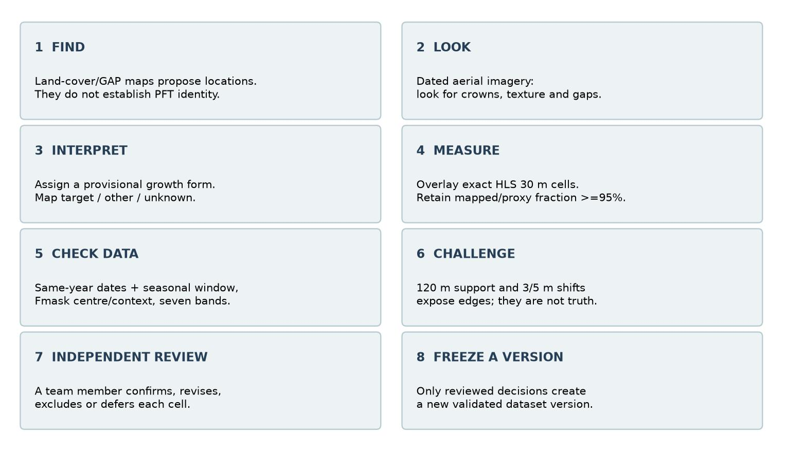
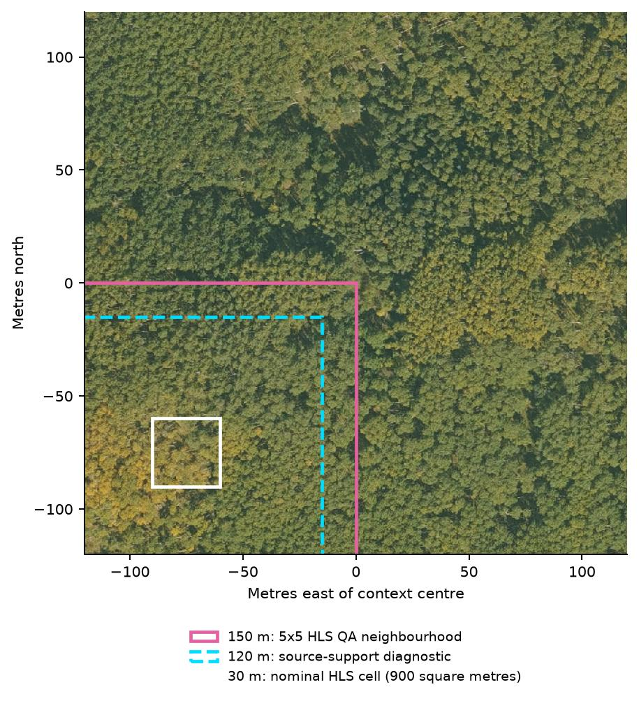
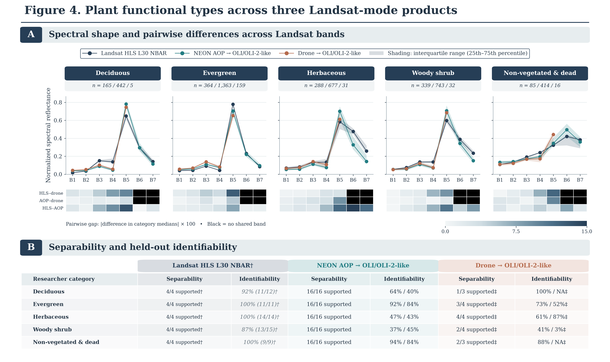
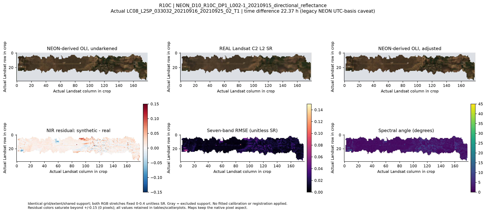

# Landsat HLS references, pure pixels and independent comparisons

**Updated 20 November 2026.** The current PFT reference study uses **Landsat HLS
L30 NBAR, version 2**, not the earlier Collection 2 surface-reflectance dataset.
The independent R10C sensor-comparison pilot below remains a separate historical
experiment; its scene, scaling and findings have not been relabelled as HLS.

## Which Landsat product are we using?

| Property | Current PFT reference dataset | Earlier independent sensor pilot |
| --- | --- | --- |
| Product | NASA Harmonized Landsat–Sentinel-2 **L30 v2 NBAR**, Landsat-derived | Landsat 8 Collection 2 Level-2 surface reflectance |
| Observations | Landsat 8/9 OLI-family observations on the HLS 30 m grid; nine selected 2023/2024 granules | One next-day Landsat 8 acquisition at R10C |
| Directional correction | HLS c-factor BRDF normalization to nadir and its recorded solar reference | No HLS NBAR normalization |
| Stored-value conversion | Valid reflectance DN × **0.0001**; −9999 is fill | Valid SR DN × **0.0000275 − 0.2** |
| Research role | Provisional high-cover PFT references and patch-level tests | Actual-sensor agreement after common-grid aggregation |

L30 denotes the **Landsat-derived** product; S30 is Sentinel-2-derived and is not
substituted in this dataset. The seven reflective bands used here are B1 coastal,
B2 blue, B3 green, B4 red, B5 near-infrared, B6 SWIR1 and B7 SWIR2. These are the
seven channels in this analysis, not a claim that Landsat has only seven bands.
The drone has only five analogous channels; no drone SWIR values are invented.

HLS uses globally fixed BRDF coefficients, not the locally fitted drone model.
NBAR does not establish identical angular/topographic processing across sensors.
The HLS grid differs from the native Collection 2 grid: the inspected grid phase
differs by 15 m in each axis. We rebuilt footprints and cover fractions on the
**actual HLS grid** rather than copying older native-Landsat pixel selections.
See [NASA's BRDF description](https://hls.gsfc.nasa.gov/brdf-adjustment/), the
[HLS L30 v2 product DOI](https://doi.org/10.5067/HLS/HLSL30.002) and
[the HLS v2 dataset paper](https://doi.org/10.1016/j.rse.2025.114723).

## How the reference search works

1. **Propose reference areas without choosing by their spectra.** Public land-cover
   products locate candidates; they do not certify PFT identity. Dated aerial
   imagery supports frozen mapped-cover interpretations. The PFT categories are
   researcher-defined; initial reference interpretations were proposed with Codex
   assistance and still require independent human review. Mixed, shadowed,
   ambiguous and unreviewed areas remain unknown/excluded rather than being
   assigned to the preferred class.
2. **Use the entire 30 × 30 m cell.** Intersect its projected HLS footprint with
   mapped target cover. The main rule is at least **95% nominal mapped cover**,
   not a pure-looking centre point. Save the cell centre, CRS, HLS row/column,
   patch identity, cover geometry, fractions and source imagery identity.
3. **Retain structural uncertainty.** Evergreen screening also uses no-fill,
   first-return height occupancy above 5 m. The lidar is from 2016/2018, before
   the 2023 reference imagery. Tall structure is not direct proof of current
   evergreen PFT cover, species, canopy fraction or temporal stability.
4. **Match place, season and reference date.** The search allows multiple years
   at the same location/season, rather than restricting itself to drone flight
   dates. The recorded search window is ±21 days around the seasonal anchor;
   selected HLS scenes must be in the aerial-reference year and within 45 days
   of its date. Repeated years are not automatically new independent patches.
5. **Screen HLS quality before retaining spectra.** Reject fill and all lower-six
   Fmask flags: cirrus, cloud, cloud/shadow adjacency, shadow, snow/ice and water.
   Reject high aerosol; retain the aerosol category explicitly, including
   climatological aerosol when present. Require the cell and its 5 × 5-pixel
   (150 m-wide) neighbourhood to pass, matching grid/date, and seven finite
   decoded bands. HLS Fmask is not Collection 2 QA_PIXEL/QA_RADSAT; we do not
   claim an unavailable per-band saturation check was performed.
6. **Group nearby cells into spatial patches before inference.** Retain all
   reviewed passes under the fixed policy. Neither spectral similarity nor a
   favourable classifier result promotes a candidate to a pure reference.

### What does “pure” mean here?

It means **passing a declared reference screen**, not independently proven
material purity. Nominal mapped cover, resampling support, georegistration
sensitivity, image quality and correct biological labels are different questions.

The additional **120 × 120 m** bounding area of 4 × 4 native source pixels is a
conservative, unweighted resampling-support sensitivity. It is not the optical
point-spread function, signed cubic-convolution weights, a standard HLS purity
requirement or a confidence bound. Unknown area can lower its score without
proving contamination. It is distinct from the 150 m Fmask neighbourhood.

Nine tested Cartesian shifts at −d, 0, +d in each axis provide another diagnostic:
1,013 current cells retain 95% cover at all tested 3 m shifts, and 974 at all
tested 5 m shifts. Those are **per-axis** shifts; diagonals reach about 4.2 m and
7.1 m. They are not measured registration errors, continuous worst-case bounds
or confidence intervals, and do not silently change the main cohort.

## Current expansion and Figure 4

The dated working cohort contains **1,241 cells in 61 patches**, expanded from
496 cells in 24 patches. Labels remain provisional; no independent purity
confirmations were recorded at the review checkpoint.

| Category | HLS cells | Spatial patches | Pooled supported contrasts | Correct held patches |
| --- | ---: | ---: | ---: | ---: |
| Deciduous | 165 | 12 | 4/4 | 11/12 |
| Evergreen | 364 | 11 | 4/4 | 11/11 |
| Herbaceous | 288 | 14 | 4/4 | 14/14 |
| Woody shrub | 339 | 15 | 4/4 | 13/15 |
| Non-vegetated & dead | 85 | 9 | 4/4 | 9/9 |

Both rows use the same expanded HLS cells. Panel A normalizes each cell by its
B1–B5 sum, then plots category medians and interquartile ranges; it does not plot
confidence intervals or squared-unit variance. Panel B uses seven-band **direct
NBAR patch medians**, without that plot normalization. Other sensors use their
recorded cohorts/protocols; the rates are not a controlled comparison of sensor
accuracy. Figure 4's older drone reference table is separate from the new
three-site translated calibration experiments below.

## Which tests verify what?

| Check | Evidence supplied | What it does not establish |
| --- | --- | --- |
| Geometry and source identity | Recomputed nominal/source fractions for all 1,241 cells agree within 10⁻⁸; IDs, grid, dates, seven-band completeness and stored-source hashes are checked | Independent PFT truth or perfect physical registration |
| Retention/rejection audit | All candidates/date QA, source footprints and excluded/unknown areas are retained; a cover-pass cell can still fail HLS quality | That a high cover fraction overrides cloud/shadow or date problems |
| Separability | Whole-patch synchronized maximum/integrated NPC, equal band weights, Holm across ten planned PFT pairs | Reliable classification, causal PFT mechanisms or universal geographic separation |
| Identifiability | Fixed training-only StandardScaler and balanced logistic regression, C = 1; leave one entire patch out | Independent new-region accuracy or independently validated labels |
| Sensitivity and human review | Separate 120 m/shift screens, pooled versus within-region tests, and cell-by-cell review materials | A reason to choose whichever cohort produces the strongest result |

NPC enumerates assignments exactly up to 100,000; larger spaces use the observed
assignment plus 99,999 reproducible random whole-patch assignments. All ten
**pooled** pairs pass the current Holm family. Within-region tests support only
**two of three testable pairs**; seven have no mixed-region support. PFT and
region remain strongly confounded. Collection/analysis has been exploratory
across rounds; the ten-pair adjustment does not control every historical look.

Whole-patch identification is **58/61 correct (95.1%)**. That is accuracy for
these labelled held patches, not a 95.1% estimate of reference purity or arbitrary
new-region performance. Increasing adjacent-cell counts does not create new
independent patches or resolve a missing class in training. The 120 m sensitivity
contains 362 cells/30 patches, six supported pooled pairs and 28/30 correct
held-patch predictions. Its different result remains visible.

The [whole-spectrum methods guide](pft-methods.md) defines the statistics; the
[BRDF/drone findings](drone-findings.md#does-brdf-improve-the-result) discuss the
separate correction-benefit audit. That audit uses a different declared
five-band/five-fold protocol and must not replace Figure 4's seven-band LOPO
numbers.

## Review and reuse the evidence

- [Team review guide — 22 pages, approximately 5 MB](../downloads/landsat-pure-pixel-review-guide.pdf): definitions, easy and problematic cases, rejection examples and review directions.
- [Complete pixel atlas — 126 pages, approximately 27 MB](../downloads/landsat-pure-pixel-complete-atlas.pdf): every retained cell, dated source imagery, proposed label/rationale, exact centre/grid and evidence ledger. Proposals are not independent confirmations.
- [Figure 4 PDF](../downloads/figure-4.pdf), [full caption](recent-evidence/figure-4-caption.md) and [standalone code/data ZIP](../downloads/figure-4-reproduction.zip).
- Machine-readable [class summary](recent-evidence/hls_class_summary.csv), [all pairwise tests](recent-evidence/hls_pairwise_tests.csv), [held-patch predictions](recent-evidence/hls_held_patch_predictions.csv) and [cohort comparison](recent-evidence/hls_cohort_comparison.csv).
- [Dated website source identities and SHA-256 hashes](recent-evidence/manifest.json).

The team review CSV in the source work bundle has stable IDs and blank reviewer,
decision, revised-PFT, confidence and issue fields. Review decisions are recorded
separately; they do not automatically edit original acceptance flags. Freeze a
new reviewed cohort after resolving disagreements. The atlas is not a blinded
validation experiment and does not replace contemporaneous ground observations.

---

## Historical independent sensor pilot: Collection 2, not HLS

!!! warning "Current empirical scope: one next-day acquisition pair"
    One R10C NEON flight from 15 September 2021 was independently compared with
    Landsat 8 on 16 September. This is not multisite real-sensor validation and
    is separate from the library polygon observations.

## The reusable workflow

Corrected NEON → undarkened synthetic OLI → area-weighted aggregation to actual
Landsat footprints → Collection 2 Level-2 surface reflectance → joint QA and
coverage → agreement diagnostics. Brightness-adjusted synthetic OLI is evaluated
as a paired secondary variant, not silently substituted for the primary result.

1. Inspect all scene candidates and their temporal/footprint/QA suitability.
   Rank usable scenes using the recorded policy; retain rejected candidates.
   Same-day ETM+ is not automatically a compatible seven-band OLI reference.
2. Decode QA_PIXEL fill, dilated cloud, cirrus, cloud, shadow and snow flags;
   reject relevant QA_RADSAT band saturation and terrain occlusion.
3. Use official SR scaling: DN × 0.0000275 − 0.2 on valid stored values.
   Finite negative SR is not automatically clipped. NEON scaling must be
   independently declared or verified from source metadata, never guessed.
4. Aggregate corrected/synthetic data to the actual north-up projected 30 m
   grid using source-cell area intersections. The primary valid-coverage
   threshold is 90% of the **whole** Landsat footprint, not only its overlap
   with available high-resolution pixels. Require joint support across variants
   and all seven bands. Cross-CRS calculations transform source cell geometry.
5. Retain original registration and all accepted cells for primary metrics;
   inspect nine declared ±30 m offsets as sensitivity, not an optimized fit.

The [module reference](../api/scientific-analysis.md) documents
`FlightValidationInput`, `FlightValidationConfig` and
`compare_flight_to_real_landsat`. The
[example](https://github.com/earthlab/spectralbridge/blob/main/examples/real_landsat_validation.py)
accepts explicit source paths and times. STAC discovery needs the optional
`landsat` extra/network; normal numerical tests use offline fixtures/mocks.

## What the pilot shows

[Open the pilot comparison at full resolution](../images/spectral-library/real-landsat-pilot.png)

*The recorded comparison uses a common grid, spatial extent, valid mask and fixed
0–0.4 RGB stretch. Maps and residuals are empirical; no synthetic landscape is
invented. [Open the retained comparison and methods](https://github.com/earthlab/spectralbridge/tree/main/provenance/real-landsat-validation/2026-10-14).*

The primary undarkened comparison has 3,583 footprints in 56 spatial blocks:
pooled seven-band RMSE 0.01477 reflectance, median spectral angle 2.089°, and
bandwise Pearson r 0.810–0.945. Correlation measures association; it is not
radiometric agreement. Bias, MAE/RMSE, identity/Deming fits, Bland–Altman residuals
and spectral angle measure different aspects of agreement.

The nominal lag is +22.37 h, conditional on a legacy NEON timestamp interpreted
as UTC; its suffix does not independently verify timezone. Original alignment
is best among the nine offsets. Higher subpixel heterogeneity accompanies larger
errors. Brightness adjustment gives mixed bandwise changes; the paired overall
uncertainty interval spans zero. Spatial-block intervals preserve local
clustering; individual cells are not independent field replicates.

Before broader claims: resolve time/coefficient-training provenance, add
independent flights/sites, and assess PSF, subpixel alignment and block-size
sensitivity. This pilot does not validate actual PFT abundance maps.
