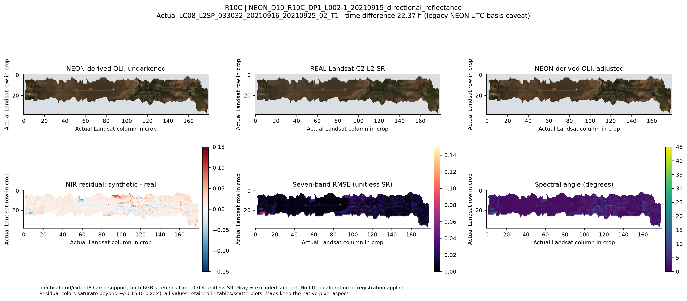

# How does synthetic OLI compare with real Landsat?

!!! warning "Current empirical scope: one next-day acquisition pair"
    One R10C NEON flight from 15 September 2021 was independently compared with
    Landsat 8 on 16 September. This is not multisite real-sensor validation and
    is separate from the library polygon observations.

## The reusable workflow

Corrected NEON → undarkened synthetic OLI → area-weighted aggregation to actual
Landsat footprints → Collection 2 Level-2 surface reflectance → joint QA and
coverage → agreement diagnostics. Brightness-adjusted synthetic OLI is evaluated
as a paired secondary variant, not silently substituted for the primary result.

1. Inspect all scene candidates and their temporal/footprint/QA suitability.
   Rank usable scenes using the recorded policy; retain rejected candidates.
   Same-day ETM+ is not automatically a compatible seven-band OLI reference.
2. Decode QA_PIXEL fill, dilated cloud, cirrus, cloud, shadow and snow flags;
   reject relevant QA_RADSAT band saturation and terrain occlusion.
3. Use official SR scaling: DN × 0.0000275 − 0.2 on valid stored values.
   Finite negative SR is not automatically clipped. NEON scaling must be
   independently declared or verified from source metadata, never guessed.
4. Aggregate corrected/synthetic data to the actual north-up projected 30 m
   grid using source-cell area intersections. The primary valid-coverage
   threshold is 90% of the **whole** Landsat footprint, not only its overlap
   with available high-resolution pixels. Require joint support across variants
   and all seven bands. Cross-CRS calculations transform source cell geometry.
5. Retain original registration and all accepted cells for primary metrics;
   inspect nine declared ±30 m offsets as sensitivity, not an optimized fit.

The [module reference](../api/scientific-analysis.md) documents
`FlightValidationInput`, `FlightValidationConfig` and
`compare_flight_to_real_landsat`. The
[example](https://github.com/earthlab/spectralbridge/blob/main/examples/real_landsat_validation.py)
accepts explicit source paths and times. STAC discovery needs the optional
`landsat` extra/network; normal numerical tests use offline fixtures/mocks.

## What the pilot shows

*The recorded comparison uses a common grid, spatial extent, valid mask and fixed
0–0.4 RGB stretch. Maps and residuals are empirical; no synthetic landscape is
invented. [Open the retained comparison and methods](https://github.com/earthlab/spectralbridge/tree/main/provenance/real-landsat-validation/2026-10-14).*

The primary undarkened comparison has 3,583 footprints in 56 spatial blocks:
pooled seven-band RMSE 0.01477 reflectance, median spectral angle 2.089°, and
bandwise Pearson r 0.810–0.945. Correlation measures association; it is not
radiometric agreement. Bias, MAE/RMSE, identity/Deming fits, Bland–Altman residuals
and spectral angle measure different aspects of agreement.

The nominal lag is +22.37 h, conditional on a legacy NEON timestamp interpreted
as UTC; its suffix does not independently verify timezone. Original alignment
is best among the nine offsets. Higher subpixel heterogeneity accompanies larger
errors. Brightness adjustment gives mixed bandwise changes; the paired overall
uncertainty interval spans zero. Spatial-block intervals preserve local
clustering; individual cells are not independent field replicates.

Before broader claims: resolve time/coefficient-training provenance, add
independent flights/sites, and assess PSF, subpixel alignment and block-size
sensitivity. This pilot does not validate actual PFT abundance maps.
