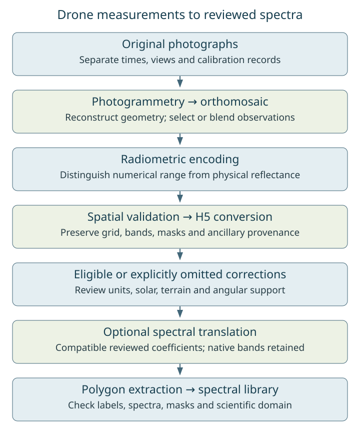
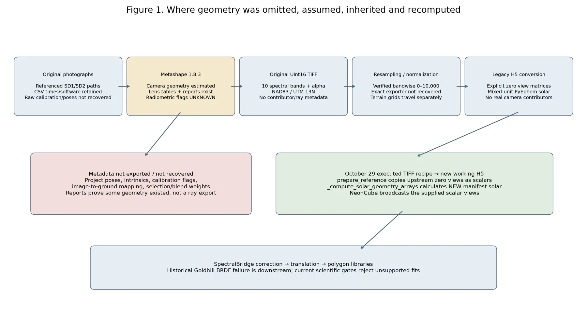

# Module vignette 6: process drone imagery

**Notebook:** [View the drone notebook in the repository](https://github.com/earthlab/spectralbridge/blob/main/docs/vignettes/notebooks/06_drone_pipeline.ipynb). GitHub displays the cells; clone or download the file to run them.

Use this module for local drone TIFF packages or HDF5 inputs. Discovery is
recursive, the original package remains traceable, and TIFF inputs enter shared HDF5/ENVI machinery. Corrections run only when their
physical-unit and geometry requirements are satisfied. Start with
[correction eligibility](../concepts/correction-eligibility.md) and the
[three-flight findings](../validation/drone-findings.md).

## Scientific branches

```text
DRONE
TIFF + ancillary + manifest
  -> working H5 -> ENVI -> eligible or explicitly omitted corrections -> native MicaSense
  -> affine cross-sensor translation -> Landsat-like raster
  -> full or polygon spectral library -> QA

NORMAL NEON
NEON H5 -> ENVI -> topo/BRDF -> corrected hyperspectral
  -> spectral convolution -> Landsat-like raster
  -> full or polygon spectral library -> QA

OPTIONAL VALIDATION
actual Landsat
            \
drone-like --- actual-Landsat grid -> pairwise QA
            /
NEON-like
```

The paths are shared through corrected ENVI and then diverge. Drone data use
reviewed affine coefficients derived by the independent bulk workflow. NEON
hyperspectral data use spectral convolution. The corrected native MicaSense
raster remains a first-class output and is never overwritten. A translated
product is Landsat-like; it is not an actual Landsat observation.

## Prepare inputs and coefficients

Place valid drone HDF5 files or reflectance TIFF packages under one input
directory. TIFF packages may include aligned terrain/view sidecars and are
matched to the bundled field manifest unless `drone_manifest_path` overrides
it. See the [detailed tutorial](../tutorials/micasense-to-landsat.md) for the
complete TIFF contract.

The TIFF bridge preserves axis-aligned, east-right, north-up grids in a valid
projected CRS, including non-square pixels. South-up, west-going, rotated and
sheared inputs fail explicitly; the pipeline does not guess a flip or resample
them. Conflicting HDF5 map information also blocks processing. Updated spatial
stage signatures refresh affected per-flight extraction products on restart.
Terrain/view sidecars require the same shape and CRS. Affine alignment is checked
at all four outer corners with a budget of eight float64 coordinate ULPs, allowing
only arithmetic/serialization roundoff. Real grid shifts still fail; ancillary
arrays are never resampled or numerically changed by this validation.
Spatial correction QA computes exact per-pixel medians and linear 90th
percentiles in bounded pixel blocks, grouping columns by non-NaN band count.
This avoids a Python percentile call per pixel without sampling or changing
the reported statistics.
See the [spatial integrity investigation](../dev/drone-spatial-integrity-investigation.md)
for source-comparison diagnostics, historical-output limitations and recovery.

Production translation consumes a static, versioned registry generated from
the completed compact bulk output. It does not fit coefficients. The production
weighting is fixed to `site_balanced`, reflecting intended transfer to new
flightlines and sites rather than optimization of the pooled pixel fit.
SpectralBridge validates equation direction, sensor identities, the exact 18
physical pair-band mappings, wavelengths, finite coefficients, confidence, and
bulk-run provenance before writing a translated product.

## Run it

```python
import json
from pathlib import Path
from spectralbridge import run_drone_pipeline

# Configuration template: requires independently verified calibration and inputs.
calibration = json.loads(Path("reviewed_flight_calibration.json").read_text())
results = run_drone_pipeline(
    input_h5_dir="drone_inputs",
    output_dir="drone_outputs",
    polygon_path="plots.geojson",
    extraction_mode="polygon",
    radiometry=calibration,
    apply_topo=False,  # Enable only after terrain/illumination validation.
    apply_brdf=False,  # Current three investigated mosaics are unsupported.
    apply_translation=False,  # Requires compatible, reviewed coefficients.
    translation_strict=False,
    drone_manifest_timezone="UTC",
)

print(results["processed"])
print(results["translation_outputs"])
print(results["matched_source_outputs"])
```

`run_drone_pipeline()` now treats missing requested products as an incomplete
run, rather than returning a successful-looking result. It validates the
working H5, raw and corrected ENVI pairs, requested full or polygon Parquet,
every requested translated target and library, stage/provenance JSON, flight QA,
and the final report. Requested topo and BRDF corrections must actually be
applied. A failure raises `DronePipelineIncompleteError`; its `results`
attribute and `drone_qa_summary.json` retain per-flight reasons. Set
`raise_on_incomplete=False` only when intentionally collecting a structured
partial batch result. A polygon run with no intersecting pixels is incomplete,
not a successful extraction. Optional actual-Landsat comparison remains
non-blocking when no acceptable observation is available. Flights whose
required scientific geometry cannot be validated or safely repaired are
reported separately in `results["blocked"]`; they are not mislabeled as
software failures.

Use `extraction_mode="full"` for all corrected pixels. Omitting
`extraction_mode` preserves the earlier behavior: polygon extraction when a
polygon is supplied, otherwise raster and QA outputs only. Translation remains
opt-in and uses the packaged site-balanced registry by default. It checks
corrected input values against the bulk fit's numeric domain before writing;
apparently fractional input is refused rather than silently rescaled. Normal
mode writes `caution`
bands with warnings, while `translation_strict=True` refuses them. A `reject`
coefficient is never applied.

## Standalone and comparison QA

Every translated run produces per-target translation JSON and PNG diagnostics
without NEON or network access. They show band mapping, coefficient evidence,
corrected-versus-translated values, reflectance shifts, valid fractions,
nodata preservation, and unusual translated values.

Set `landsat_qa=True` to request an overlapping Landsat Collection 2 Level 2
scene from Microsoft Planetary Computer. Install this optional support with:

```bash
python -m pip install -e ".[landsat]"  # from the source checkout
```

Alternatively, use `landsat_product="landsat_stack.tif"` to supply an
analysis-ready multiband raster or a previously cached observation manifest.
The comparison selects the closest acceptable scene within
`landsat_search_days`, applies the Landsat QA pixel mask, and aggregates the
translated drone product onto the actual Landsat grid using valid-aware area
averaging. Failed searches, cloud rejection, or insufficient overlap are
recorded as optional-QA limitations and do not fail the core drone run.

Add `comparison_neon_product="neon_landsat_like.img"` to compare an existing
normal-pipeline NEON product on the same Landsat support. The three reported
pairs are drone-like versus actual, NEON-like versus actual, and drone-like
versus NEON-like. NEON is optional and is never processed by drone code.

## Restart and outputs

Solar geometry deserves a separate review before accepting corrected products.
The original HDF5 or TIFF package is authoritative and read-only. Discovery
ignores generated `__working.h5` files. Every run starts from the original
source, then reuses or rebuilds the derived working copy according to its stage
signature. Passing a working H5 as a source is rejected because it loses the
provenance needed to decide whether a repair remains valid.

For HDF5 input, the working-copy stage compares embedded solar arrays with an
independent scene-center position computed from the acquisition datetime and
georeference. A valid array is preserved. A missing or materially inconsistent
array is replaced **only in the working copy** when the datetime has an explicit
timezone, scene coordinates are valid, the expected sun is above the horizon,
and manifest provenance authorizes the repair. The canonical
`Solar_Zenith_Angle` and `Solar_Azimuth_Angle` datasets are then used by
topographic/BRDF correction. The source H5 fingerprint is verified before and
after repair. If those conditions are not met, the flight is
`blocked_scientific` instead of being silently corrected with questionable
geometry.

For TIFF input, aligned solar rasters take precedence over explicit scalar
angles, which take precedence over manifest-derived geometry. Naive manifest
times are localized with `drone_manifest_timezone` (default `"UTC"`); pass a
verified IANA zone when the campaign used local civil time. Ambiguous DST
times, malformed dates, missing coordinates, conflicting duplicate manifest
rows, and below-horizon solutions block the affected flight while the campaign
continues.

Each flight audit records source and UTC-normalized acquisition time, timezone,
coordinate source and scene center, embedded and expected angle summaries,
zenith and circular-azimuth residuals, validation status, geometry actually
used, repair decision/reason, and source fingerprint. The calculation reuses the package's
approximate [NOAA-style solar-position equations](https://gml.noaa.gov/grad/solcalc/solareqns.PDF),
not a precise ephemeris. The 5° validation tolerance is inclusive and applies
to zenith plus circular azimuth residuals. These are workflow validation bounds,
not universal calibration limits, and the code never substitutes
`90 - angle` as an undocumented repair.

On a production VM, inspect existing working H5 files without rerunning
corrections or rewriting products:

```bash
PYTHONPATH=src python scripts/diagnose_drone_solar_geometry.py \
  /home/jovyan/data-store/SpectralBridge_Drone_2023_2024_Production/flight_outputs \
  --output /home/jovyan/data-store/SpectralBridge_Drone_2023_2024_Production/solar_validation/solar_geometry.csv \
  --candidate-timezone UTC --candidate-timezone America/Denver
```

The two timezone candidates in the CSV are hypothetical interpretations until
the field manifest's convention is independently verified. Review source
dataset units, scale/fill attributes, collection date, scene CRS, and circular
residuals together. A filename/manifest date mismatch requires provenance
review because a package filename need not be the acquisition date.

Valid working H5, corrected ENVI, translated ENVI, and translated Parquet
products are reused when their inputs and translation signatures match.
Legacy H5 sun-angle arrays under `Reflectance/Metadata`, including nested
`to-sun_*` datasets, are exposed through lightweight links in the *working*
copy; source H5 files are not changed. Continue a campaign by rerunning the
same command against the original input root and same output root. Missing or
signature-invalid stages resume from the first incomplete stage. Do not set
`overwrite=True` for an ordinary continuation.

Each completed flight directory contains `spectralbridge_flightline.json` and
matched native-MicaSense/Landsat-like ENVI pairs. Consequently
`run_bulk_pipeline(drone_outputs, ..., input_mode="auto")` discovers completed
drone flights directly; no manual rename or campaign-wide pixel merge is
needed. Per-flight Parquets remain authoritative. Set `merge_extractions=True`
only when a legacy consumer explicitly requires the optional run-level merged
tables.

Start bulk work with `preflight_only=True`. Bulk inventories the per-flight
Parquet footers, schemas, row counts, sizes, QA state, sensors, and translation
availability without scanning pixels or writing into the drone tree. The
translated Landsat-like products are applications of an existing coefficient
registry, not independent Landsat observations, so the ordinary drone campaign
is analyzed as `derived_application_verification`. Bulk writes compact fits and
LOSO outputs to verify application consistency, with coefficient metadata marked
`diagnostic_application_verification_only`. Do not feed those circular
diagnostics back into the registry or interpret them as empirical calibration.
The canonical shared-band contracts are 4 bands for TM/ETM+ and 5 for
OLI/OLI-2; the 6/7-band contracts remain specific to NEON convolution products.

With full extraction, the six canonical per-flight analysis tables are the
native corrected `__full.parquet`, four sensor-specific
`__landsat_like_<target>_translated_envi.parquet` tables, and the optional
combined Landsat-like table used by validated production packaging. Polygon
extraction uses the corresponding `__polygons.parquet` forms. Every translated
table carries the translation pair, source/target sensor, coefficient hash, and
evidence-boundary columns; bulk validates these fields from the Parquet schema.

| Artifact | Role | Regeneration rule |
| --- | --- | --- |
| Original H5/TIFF package | Authoritative immutable input | Never generated or modified |
| `__working.h5` | Derived, restartable bridge and repair target | Reuse only when source/config/solar signature matches |
| ENVI, translation, extraction, and QA outputs | Derived scientific products | Reuse only when their stage contracts validate |
| `spectralbridge_flightline.json` and stage/provenance JSON | Identity and audit contract | Required and deterministic |

Optional Landsat failure does not invalidate or recompute core products. See
[outputs and naming](../pipeline/outputs.md) for the complete contract, and
review every QA JSON before treating a coefficient application as trustworthy.

## Continue

- [Review QA outputs](qa-and-analysis.md)
- [Extract polygon spectra](polygon-extraction.md)
- [Detailed MicaSense tutorial](../tutorials/micasense-to-landsat.md)
- [Package architecture](../dev/architecture.md)

See the [API Reference for drone call signatures](../api/generated/pipelines-drone.md) for current signatures, defaults, inputs and outputs.

## Required calibration and mosaic BRDF limitations

Drone correction now requires an authoritative affine calibration record. Supply
it to `run_drone_pipeline(..., radiometry=record)` or
`convert_drone_tiff_to_h5(..., radiometry=record)`. An existing H5 can carry the
same JSON record in the reflectance dataset's `spectralbridge_radiometry`
attribute; the pipeline writes supplied calibration only to its derived working
copy. The record has `scale`, `offset`, `status="VALID"`, and a nonempty
`provenance` describing the calibration document or source metadata. Its equation
is `physical = scale * stored + offset`. Do not copy a calibration from a
different flight or infer one from the pixel histogram.

```python
import json
from pathlib import Path
from spectralbridge import run_drone_pipeline

# Prepared from authoritative calibration records, not a guessed divisor.
record = json.loads(Path("reviewed_flight_calibration.json").read_text())
result = run_drone_pipeline(
    "source-flight/",
    output_dir="fresh-reviewed-output/",
    radiometry=record,
    apply_topo=False,  # Topographic scientific approval is separate.
    apply_brdf=False,  # Explicitly unnormalized mosaic; status NOT_REQUESTED.
    apply_translation=False,
)
```

The example explicitly omits BRDF because constant-nadir mosaic angles cannot
identify a three-coefficient Ross–Li fit. It does not establish that all source
mosaics have valid calibration or terrain/solar geometry. A missing calibration
still blocks physical correction. `apply_brdf=True` requires independent angular
support and a validated shared model; it cannot fabricate viewing variation.

New corrected headers record physical scale/offset/provenance and BRDF status.
Unsupported requested BRDF is scientifically blocked, with native/topographic-only
products retained where appropriate. Existing spatial repairs remain necessary
but do not establish radiometric validity. Legacy translation registries and
unmarked historical tables require review before joining approved spectral
libraries. See [the common contract](../pipeline.md#physical-reflectance-and-correction-validity).

## Complete drone measurement workflow



*Actual stage order and evidence boundaries. Spectral translation is optional;
a library can retain native bands. Upstream photogrammetry is outside
SpectralBridge. The [provenance investigation](../dev/photogrammetry-metadata-investigation.md)
traces what the inspected files actually preserve.*

| Measurement state | Meaning |
| --- | --- |
| Original camera observation | One exposure with its own time, direction, calibration and footprint |
| Orthomosaic pixel | A selected or blended ground-grid value; not all contributing exposures |
| Calibrated reflectance | Physical reflectance established by source calibration and encoding records |
| Numerically normalized value | A number transformed to a chosen range; physical units may remain unknown |
| Recovered source DN | Inverse-normalized numerical representation; not original native-resolution samples |
| Topographically corrected measurement | Terrain/illumination-adjusted value, conditional on input and model validity |
| BRDF-normalized reflectance | Supported directional model evaluated at a recorded reference geometry |
| Spectrally translated product | Configured sensor-like values; not an independent target-sensor observation |

Photogrammetry reconstructs camera/ground geometry and mosaics observations.
Radiometric encoding establishes how stored numbers relate to source values;
only calibration evidence establishes physical units. Spatial validation protects
which ground location each value represents. H5 conversion carries spectral and
ancillary metadata into the shared correction machinery. Eligible corrections
precede optional wavelength-matched affine translation. Polygon extraction then
attaches researcher identities to validated pixels; library review evaluates
spectra, labels, masks and the intended scientific domain together.

## Check spatial correspondence before extraction

The Gordon/Goldhill/Ruby upstream H5s stored a signed negative Y map size where
ENVI expects a pixel-size magnitude, placed TIFF corner coordinates in a legacy
center-reference field, and mixed NAD83 WKT with a WGS84 map-info datum. The old
native ENVI export reflected their geographic row direction; the center/corner
error also introduced a half-pixel shift in the reader. Arrays themselves were
unchanged. A plausible image or bounding-box overlap cannot certify polygon
membership.

Current TIFF ingestion accepts valid projected, axis-aligned east-right/north-up
grids; it rejects conflicting H5 conventions and unsupported orientation instead
of guessing a flip. It marks TIFF corner references, writes standard WKT,
preserves precision, checks ancillary shape/CRS/outer-corner alignment and
invalidates dependent extraction when spatial backing changes. NEON's legacy
center convention is unchanged. See the [spatial report](../dev/drone-spatial-integrity-investigation.md)
for the eight-coordinate-ULP roundoff allowance and regression evidence.

Before extracting, compare an independently sourced TIFF against the actual
stages and polygons. From a source checkout, adapt these paths to one flight:

```bash
python scripts/diagnose_drone_spatial_integrity.py \
  --source-tiff source/aligned_orthomosaic.tif \
  --source-bands 1,2,3,4,5,6,7,8,9,10 \
  --h5 flight/AOP_Ruby_20230814__working.h5 \
  --native flight/AOP_Ruby_20230814__envi.img \
  --polygons Datasets/niwot_aop_polygons_2023_12_8_23_analysis_ready_half_diam.gpkg \
  --id-column GlobalID --output artifacts/spatial_check
```

Declare bands only after verifying their identity. Original packages have ten
spectral bands plus an alpha band; the package does not silently trim an unknown
extra band. Check the diagnostic's CRS, affine, corner/center control points,
orientation, spectral correspondence and polygon memberships. Supply corrected,
final and Parquet paths as shown in the full report to test downstream stages.
Exit 0 covers only supplied comparisons; exit 2 means missing required evidence,
and exit 1 reports discrepancies. Source agreement is not surveyed field accuracy.
Spatial repair does not resolve radiometric or acquisition-time uncertainty.

## Numerical scaling is not physical calibration

The inspected exports independently mapped each band's observed range to
0–10,000. For band `b`, with recorded original extrema, the verified equation is:

```text
S_b  = 10000 * (DN_b - min_b) / (max_b - min_b)
DN_b = min_b + S_b * (max_b - min_b) / 10000
```

Here `S_b` is stored normalized data and `DN_b` is the source numerical
representation. These are code-form equations so they remain readable without
a browser mathematics plugin. The paired 25 cm comparison checked 24,387,540
finite values with maximum discrepancy below 0.000781 normalized units. Evidence
supports the same mapping for current 10 cm inputs, but exact exporter/interpolation
history and rare large border residuals remain unresolved. Neither the reason
for choosing this normalization nor its exact implementing script was recovered.

| Flight | Original minima in spectral order | Original maxima |
| --- | --- | --- |
| Gordon | All zero | All 65,535 |
| Goldhill | Band 10 / NIR = 174; others zero | All 65,535 |
| Ruby | Bands 1, 2, 10 / NIR = 4, 3, 297; others zero | All 65,535 |

Keep each band's source identity, minimum, maximum, mask and band order. Do not
recompute extrema on a crop: that defines a different mapping. Offsets alter
band relationships and spectral indices. Recovered DN preserves the documented
numeric representation of resampled pixels; it does not establish physical
reflectance or exactly reconstruct native camera pixels.

The shared contract is `physical = scale * stored + offset`. A valid record
requires finite scalar values, positive scale, `status="VALID"`, the exact
convention and nonempty authoritative provenance. A source H5 may carry JSON in
`spectralbridge_radiometry`; TIFF identity scale tags alone remain unsupported.
Unknown inputs carry `UNSUPPORTED` radiometry with absent scale/offset, rather
than an invented divisor. `Radiometry` currently accepts a **scalar** mapping;
the three-flight band-specific inverse is not an automatic production ingest
feature. Do not pass a vector of minima as its offset.

Physical interpretation needs panel images/certificates or justified irradiance
calibration, exposure/gain and sensor records, band sensitivity and actual
photogrammetry/export settings. A vendor's 32,768 encoding applies only when
those project conventions are established. **Neither recovered DN / 32,768 nor
normalized data / 10,000 is verified reflectance for these flights.**
See [paired evidence](https://github.com/earthlab/spectralbridge/blob/main/provenance/drone-scale-confirmation/2026-10-30/README.md)
and [inverse-recovery limits](../dev/drone-radiometric-recovery-experiment.md).

## Photogrammetry and directional information



*Verified file/code lineage and unresolved project-to-export links.
[Full provenance investigation](../dev/photogrammetry-metadata-investigation.md).*

Overlapping photographs can see the same target from different directions.
Photogrammetry estimates camera positions, orientations and lens parameters;
terrain and visibility connect image rays to ground targets. Orthomosaicking
selects or blends observations into a ground-grid pixel. That output generally
cannot recover its separate source measurements or one uniquely physical view.
Assigned nadir angles do not reconstruct the original rays.

The three Metashape 1.8.3 reports document geometric estimates. The matching
machine-readable projects, poses and contributor exports were not found in the
bounded search; this does not prove they were discarded or are lost. Archived
`tiff_to_h5` code explicitly writes zero sensor-angle matrices. The October 29
recipe copied their constant values into scalar inputs; the current writer did
not invent a zero default. The reader broadcasts supplied scalars and raises
when angles are absent. All three current designs have rank 1 of 3 and 0/10
supported bands under scene-solar RossThick/LiDenseR. Original overlapping
photographs might support a different fit, but overlap counts alone do not
establish sufficient angular coverage.

Upstream panel, irradiance, exposure, vignette, camera radiometric, color/brightness,
block-adjustment and BRDF operation states remain **unknown**. Mosaic blending
and geometric lens calibration do not prove physical calibration or balancing.
No duplicated upstream correction has been established. Recover actual settings
before adding another correction. The old solar grids reproduce mixed-unit
PyEphem errors; the rebuilt grids are manifest-derived NOAA calculations.
Conflicting acquisition dates, especially Ruby, remain unverified despite the
new calculations' numerical plausibility.

The [UAV literature comparison](../reference/literature.md#uav-radiometry-and-directional-correction)
describes image-level block adjustment, anisotropy, irradiance/vignette and
planned multi-angle methods. These generally need calibrated repeated
same-target observations before final mosaicking. Empirical post-mosaic fitting
still requires valid units and supported geometry; our current mosaics fail that
gate. Published methods have not been validated on these flights. Recover the
matching project/settings and a small calibrated overlap subset before deciding
between retaining calibrated no-extra-BRDF mosaics, image-level block adjustment
or a supported angular model. NEON instrument geometry is different evidence;
every NEON flight must still satisfy the shared computational and scientific gates.

Last updated: 2026-11-02
