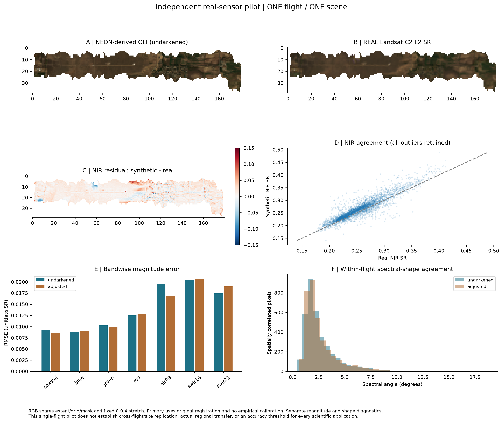

# Module vignette 3: harmonize target sensors

**Notebook:** [View the Landsat harmonization notebook in the repository](https://github.com/earthlab/spectralbridge/blob/main/docs/vignettes/notebooks/03_harmonize_to_landsat.ipynb). GitHub displays the cells; clone or download the file to run them.

Use this module when a corrected NEON cube exists and you want reflectance in
configured target-sensor bandspaces such as Landsat or MicaSense. SpectralBridge
integrates corrected spectra against the registered spectral response
definitions.

## Continue the standard run

Rerun the same `spectralbridge-pipeline` command used to create the corrected
cube. Earlier valid stages will be skipped and each target sensor will be
checked independently.

```bash
spectralbridge-pipeline \
  --base-folder spectralbridge_output \
  --site-code NIWO \
  --year-month 2023-08 \
  --product-code DP1.30006.001 \
  --flight-lines NEON_D13_NIWO_DP1_L020-1_20230815_directional_reflectance \
  --engine thread \
  --max-workers 2
```

Read the sensor summary in the log. It separates products that were created,
already existed, or failed.

## Confirm the result

Target products follow the pattern:

```text
<flightline>_<sensor>_envi.img
<flightline>_<sensor>_envi.hdr
<flightline>_<sensor>_envi.parquet
```

Use the matching ENVI header to interpret band order and wavelengths. Use the
Parquet sidecar or merged table for tabular analysis.

## Validate against a real Landsat observation

Synthetic target bands test spectral integration; they are not real satellite
observations. The independent real-observation workflow compares a full corrected
NEON flight with one explicitly selected Landsat Collection 2 Level-2
surface-reflectance scene, aggregating NEON to the actual 30 m footprints.

```text
NEON hyperspectral -> correction -> synthetic OLI-like bands
                                      |
                              actual pixel-area aggregation
                                      |
                           compare with REAL Landsat SR
```

Use the seven-band flight workflow separately from the existing optional drone
comparison. It preserves every search candidate, QA_PIXEL and QA_RADSAT exclusions,
full-cell coverage, common support for adjusted/undarkened products, block-bootstrap
uncertainty and original-versus-shifted registration diagnostics. It fits no
calibration correction.

```python
from spectralbridge.landsat_flight_validation import (
    FlightValidationInput, compare_flight_to_real_landsat,
)

flight = FlightValidationInput(
    flight_id="my_flight", site="NIWO",
    acquisition_datetime="2023-08-15T18:30:00+00:00",
    corrected_raster="products/corrected.img",
    undarkened_raster="products/landsat_oli_undarkened.img",
    adjusted_raster="products/landsat_oli.img",
    synthetic_scale_factor=10000,
    time_provenance="Verified flight acquisition metadata in UTC",
    timezone_verified=True,
)
result = compare_flight_to_real_landsat(flight, "validation/my_flight")
```

The paths and timestamp above are illustrative. Supply verified metadata and seven
numeric physical wavelength coordinates. Missing/ambiguous band identities are
refused; generic `band_01` wavelength headers need a production metadata repair,
not numerical inference. Acquisition time requires an explicit timezone/basis;
legacy assumptions must be disclosed. Existing source files are read in place.
Cross-CRS footprint intersections require Shapely 2 and pyproj; registration offsets currently
require the synthetic and reference grids to share a projected CRS. Reproject and
validate a product explicitly before using offsets across CRSs; the workflow does
not silently shift it. Public remote reads require `pystac-client` and
`planetary-computer` in addition to the raster dependencies.

The reproducible command-line example accepts a JSON object with those input
fields:

```bash
python examples/real_landsat_validation.py flight.json --output validation/my_flight
```

Default gates are >=90% valid area of each full Landsat footprint and at least 100
matched pixels. Results include compact `pixel_metrics.parquet`, scene selection,
band/flight/brightness/registration/subset metrics, QA and scientific figures, and
a checksum manifest. Valid completed outputs are reused for matching source,
configuration and implementation identities. No scene/cloud-only outcomes are
explicit statuses, not failed translation metrics. Across-flight summaries read
only compact completed outputs through `summarize_flight_validations` and equally
weight flights.

### R10C pilot: one flight, next-day Landsat 8

The archived real 15 September 2021 R10C flight was compared with product
`LC08_L2SP_033032_20210916_20210925_02_T1`. There were 3,583 accepted Landsat
footprints and 56 spatial blocks. Undarkened band correlations were 0.810-0.945,
median seven-band angle 2.089 degrees and pooled RMSE 0.01477 unitless reflectance.
The original alignment was best among nine declared 30 m offsets; no shift was
applied. More homogeneous footprints agreed better, but contrast discrepancies
remained. Adjusted pooled RMSE was 0.01459; its paired improvement interval spanned
zero, with clear NIR improvement and SWIR2 worsening.



The +22.37-hour offset is conditional on interpreting the legacy NEON "computer
time" as UTC. No same-day OLI gold case or cross-flight/site replication was
available. This supports a qualified real-observation pilot, not sensor
interchangeability or a universally beneficial brightness adjustment. Different
spatial support/PSF, acquisition times, atmosphere, viewing and solar geometry,
response approximations, registration and processing normalization prevent perfect
identity. These discrepancies cannot all be attributed to translation error.

Full design, all ten scientific questions, methods, candidate scenes, compact
records and PDF/PNG/SVG figures are preserved in the repository's
[real Landsat provenance](https://github.com/earthlab/spectralbridge/tree/main/provenance/real-landsat-validation/2026-10-14).
Independent real-observation agreement is scoped to this acquisition pair;
cross-flight, cross-site and held-out calibration generalization remain untested.
See the [scientific validation levels](../validation/scientific-validation.md).

## Continue

- [Build analysis tables](analysis-tables.md)
- [Review QA outputs](qa-and-analysis.md)
- Technical details: [stage contracts](../pipeline/stages.md) and
  [configuration](../reference/configuration.md)
