# SpectralBridge formal verification explained

Preserving composition while losing identifiability.

## What did we prove?

SpectralBridge moves spectral information among sensors and uses that information to distinguish and quantify ecological cover categories. The formal verification asks a simple question: when we transform a spectrum, which scientific properties are mathematically guaranteed to survive? The answer is both reassuring and limiting.

Under appropriate assumptions, fixed linear and affine sensor transformations preserve the proportions of an ideal spectral mixture. But reducing spectral information can make different mixtures indistinguishable. Composition can survive the forward transformation even when it can no longer be uniquely recovered from the transformed observation.

### The whole story
Observation → correction → sensor translation → spectral library → mixture inference → reconstruction or prediction → abundance interpretation. Some arrows follow exact algebra. Others depend on scene fitting, masks, calibration, reference selection and biological evidence. The entire operational chain has not been proved physically correct.

### Six questions that must stay separate
Preservation: do the original weights still satisfy the transformed mixture equation? Information: which spectral distinctions remain observable? Identifiability: can only one allowed composition explain the observation? Reconstruction: how closely does a proposed mixture match the spectrum? Prediction: how accurate is a learned fraction estimate on new targets? Field validity: do those numbers correspond to independently measured cover?

### What was checked
The existing layer contains 106 theorem declarations, accepted by Lean with only its standard mathematical foundations. Nine exact rational bridge cases are compared with Python calculations; four additional tests expose current audit boundaries. These are useful connections between equations and software, not a proof of all floating-point executions.

### How to read this report
Blue anchors the proved algebra. Green marks conditional mathematical models, gray numerical checks, and warm brown empirical or data-dependent steps. Every toy spectrum is explicitly hypothetical; every empirical number comes from the canonical validation outputs. No new scientific models or theorems were fitted or added for this explanation.

### The central result
SpectralBridge can preserve composition while losing identifiability. Mathematical coherence is valuable precisely because it makes the limits of interpretation harder to overlook.

Evidence: `formal/SpectralBridge/Core.lean: linear_mixture`; `formal/SpectralBridge/Core.lean: affine_mixture`; `formal/SpectralBridge/Inference.lean: rank_cannot_increase`; `formal/SpectralBridge/Counterexamples.lean: convolution_destroys_identifiability`

## The whole pipeline: local guarantees, shared assumptions

### The idea
NEON/AOP begins with packaged reflectance, not a formally verified radiance-to-reflectance inversion. Corrected NEON can be convolved to synthetic OLI or MicaSense products. Native drone observations follow a separate wavelength-mapped affine translation. Actual Landsat is an independent comparison path, not another synthetic observation.

### What this means for a scientist
The diagram marks the kind of support available at each stage. A conditional algebraic result can be exact while its sensor or biological interpretation still needs evidence. Gray numerical checks are an additional kind of evidence, not a substitute for the warm empirical steps.

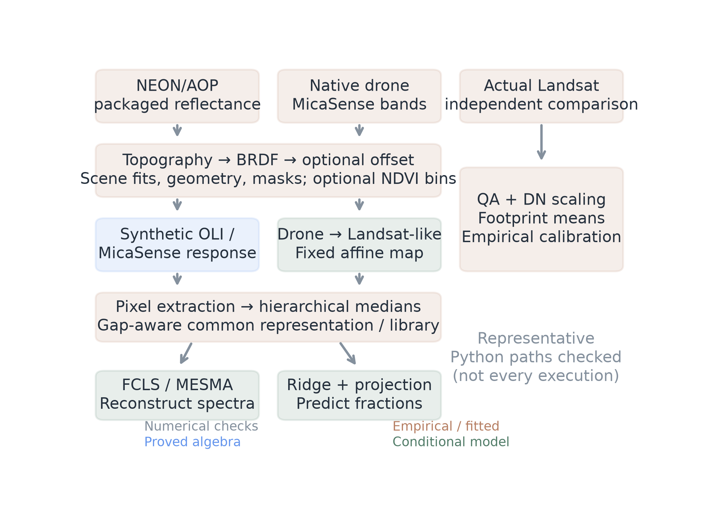

**What am I looking at?** The actual NEON, drone and independent Landsat paths.

**What should I notice?** Fits, masks and medians sit between locally tractable operations.

**What does it mean?** Apply a theorem only where its hypotheses match the stage and support.

**What does it NOT mean?** The whole pipeline is not certified as one linear or physically correct operator.

Evidence: `formal/TRACEABILITY.md`; `formal/SpectralBridge/Pipeline.lean: full_pipeline_conditional`

## 1 | Tests ask about examples; proofs ask about every valid case

### The idea
A conventional unit test asks, “Did this example produce the expected answer?” A proof asks, “For every input satisfying these assumptions, must this property hold?” SpectralBridge uses both. Lean is a checker of explicitly written mathematical arguments; it does not inspect a landscape or decide whether a category label is true.

### What was actually checked
The full root import builds all 106 declarations. An axiom audit lists the foundational dependencies of each result: choice, propositional extensionality and quotient soundness. These are mathematical foundations, not added assumptions that sensors are calibrated or plants are pure. No custom axiom or unfinished proof is used.

### The implementation bridge
Lean evaluates nine rational cases: response weighting, multiplication, affine translation, footprint mean, synthetic mixture, FCLS oracle, MESMA search, ridge prediction and simplex projection. Python calls the corresponding functions, including toy file-writing paths. Float32 checks allow 10⁻⁶ or 10⁻⁵ absolute error; most float64 checks use 10⁻¹⁰ to 10⁻¹² or tighter.

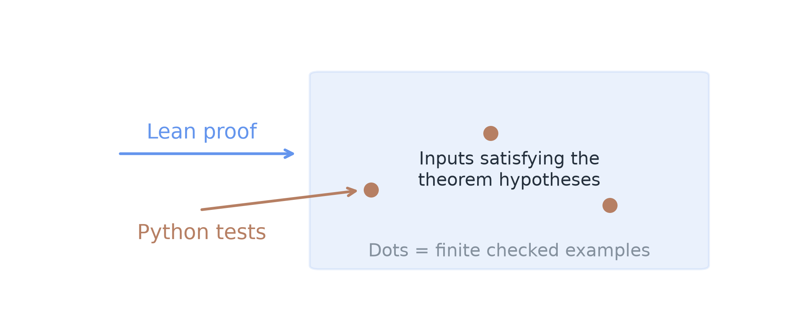

**What am I looking at?** Dots are checked examples inside the hypotheses of a mathematical claim.

**What should I notice?** A proof covers a stated domain; tests sample computations.

**What does it mean?** Agreement supports implementation conformance for those cases.

**What does it NOT mean?** The sorting algorithm, active-face solver and arbitrary IEEE execution are not universally certified.

Evidence: `formal/checks/axioms.log`; `formal/SpectralBridge/Bridge.lean`; `formal/tests/test_conformance.py`

## 2 | Spectra, vectors and the geometry of fractions

### The idea
A plotted curve and its ordered list of band values are two views of the same sampled spectrum. The mathematical vector records the values and their positions; wavelength metadata supplies their physical meaning. Real-valued vectors cannot themselves certify units, calibration or field provenance.

### The mathematics
x = [x₁, x₂, …, xₙ]     and     y = 0.6 A + 0.4 B

### In plain language:
Take 60% of every coordinate of A and 40% of the same coordinate of B. The mixture curve is computed coordinate by coordinate, without inventing a new biological observation.

### Valid fractions
A fraction vector is in the simplex when every entry is nonnegative and all entries add to one. Three fractions occupy a triangle: corners are pure components, edges contain two-component mixtures, and the interior contains three-component mixtures. “Pure” here means an algebraic corner, not evidence of biological purity.

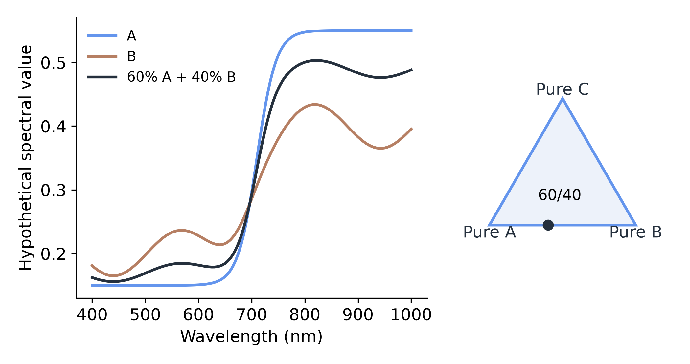

**What am I looking at?** Hypothetical spectral curves and a three-component fraction triangle.

**What should I notice?** The 60/40 point lies on the A/B edge.

**What does it mean?** Simplex constraints express valid proportions and put ideal mixtures in the endmember convex hull.

**What does it NOT mean?** The curves are not measured vegetation spectra, and simplex membership does not establish field cover.

Evidence: `formal/SpectralBridge/Core.lean: pair_simplex`; `formal/SpectralBridge/Core.lean: triple_simplex`; `formal/SpectralBridge/Inference.lean: mixture_convexHull`

## 3 | Mix first or change sensors first: the same endpoint

### The idea
A fixed linear transformation combines spectral coordinates with fixed coefficients. Sampled sensor response weighting is such an operation on a common valid support. Scaling a spectrum or selecting fixed bands is also linear.

### The mathematics
T(Σ fᵢ xᵢ) = Σ fᵢ T(xᵢ)

### In plain language:
Transforming a mixture gives the same result as transforming each ingredient first and then mixing with the original weights. This is the preservation guarantee: the original fractions still solve the forward equation.

### Connection to SpectralBridge
The exact toy operator in the figure adds two coordinates. It makes the commutation visible without pretending to be a Landsat response. The general proof also applies to fixed OLI/MicaSense convolution matrices and fixed multiplicative adjustments, provided target and references receive the same transformation and use the same support.

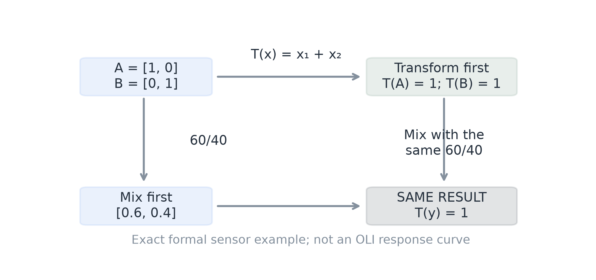

**What am I looking at?** Two routes through the proved two-coordinate toy calculation.

**What should I notice?** Both routes finish at 1 using the same 60/40 weights.

**What does it mean?** Fixed linear operations preserve the mixture equation.

**What does it NOT mean?** The endpoint does not necessarily reveal which weights produced it.

Evidence: `formal/SpectralBridge/Core.lean: linear_zero`; `formal/SpectralBridge/Core.lean: linear_add`; `formal/SpectralBridge/Core.lean: linear_smul`; `formal/SpectralBridge/Core.lean: linear_mixture`; `formal/SpectralBridge/Counterexamples.lean: sumSensor`

## Sensor response: a weighted sum, with a real implementation guard

### The idea
The inline pipeline samples Gaussian responses at the supplied wavelengths, using packaged band centers and full widths at half maximum. “Straight” resampling uses the nearest coordinate. It does not integrate a continuous measured response curve; the discrete formula is the contract being explained.

### The mathematics
wᵢ = rᵢ / (Σ r + ε),   ε = 10⁻¹²;     output = Σ wᵢ xᵢ

### In plain language:
A band is a weighted combination of input coordinates. Nonnegative weights summing exactly to one preserve constants and keep outputs between input bounds. The actual epsilon denominator makes the weights sum to response_sum / (response_sum + epsilon), so exact constant preservation does not follow.

### What the proof establishes
The fixed-weight operation remains linear. For a constant input, the exact-real attenuation factor is proved. When sampled support is tiny, attenuation can be large; the Python near-zero-response example reproduces it. This is not evidence that ordinary production bands have tiny support.

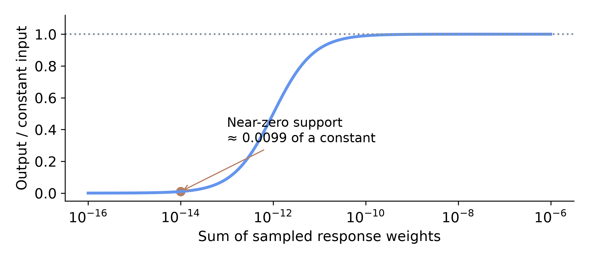

**What am I looking at?** The proved constant-input factor as sampled response support changes.

**What should I notice?** At response sum 10⁻¹⁴, the output is about 0.0099 of the constant input.

**What does it mean?** Normalization details matter independently of linearity.

**What does it NOT mean?** This curve is not an observed calibration error or a measured sensor response.

Evidence: `formal/SpectralBridge/Core.lean: weighted_bounds`; `formal/SpectralBridge/Core.lean: normalized_constant`; `formal/SpectralBridge/Core.lean: epsilon_constant`; `src/spectralbridge/resample.py`

## 4 | Why an intercept can preserve convex mixtures

### The idea
An affine map first applies a linear transformation and then adds an offset. Offsets might seem to break mixture algebra, but a shared offset is added exactly once when the mixture weights total one.

### The mathematics
T(x) = A x + b;   Σ fᵢ(A xᵢ + b) = A Σ fᵢxᵢ + b Σ fᵢ = A Σ fᵢxᵢ + b

### In plain language:
Because fractions sum to one, the component offsets add to one common offset. The same affine translation can shift all spectra while retaining their ideal mixture proportions.

### The exact condition
Sum-to-one is sufficient. More generally, commutation holds exactly when b = (sum of weights) × b. A zero offset therefore works without normalized weights. Applying different fitted offsets to different ingredients is not covered.

### Connection to SpectralBridge
Native MicaSense-to-Landsat-like translation applies mapped per-band slopes and intercepts. This is distinct from packaged percentage adjustments applied to synthetic Landsat products relative to MicaSense. Neither equation proves that the empirical coefficients transfer to independent sensors.

|Transformation / actual path|Class and preservation conditions|Empirical assumption|
|---|---|---|
|NEON storage scaling io/neon.py|Fixed multiplier: linear. Same scale and support preserve weights.|Header scale represents the intended quantity.|
|NEON → synthetic OLI/MicaSense resample.py + pipeline SRFs|Fixed sampled weights: linear, including epsilon. Exact normalized constants require true normalization.|Response approximation adequately represents the target sensor.|
|Synthetic Landsat percentage adjustment pipeline brightness helper|Fixed gains: linear on valid bands; axis and coefficients must match.|Percent coefficients transfer to the intended comparison.|
|Native drone → Landsat-like drone_translation.py|Wavelength-mapped affine. Shared transform preserves simplex weights. No convolution here.|Synthetic NEON-derived coefficients are appropriate for native drone data.|
|Actual Landsat DN conversion landsat_agreement.py|Affine: 0.0000275 × DN − 0.2 on valid DN [1,65455].|Product metadata, QA and independent acquisition alignment.|

Evidence: `formal/SpectralBridge/Core.lean: affine_mixture_defect`; `formal/SpectralBridge/Core.lean: affine_mixture`; `formal/SpectralBridge/Core.lean: affine_mixture_iff`; `formal/TRANSLATION_INVARIANCE.md`

## The transformations that do - and do not - fit the theorem

### The implementation matters
Frozen SCS+C and BRDF factors are diagonal multipliers at a location. Their algebra is simple, but the factors come from geometry and fitted parameters; optional NDVI bins can change with the data. Scene percentile matching and regression brightness estimation are also data-dependent. Default clipping makes even a frozen affine brightness step nonlinear when clipping is active.

### The ordering is real
The correction core applies topography, then BRDF, then an optional additive offset. Two fixed diagonal multipliers commute. An offset and a multiplier generally do not: scaling 3 + 1 by 2 gives 8, while scaling 3 first and then adding 1 gives 7.

### Aggregation is not interchangeable
Actual Landsat common-footprint means use normalized area weights on fixed joint-valid support. The primary polygon/year library instead uses hierarchical medians. A proved counterexample has medians of [0,0,1] and [0,1,0] both zero, but the median of their sum [0,1,1] is one. Do not use the mean theorem to reorder median aggregation and cross-band mixing.

|Transformation / actual path|Class and preservation conditions|Empirical assumption|
|---|---|---|
|Frozen topo/BRDF factors corrections.py|Diagonal linear map at a location. Shared frozen positive factors preserve weights/signs.|Geometry and fitted model are appropriate; masks remain fixed.|
|Fitted/clipped scene brightness brightness.py|Data-dependent; frozen preclip map affine. Clipping is nonlinear. No universal preservation.|Scene statistics and reference matching have scientific relevance.|
|Area-weighted footprint mean landsat_agreement.py|Linear with fixed common support and normalized weights; commutes with shared affine maps.|Registration, overlap and joint-valid support are correct.|
|Hierarchical polygon/year median plant_spectral_atlas.py|Nonlinear under arbitrary mixing. Mean commutation does not apply.|Labels, identities and reference variability represent intended cover.|
|Ridge + simplex projection researcher_information.py + benchmark|Frozen raw prediction affine; projection nonlinear. No inverse uniqueness guarantee.|Training fractions and distribution support the intended prediction.|

Evidence: `formal/SpectralBridge/Core.lean: mean_affine`; `formal/SpectralBridge/Core.lean: multipliers_commute`; `formal/SpectralBridge/Core.lean: order_matters`; `formal/SpectralBridge/Core.lean: median_not_additive`; `formal/SpectralBridge/Core.lean: clipping_not_mixture`; `formal/TRANSLATION_INVARIANCE.md`

## 5 | The central surprise: a distinction can disappear

### The idea
A forward transformation can be mathematically correct and still discard the dimensions that distinguish materials. The exact proved example starts with A = [1,0] and B = [0,1]. Their two-coordinate mixtures identify the A/B fraction. The sensor then adds those two coordinates.

### The mathematics
T([x₁,x₂]) = x₁ + x₂;    T(A) = T(B) = 1;    rank(T E) ≤ rank(E)

### In plain language:
Every A/B mixture produces the same summed measurement. The weights still satisfy the transformed mixture equation, but that equation now has many answers. A fixed linear transformation cannot create rank that the original library lacked.

### What this means for a scientist
A many-to-fewer-band linear map is noninjective on the whole input space. It may still distinguish a particular restricted library; fewer bands do not prove that every real mixture is ambiguous. The counterexample proves possibility, not the failure rate of OLI.

**What am I looking at?** The exact two-to-one-coordinate counterexample in the Lean files.

**What should I notice?** Distinct inputs collapse to one identical sensor value.

**What does it mean?** COMPOSITION CAN BE PRESERVED WHILE IDENTIFIABILITY IS LOST.

**What does it NOT mean?** The toy sum is not an actual OLI band, and it does not prove all OLI mixtures are nonidentifiable.

Evidence: `formal/SpectralBridge/Inference.lean: rank_cannot_increase`; `formal/SpectralBridge/Inference.lean: fewer_bands_not_injective`; `formal/SpectralBridge/Counterexamples.lean: hyperspectral_identifiable`; `formal/SpectralBridge/Counterexamples.lean: convolution_destroys_identifiability`

## 6 | One spectrum can have more than one composition

### The idea
Identifiability asks whether different allowed fraction vectors can give exactly the same spectrum. It is a property of the reference system and observation model, not simply a low residual from one fitted solution.

### The mathematics
A = [1,0], B = [0,1], C = [0.5,0.5];     0.5 A + 0.5 B = C

### In plain language:
A half-and-half A/B mixture and a pure C reference produce the same two-coordinate observation. Both have valid fractions; both reconstruct exactly. The observation cannot select a unique answer.

### Connection to SpectralBridge
The proved example uses a singleton class system and a two-class system, matching the logic of alternative candidate compositions in the MESMA diagnostic. It does not assert that any specific biological material is literally the midpoint of two others. In real data, near equality, noise and reference variability can make the practical distinction harder still.

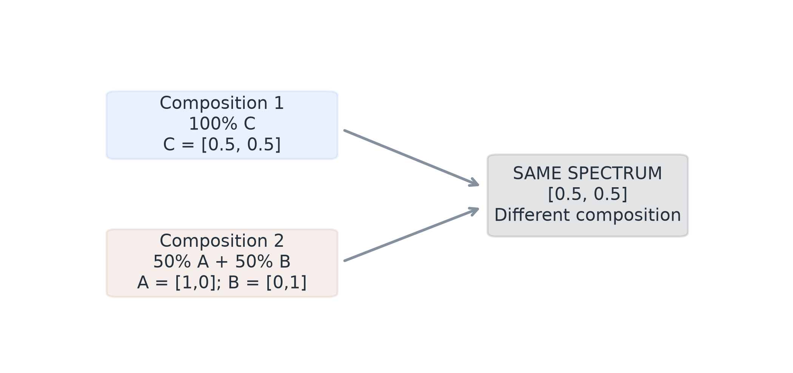

**What am I looking at?** The exact three-reference ambiguity example.

**What should I notice?** Two different category fraction vectors reach the same observation.

**What does it mean?** Zero reconstruction error does not guarantee a unique composition.

**What does it NOT mean?** Toy labels A/B/C are not independently validated biological categories.

Evidence: `formal/SpectralBridge/Counterexamples.lean: ambiguous_reconstruction`; `formal/SpectralBridge/Counterexamples.lean: reconstruction_not_identifiability`; `formal/SpectralBridge/Counterexamples.lean: mesma_ambiguity`

## 7 | FCLS: find the closest allowed spectral mixture

### The idea
Fully Constrained Least Squares takes a fixed set of endmembers and finds nonnegative fractions adding to one that best reconstruct the observed spectrum. The endmembers define a convex feasible region in spectral space.

### The mathematics
minimize ||y − E f||²,   with fᵢ ≥ 0 and Σ fᵢ = 1

### In plain language:
Choose the allowed mixture whose predicted spectrum is closest to the observation. Dividing squared error by the number of bands changes the scale of the objective but not its minimizer when band count is positive.

### What is proved
The ideal feasible set is convex and compact, the objective is convex, and a minimizer exists when there is at least one component. Uniqueness follows under identifiability. If the supplied references are the true generating references and the mixture model is exact and identifiable, the ideal solver recovers the generating fractions.

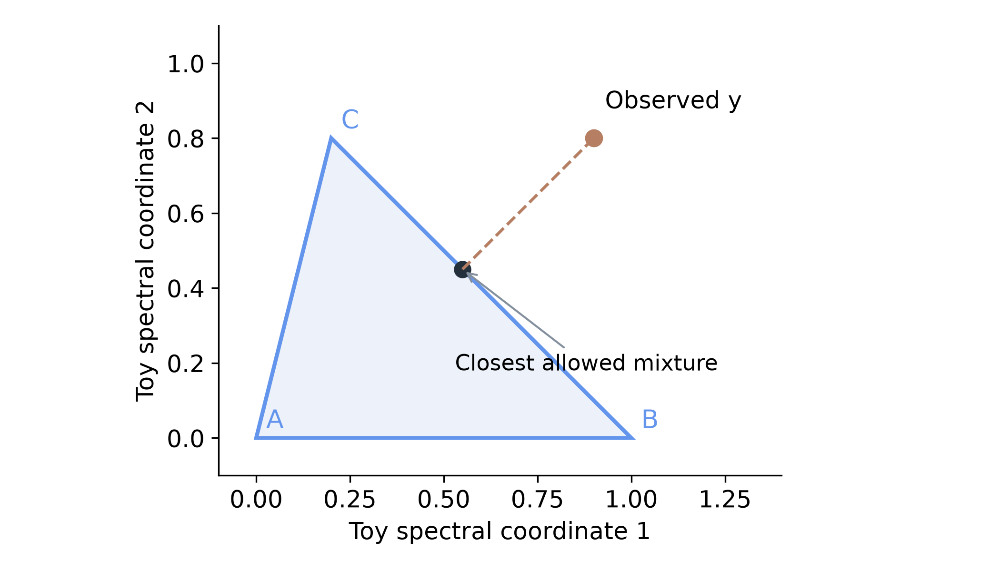

**What am I looking at?** A hypothetical two-coordinate spectral triangle and a target outside it.

**What should I notice?** The closest feasible point is a reconstruction, not a measured fraction truth.

**What does it mean?** The solver works when given the right ingredients and an identifiable ideal model.

**What does it NOT mean?** The oracle theorem does not validate reference purity, physical mixing or field abundance.

Evidence: `formal/SpectralBridge/Inference.lean: fcls_exists`; `formal/SpectralBridge/Inference.lean: fcls_convex`; `formal/SpectralBridge/Inference.lean: fcls_unique`; `formal/SpectralBridge/Inference.lean: fcls_exact_recovery`; `provenance/researcher-pft-information/2026-10-15/v1/tables/oracle_solver_controls.csv`

## 8 | MESMA: search among plausible reference combinations

### The idea
MESMA adds a candidate-library search around constrained fitting. In the actual utility, default models contain up to three different categories, one retained reference per category, with a 20,000-model guard. Boundary faces are considered explicitly; near-singular and tiny-interior candidates can be excluded by numerical thresholds.

### The mathematics
Near-fit set = saved candidate fractions with RMSE ≤ chosen RMSE + 0.01

### In plain language:
Several admitted class compositions may fit almost as well as the selected one. The formal tolerance-aware search theorem bounds the chosen cost relative to admitted costs; it is not a guarantee about every physical composition.

### What is actually saved
The implementation keeps one best fraction solution per class set, then summarizes ranges among near-fitting class sets. Those ranges are a restricted candidate diagnostic. Increasing the tolerance can enlarge the mathematical near-fit set; it cannot make uniqueness more secure.

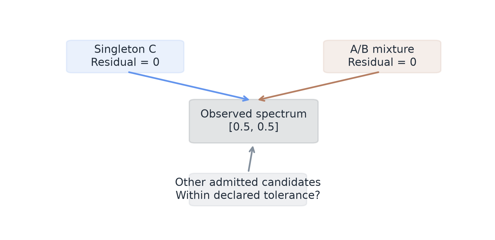

**What am I looking at?** The exact C versus A/B ambiguity, surrounded by a conceptual candidate search.

**What should I notice?** A winner and an equally good alternative can coexist.

**What does it mean?** MESMA optimizes spectral reconstruction within the retained search.

**What does it NOT mean?** Saved ranges are not exhaustive physical uncertainty or proof of biological truth.

Evidence: `formal/SpectralBridge/Inference.lean: tolerant_search_bound`; `formal/SpectralBridge/Inference.lean: ambiguity_mono`; `formal/SpectralBridge/Inference.lean: selected_feasible`; `src/spectralbridge/mixtures.py`

## 9 | Ridge learns a fraction predictor

### The idea
Ridge uses training spectra and known synthetic fraction targets to learn a regularized mapping. It is a supervised prediction problem, whereas MESMA searches reference mixtures to reconstruct each target spectrum. A ridge prediction is a learned estimate under the training distribution, not a proof of a unique conditional expectation.

### The mathematics
minimize ||F_c − X_c B||² + α ||B||²,   α > 0

### In plain language:
Fit fractions while penalizing very large coefficients. The centered training design and targets, positive penalty and fixed preprocessing give a unique coefficient minimizer for each output column. The benchmark fits an unpenalized intercept and restores it during prediction.

### Connection to SpectralBridge
Standardization is fitted on proper-training mixtures only. Alpha is chosen from 0.1 and 10 on calibration mixtures, not target truth. A fixed trained model returns one prediction even if multiple compositions could produce that spectrum. UNIQUE MODEL FIT does not mean UNIQUE PHYSICAL COMPOSITION.

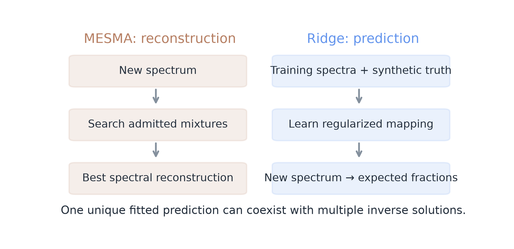

**What am I looking at?** The actual distinction between candidate reconstruction and supervised prediction.

**What should I notice?** The two methods optimize different targets.

**What does it mean?** A unique ridge fit can improve expected synthetic prediction error without resolving inverse ambiguity.

**What does it NOT mean?** No theorem says ridge is universally superior to MESMA.

Evidence: `formal/SpectralBridge/Ridge.lean: ridge_positive`; `formal/SpectralBridge/Ridge.lean: ridge_normal_equation`; `formal/SpectralBridge/Ridge.lean: ridge_minimizer_unique`; `formal/SpectralBridge/Counterexamples.lean: perfect_prediction_not_unique_inversion`; `provenance/researcher-pft-information/2026-10-15/v1/run_abundance.py`

## 10 | Projection imposes valid fraction geometry

### The idea
Unconstrained ridge predictions can be negative or fail to sum to one. Euclidean simplex projection chooses the nearest fraction vector that is nonnegative and sums to one. It is more than clipping negatives: the entries must be adjusted together.

### The mathematics
p = nearest feasible fraction vector to x;     ||p − f*|| ≤ ||x − f*|| for feasible truth f*

### In plain language:
The ideal projection cannot increase Euclidean distance to any truth already in the simplex. It returns valid fractions, leaves valid inputs unchanged and is idempotent: projecting again changes nothing.

### What is and is not verified
The Lean result uses the Euclidean metric, not the default norm on a function vector. A threshold-form certificate and an exact toy certificate connect to the sorting rule. General sorting/rank-index and arbitrary floating-point equivalence are not fully proved; representative Python checks support that bridge.

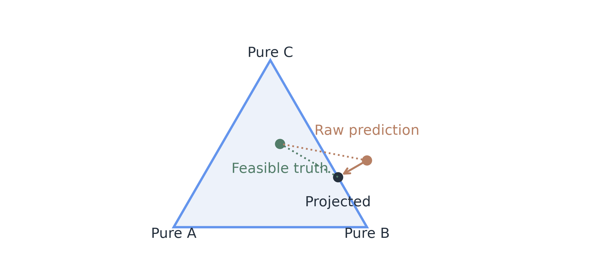

**What am I looking at?** A hypothetical sum-one fraction plane; the raw point has a negative A entry.

**What should I notice?** Projection moves to the nearest valid point; dotted lines show distance to a feasible truth.

**What does it mean?** Valid constraints can improve fraction error without adding spectral measurements.

**What does it NOT mean?** Projection does not recover information lost by convolution or eliminate candidate ambiguity.

Evidence: `formal/SpectralBridge/Projection.lean: projection_unique`; `formal/SpectralBridge/Projection.lean: projection_mem`; `formal/SpectralBridge/Projection.lean: projection_idempotent`; `formal/SpectralBridge/Projection.lean: simplex_projection_error`; `formal/SpectralBridge/Bridge.lean: projection_certificate`

## 11 | The full chain is a conditional scientific argument

### The idea
The composition theorem requires preserved generating mixtures, appropriate references, transformed identifiability and an ideal constrained optimizer. These are explicit hypotheses, not facts proved for every scene.

### The mathematics
Correct generating model + preserved mixture + transformed identifiability + ideal solver ⇒ generating fractions recovered

### In plain language:
Recovery follows when the hypotheses hold. Scene-dependent correction, masks or medians can break preservation. Ridge prediction is not substituted for the ideal FCLS solver.

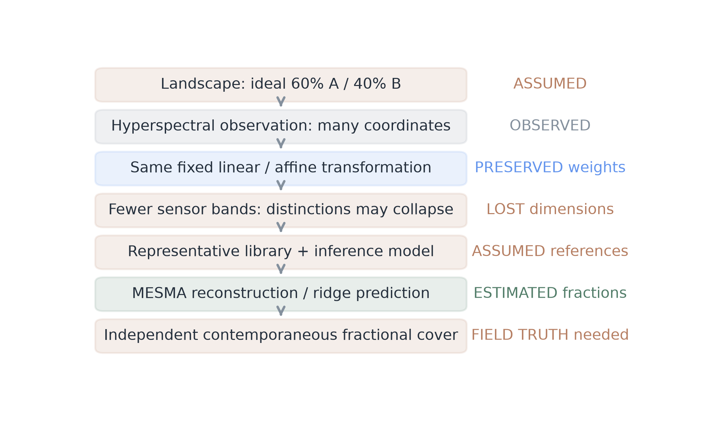

**What am I looking at?** An ideal 60/40 story with preservation, loss, assumptions and estimation marked separately.

**What should I notice?** Fewer measurements and added empirical assumptions enter at different places.

**What does it mean?** Use the composition theorem as an assumption checklist, not an operational approval stamp.

**What does it NOT mean?** Neither the physical landscape nor the complete Python workflow has been certified by this diagram.

Evidence: `formal/SpectralBridge/Inference.lean: pipeline_recovery`; `formal/SpectralBridge/Pipeline.lean: full_pipeline_conditional`; `formal/ASSUMPTIONS.md`

## 12 | What the proof says about the observed results

### Separability is empirical
The canonical analysis finds differences for all ten researcher-category pairs in acquisition-matched sampled comparisons. The five labels are Deciduous, Evergreen, Herbaceous, Non-vegetated & dead, and Woody shrub. Lean does not establish that biological or statistical finding; background/dead cover is a comparator rather than a biological PFT.

### Recognition is not mixture identifiability
The classifiers identify unseen labelled polygons with useful but imperfect balanced accuracy. Geographic transfer is weaker. Synthetic OLI retains signal, but recognition drops relative to full NEON. The formal rank-loss result explains a possible mechanism, not a causal attribution of the entire observed accuracy gap.

### Reading the evidence
Points below are means of the saved outer scores, not confidence intervals. New polygons and held sites are distinct validation questions. Synthetic OLI is derived from the same corrected NEON source; it is not an independent Landsat acquisition.

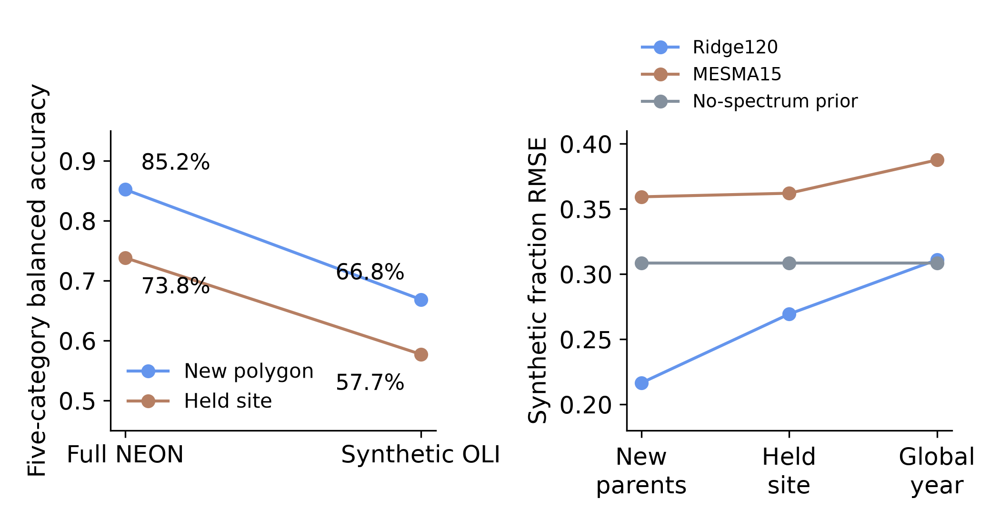

**What am I looking at?** Canonical full-NEON/synthetic-OLI recognition and NEON synthetic-fraction error.

**What should I notice?** The held-site recognition penalty and the global-year ridge/prior failure remain visible.

**What does it mean?** The empirical outcomes are compatible with information loss and library-dependent prediction.

**What does it NOT mean?** A mathematical possibility is not proof of the cause, universality or field validity of these outcomes.

Evidence: `provenance/researcher-pft-information/2026-10-15/v1/tables/complementary_feature_performance.csv`; `provenance/researcher-evidence/2026-10-16/v1/tables/abundance_domain_summary.csv`; `output/pdf/researcher_evidence/Separability_Identifiability_and_Abundance.pdf`

## The abundance controls make the interpretation sharper

### The oracle
Known-generating-parent FCLS produces nearly zero synthetic fraction error. This is expected when exact linear mixtures, common representation, appropriate references and identifiability hold. It tests an ideal numerical case, not independently measured field cover.

### Ridge120 and the matched15 control
The larger-parent ridge benchmark reduces mean-fold synthetic error relative to MESMA15. Restricting ridge to the exact 15 MESMA parents removes the mean NEON advantage. Retained diversity, training bundles and model priors also change, so the control does not isolate one causal mechanism or prove intrinsic algorithm superiority.

### The global-year prior
Global-year ridge fails the no-spectrum prior on average. A predictor can therefore be mathematically well defined and still be less useful than a simple baseline under domain change. Retrospective labels and site/year composition also limit annual biological interpretations.

### How proof and evidence fit
The formal ambiguity example explains why low residual alone cannot validate composition. The projection theorem explains why valid-fraction geometry can help error. Neither theorem selects a universal estimator winner. All abundance values here are controlled synthetic algebraic fractions; independent field fractional-cover validation remains outstanding.

### A concrete objective mismatch
Suppose the true category is A at observed [0,0], but the retained A reference is [1,1] and B is [0,0]. Choosing B reconstructs perfectly while assigning the wrong category. Choosing A has larger spectral residual but correct class fractions. The formal counterexample separates these two losses; it does not assume the retained library is the true generating library.

|NEON synthetic target|Ridge120|MESMA15|Matched Ridge15|No-spectrum prior|
|---|---|---|---|---|
|New parents|0.216|0.359|0.365|0.309|
|Held sites|0.269|0.362|0.387|0.309|
|Global year|0.311|0.388|0.405|0.309|

Evidence: `provenance/researcher-evidence/2026-10-16/v1/tables/abundance_domain_summary.csv`; `provenance/researcher-evidence/2026-10-16/v1/tables/same_candidate_ridge.csv`; `provenance/researcher-pft-information/2026-10-15/v1/tables/oracle_solver_controls.csv`; `formal/SpectralBridge/Counterexamples.lean: residual_does_not_order_abundance_error`; `output/pdf/researcher_evidence/Separability_Identifiability_and_Abundance.pdf`

## 13 | The implementation audit found consequential discrepancies

### The idea
A coherent mathematical specification does not prove that every array operation implements it correctly. The audit found reproducible departures from expected axis and pixel-identity contracts. They must be investigated, not dismissed because other tests or proofs pass.

### What was reproduced
For a band-first cube with shape (7,2,3), the brightness helper selects the smallest dimension - the two image rows - as its band axis. For a 3×3 raster with chunk size four, overlapping extraction windows emit 15 rows for nine unique pixels.

### What we can conclude
Both fixtures can change outputs in affected executions. Their impact on existing scientific results is not yet established. No historical output was replaced, and production fixes remain queued separately. The following pages account for every documented discrepancy and boundary, including issues that are not bugs.

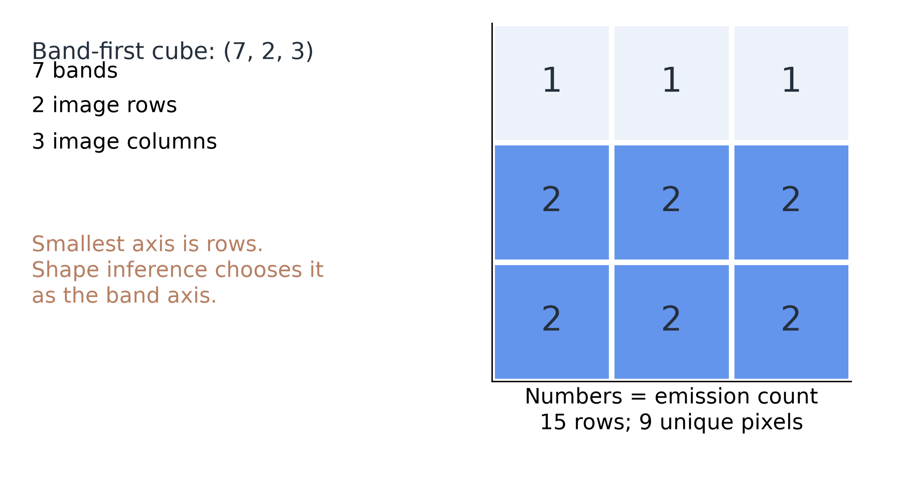

**What am I looking at?** The actual two audit fixtures, with pixel emission counts in the right panel.

**What should I notice?** A spatial axis is mistaken for bands; some raster rows are emitted twice.

**What does it mean?** These are concrete implementation concerns requiring explicit contracts and provenance review.

**What does it NOT mean?** The fixtures do not show that the supplied historical library used either affected path.

Evidence: `formal/IMPLEMENTATION_AUDIT.md`; `formal/tests/test_conformance.py`

## Audit details: the two reproduced contract failures

### A1 | Band-axis inference
**What the code does:** The percentage-brightness helper chooses the smallest array dimension as bands. A (7,2,3) band-first cube is moved so its two image rows become the apparent bands.
**What the specification expects:** Each known band should receive its own coefficient, independent of image size.
**Why they differ:** Array shape is used as a proxy for the semantic band axis.
**Can it change outputs?** Yes. Gains can be applied across rows and only two coefficients used. The small fixture reproduces this.
**Can it change existing scientific results?** Impact not yet established. Trace actual product shapes and the generating code path.
**Severity:** High; confirmed toy reproduction.
**Recommended action:** Use an explicit band-axis contract, test both layouts and edge shapes, then audit affected product provenance.

### A2 | Overlapping extraction windows
**What the code does:** Chunk starts and ends use integer row conversion with an extra end row. Consecutive windows overlap; the 3×3 fixture emits 15 rows for nine pixels.
**What the specification expects:** Each selected raster/pixel identity should occur once.
**Why they differ:** Flat chunk boundaries are converted to whole-row windows without trimming duplicated rows.
**Can it change outputs?** Yes. Counts and downstream summaries can change; weighting duplicated pixels may alter medians.
**Can it change existing scientific results?** Impact not yet established. Determine whether the historical library used this extractor and whether duplicates were removed.
**Severity:** High; confirmed toy reproduction.
**Recommended action:** Use disjoint row blocks or trimmed flat windows, assert unique source/pixel keys, quantify impacts before creating new versioned outputs.

Evidence: `formal/IMPLEMENTATION_AUDIT.md`; `formal/tests/test_conformance.py`; `formal/TRACEABILITY.md`

## Audit details: normalization, correction and search

### A3 | Response normalization
**What the code does:** Inline convolution divides by response sum plus 10⁻¹². Zero support produces zero; negative weights are not rejected.
**What the specification expects:** An exact normalized nonnegative average preserves constants and bounds.
**Why they differ:** The stabilizing denominator changes the normalization; the exact-real factor is sum/(sum+epsilon).
**Can it change outputs?** Yes, strongly when support is tiny. Ordinary well-supported bands may have negligible differences.
**Can it change existing scientific results?** Impact not yet established; the near-zero toy is not a measured production-band error.
**Severity:** Low for ordinary support; high for near-zero support.
**Recommended action:** Validate response sign/support and choose an explicit zero-support policy; retain the epsilon-specific theorem until implementation changes.

### A4 | Fitted corrections are data-dependent
**What the code does:** SCS+C fits coefficients; BRDF can choose NDVI bins; scene brightness fits parameters and usually clips.
**What the specification expects:** A linear theorem requires one fixed operator on common support.
**Why they differ:** Re-estimation, bin selection and clipping can change the operator with its input.
**Can it change outputs?** Yes if an analyst reorders operations or assumes full-pipeline linearity. This is not itself an implementation bug.
**Can it change existing scientific results?** Impact not yet established for any improper reorder; the existing ordering is preserved.
**Severity:** Specification boundary.
**Recommended action:** State frozen-parameter hypotheses and retain the documented correction order.

### A5 | MESMA is a restricted numerical search
**What the code does:** The code limits categories/models, excludes tiny interiors, skips numerically weak Gram systems and updates only beyond a 10⁻¹⁴ MSE improvement.
**What the specification expects:** An unrestricted exact argmin ranges over every mathematically allowed candidate.
**Why they differ:** The executed search admits only a finite, thresholded subset and uses a tie tolerance.
**Can it change outputs?** Yes relative to an unrestricted ideal solver, particularly near boundaries or degeneracy.
**Can it change existing scientific results?** Impact not yet established beyond documented solver controls; exact-real optimality is not asserted for Python.
**Severity:** Specification boundary, not automatically a bug.
**Recommended action:** Use the admitted-search tolerance theorem; retain rank/interior/tie settings and avoid unrestricted-optimum claims.

Evidence: `formal/IMPLEMENTATION_AUDIT.md`; `formal/tests/test_conformance.py`; `formal/TRACEABILITY.md`

## Audit details: uncertainty, ridge and aggregation

### A6 | Ambiguity is not exhaustive uncertainty
**What the code does:** One best fraction solution is stored per class set; near-fit ranges use those solutions within chosen RMSE + 0.01.
**What the specification expects:** All feasible near-optimal fractions would define a larger uncertainty question.
**Why they differ:** The saved diagnostic samples candidate-class-set winners, not every feasible composition.
**Can it change outputs?** It changes which alternatives are represented; it need not change the selected estimate.
**Can it change existing scientific results?** The existing diagnostic is not an exhaustive physical interval. Broader field impact is not established.
**Severity:** Interpretation limitation.
**Recommended action:** Name the retained library, metric, tolerance and restricted range; do not call it full physical uncertainty.

### A7 | Centering and intercept matter
**What the code does:** Ridge uses proper-training standardization, fit_intercept=True and calibration-selected alpha.
**What the specification expects:** The inverse formula must use centered transformed design/targets and restore the unpenalized intercept.
**Why they differ:** A naive uncentered formula describes a different model.
**Can it change outputs?** Yes if the wrong formula is used for replay or explanation; the audited implementation uses the stated conventions.
**Can it change existing scientific results?** No leakage was found in inspected preprocessing code; this is inspection/numerical evidence, not a workflow proof.
**Severity:** Specification boundary.
**Recommended action:** Keep means, scales, centering, alpha and intercept in replay provenance; use the proved centered objective.

### A8 | Library medians are not means
**What the code does:** Extraction emits pixels; the primary library aggregates hierarchical medians with unsupported bands missing.
**What the specification expects:** The mean commutation theorem applies to normalized arithmetic averaging on fixed support.
**Why they differ:** Medians are nonlinear under arbitrary addition/cross-band mixing.
**Can it change outputs?** Yes if a mean theorem is used to reorder median aggregation and transformation.
**Can it change existing scientific results?** Impact not yet established for any altered order; no aggregation was changed.
**Severity:** Interpretation limitation.
**Recommended action:** Describe actual medians and common support; use the proved median counterexample rather than a mean claim.

Evidence: `formal/IMPLEMENTATION_AUDIT.md`; `formal/tests/test_conformance.py`; `formal/TRACEABILITY.md`

## Audit details: response, calibration and masks

### A9 | Multiple response backends
**What the code does:** Inline Gaussian sampling, input-width-weighted legacy fallback and optional HyTools implementations differ; the legacy wrapper assumes 426 bands/FWHM5.
**What the specification expects:** A coefficient-equivalence claim would require the same actual coefficient construction.
**Why they differ:** Backends and defaults encode different approximations and metadata assumptions.
**Can it change outputs?** Yes. Frozen matrices can all be linear while producing different numbers.
**Can it change existing scientific results?** Impact not yet established across historical backends.
**Severity:** Implementation boundary.
**Recommended action:** Record backend/version/input metadata, pin optional dependencies and do not claim universal coefficient equivalence.

### A10 | Synthetic coefficients are not independent calibration
**What the code does:** The packaged drone registry was fitted between synthetic products from corrected NEON; range checks guard numerical compatibility.
**What the specification expects:** Physical calibration transfer requires independent aligned native-sensor observations.
**Why they differ:** A complete synthetic fit or high correlation does not establish empirical cross-sensor validity.
**Can it change outputs?** Applied coefficients change outputs; physical correctness is not established by their algebra.
**Can it change existing scientific results?** Native-drone/actual-Landsat validity remains an empirical question.
**Severity:** Metadata/scale interpretation limitation.
**Recommended action:** Collect independent calibration/validation observations; retain diagnostic provenance and explicit sensor direction.

### A11 | Missing data change the domain
**What the code does:** Inline products reset all-band nodata pixels; partial nodata/NaNs can enter sums. Extraction rejects -9999 but not every nonfinite value.
**What the specification expects:** Real-vector theorems require finite common support and aligned masks.
**Why they differ:** Array missingness is not represented by a finite real number; masks can alter effective operators.
**Can it change outputs?** Yes. Invalid values can propagate or contaminate weighted values.
**Can it change existing scientific results?** Impact not yet established; quantify actual partial-missing cases before judging a dataset.
**Severity:** Masking/implementation boundary.
**Recommended action:** Declare and test per-band support and nodata policies; preserve legitimate finite negative corrected values.

Evidence: `formal/IMPLEMENTATION_AUDIT.md`; `formal/tests/test_conformance.py`; `formal/TRACEABILITY.md`

## Audit details: layout, imports and wavelength precision

### A12 | Optional brightness layout heuristic
**What the code does:** The scene-brightness helper treats the array as band-first when its first dimension is no larger than its last.
**What the specification expects:** Accepted layouts need a known band axis.
**Why they differ:** A relative-size comparison cannot identify semantics for every shape.
**Can it change outputs?** Yes for ambiguous shapes; fitting and clipping can compound interpretation differences.
**Can it change existing scientific results?** Impact not yet established; this finding is confirmed by inspection, not the separate A1 fixture.
**Severity:** Potential axis defect; inspected boundary.
**Recommended action:** Add an explicit axis contract and layout tests; do not treat default clipping as globally affine.

### Startup | Lazy Parquet import
**What the code does:** The helper accesses pyarrow.parquet without explicitly importing that submodule. A fresh isolated run raised AttributeError.
**What the specification expects:** The advertised extraction path should initialize its own dependency.
**Why they differ:** Execution can depend on whether another import has already loaded the submodule.
**Can it change outputs?** It can prevent execution; it does not silently change a successfully produced spectrum.
**Can it change existing scientific results?** Impact not yet established. The overlap fixture imports the submodule explicitly to reach the loop.
**Severity:** Execution/import-order issue.
**Recommended action:** Import pyarrow.parquet inside the lazy helper and test a fresh process.

### Precision | Rounded wavelength labels
**What the code does:** Decimal centers/FWHM enter inline construction as float32; polygon wavelength labels are rounded to integer nm.
**What the specification expects:** Response construction should use authoritative response metadata.
**Why they differ:** A rounded column name omits decimal-center precision and the response width/function.
**Can it change outputs?** Reconstructing an operator from labels alone can change results; ordinary labeling does not change prior convolution values.
**Can it change existing scientific results?** Impact not yet established for any metadata reconstruction. No coefficient-direction error was found in the inspected application.
**Severity:** Metadata precision boundary.
**Recommended action:** Use original header/configuration responses, preserve their hashes and distinguish labels from sensor definitions.

Evidence: `formal/IMPLEMENTATION_AUDIT.md`; `formal/tests/test_conformance.py`; `formal/TRACEABILITY.md`

## 14 | What is actually proved? Mathematical statements

### Read the status and its conditions together
PROVED means an existing kernel-checked mathematical result. A conditional statement is still a proof, but its scientific use requires the listed hypotheses. Every proof-linked row below names an actual audited theorem in the machine-readable companion table. Nothing is labeled proved solely because it appeared in a plan.

|Scientific statement|Status|Meaning|
|---|---|---|
|Fixed sensor weighting is linear|PROVED IF ASSUMPTIONS HOLD|Same finite weights and support; no physical response validation.|
|Ideal linear maps preserve weights|PROVED|The forward weighted-sum equation commutes with any fixed linear map.|
|Shared affine maps preserve simplex mixtures|PROVED IF ASSUMPTIONS HOLD|Sum-to-one or the exact offset-defect condition; same map on every component.|
|Band reduction can destroy identifiability|PROVED|The exact two-coordinate counterexample loses the A/B distinction.|
|Every fewer-band library loses uniqueness|NOT ESTABLISHED|Whole-space noninjectivity does not imply failure on every restricted mixture simplex.|
|A mixture spectrum lies in the reference convex hull|PROVED IF ASSUMPTIONS HOLD|Nonnegative fractions total one; reference spectra use compatible coordinates.|
|FCLS minimizer exists and is unique|PROVED IF ASSUMPTIONS HOLD|Existence needs a nonempty finite simplex; uniqueness additionally needs identifiability.|
|Known-parent ideal recovery works|PROVED IF ASSUMPTIONS HOLD|True generating references, exact linear model, transformed identifiability, ideal solver.|
|Good reconstruction guarantees true composition|FALSE / COUNTEREXAMPLE|Pure C and half A/B reconstruct the same spectrum with different class fractions.|
|MESMA winner beats every physical mixture|NOT ESTABLISHED|The proved bound concerns admitted finite costs and a tolerance, not all biology.|

Evidence: `formal/PROOF_STATUS.md`; `formal/checks/axioms.log`

## What is actually proved? Prediction and field interpretation

### A guarantee has a domain
NUMERICALLY CHECKED and EMPIRICALLY SUPPORTED mean different things from PROVED. A counterexample refutes a universal implication; it does not estimate how frequently a real deployment will fail. A missing empirical measurement cannot be repaired by adding a mathematical axiom.

|Scientific statement|Status|Meaning|
|---|---|---|
|Positive-alpha ridge has unique fitted coefficients|PROVED IF ASSUMPTIONS HOLD|Fixed centered design/targets and positive regularization; restore the intercept.|
|One ridge prediction implies physical uniqueness|FALSE / COUNTEREXAMPLE|Perfect prediction can coexist with an ambiguous reference inverse.|
|Ideal projection gives valid fractions|PROVED|Nonnegative entries total one; feasible predictions are fixed and projection is idempotent.|
|Projection cannot worsen distance to feasible truth|PROVED IF ASSUMPTIONS HOLD|Euclidean projection and truth in the same nonempty simplex.|
|Python exactly matches the spec for every input|NOT ESTABLISHED|Nine rational examples agree numerically; full IEEE/sorting/active-face equivalence is not proved.|
|Representative Python calculations agree|NUMERICALLY CHECKED|Nine bridge cases plus four audit tests; declared per-case tolerances.|
|Sampled category spectra differ|EMPIRICALLY SUPPORTED|All ten pairs in the reported acquisition-matched design; not a Lean biological theorem.|
|Ridge is universally better than MESMA|NOT ESTABLISHED|Matched15 removes the mean NEON advantage; domain and library capacity matter.|
|Calibration and field observations are correct|NOT ESTABLISHED|Algebra does not supply independent sensor or label truth.|
|Synthetic fractions establish field fractional cover|NOT ESTABLISHED|Independent contemporaneous field-fraction validation remains outstanding.|

Evidence: `formal/PROOF_STATUS.md`; `formal/checks/axioms.log`; `output/pdf/researcher_evidence/Separability_Identifiability_and_Abundance.pdf`

## 15 | The assumption ladder

### The idea
A guarantee at one level does not automatically validate the next. Correct algebra still needs a conforming implementation. A conforming implementation still needs appropriate sensor physics. Ecological fractions need representative references, meaningful categories and independent truth.

### What most limits biological interpretation
The historical library’s physical scale and reference purity remain unresolved. Linear mixing and cross-sensor coefficient transfer must be appropriate at aligned support. Recorded cover categories do not independently establish material purity or annual biological change. Independent contemporaneous field fractions are the final missing evidence, not another synthetic model sweep.

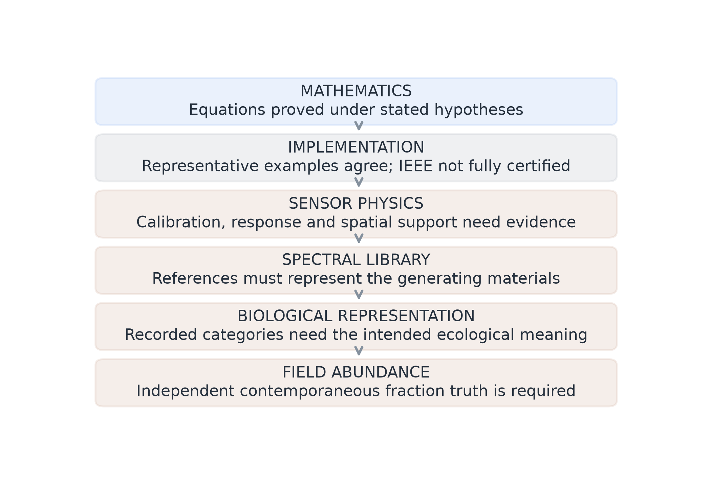

**What am I looking at?** The successive evidence requirements from equations to field abundance.

**What should I notice?** Only the mathematical level is supplied by proof; examples support parts of implementation.

**What does it mean?** Plan new measurements at the level where evidence is missing.

**What does it NOT mean?** A complete proof build does not fill calibration, biological or field-truth gaps.

Evidence: `formal/ASSUMPTIONS.md`; `formal/SpectralBridge/Pipeline.lean: full_pipeline_conditional`

## Evidence guide: what was rebuilt and compared

### A checked mathematical layer
All eight Lean source modules and their complete root import were read and rebuilt. Every one of the 106 project theorem declarations appears in the axiom audit. The only dependencies are Lean’s standard foundations; no theorem assumes that calibration, field observations or biological labels are correct.

### A finite implementation bridge
The table gives the nine Lean rational calculations compared with actual Python paths. Absolute tolerances are declared in the conformance tests; relative tolerance is zero for these comparisons. Four further tests expose axis inference, tiny-response normalization, median/clipping noncommutation and overlapping extraction windows.

### Where the underlying evidence lives
The canonical 26-page scientific report is Separability, Identifiability and Abundance under output/pdf/researcher_evidence/. The formal proof-status matrix, assumptions, transformation map and implementation audit are under formal/. This report’s tables, Markdown and manifests preserve exact source paths, theorem names, filters and hashes without copying the original spectral library.

|Case|Exact / simple example|Absolute tolerance|
|---|---|---|
|Response weighting|[2,6], weights [1,3]: ≈ 5|10⁻⁶|
|Percentage multiplication|100 → 95.555048|10⁻⁵|
|Affine drone writer|2 × 3 + 1 → 7|10⁻⁶|
|Footprint mean|Equal-area [2,6] → 4|10⁻¹⁰|
|Synthetic mixture|20% / 80% unit references|10⁻¹⁵|
|FCLS oracle|[0.25,0.75] recovered|10⁻¹⁰|
|MESMA ambiguity|C selected; A/B also exact|10⁻¹⁰|
|Centered ridge|[1/3,2/3] at input 0.5|10⁻¹²|
|Simplex projection|[-2,1,0.8] → [0,0.6,0.4]|10⁻¹²|

Evidence: `formal/checks/axioms.log`; `formal/SpectralBridge/Bridge.lean`; `formal/tests/test_conformance.py`; `output/pdf/researcher_evidence/Separability_Identifiability_and_Abundance.pdf`

## 16 | What we learned

### The mathematical core is coherent under explicit assumptions
Fixed linear and appropriate affine transformations preserve ideal mixture weights. The same transformation must be used on targets and references, with compatible finite support. Nonlinear, fitted or masked stages do not inherit that conclusion automatically.

### Preservation forward is not recovery backward
Band reduction can destroy the distinction among mixtures. The forward equation can remain valid while more than one composition produces the same observation. The proof makes that possibility exact rather than rhetorical.

### Reconstruction and prediction answer different questions
FCLS/MESMA reconstruct spectra from allowed ingredients. Ridge learns a regularized fraction predictor. Good reconstruction and good prediction both differ from unique physical inversion. A unique fitted coefficient matrix is not a unique biological composition.

### Library representation is central
The empirical matched15 and global-year controls limit favorable averages. More representative reference diversity, valid units, independent sensor observations and contemporaneous field fractions matter more than declaring an algebraic winner.

### What this effort delivered
All 106 theorem declarations rebuild with standard foundations only. Thirteen conformance/audit tests reconnect selected mathematical calculations to actual Python paths. The report adds explanations and figures, not new theorems or scientific refits. The implementation discrepancies remain visible and queued for separate review.

### How to use the result
For a scientific claim, ask which mathematical hypotheses apply, whether the actual execution meets them, and what independent sensor/biological evidence supports the interpretation. Keep sampled recognition, synthetic fraction prediction and field abundance separate.

### The final boundary
The proof does not tell us that every abundance estimate is true. It tells us precisely what must be true for an abundance estimate to have the interpretation we give it.

Evidence: `formal/CLAIMS.md`; `formal/PROOF_STATUS.md`; `formal/IMPLEMENTATION_AUDIT.md`; `output/pdf/researcher_evidence/Separability_Identifiability_and_Abundance.pdf`
