# Purpose and relationship to the main text

The main paper argues that comparable reflectance has to be constructed and that researchers should be able to examine how that construction was made. This supplement provides the detail needed to assess that claim: processing contracts and transformations, the intended drone artifact sequence, the first 43-flight production attempt, the streaming bulk workflow inspected in September 2026, historical QA records, and the supplied 122-flightline analysis. Development history, neighboring- software comparisons, and the prospective QA and resource protocol are included here so that the main paper can stay focused on the scientific problem. The organization follows the questions a reader is likely to ask. What is the software intended to produce? Which numerical transformations does it apply? How are completion and QA judged? What happened in controlled tests and real-data runs? Which conclusions can be drawn from the collection analysis, and what remains to be tested? Detailed provenance and future protocols follow the results they qualify. The historical NEON and intended drone descriptions retain the 4 September audit at f7e7ddd; the bulk and release-preparation update refers to c86da6a, inspected 9 September [@si_earthlab2026ak; @si_earthlab2026l]. R10C was generated at d88e8d0 and archived at f7e7ddd. The supplied bulk results have a separate analysis run identifier, not yet linked to an executed source revision by a matching manifest. The exact revision and resolved configuration used for the 43-flight drone production attempt were not included in its supplied inventory, and no corrective revision is assigned here [@si_spectralbridgeprojectteam2026]. Source inspection, historical execution, production inventory, and this revision’s reanalysis of exported bulk tables are kept distinct. The software-lineage section uses the same revision boundaries. It draws on explicit notices in pinned source files, cited repository history, and the later repository audit summarized for this revision. No standalone HYTOOLS_PROVENANCE.md or provenance manifest was supplied with the manuscript workspace. We therefore do not describe the later attribution work as documentation that existed in historical releases. Where file-level evidence is incomplete, the tables say so rather than declaring independence. Four terms keep the claims consistent. Implemented means that behavior is present in source code. Tested means that a controlled fixture exercises a defined contract. Demonstrated refers to artifacts and behavior recorded in a real-data run. Scientifically validated requires independent observations or a justified external reference. Thus, the drone campaign demonstrates discovery, staging, and persistence of intermediate products, but not completion of the full drone route.

# Software scope and supported paths

SpectralBridge has two observation-level paths and one collection-level path. NEON processing produces source-product and geometry-normalized hyperspectral representations, configured target- band products, analysis tables, and QA. Drone processing ingests supported local observations while preserving their identity, correction availability, and provenance [@si_earthlab2026am; @si_earthlab2026m]. The bulk path then catalogs eligible target products and reads aligned ENVI windows; merged Parquet remains available for compatibility. Bulk analysis starts from completed products and does not rerun geometry normalization or target-band weighting [@si_earthlab2026a]. The project-level relationship Drone → NEON → Landsat is conceptual. NEON supplies a dense reference spectrum from which configured MicaSense- and Landsat-like band representations can be constructed. The package does not implement a direct, universal drone-to-Landsat conversion, and target-band weighting does not alter spatial support [@si_nationalecologicalobservatorynetwork2026; @si_earthlab2026am; @si_earthlab2026s]. Each observing system brings a different strength. Imaging spectroscopy preserves contiguous spectral information [@si_goetz1985]; the NEON Airborne Observation Platform applies it to repeatable ecological observation [@si_kampe2010]; Landsat provides a long calibrated record at moderate resolution [@si_wulder2022]; and compact UAV instruments provide flexible, very-high-resolution sampling while demanding careful measurement design and calibration [@si_aasen2018; @si_mamaghani2019]. SpectralBridge addresses the spectral and workflow parts of relating these systems, not the entire comparison problem.

# Flightline processing contracts

## Canonical NEON stage sequence

Table 1: Canonical NEON processing stages and their scientific interpretation [@si_earthlab2026i; @si_earthlab2026e; @si_earthlab2026s].

| Stage | Principal input | Principal output | Scientific purpose |
| --- | --- | --- | --- |
| Source acquisition | Flightline identifier and | Source HDF5 | Preserve the acquired |
|  | NEON product request |  | observation and identity. |
| Source-product | NEON HDF5 | ENVI image and header | Expose reflectance and map |
| export |  |  | information in a standard |
|  |  |  | raster representation without |
|  |  |  | implying unprocessed sensor |
|  |  |  | data. |
| Parameterization | Reflectance and | JSON model reference and | Record the retained BRDF |
|  | ancillary geometry | geometry summaries | and geometry information; |
|  |  |  | scene SCS+C terms are not |
|  |  |  | persisted. |
| Correction | Source-product ENVI | Combined topographic- | Normalize modeled terrain and |
|  | and geometry/model | and-BRDF-corrected | directional effects. |
|  | information | ENVI |  |
| Configured | Geometry-normalized | Target-band | Apply target-band weights and |
| target-band | hyperspectral cube and | representations of NEON | any separately recorded |
| weighting | configured weight | pixels | brightness adjustment without |
|  | arrays |  | changing spatial support. |
| Tabulation | ENVI products | Per-product Parquet files | Make pixel-level values and |
|  |  | and merged flightline table | metadata available to |
|  |  |  | statistical workflows. |
| Quality assurance | Stage artifacts and | JSON, metrics, HTML, | Record evaluated rules, |
|  | configured checks | visual panels, and optional | warnings, failures, and |
|  |  | combined PDF | unevaluated questions. |

Canonical paths and per-flightline directories isolate products during parallel runs and provide stable locations for restart checks [@si_earthlab2026i; @si_earthlab2026e; @si_earthlab2026s]. The command- line interface and worked invocation are maintained in the versioned project documentation; worker count and storage configuration are execution choices rather than scientific defaults.

## Optional across-track half-flight processing

Full-flightline processing remains the default. When split across track=True, SpectralBridge downloads or reuses one source HDF5 file, divides the across-track columns into left and right windows, and writes each window to a separately suffixed product tree. If the sample count is odd, the right window receives the additional column. The two windows share source identity but are independent pipeline units for output paths, QA, and restart [@si_earthlab2026o; @si_earthlab2026i]. This mode changes more than memory layout. Topographic and BRDF estimation for each run sees only the pixels in that window, so half-flight products are not assumed to be numerically identical to the corresponding subset of a full-flightline result. Bulk-run records must therefore distinguish

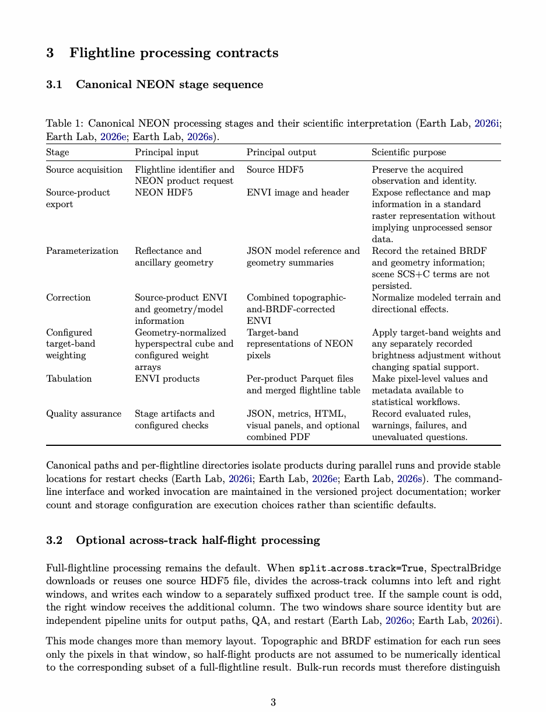

full, left-half, and right-half processing. The mode provides an operational option for large inputs, but its effect on peak memory, run time, correction estimates, and seam behavior must be measured rather than inferred [@si_earthlab2026o; @si_earthlab2026ao].

# Scientific transformations

## Configured target-band weighting

Nominally similar bands can have different relative spectral responses and therefore produce different reflectance values over the same target [@si_chander2013; @si_roy2016; @si_claverie2023]. SpectralBridge addresses this spectral part of the comparison by applying sampled target-band weights to the NEON spectrum. The result is a configured target-band representation of the NEON observation, not an independently observed target-sensor measurement. Some source code and historical QA records call this stage spectral convolution; the manuscript uses target-band weighting when discussing its scientific meaning. For reflectance samples ρi and response weights sb,i already sampled on the same source-band grid, the implemented target-band quantity is

$$
\hat{\rho}_b = \frac{\sum_i \rho_i s_{b,i}}{\sum_i s_{b,i}}. \label{eq:weighting}
$$

The implementation normalizes each response by its discrete sum and applies a floating-point matrix product [@si_earthlab2026aa]. The wavelength vector is checked for dimensional alignment but is not used for wavelength-interval quadrature. The routine therefore assumes that the supplied sampled weights already encode the intended wavelength sampling and does not independently establish their units, ordering, spacing, provenance, or spectral overlap. Configured outputs include representations labeled for Landsat 5 TM, Landsat 7 ETM+, Landsat 8 OLI, Landsat 9 OLI-2, and MicaSense, together with downstream affine coefficient sets for selected MicaSense-like and Landsat-like variables. Packaged center and full-width-at-half-maximum values are stored in the repository’s sensor-parameter JSON [@si_earthlab2026q]. These parameters can define Gaussian approximations but are not themselves measured relative spectral response curves; the Landsat 8 Operational Land Imager, for example, has measured bandwise relative spectral responses that determine its actual wavelength weighting [@si_barsi2014]. More generally, quantitative UAV multispectral use depends on documented geometric and radiometric calibration, and camera-specific characterization can reveal departures from factory assumptions [@si_aasen2018; @si_mamaghani2019; @si_cao2019]. Some configured Landsat-like products receive an empirical percentage adjustment after Equation 1. The inspected coefficient files describe adjustments derived from Table Mountain HLS median differences and warn that their band indices are wavelength-aligned rather than interchangeable with native sensor numbering [@si_earthlab2026r]. Product headers and QA artifacts record whether the adjustment was applied, but the purely weighted representation is not always retained as a separate canonical raster. Target-band weighting and brightness adjustment are therefore distinct measurement states even where the artifact chain combines them, and transferability of the adjustment beyond its derivation context has not been established. Evaluations of bandpass- adjustment techniques show that simple linear, spectral-library, adaptive, and nonlinear methods have different data requirements and performance; no one fitted form is a complete definition of sensor harmonization [@si_claverie2023]. HLS version 2.0 further demonstrates that operational harmonization combines atmospheric correction, cloud and shadow handling, directional normalization, bandpass adjustment, and common gridding [@si_ju2025]. Five controlled source/target band-count variations agreed with an independently implemented normalized-weight calculation to an absolute tolerance of 2 × 10−7 [@si_earthlab2026ar]. This tests the arithmetic contract. It does not validate weight provenance, usable spectral support, or agreement with measured satellite observations. Declared poor-quality source bands are retained visibly in the R10C evidence, but the archived reports do not establish whether they received nonzero weight in each target band [@si_earthlab2026w; @si_earthlab2026y]. Before scientific interpretation, the planned study must report usable source-wavelength coverage for every target-band representation, identify overlap with declared poor-quality bands, and define the status assigned when usable support falls below the recorded thresholds. Until then, an arithmetic pass for spectral weighting should not be read as evidence that every target band has adequate scientific support.

## Topographic and BRDF normalization

SpectralBridge applies sun-canopy-sensor plus C (SCS+C) topographic normalization followed by kernel-driven bidirectional reflectance distribution function (BRDF) normalization. SCS+C is attributed to its forest topographic-correction source [@si_soenen2005]; RossThick and LiDenseR belong to volume- and geometric-scattering model lineages developed and operationalized across several studies [@si_ross1981; @si_roujean1992; @si_li1992; @si_wanner1995; @si_schaaf2002]. The source implementation has a separate provenance: calc cosine i, calc volume kernel, and calc geom kernel, together with portions of the surrounding correction module, explicitly identify adaptation from the GPLv3-licensed HyTools project [@si_chlus2025; @si_earthlab2026z]. In the default mode, one SCS+C term per band is estimated from pixels passing the source no-data and finite-value masks, using streamed sufficient statistics across the flightline. Correction is applied in full-width row strips. Scene-level BRDF coefficients are then applied using those kernels, scene-mean solar zenith, local view geometry, and a conventional normalization target of 45-degree solar zenith, nadir view, and zero relative azimuth; this is not the actual acquisition geometry of Landsat or NEON [@si_queally2022; @si_earthlab2026ao]. Non-finite or unsuitable correction ratios are replaced by neutral factors rather than allowed to create extreme values [@si_earthlab2026z]. The fraction of pixels and bands receiving neutral fallbacks should be retained as a QA diagnostic because numerical stability does not imply that a correction was applied. An optional tiled mode fits independent topographic terms in non-overlapping 100 × 100-pixel tiles. This reduces fitting scope but creates a specific QA question: whether grid-aligned seams appear in the normalized product. The canonical normalized cube combines topographic and BRDF operations. Separate topographic-only and BRDF-only cubes are not retained, so attribution of their individual effects requires additional runs or outputs [@si_earthlab2026ao; @si_earthlab2026s]. These empirical and semi-empirical models alter observed relationships with terrain and acquisition geometry. Independent reference observations are needed to determine whether the resulting reflectance is more accurate for a particular scientific use, especially when vegetation composition covaries with slope or aspect [@si_soenen2005; @si_queally2022].

## Spatial support

Spectral weighting changes band space, not pixel footprint. A target-band representation of a NEON pixel and an actual Landsat footprint remain different mixtures even when they use similar band labels; a sensor’s point-spread function can also extend the contributing area beyond a nominal pixel boundary [@si_teillet1997; @si_woodcock1987; @si_huang2002]. Spatial comparison must distinguish grain, support, extent, and the scale of the ecological process [@si_dungan2002]. SpectralBridge retains geospatial rasters and polygon-extraction products so users can define co-registration and aggregation explicitly [@si_earthlab2026s; @si_earthlab2026m]. The aggregation rule determines which fine-resolution observations contribute, how incomplete overlap is handled, and whether the resulting quantity represents area, cover, or another ecological target.

# Drone processing pipeline

The drone pipeline is intended to prepare the independently acquired fine-resolution side of the comparison. It recursively discovers local HDF5 inputs and supports configured local TIFF inputs, preserves provenance from original filenames, and stages a working HDF5 representation. The intended downstream sequence is working HDF5, native-drone ENVI representation, geometry normalization where supported, geometry-normalized native-drone representation, optional applica- tion of reviewed affine relationships to construct configured Landsat-like variables, full-image or polygon extraction, Parquet, and QA [@si_earthlab2026m; @si_earthlab2026aj]. This use case follows a broader ecological need to connect reproducible UAS observations with NEON’s continental sampling framework [@si_koontz2022]. Topographic and BRDF normalization require the corresponding terrain, view, and solar geometry. Radiometric panel methods, empirical-line calibration, camera characterization, and downwelling- sensor geometry can each influence retrieved UAV reflectance and must be recorded as part of the measurement definition [@si_wang2015; @si_cao2019; @si_schneiderzapp2019; @si_origo2025]. The intended QA record distinguishes a correction that ran from one that was skipped because geometry was unavailable or that used a fallback after a quality check. Users can request all available pixels or restrict extraction to intersecting polygons. Each discovered flight receives a separate output directory with drone-native identity. Which artifacts are required depends on the resolved configuration; completion must therefore be evaluated against that configuration rather than against a universal list or process return code. The optional affine relationships require especially careful language.       The documented post- normalization equation is 

$$
L = a + bM. \label{eq:si-affine}
$$

 where M is a corrected native-drone variable and L is a configured Landsat-like variable. The release-candidate documentation specifies wavelength-aware source-to-target mapping, a versioned reviewed coefficient registry, and a fixed production policy using the site-balanced relationship. The drone route neither estimates these coefficients at runtime nor performs spectral convolution; convolution remains part of the NEON hyperspectral path. If an approved production registry is unavailable, the documented default is to stop with an actionable error rather than derive a registry from summary statistics [@si_earthlab2026aj]. The registered relationships were derived from same-source synthetic NEON representations. Ap-

plying Equation 2 is not empirical calibration against independent Landsat observations and does not create Landsat spatial support. No configured Landsat-like variables are inferred from the 43-flight production attempt because the expected downstream raster and tabular products were absent [@si_earthlab2026d; @si_spectralbridgeprojectteam2026]. Optional external QA can search for an overlapping Landsat Collection 2 Level 2 scene, use a supplied analysis-ready raster, or reuse a cached observation manifest. The documented comparison places products on a common Landsat grid and can include a pre-existing NEON-convolved product. Reproducible use therefore requires the Landsat product identifier, acquisition time, masks, scale and offset, grid and resampling rules, overlap definition, and local cache or query record [@si_usgeologicalsurvey2026]. This capability is not evidence that such a comparison ran for the 43-flight campaign or that agreement was scientifically validated. Surface-reflectance validation requires independent, fully characterized reference measurements with uncertainty and traceability, together with spatial and temporal matching rules [@si_origo2020; @si_origo2025]. Table 2 states the configuration-dependent completion contract used to interpret a future campaign replay. It is the manuscript’s scientific acceptance protocol, not a claim that the production orchestrator already enforces every gate. A stage marked as not requested or unsupported must carry an explicit recorded disposition; silently omitting it is not equivalent to satisfying it. The drone and NEON pipelines therefore meet scientifically rather than through a hidden conversion. The intended drone path preserves and prepares the observed high-resolution measurement; the NEON path constructs MicaSense- and Landsat-like band representations; and the researcher must still define temporal matching, geometric overlap, spatial aggregation, and the ecological sampling unit. The first real campaign does not yet provide completed products for that comparison.

Table 2: Configuration-dependent artifact contract for the drone route. A flight is complete only when every artifact required by its resolved configuration satisfies the stated evidence check.

| State | Required when | Minimum completion evidence | Non-completing disposition |
| --- | --- | --- | --- |
| Working HDF5 | A discovered observation | File opens; required observation arrays | Missing, unreadable, |
|  | is staged | and source identity are readable; | or identity |
|  |  | provenance points to the original local | mismatch. |
|  |  | input. |  |
| Native ENVI | Raster representation is | Header/image pair opens together; | Missing member of |
| representation | requested or is a | dimensions, bands, coordinate reference | the pair, unreadable |
|  | prerequisite of a | information, and no-data metadata pass | data, or inconsistent |
|  | requested downstream | structural checks. | dimensions. |
|  | stage |  |  |
| Geometry- | Geometry normalization | Output raster opens; the correction | Unrecorded |
| normalized | is requested and | record identifies whether normalization | omission. An |
| native-drone | supported by available | ran, its inputs, and any fallback | explicit unsupported |
| representation | ancillary data | fractions. | or skipped status |
|  |  |  | may be valid for a |
|  |  |  | configuration that |
|  |  |  | does not require |
|  |  |  | normalized output, |
|  |  |  | but is not evidence |
|  |  |  | of normalization. |
| Configured | Application of a reviewed | Output opens; registry version, | Missing output or |
| Landsat-like | affine relationship is | coefficient and estimator identifiers, | registry evidence; a |
| representation | requested | wavelength mapping, source and target | native-drone |
|  |  | variables, a and b, order of application, | product does not |
|  |  | and units or stored-value scale are | substitute for this |
|  |  | recorded. | state. |
| Extracted Parquet | Full-image or polygon | File and schema are readable; flight | Missing or |
|  | extraction is requested | identity, variables, row count, extraction | unreadable table, or |
|  |  | mode, and polygon identity where | an unexplained |
|  |  | applicable are recorded. A zero-row | zero-row result. |
|  |  | polygon result requires an explicit |  |
|  |  | overlap disposition. |  |
| QA evidence | A stage or complete flight | Stage JSON parses; evaluated rules | A QA rendering |
|  | is evaluated | identify their artifact; a combined report | alone cannot |
|  |  | preserves pass, warning, failure, and | substitute for a |
|  |  | not-evaluated states. | missing scientific |
|  |  |  | product. |

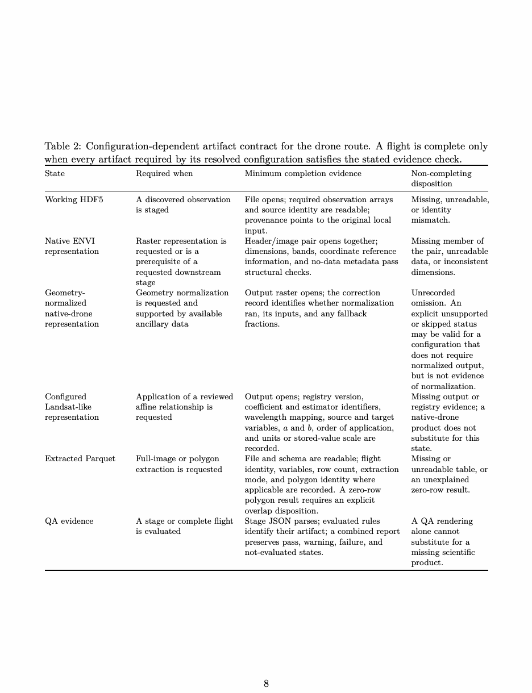

# File contracts, provenance, and restart behavior

The phrase “outputs are the API” means that stages communicate through named files, not only through values held in memory [@si_earthlab2026p]. Those files preserve the scientific sequence: source observation, working or source-product representation, geometry/model summary, geometry- normalized representation, configured target-band representation, extracted table, and QA record. The resolved configuration determines which of them are required. This design is consistent with FAIR workflow and research-object practices that package data, software, parameters, provenance, and results as one inspectable record [@si_goble2020; @si_soilandreyes2022]. This design helps localize a problem, although it does not diagnose the cause automatically. A source-product cube can show whether an unexpected pattern was already present; the geometry- normalized cube can show whether it appeared during normalization; the target-band product can reveal a change during band construction; and the Parquet output can reveal a change during extraction or merging. Some boundaries remain coarse: topographic and BRDF effects share one cube, and weighting and brightness adjustment can share one target-product stage. The files can therefore identify the stage at which a pattern appeared without always isolating the operation within that stage [@si_earthlab2026p; @si_earthlab2026i; @si_earthlab2026s]. On rerun, a stage can reuse artifacts that pass its format checks and reconstruct outputs that are absent or rejected [@si_earthlab2026f; @si_earthlab2026aq]. JSON must parse, ENVI image/header pairs must pass internal readability checks, and Parquet outputs receive schema-read checks. QA reuse is stricter: the public contract requires matching schema, parameters, thresholds, software version, and input/output fingerprints [@si_earthlab2026af]. Format checks, QA reuse, and completion are therefore separate decisions. Reproducible reuse requires retaining or recording:

• the full software commit and installed package versions; • the command and resolved configuration; • source identifiers and, where possible, checksums; • packaged response-definition versions or exact response arrays; • the expected artifacts implied by the resolved configuration and their stage dependencies; • produced artifacts and their checksums; and • the execution environment and resource configuration.

Two important gaps remain: the scene-wide SCS+C coefficients applied to the geometry-normalized cube and the exact per-output-band weights are not fully serialized in the canonical record [@si_earthlab2026ao; @si_earthlab2026aa; @si_earthlab2026s]. Both are needed to reconstruct every numerical transformation exactly.

# Multi-flightline bulk analysis

The bulk implementation inspected on 9 September 2026 replaces the earlier Parquet-centered description with direct raster streaming. Analysis eligibility requires the requested matched products, not a complete upstream archive or an upstream QA pass. Catalogs retain duplicate identities and ineligible inputs. Merged Parquet remains supported, but the direct route does not populate a pixel-scale observation cache [@si_earthlab2026a; @si_earthlab2026c]. The pipeline provides four related evidence products:

Table 3: Updated bulk-analysis products and their interpretation [@si_earthlab2026a; @si_earthlab2026c].

| Product | Function | Scientific interpretation |
| --- | --- | --- |
| Catalog and census | Inventory identities, schemas, | Defines the analyzed collection and exclusions |
|  | row counts, sites, dates, and | before summaries are interpreted. |
|  | duplicate or rejected inputs. |  |
| Compact statistics | Reduce aligned raster windows | Supports grouped fitting without storing |
|  | to mergeable per-flightline | another pixel-scale table. |
|  | moments. |  |
| Same-source | Fit pooled, per-flightline, | Describes relationships among products derived |
| relationship summaries | per-site, flightline-balanced, | from the same geometry-normalized NEON |
|  | and site-balanced relationships | observations; it is not empirical calibration |
|  | between wavelength-matched | between independently observed sensors. |
|  | target products. |  |
| Leave-one-site-out | Refit without one site and | Describes out-of-site stability of a same-source |
| evaluation | report held-out-site diagnostics. | synthetic relationship; it is not independent |
|  |  | cross-sensor validation. |

Pixels are nested within flightlines, and flightlines are nested within sites. Pooled pixel regressions are therefore descriptive and must not present pixel count as the number of independent land- scapes [@si_hurlbert1984]. The three reported estimands differ only in group contribution: pixel-pooled fitting gives each selected pixel equal weight, flightline-balanced fitting gives each flightline equal total weight, and site-balanced fitting gives each site equal total weight. The exported weighting descriptions and replicate counts were checked against these definitions. The balanced summaries are sensitivity analyses, not independent replications or a hierarchical uncertainty model. Validation of spatially and hierarchically structured data should preserve that dependence in its training and test partitions [@si_roberts2017]. Leave-one-site-out evaluation fits on two observed sites and evaluates the third; with only three sites, its three folds describe those particular site/acquisition combinations rather than a population of possible sites or a general model area of applicability [@si_meyer2021]. All summaries inherit the limitations of the underlying products: paired synthetic bands share one corrected NEON source and do not constitute independently acquired drone or Landsat observations [@si_earthlab2026b; @si_earthlab2026d]. For each chunk, counts, means, centered sums of squares, and cross-products are accumulated in numerically stable bivariate moments. Merging produces flightline and collection records; inverse merging removes a held-out site’s contribution to training. A second bounded pass calculates errors that are not all recoverable from moments alone [@si_earthlab2026an; @si_earthlab2026c]. The bulk manifest and per-flightline checkpoint records should accompany source hashes and the resolved configuration; restartability is not a substitute for exact-run provenance. The direct reader checks dimensions, transform, and coordinate reference system and applies sensor- wide finite/no-data rules together with the configured minimum-value threshold. It reads stored raster values without itself establishing their physical scale [@si_earthlab2026an]. Concurrency, window size, and storage throughput therefore matter both to reproducibility and to the cost

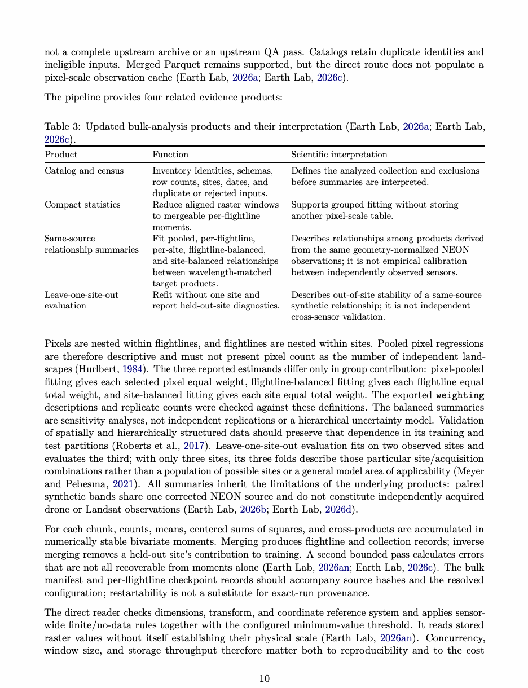

of repeated reads. Explicit dataset materialization and the compatibility input path should be benchmarked separately, not described as mandatory costs of streaming. The results interpretation layer operates on the manifest and compact model/group tables without reopening the source rasters [@si_earthlab2026g]. This manuscript’s focused examination similarly uses the supplied CSV exports. Neither workflow supplies a complete upstream QA census merely by accepting inputs into a relationship analysis.

## Additional spectral-library reporting route

The release-candidate interface also exposes spectral-library preflight and reporting as first-class routes. A preflight inspects a supplied Parquet library’s schema, group counts, and anticipated rendering work before analysis. The reporting route reads that library in place and can produce species summaries, quantiles, spectral ensembles, hierarchical variability summaries, traceable extreme-spectrum diagnostics, and optional multipage reports without making a second row-level copy of the library [@si_earthlab2026aj]. This route is relevant to the package’s broader analysis design and is included in the documented exact-artifact smoke. No executed spectral-library output was supplied with the manuscript evidence bundle, however, so this manuscript treats it as implemented and bounded-test functionality rather than a demonstrated scientific result.

# Quality-assurance model

Every run raises four questions. Did the code execute? Were the products required by the resolved configuration written and readable? What did QA report about those products? Do independent observations support their scientific interpretation? We call these process, artifact, QA, and validation status. Remote-sensing frameworks likewise treat validation as evidence assembled from representative comparisons and characterized reference measurements, not as a single binary label [@si_morisette2006; @si_origo2020]. The 43-flight campaign is a concrete example: it reached intermediate and QA states but did not satisfy its downstream artifact contract [@si_spectralbridgeprojectteam2026]. SpectralBridge separately uses pass, warn, and fail within evaluated QA records. Table 4 defines that narrower vocabulary [@si_earthlab2026s; @si_earthlab2026w].

| Status | Meaning |
| --- | --- |
| pass | The evaluated artifact or numerical quantity met its configured rule. |
| warn | The evaluated quantity or known condition requires interpretation; the |
|  | status does not independently establish full pipeline completion. |
| fail | A required artifact or evaluated rule prevents the intended interpretation. |
| Not evaluated | Available artifacts do not answer the stated question; absence of evidence |
|  | is not converted into a pass. |

Table 4: QA status semantics. A status applies to its named diagnostic, not to process execution, complete fulfillment of a resolved artifact contract, or universal scientific validity [@si_earthlab2026s; @si_earthlab2026w].

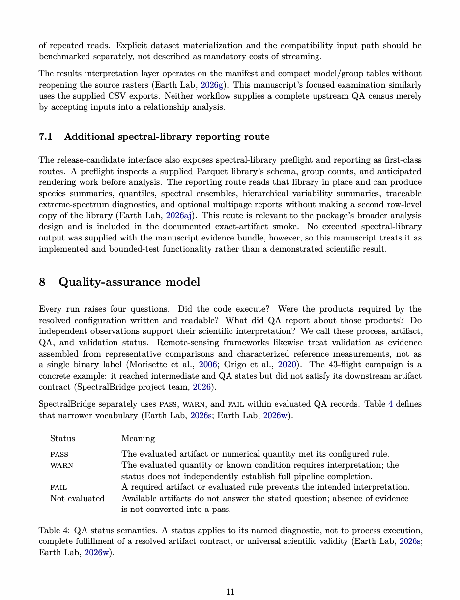

QA artifacts include visual panels, machine-readable JSON and metric records, stage-level HTML and JSON reports, and an optional combined PDF [@si_earthlab2026s]. These products record observed values, thresholds, provenance fields, and reasons that a diagnostic could not be evaluated. Several recorded thresholds are provisional workflow diagnostics rather than externally validated scientific decision limits. For a collection QA census, the emitted combined status is treated as authoritative rather than reconstructed from selected metrics. pass, warn, and fail counts are mutually exclusive. A missing or unreadable report remains a separate category in the attempted-flightline denominator. Stage-specific warning counts can overlap. Threshold sets and their provisional flags must be archived so that changes in rules are not mistaken for changes in data quality [@si_earthlab2026w; @si_earthlab2026x]. The supplied bulk fit status ok is not this combined QA status.

| Recorded R10C diagnostic | Warn threshold | Fail threshold |
| --- | --- | --- |
| Within-footprint valid fraction | below 0.90 | below 0.70 |
| Negative-reflectance fraction | above 0.01 | above 0.05 |
| Usable-band fraction above 1.2 | above 0.01 | above 0.05 |
| Absolute correction difference, 99th percentile | above 0.20 | above 0.50 |
| Chunk-seam score | above 1.5 | above 2.5 |
| Spectral-response coverage | below 0.98 | below 0.90 |

Table 5: Provisional R10C screening rules, not independently validated ecological decision lim- its [@si_earthlab2026x]. The supplied bulk tables do not establish that these checks were run on every input.

## Validation tiers and installed-artifact checks

The inspected documentation separates validation into two tiers. Tier A builds the wheel and source distribution, installs the exact artifact into a clean environment outside the source checkout, blocks network access, and runs small deterministic smoke fixtures through the NEON, drone, and bulk entry points. This bounded strategy addresses a common scientific-software problem: many computations lack a complete test oracle even when their software contracts can be tested [@si_kanewala2014]. The public validation page reports a separate offline campaign with 40 of 40 passing variations: five variations for each of eight modules. It records revision bebf707, marks the working tree as dirty, and gives 14 August 2026 as its last update. This supports the recorded module checks but does not uniquely identify a clean source state [@si_earthlab2026al]. The 4 September audit reports successful clean wheel checks on local Python 3.10, 3.11, 3.12, and 3.14 interpreters and a source-distribution check on Python 3.10. The tag-release workflow has the narrower supported gate of the exact wheel on Linux with Python 3.10–3.12 and the source distribution on Python 3.10 [@si_earthlab2026ap; @si_earthlab2026v; @si_earthlab2026k]. The NEON smoke fixture uses an 8 × 8 × 32 synthetic cube and exercises geometry normalization, configured target products, Parquet conversion and merging, QA, and restart. Drone smoke tests exercise full-image and polygon routes, and bulk smoke tests exercise census, relationship fitting, coefficient export, leave-one-site-out evaluation, optional materialization, and restart. The release- candidate README also identifies spectral-library reporting as part of the bounded exact-artifact smoke [@si_earthlab2026aj]. These tests provide evidence for packaging, stage connectivity, artifact readability, and bounded restart behavior. They do not test production scale or scientific accuracy.

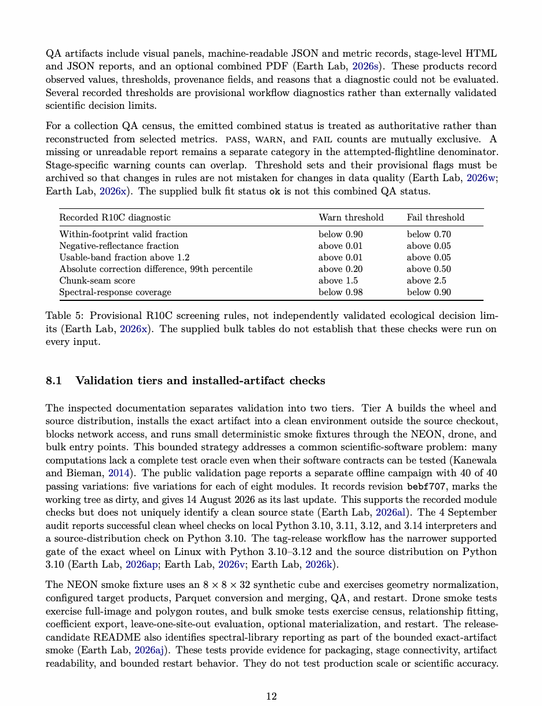

Tier B consists of selected real-flightline records such as R10C and is the appropriate tier for operational scaling and data-dependent QA evidence [@si_earthlab2026t; @si_earthlab2026v]. The following sections use those distinctions consistently. The drone campaign examines campaign- scale orchestration and completion; R10C records a completed flightline with warnings; WREF preserves a more limited visual QA record; and the bulk exports support collection-level analysis of target-band products that had already been made.

# First production drone campaign attempt

The supplied production inventory covers 43 historical flight packages: 17 from 2023 and 26 from 2024. Source discovery and staging produced 43 working HDF5 observations and approximately 7.15 GB of output. The inventory does not identify the exact production commit, resolved configuration, manifest, file checksums, per-stage timings, or a corrective revision; we leave those fields unspecified rather than inferring them [@si_spectralbridgeprojectteam2026].

Table 6: Observed inventory after the first 43-flight drone production attempt. Counts describe files found by post-run inspection, not products inferred from run status.

| Artifact class | Observed count | Interpretation |
| --- | --- | --- |
| Working HDF5 | 43 | Persisted intermediate observation state |
| JSON | 215 | Machine-readable run or QA records; detailed roles not |
|  |  | supplied |
| QA PDF | 43 | Visual QA artifacts found |
| QA PNG | 43 | Visual QA artifacts found |
| ENVI header | 0 | Expected downstream representation absent |
| ENVI image | 0 | Expected downstream representation absent |
| Parquet | 0 | Expected extracted analysis product absent |

The orchestration summary classified all 43 flights as processed and none as failed. Yet the public output contract identifies a readable merged Parquet table with matching QA, together with configured sensor products when requested, as the primary completion signals [@si_earthlab2026af]. Those products were absent. The run therefore shows that the HDF5 route can discover, stage, and preserve intermediate states across a substantial campaign, but it does not demonstrate corrected drone outputs, configured Landsat-like variables, completed extraction, or drone/Landsat agreement. We treat the mismatch as an orchestration and completion-accounting defect. Named artifact classes made the incomplete state visible, but the orchestration did not use that same record correctly when assigning completion. No root cause is assigned. The 43 working HDF5 files may support restart after correction, but their practical reuse and downstream completion must be shown by replay. A publication replay should retain both records: the original incomplete attempt and the corrected run. The new record should identify its software revision, resolved configuration, artifact contract, input and output checksums, per-stage status, any reused HDF5 files, and the rule that prevents completion when required products are absent. The original attempt should not be overwritten or counted retroactively as complete.

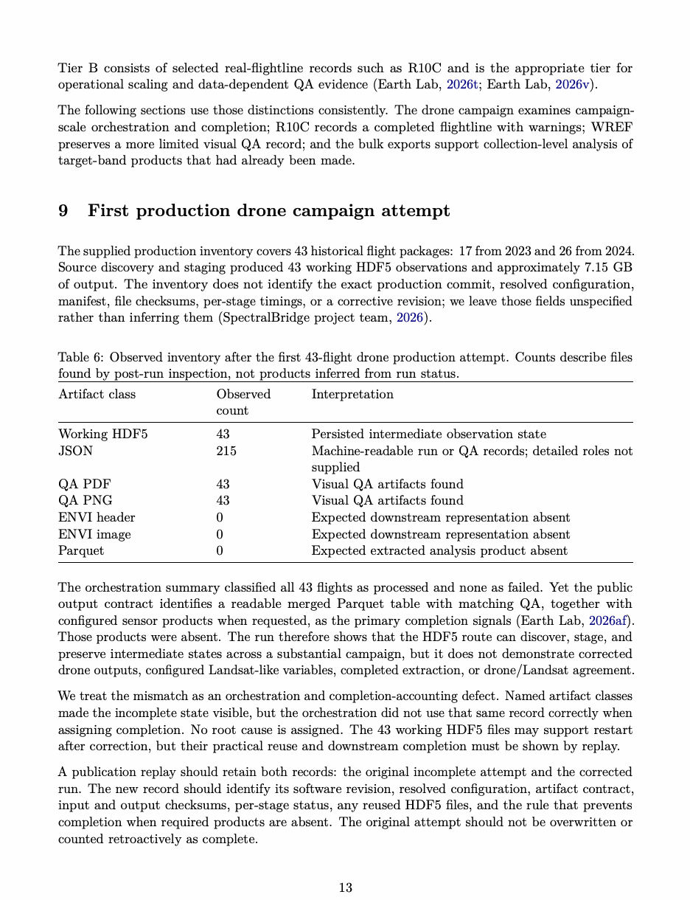

# R10C real-flightline demonstration

The checked-in example processes the flightline

NEON_D10_R10C_DP1_L002-1_20210915_directional_reflectance.

The workflow produced all of its declared artifacts, but the combined interpretation remained warn [@si_earthlab2026w; @si_earthlab2026y]. The 2,532,249,598-byte source HDF5 decoded to 1,115 lines by 5,351 samples by 426 bands. The run wrote approximately 21 GB of local output, while the retained validation-report bundle occupied 4.6 MB. The archived reports identify package version 2.2.0 and the following generating revision:

d88e8d0947718d1e33b534080c224b703987e536.

The inspected repository commit, f7e7ddd, archives those reports but did not generate them. R10C also predates the 9 September release-preparation snapshot. We therefore use it as a record of that historical run, not as an exact-artifact replay [@si_earthlab2026t]. The combined report uses schema version 1.3 and plot-contract version 1.1. Its declared pipeline evolution.png uses fixed display ranges for cross-report comparability; those limits are explicitly display-only, and values outside them remain in the machine-readable metrics. The corresponding figure in the main manuscript summarizes the combined JSON rather than reproducing that original report plot; the tables below retain the detailed numerical record without duplicating that figure [@si_earthlab2026w; @si_earthlab2026y].

| Stage | Status |
| --- | --- |
| Source acquisition | pass |
| Input reflectance | warn |
| Correction parameters | warn |
| BRDF and topographic correction | warn |
| Spectral convolution (target-band weighting) | pass |
| Analysis tables | pass |

Table 7: Stage statuses in the R10C combined QA record [@si_earthlab2026w].

Several apparently conflicting values become clear once their denominators are stated. The 0.571 bounding-box footprint fraction describes how much of the rectangular raster is occupied by the swath; the 1.0 within-footprint valid fraction says that all pixels inside that footprint passed the relevant check. Likewise, the provisional threshold in Table 5 applies to the usable-band fraction above 1.2, 1.41814 × 10−5 , rather than the all-evaluated-band fraction, 0.0593153. The report also records zero negative-reflectance fractions for the highlighted input, geometry-normalized, and target-band states. These are descriptive checks, not evidence that the transformations improved agreement with another sensor [@si_earthlab2026w; @si_earthlab2026y]. The 68 known poor-quality wavelength bands were classified in report only no masking mode, and the report records data modified=false: the bands were labeled but neither masked nor replaced. Four persisted geometry summaries fell outside their expected radian ranges. The walkthrough

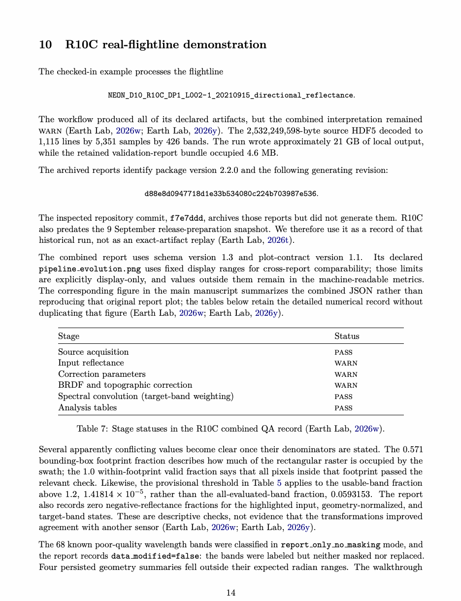

| Diagnostic | Recorded value |
| --- | --- |
| Package-declared poor-quality bands retained | 68 |
| Classification behavior for poor-quality bands | Report only; no masking |
|  | or replacement |
| Bounding-box footprint fraction | 0.571275 |
| Within-footprint valid fraction | 1.0 |
| Input median reflectance | 0.250400 |
| Input negative-reflectance fraction | 0.0 |
| Fraction of evaluated input-band values above 1.2 | 0.0593153 |
| Fraction of usable input-band values above 1.2 |  |
| Combined-correction median reflectance | 0.250400 |
| Combined-correction negative-reflectance fraction | 0.0 |
| Fraction of evaluated corrected values above 1.2 | 0.0593168 |
| Combined-correction absolute-difference 99th percentile | 0.00389395 reflectance |
| Convolved median reflectance | 0.144450 |
| Convolved negative-reflectance fraction | 0.0 |
| Fraction of evaluated convolved values above 1.2 |  |
| Readable Parquet outputs | 18 |

Table 8: Selected machine-readable diagnostics from the R10C combined QA JSON [@si_earthlab2026w]. Values describe this run and are not estimates of performance across sites.

suspects that no-data values affected these summaries, but the archived evidence does not establish the cause or show whether the issue was confined to persisted summaries rather than fitted correction terms. The files were not silently repaired. The combined report summarizes stage status and two pipeline-level findings; the fuller list of unevaluated questions comes from the stage reports and real-data walkthrough. Those questions include separate attribution of topographic and BRDF effects, per-output-band weight support, held-out affine-relationship residuals and cycle consistency, and direct Landsat Collection 2 NBAR comparability [@si_earthlab2026w; @si_earthlab2026x; @si_earthlab2026y]. R10C therefore demonstrates end-to-end artifact completion for its declared historical route, stage- specific QA, and preservation of warnings. It does not measure correction efficacy or cross-sensor agreement [@si_earthlab2026w; @si_earthlab2026y]. Read beside the drone campaign, it shows why a completed artifact chain answers a different question from a successful process return code.

# WREF visual QA example

A separate four-page visual QA report for flightline

NEON_D16_WREF_DP1_L040-1_20230625_directional_reflectance.

shows the products in more detail than the combined R10C status summary. It includes every generated ENVI representation, pre- and post-correction diagnostics, wavelength and header checks, target-band locations, filtering summaries, and the Parquet merge inventory. Because the PDF

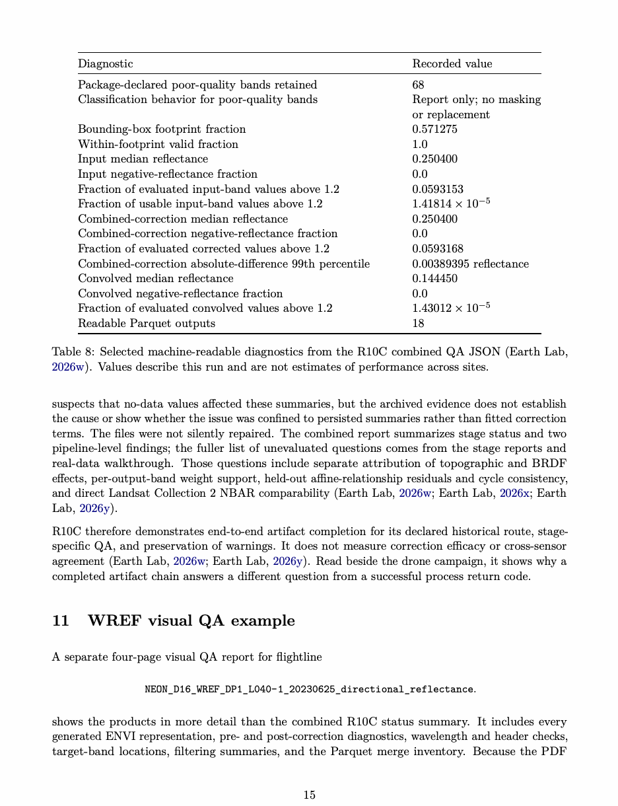

identifies neither its generating SpectralBridge commit nor its QA schema, we treat it as a visual inspection record rather than a machine-readable collection record. The complete four-page report is retained unchanged as a supplied source artifact. Here, its correction plots are reflowed for legibility and selected tabular-inventory values are presented as a visual summary. Its product overview preserves the narrow across-track geometry and displays every target representation, but repeated short labels for the final MicaSense products are ambiguous; future reports should include unique product identifiers or output paths. The correction diagnostics in Figure 1 show nearly overlapping aggregate pre- and post-correction histograms and wavelength-dependent changes that are small in median but heterogeneous across pixels. The same page also displays mean slope, aspect, sensor-zenith, and sensor-azimuth values far outside physically meaningful radian ranges. The visual report therefore reinforces the need to retain the geometry warning; it does not establish whether the out-of-range values affected correction fitting or only the displayed summaries. The spectral page, retained in the supplied source report but not reproduced here, confirms a monotonic, finite 426-band wavelength vector spanning approximately 384–2512 nm and reports that the ENVI header lacks band names. It also contrasts full-cube with filtered-table summaries that use different observational supports and therefore should not be compared as if they described the same statistical population. The tabular inventory in Figure 2 reports 18 Parquet files totaling 32.9 MB and a merged table containing 151 rows and 964 columns. It also exposes an internal reporting inconsistency: the merge- status panel counts 16 resampled inputs, while the quality-check panel states that no resampled products were found. This disagreement should be resolved in the report generator before the visual page is used for automated cohort interpretation.

{#fig:si1}

{#fig:si2}

# Bulk analysis: collection and variable definitions

The preceding records ask whether requested artifacts existed and what their QA reported. The bulk analysis begins later in the chain. It starts with eligible target-band products and asks how their same-source relationships vary across the accepted collection. The available bundle contains a visual report and CSV exports. Table 14 identifies the report and the five primary numerical tables used here. They share the following analysis run identifier:

986e495c2c8e9dda579528b41df44cb24f670055558c85f54941341403a48489

This identifies the analysis, not an executed Git revision. No matching run manifest was sup- plied [@si_spectralbridgebulkevidencebundle2026].

## Collection accounting and acquisition coverage

The tables contain 122 distinct flightline identifiers and 18 pair-band combinations per flightline, giving 2,196 local fits. They also contain 54 candidate coefficient records—18 relationships under three weightings—plus 54 site fits and 54 held-out-site evaluations. Every exported fit status is ok, but that label says nothing about upstream QA or unrepresented attempts. Because the selection rule, attempted-input denominator, rejected-input inventory, and processing-partition metadata are unavailable, these counts describe accepted records rather than a completion rate or a completed version of the earlier 100-flightline protocol. Summing the largest exported sample count for each flightline gives 899,692,166 selected observations. For each pair-band, the flightline counts sum to the pooled count, which is either 899,686,966 or 899,692,166. We retain the 5,200-observation difference because the tables do not reveal which masks or input conditions caused it. These observations are not independent ecological replicates and should not be multiplied by the 18 relationships. The repository’s description of the staged archive and checkpoints is an operator-reported production record, not a rerun performed for this paper [@si_earthlab2026u].

Table 9: Acquisition years parsed from distinct exported flightline identifiers. Dates require confirmation against source metadata and the run manifest.

| Site | 2020 | 2023 | Total |
| --- | --- | --- | --- |
| NIWO | 23 | 9 | 32 |
| WREF | 0 | 40 | 40 |
| YELL | 0 | 50 | 50 |
| Total | 23 | 99 | 122 |

Site and acquisition year are unevenly represented (Table 9). Holding out NIWO removes every 2020 observation from training, whereas holding out WREF or YELL leaves mixed-year training data. The held-out scores therefore describe the observed combinations of site and acquisition rather than a pure site effect. The available per-flightline exports permit a bounded year sensitivity for the focal TM matched band-3 diagnostic, but not a year-matched refit of the pooled, balanced, or held-out models. Table 10

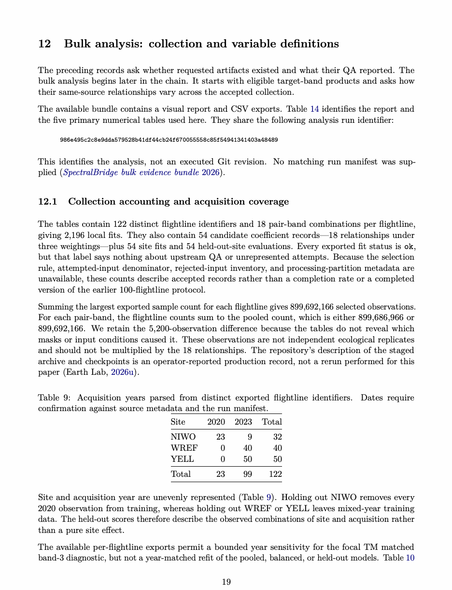

separates NIWO’s two filename-derived years and summarizes the other 2023 groups. NIWO medians are similar in 2020 and 2023, while the lower WREF and YELL distributions remain visible in 2023. This descriptive check shows that NIWO’s local median is not created solely by combining its two years; it does not separate site, acquisition year, atmospheric conditions, phenology, or processing history. A 2023-only model refit would contain 99 flightlines, including only nine at NIWO, and has not been performed. The supplied models are therefore not relabeled as year-controlled evidence.

Table 10: Filename-derived year sensitivity for within-flightline R2 of TM matched band 3. Values are recalculated from the supplied local-fit export; they are descriptive ranges, not uncertainty intervals [@si_spectralbridgebulkevidencebundle2026].

| Site | Year | Flightlines | Minimum | Median | Maximum |
| --- | --- | --- | --- | --- | --- |
| NIWO | 2020 | 23 | 0.6938 | 0.7547 | 0.8296 |
| NIWO | 2023 | 9 | 0.7285 | 0.7596 | 0.8317 |
| WREF | 2023 | 40 | 0.4287 | 0.5280 | 0.7017 |
| YELL | 2023 | 50 | 0.2623 | 0.6124 | 0.7888 |

## What exactly is compared?

The exported equations use x for a matched MicaSense-derived product variable and y for a configured Landsat-derived product variable, with fitted target ŷ = ax + b. The four product pairs are listed in Table 11. Their names identify computational products rather than four sets of independently acquired satellite observations. Both sides derive from corrected NEON spectra. The table preserves exported numbering without assigning native sensor band names or wavelength intervals that the run evidence does not establish.

Table 11: Exact exported product identifiers and matched indices. Source identifiers are defined immediately below the table.

| Source family | Target identifier | Matched indices |
| --- | --- | --- |
| A | Landsat_5_TM | 1–4 |
| A | Landsat_7_ETM+ | 1–4 |
| B | Landsat_8_OLI | 1–5 |
| B | Landsat_9_OLI-2 | 1–5 |

Family A is MicaSense_to-match_TM_and_ETM+; family B is MicaSense_to-match_OLI_and_ OLI-2. Source and target index fields agree in every exported row. In this manuscript, “TM matched band 3” means family A index 3 against Landsat_5_TM index 3. It is not an assertion about native Landsat or MicaSense band numbering. The numerical variable definition is recoverable; the run-specific physical definition is not yet complete. Required records are the source wavelengths, actual response arrays on that grid, excluded-band treatment, brightness coefficients and their order of application, and stored-value scale, offset, units, and no-data rules for both products. Generic packaged centers, widths, and defaults do not demonstrate which definitions generated this run. The audited streaming reader uses stored values; it does not establish physical scaling for them [@si_earthlab2026an]. We therefore retain slopes, correlations, and descriptive scores while treating intercepts, RMSE, bias, and reference displacements as quantities in exported units. We do not apply an assumed scale factor, infer

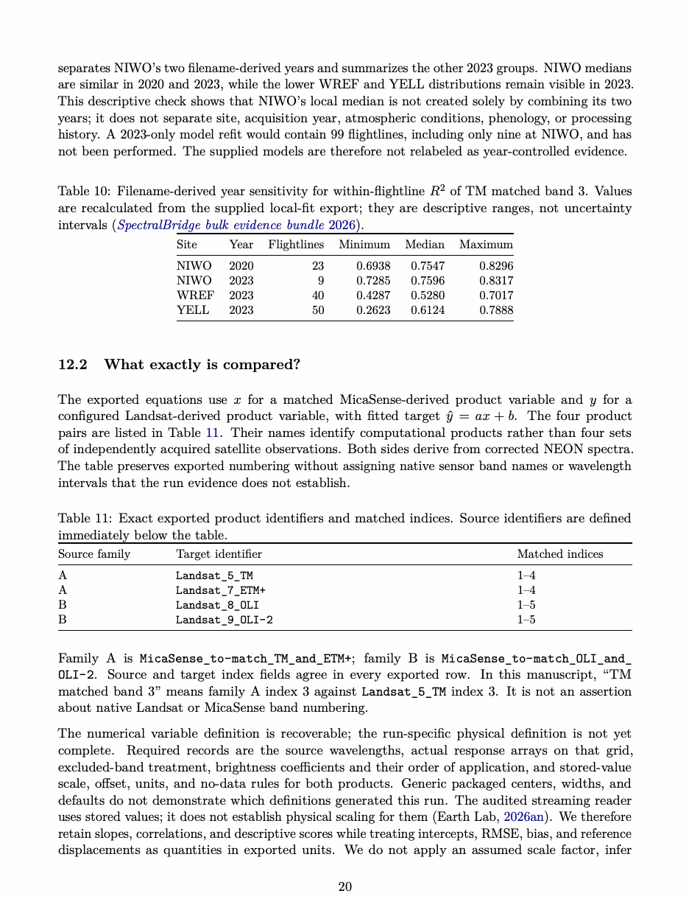

physical reflectance outliers from large stored numbers alone, or attribute the TM result to a particular spectral region.

## Numerical summaries and their estimands

The primary collection summaries use 18 relationships within each weighting scheme (Table 12). Pooling emphasizes pixels; the balanced schemes change group contributions. The schemes reuse observations and are sensitivity descriptions, not independent replications. No confidence interval is estimated by treating the 54 records as a sample of 54 independent relationships.

Table 12: Separate summaries across the same 18 pair-band relationships. TM values refer to matched band 3.

| Weighting | Relationships | Median | TM |
| --- | --- | --- | --- |
| Pixel pooled | 18 | 0.9944 | 0.5944 |
| Flightline balanced | 18 | 0.9909 | 0.5950 |
| Site balanced | 18 | 0.9948 | 0.6043 |

For the TM diagnostic, the exported within-flightline R2 agrees numerically with squared correlation. Correlation-based local fit is invariant to a nonzero uniform affine rescaling of either variable, but RMSE and intercepts are not scale-invariant. This algebraic property does not rule out spatially or spectrally varying corrections, inconsistent encodings across inputs, or nonlinear effects. A high R2 is not agreement with the identity line; agreement between measurement methods requires examination of their differences and scale, not correlation alone [@si_bland1986]. A lower R2 is likewise not by itself an unacceptable physical error. Scores depend on the response distribution and require an application-specific interpretation.

Table 13: Different diagnostics for TM matched band 3. Local ranges summarize separate within- flightline fits. The site-fit column is in-sample; the held-out column evaluates a model trained on the other two sites. These columns are not a controlled comparison of predictive performance.

| Site | Local median | Local range | Site-fit | Held-out |
| --- | --- | --- | --- | --- |
| NIWO | 0.7560 | 0.6938–0.8317 | 0.7810 | 0.5529 |
| WREF | 0.5280 | 0.4287–0.7017 | 0.5041 | 0.3305 |
| YELL | 0.6124 | 0.2623–0.7888 | 0.6187 | 0.5898 |

Eight of the 122 TM local fits exceed 0.8; the maximum is 0.8317. No scientific acceptance threshold is implied. The descriptive conclusion is that changing the supplied collection weights does not remove the lower fit and that departures from a close linear relationship also occur within flightlines. This does not isolate within- and between-group contributions or exclude additional pooling effects. The diagnostic was selected after inspection of the report and should be understood as exploratory, not a pre-specified hypothesis test. WREF’s held-out score of 0.3305 is separate from its in-sample site-fit score of 0.5041. Their difference is not an estimate of a geographic transfer penalty. A controlled comparison would reserve the same WREF test observations for both models, fit the local baseline on other WREF spatial units, fit the external model without WREF, and evaluate both in identical verified units. Spatial blocking, comparable training information, and year-matched sensitivity would help distinguish

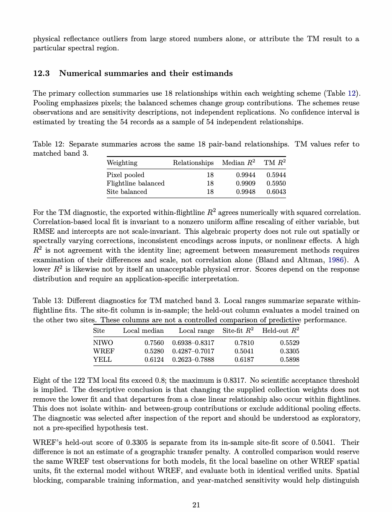

transfer from fitting optimism and acquisition composition [@si_roberts2017]. The supplied three-site collection does not establish a general geographic domain of applicability [@si_meyer2021].

## Reference displacement is not prediction error

The supplied displacement table evaluates each equation at the median of the per-flightline source means for its pair-band. If x̄f is a flightline source mean, its definitions are 

$$
x_{\mathrm{ref}} = \operatorname{median}_f \bar{x}_f, \qquad \Delta = a x_{\mathrm{ref}} + b - x_{\mathrm{ref}}, \qquad p = 100\Delta/x_{\mathrm{ref}}. \label{eq:si-displacement}
$$

The same reference is used under all three weightings. The field named absolute_correction stores signed ∆ (24 of 54 entries are negative); the median of |p| is 7.54%, and its maximum is 110.92%. The maximum occurs for the pooled TM matched band-3 equation, evaluated at xref = 357.971255 exported units. These are reference-dependent equation displacements, not residual prediction error, an accuracy improvement, or the amount of upstream brightness correction. The results implementation inspected at c86da6a uses a pixel-pooled source-mean reference by default [@si_earthlab2026g]. The supplied export is described by Equation 3, not silently recomputed under that later default. Neither definition establishes a physically meaningful correction percentage without verified value definitions and a reason to compare source and target to the identity line. Accordingly, displacement is retained here for report reconstruction, not used as a principal scientific performance claim.

## Executable audit and file provenance

Run python scripts/audit bulk.py from the manuscript directory using Python with NumPy and pandas. The audit verifies file hashes, run identifiers, unique scientific keys, counts, separate weighting summaries, filename-derived years, the descriptive year sensitivity, local and held-out diagnostic values, inline figure coordinates, and the displacement arithmetic. It reads the supplied exports without modifying them or downloading data. This is a reproducible compact-table example; it does not execute SpectralBridge or verify the reduction of the original raster archive. Several local convenience exports reorganize the same supplied records:

all_candidate_coefficients.csv, correction_magnitude_all.csv, weakest_translation_cases.csv, weakest_20_fits.csv, largest_translation_corrections.csv, largest_20_corrections.csv, pooling_strategy_comparison.csv, and visual_report_summary.csv.

These files are derived views for review and presentation, not independent observations or additional production evidence. The five primary numerical exports and visual report identified below remain the evidential inputs to the audit.

Table 14: SHA-256 checksums of primary supplied evidence used in this revision. Long filenames wrap; checksums identify bytes, not scientific validity.

| File | SHA-256 |
| --- | --- |
| SpectralBridge_Bulk_Results_Visual_ | ac597ef955813205689177f806a87e31ffa3195bc1af681160681279cc043e66 |
| Report.pdf |  |
| translation_coefficients.csv | 899eaa37521be89fb8aa521528962c807cd122770c5d606eab03540212a95382 |
| per_flightline_regressions.csv | 4911fb363bdbbae37c121c5c0c511b9fba05839d9f762e84e0f900e259d4e6e1 |
| per_site_regressions.csv | 8b43ae837cf8e1ecf0efd09c4658ccaacb25942f7cb1383c397c211a319e8cd7 |
| leave_one_site_out.csv | a8b95002fb51ac74d7a050f5803fa6528633008922dd6eb525b1d41cf39e7f3a |
| translation_correction_magnitude.csv | ee0f60cf319f5e31c798ce596059410407054f66b14996769e4d721a17493a2d |

# What remains to be established

The current records answer useful questions, but they do not yet reconstruct a production run. The bulk tables lack the executed revision, manifest, input checksums, configuration, product headers, and performance measurements. The drone inventory likewise lacks its production revision, resolved configuration, checksums, and verified completion record. A reproducible example needs a manifest that connects each run identifier to those materials, together with a bounded input subset, an executable command, and expected outputs. The bulk audit verifies the exported tables; the drone inventory verifies the observed file census. R10C and WREF preserve historical warnings but are not correction references. Table 15 keeps records generated under different revisions separate. A “not supplied” entry identifies exactly what a publication replay or archive still needs to add.

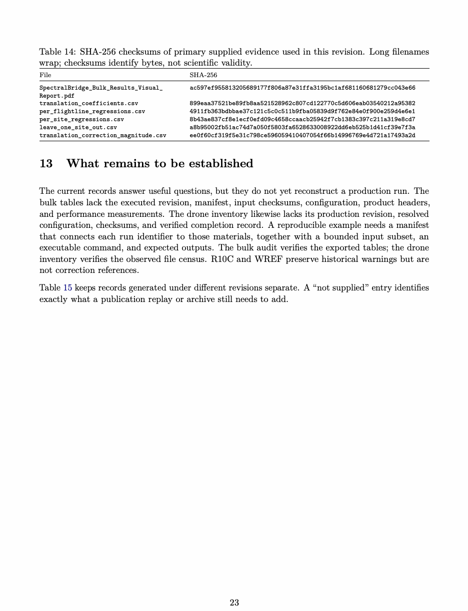

Table 15: Lineage of the evidence used in this manuscript. Missing fields are recorded rather than inferred.

| Evidence | Input or scope | Generating revision | Configuration and QA identity | Archive evidence |
| --- | --- | --- | --- | --- |
| Installed-package | Tiny deterministic | Revisions identified by | Fixture commands and | Exact-distribution |
| fixtures | normal, drone, and | the validation and | expected outputs are | smoke records; not |
|  | bulk inputs | release-preparation | recorded; the release | production |
|  |  | records | workflow’s supported gate | data (Earth Lab, |
|  |  |  | covers Python 3.10–3.12 for | 2026ap; Earth Lab, |
|  |  |  | wheels and 3.10 for the | 2026v; Earth Lab, |
|  |  |  | source distribution. | 2026l). |
| R10C flightline | Named NEON R10C | d88e8d0 (full identifier | Package version 2.2.0 and | Checked-in |
|  | HDF5; bounded | in the R10C section); | stage reports recorded; a | machine-readable |
|  | fingerprint and file size | reports later archived | single bundle containing | reports and cited |
|  | recorded | at f7e7ddd | command, resolved | walkthrough (Earth |
|  |  |  | configuration, environment, | Lab, 2026w; Earth |
|  |  |  | full input checksum, | Lab, 2026x; Earth |
|  |  |  | schema/threshold identifier, | Lab, 2026y). |
|  |  |  | and report checksum was not |  |
|  |  |  | supplied. |  |
| WREF visual | Separately supplied | Not identified in the | Generating configuration, | Source PDF |
| report | WREF report and | PDF | QA schema, and threshold | retained; checksum |
|  | displayed product |  | identifier not supplied. | and PDF metadata |
|  | inventory |  |  | recorded in the |
|  |  |  |  | provenance JSON. |
|  |  |  |  | Used only as a |
|  |  |  |  | historical visual |
|  |  |  |  | artifact. |
| Bulk analysis | 122 accepted exported | Executed software | Manifest, resolved | Report plus five |
|  | flightline identities and | revision not supplied; | configuration, response | primary CSVs with |
|  | 18 pair-band | analysis run ID is | arrays, scaling, input | recorded SHA-256 |
|  | relationships | recorded in Section 12 | checksums, and performance | hashes; |
|  |  |  | record not supplied. | compact-table audit |
|  |  |  |  | is |
|  |  |  |  | reproducible (Spec- |
|  |  |  |  | tralBridge bulk |
|  |  |  |  | evidence bundle |
|  |  |  |  | 2026). |
| Drone campaign | 43 historical flight | Not supplied | Resolved configuration, | Post-run inventory |
|  | packages: 17 from |  | completion contract, stage | records working |
|  | 2023 and 26 from 2024 |  | timing, checksums, and QA | HDF5, JSON, PDF, |
|  |  |  | schema identity not supplied. | and PNG states |
|  |  |  |  | and absent |
|  |  |  |  | ENVI/Parquet |
|  |  |  |  | states; no |
|  |  |  |  | permanent archive |
|  |  |  |  | identifier |
|  |  |  |  | supplied (Spectral- |
|  |  |  |  | Bridge project team, |
|  |  |  |  | 2026). |

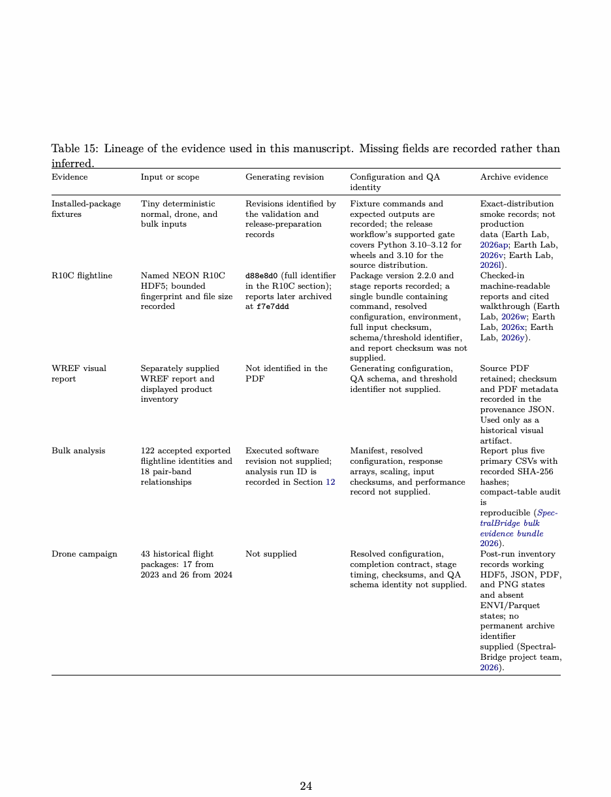

Table 16: Outstanding checks and the claims they would enable. None is reported as completed by this table audit.

| Question | Required evidence or comparison | Claim enabled |
| --- | --- | --- |
| Did the drone route | Replay the staged campaign after orchestration | End-to-end artifact |
| complete? | correction; verify configuration-dependent ENVI, | completion of the campaign, |
|  | configured Landsat-like, extraction, Parquet, and QA | not sensor validation. |
|  | artifacts with a completion-enforcing manifest. |  |
| Which affine relationship | Archive the reviewed registry, registry version and | Reconstruct the configured |
| was applied? | checksum, source and target wavelength mapping, | Landsat-like drone variables |
|  | estimator identity, coefficients, confidence state, and | without implying empirical |
|  | resolved strictness policy. | sensor calibration. |
| How does a completed | Follow UAV surface-reflectance validation practice; | A bounded comparison with |
| drone product compare | record the Landsat Collection 2 product identifier, | an independent observation, |
| with Landsat? | acquisition time, scaling, masks, cache or query record, | not universal agreement. |
|  | common-grid definition, resampling, overlap, temporal |  |
|  | offset, reference characterization, and uncertainty |  |
|  | analysis (Origo et al., 2025; Origo et al., 2020; U.S. |  |
|  | Geological Survey, 2026). |  |
| What do target variables | Archive actual wavelength grids, response weights, | Physical interpretation of |
| represent? | excluded bands, brightness settings, scale/offset, and | band support and error units. |
|  | no-data rules for the executed run. |  |
| Did geometry warnings | Trace source geometry through unit conversion and | Distinguish faulty summaries |
| affect corrections? | fitted terms; compare corrected results after any | from altered computation. |
|  | necessary repair. |  |
| Did retained poor-quality | Calculate their nonzero target-weight contributions | Assess spectral-support |
| bands influence outputs? | and compare results under documented exclusion rules. | sensitivity. |
| What changes during | Compare pure weighting and adjusted products from | Attribute the adjustment |
| brightness adjustment? | identical inputs, preserving both states and coefficients. | separately from target-band |
|  |  | weighting. |
| How well does the | Evaluate local and external models on the same | Estimate a defined predictive |
| equation transfer? | spatially held-out observations, including year-matched | comparison rather than an |
|  | sensitivity. | in-sample/held-out |
|  |  | difference. |
| What resources does | Measure wall time, process-tree peak RAM, bytes | Workload-specific resource |
| processing require? | read/written, concurrency, and hardware on a bounded | estimates, not a |
|  | reproducible workload; use matched conditions for any | hardware-independent |
|  | comparator. | speedup. |

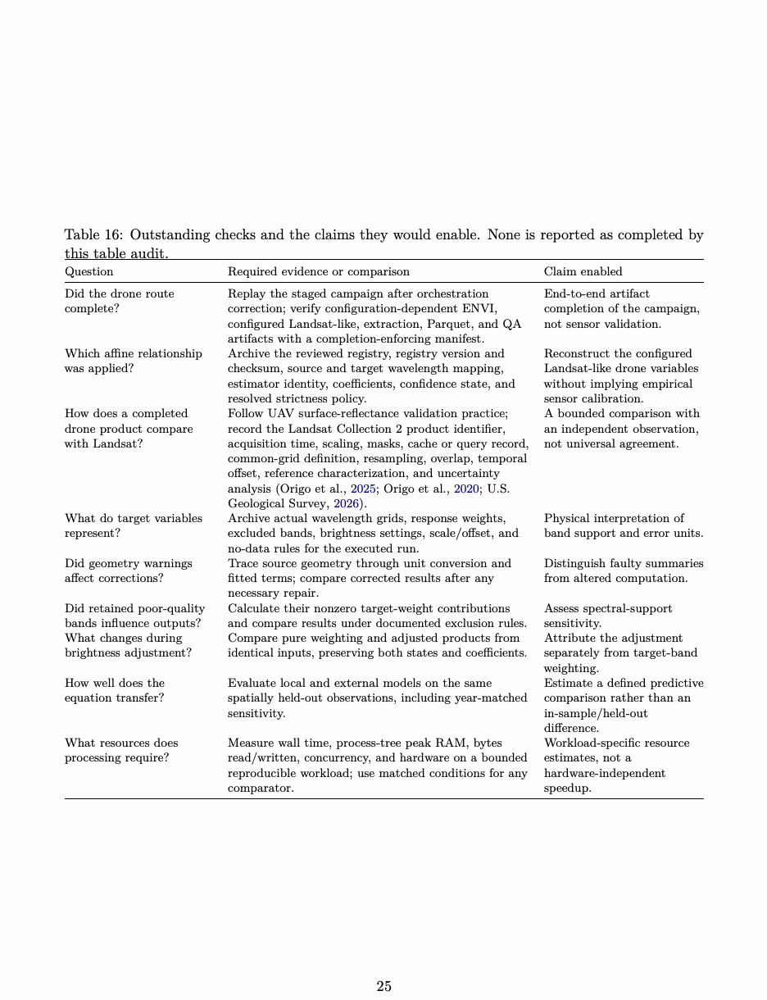

# Claims and their boundaries

Table 16 lists the work still needed. The next two tables summarize what the present records already support and where each claim stops.

Table 17: Claims supported by the evidence reviewed here and their boundaries.

| Claim | Evidence | Boundary |
| --- | --- | --- |
| The inspected production | Package dependencies and | This describes runtime dependency, not |
| pathway does not require HyTools | internal pipeline imports at the | source or intellectual independence from |
| at runtime. | inspected commit; the 27–28 | HyTools. |
|  | October 2025 transition |  |
|  | history (Earth Lab, 2026ag; |  |
|  | Earth Lab, 2026i; Earth Lab, |  |
|  | 2025b). |  |
| Inspected components retain | Provenance notices in | The relationship differs by component: |
| documented HyTools lineage. | neon cube.py, envi writer.py, | adapted code, inherited algorithms, |
|  | and corrections.py (Earth | architectural influence, and |
|  | Lab, 2026n; Earth Lab, 2026ae; | SpectralBridge-specific development should |
|  | Earth Lab, 2026z). | not be conflated. |
| The intended drone pipeline | Drone workflow documentation, | The 43-flight campaign did not produce the |
| supports full-image and polygon | installed-artifact smoke tests, | expected downstream ENVI or Parquet |
| extraction, reviewed | and relevant UAV | artifacts; documented capability is not |
| registry-based affine variables, | calibration/validation | evidence that translation or external QA ran |
| and optional Landsat QA while | practice (Earth Lab, 2026m; | on real campaign data. |
| recording correction availability | Earth Lab, 2026aj; Earth Lab, |  |
| and provenance. | 2026t; Cao et al., 2019; Origo |  |
|  | et al., 2025). |  |
| The pipeline preserves named | Canonical path registry, | Some realized parameters and exact weights |
| intermediate products. | pipeline source, and | are not fully serialized. |
|  | documented outputs (Earth |  |
|  | Lab, 2026e; Earth Lab, 2026i; |  |
|  | Earth Lab, 2026s). |  |
| Configured target-band weighting | Source inspection and five | Does not validate weight provenance or |
| executes the implemented discrete | controlled validation | satellite agreement; brightness-adjusted |
| weighted average. | variations (Earth Lab, 2026aa; | outputs are a subsequent state. |
|  | Earth Lab, 2026ar). |  |
| Stages can recover from | Restart implementation, | Structural checks and matching QA |
| interruption by reusing artifacts | controlled save/restart tests, | fingerprints do not by themselves establish |
| that pass their format-specific | and the public output | that every configuration-dependent artifact |
| checks; QA reuse additionally | contract (Earth Lab, 2026f; | was requested and produced. |
| matches schema, parameters, | Earth Lab, 2026aq; Earth Lab, |  |
| thresholds, version, and artifact | 2026af). |  |
| fingerprints. |  |  |
| Opt-in across-track processing | Half-flight implementation and | Memory benefit and numerical agreement |
| creates independent left and right | pipeline integration (Earth Lab, | with a full-flightline run have not yet been |
| pipeline units from one source | 2026o; Earth Lab, 2026i). | quantified. |
| HDF5. |  |  |

The present records do not yet support broad claims of universal sensor agreement, direct drone-to- Landsat calibration, equivalent behavior across ecosystems, or improved ecological inference. The immediate software need is a replay of the drone route with its artifact contract enforced. Scientific agreement then requires paired observations, explicit spatial aggregation, held-out evaluation, uncertainty propagation, and characterized independent references [@si_origo2025; @si_origo2020].

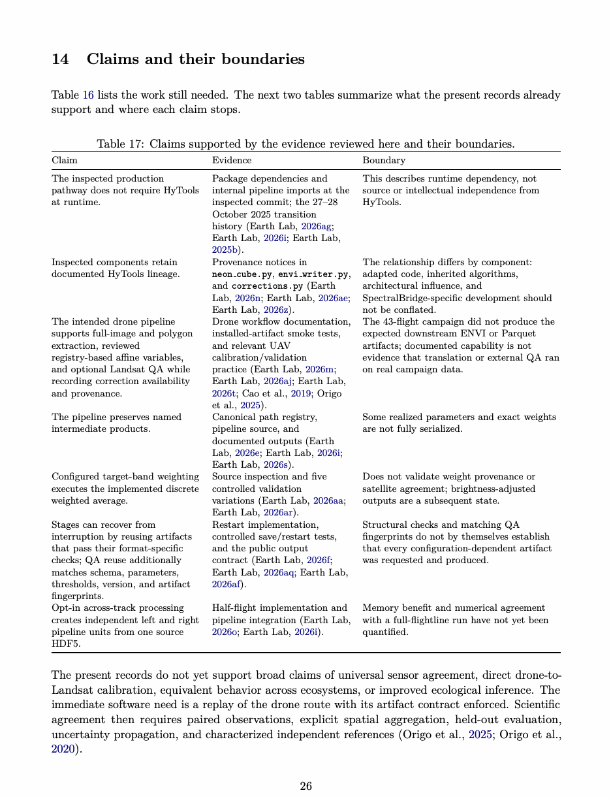

Table 18: Collection and execution evidence (continued from Table 17).

| Claim | Evidence | Boundary |
| --- | --- | --- |
| Bulk analysis provides grouped | Supplied CSVs and | Shared-source synthetic products, three sites, |
| fits for 122 flightlines across three | operator-reported production | and incomplete exact-run provenance limit |
| sites. | record (SpectralBridge bulk | calibration and generalization claims. |
|  | evidence bundle 2026; Earth |  |
|  | Lab, 2026u). |  |
| TM matched band 3 has lower fit | Reanalysis of 122 local fits and | Descriptive group-level localization; no |
| under all supplied weightings and | three weighting | physical cause, accuracy threshold, or isolated |
| within individual flightlines. | schemes (SpectralBridge bulk | pooling effect is established. |
|  | evidence bundle 2026). |  |
| The exact built distribution can | Tier A wheel and | Tiny deterministic fixtures do not establish |
| execute bounded normal and | source-distribution smoke | production-scale performance or scientific |
| drone workflows and the bulk | records (Earth Lab, 2026ap; | accuracy. |
| pipeline after clean installation. | Earth Lab, 2026v). |  |
| The recorded offline validation | Public validation tables: eight | The record identifies revision bebf707 but |
| campaign reports 40 of 40 passing | modules with five variations | also a dirty working tree; it is bounded |
| module variations. | each (Earth Lab, 2026al). | software-contract evidence, not an exactly |
|  |  | reconstructable clean revision or scientific |
|  |  | validation. |
| Spectral-library preflight and | Release-candidate README | No executed spectral-library analysis was |
| reporting are documented public | and public interface | supplied as manuscript evidence, so no |
| routes and are included in the | description (Earth Lab, | scientific result from that route is claimed |
| bounded exact-artifact smoke. | 2026aj). | here. |
| The real drone route discovered | Post-run campaign inventory: | Orchestration reported 43 processed and zero |
| and staged 43 observations and | 17 packages from 2023, 26 from | failed despite absent ENVI and Parquet |
| persisted working HDF5 and QA | 2024, and approximately | products; complete production traversal is |
| artifacts. | 7.15 GB of | not established. |
|  | output (SpectralBridge project |  |
|  | team, 2026). |  |
| QA preserves warnings and | Machine-readable R10C | Statuses apply only to the diagnostics that |
| unevaluated questions. | combined report and | ran. |
|  | documented QA |  |
|  | semantics (Earth Lab, 2026w; |  |
|  | Earth Lab, 2026y). |  |
| The documented R10C flightline | Checked-in stage artifacts and | One flightline is not a multi-site performance |
| completes end to end. | combined QA report (Earth | estimate. |
|  | Lab, 2026w; Earth Lab, 2026y). |  |
| Candidate study flightlines span | Recorded candidate source sizes | Variation in source size does not yet establish |
| approximately 2.5–16 GB in | and the pre-specified study | the corresponding variation in peak memory, |
| source-file size. | resource record (Earth Lab, | wall time, or other resource requirements. |
|  | 2026t). |  |

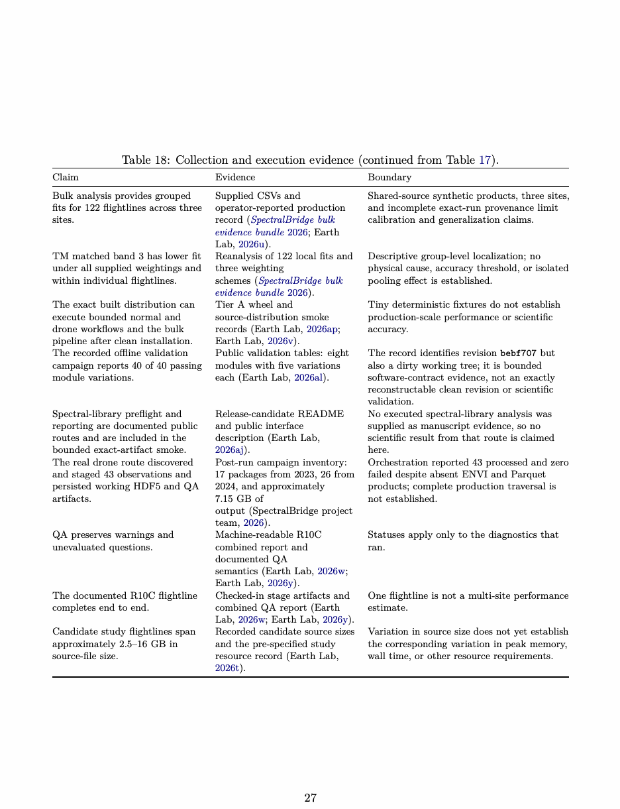

# Reproducibility checklist

The checklist below turns those boundaries into a practical archive specification. For every included flightline, record the following items, consistent with guidance for reproducible computational research, FAIR workflows, and packaged research objects [@si_sandve2013; @si_wilson2017; @si_goble2020; @si_soilandreyes2022]:

1. the full input identifier, product code, site, date, input checksum, and any embedded identity metadata used to verify the filename-derived identity; 2. source file size in bytes; 3. the complete command and resolved configuration, including full- or half-flight mode and window; 4. the required artifact contract implied by that configuration and the completion rule applied to it; 5. the SpectralBridge commit, exact wheel or source-distribution checksum, and dependency environment; 6. worker count, host information, wall time, and peak resident memory; 7. hashes for source-product, corrected, convolved, tabular, and QA outputs; 8. stage-level and combined QA JSON records; 9. the exact spectral-response definitions and brightness coefficients used; 10. for drone affine products, the reviewed registry version and checksum, estimator identity, wavelength mapping, coefficient identifiers and values, confidence state, and strictness policy; 11. for optional external Landsat QA, the product identifier, acquisition time, masks, query or cache record, common grid, resampling, overlap rule, and temporal offset; 12. any manual exclusions, reruns, or interpretation decisions; 13. both the original and corrected run records when a completion-accounting defect is discovered, including which intermediate artifacts were reused; 14. links between every reported study statistic and the contributing source-flightline records; and 15. the bulk run identifier, manifest, source catalog, duplicate decisions, weighting scheme, stored- value scaling, reference-value definition, and streaming, compatibility, or materialization mode when bulk analysis is used.

The R10C artifact records its generating commit and bounded input fingerprint, but it does not package the command, resolved configuration, dependency environment, full input checksum, and report checksum as one replay record. A publication archive should close that gap and should either rerun R10C under the publication commit or retain the revision difference explicitly [@si_earthlab2026w; @si_earthlab2026y]. The drone archive has the complementary gap: it preserves intermediate campaign output but does not identify the production revision or demonstrate fulfillment of the requested downstream contract [@si_spectralbridgeprojectteam2026].

# Figure and table provenance

The conceptual sensor figure is drawn directly in main.tex. Its Landsat 8 OLI and MicaSense red- band centers and widths come from figures/sensor_band_example.json, which records the pinned repository source [@si_earthlab2026q]. The native drawing uses centers of 654.6 and 650 nm and full widths at half maximum of 37.5 and 16 nm, respectively. The spectrum and Gaussian response profiles are illustrative and prominently labeled as approximations rather than measured response curves. Landsat 8 measured relative spectral responses are documented independently [@si_barsi2014]; a future revision could replace the Gaussian illustration with versioned measured curves if those data are incorporated with matching provenance. No such substitution is made here. The R10C summary figure is drawn directly in main.tex, with labels and rounded values checked against figures/r10c_qa_extract.json. Stage statuses and highlights in that extract are tran- scribed from the combined QA JSON; unevaluated questions are drawn from the cited stage records and walkthrough. The extract records both the archive commit and the reports’ generating revi- sion [@si_earthlab2026w; @si_earthlab2026x; @si_earthlab2026y]. Before submission, the extract should be regenerated automatically from checksum-verified copies of those records or independently checked against each one. The three-pipeline diagram, completion-gate diagram, and bulk diagnostic figure are drawn directly in main.tex. The pipeline’s bulk row follows the September streaming revision; its drone row represents the intended contract and is explicitly distinguished from the observed campaign inventory. The completion-gate figure is conceptual and contains no measured quantities. The bulk diagnostic’s three observed flightline ranges and medians are checked against the supplied CSVs by scripts/ audit_bulk.py. Results, definitions, and primary file hashes are included directly in this supplement. The original report and exports are unchanged. The audit checks numerical consistency and does not rerun the raster workflow. Typography and colors are defined in the preambles; drawings compile as vector graphics without Python execution. Status labels distinguish warnings from passing checks without relying on color alone. In the bulk figure, range lines and filled median markers represent local fits; ranges are not confidence intervals. Held-out scores are reported separately so the figure does not suggest a paired predictive comparison. The WREF figures are composed directly in supplement.tex from the retained original PDF, whose checksum was verified against figures/wref_visual_qa_provenance.json. Original vector plots from page 2 are cropped and reflowed with new headings, top-row axis labels, and a caution note; the plotted data, tick values, and legends are unchanged. The nodata-exclusion note is retained in the new reading guide. Selected page 4 inventory values were checked against the PDF text: 18 files, 32.9 MB, 151 merged rows, and 964 columns comprising 426 raw, 426 corrected, 58 convolved, and 54 metadata columns. The merge panel’s 16 resampled inputs and the quality check’s conflicting absence message are both retained. This derivative does not reproduce every field on the original page or resolve its conflicting messages. The complete source report remains unchanged, including the product overview and spectral checks not reproduced here. Its filename, checksum, PDF creation metadata, and evidence limitations are recorded in the provenance JSON. Values from this visual report are not used as cohort observations.

# A Software lineage and implementation provenance

SpectralBridge began as an effort to use HyTools directly for NEON HDF5 and ENVI input/output, image and chunk iteration, topographic and BRDF correction, spectral resampling, and output writing [@si_chlus2025; @si_earthlab2025a]. As sensor-specific, operational, and evidential requirements accumulated, the team repeatedly modified, specialized, and replaced parts of that pathway. The current package is therefore not a thin interface around HyTools. HyTools nevertheless remains its closest implementation predecessor and an important part of its scholarly provenance. The relationship is not captured by a single label. It includes published scientific methods im- plemented by both projects, source explicitly adapted from HyTools, historical HyTools source retained outside the active package tree, interoperability work during the transition, and workflow components for which the reviewed evidence identifies no material HyTools implementation lineage. Because the available audit does not quantify line-by-line derivation across the complete codebase, the manuscript does not convert the team’s qualitative experience of an extensive rewrite into a percentage-of-code claim. These categories answer different questions. A scientific citation identifies the origin and interpre- tation of a method. A source notice identifies implementation lineage. A dependency declaration states what must be installed at runtime. A historical repository tree records development history. None substitutes for the others. In particular, implementing the same published equation does not by itself establish code adaptation, while removing HyTools from runtime dependencies does not remove adaptation already present in source.

## A.1 Evidence and revision boundary

The file-level claims below are bounded to explicit notices in the source files pinned for the 4 September audit and to the repository history already cited in this supplement. The later source audit supplied for this manuscript additionally reports original HyTools source and notices under deprecated/; the current repository exposes that historical tree, but an exact commit for the completed provenance audit was not supplied [@si_earthlab2026ak; @si_earthlab2026ac]. No standalone HYTOOLS_PROVENANCE.md or provenance manifest accompanied the manuscript materials. The table therefore uses “uncertain” where the supplied evidence does not establish a stronger classification, and it does not attribute later provenance documentation backward to R10C, f7e7ddd, or c86da6a. The runtime transition is better established. October 2025 history records direct compatibility work followed by the addition of internal NEON access, ENVI writing, correction, and resampling components [@si_earthlab2025a; @si_earthlab2025b]. At both inspected manuscript snapshots, HyTools is absent from the declared runtime dependencies [@si_earthlab2026ag; @si_earthlab2026l]. That supports the statement that the inspected production pathway does not require HyTools to be installed. It does not support a statement that SpectralBridge contains no HyTools-derived implementation.

## A.2 Component-level provenance

Tables 19–21 separate scientific-method credit from implementation credit. “Adapted from HyTools” is reserved for source files that say so. “No material lineage detected” means only that the reviewed notices and audit did not identify such lineage; it is not a universal claim of independent creation.

Table 19: Scientific-method and implementation provenance for correction components. Classifica- tions are evidence-bounded rather than claims of originality.

| SpectralBridge component | Scientific method or source | HyTools relationship | SpectralBridge role | Attribution evidence |
| --- | --- | --- | --- | --- |
| Solar/incidence | Solar incidence on | calc cosine i is | Supplies pixelwise | Method literature plus source |
| geometry | sloped terrain; | explicitly adapted | illumination geometry for | notice (Earth Lab, 2026z). |
|  | established | from HyTools. | topographic fitting and |  |
|  | remote-sensing |  | application. |  |
|  | geometry (Teillet |  |  |  |
|  | et al., 1997). |  |  |  |
| Topographic- | Terrain-illumination | Portions of the | Adds SpectralBridge masks, | HyTools and pinned correction |
| correction | normalization in the | correction architecture | streamed flightline statistics, | sources (Chlus et al., 2025; |
| framework | remote-sensing | and geometry | neutral fallbacks, named | Earth Lab, 2026z; Earth Lab, |
|  | literature (Teillet | implementation retain | artifacts, and optional tiled | 2026ao). |
|  | et al., 1997; Soenen | documented HyTools | fitting. |  |
|  | et al., 2005). | lineage. |  |  |
| SCS+C | Sun-canopy-sensor | Shared published | Estimates and applies | Original method and software |
|  | plus C | method implemented | per-band topographic terms | lineage cited separately. |
|  | formulation (Soenen | inside a module with | in the configured processing |  |
|  | et al., 2005). | documented HyTools | mode. |  |
|  |  | adaptation; HyTools is |  |  |
|  |  | not credited as the |  |  |
|  |  | origin of SCS+C. |  |  |
| BRDF | Kernel-driven | Adapted and | Fits or applies | Method papers, HyTools |
| correction and | normalization and | specialized from | NEON-focused coefficients, | release, and source |
| fitting | FlexBRDF | HyTools correction | reference geometry, masks, | notice (Chlus et al., 2025; |
|  | practice (Roujean | and kernel code. | fallbacks, and stage | Earth Lab, 2026z; Earth Lab, |
|  | et al., 1992; Wanner |  | diagnostics. | 2026ao). |
|  | et al., 1995; Schaaf |  |  |  |
|  | et al., 2002; Queally |  |  |  |
|  | et al., 2022). |  |  |  |
| Ross | Ross model family and | calc volume kernel is | Evaluates the | Original models plus function |
| volumetric | later kernel | explicitly adapted | volume-scattering term used | notice (Earth Lab, 2026z). |
| kernel | formulations (Ross, | from HyTools. | in BRDF fitting and |  |
|  | 1981; Roujean et al., |  | normalization. |  |
|  | 1992; Wanner et al., |  |  |  |
|  | 1995). |  |  |  |
| Li geometric | Li geometric-optical | calc geom kernel is | Evaluates the | Original models plus function |
| kernel | model family and | explicitly adapted | geometric-scattering term | notice (Earth Lab, 2026z). |
|  | reciprocal kernels (Li | from HyTools. | used in BRDF fitting and |  |
|  | and Strahler, 1992; |  | normalization. |  |
|  | Wanner et al., 1995). |  |  |  |

## A.3 Historical source, packaging, and licensing

The source under deprecated/ must be distinguished from both active SpectralBridge modules and installed dependencies. Its presence documents historical reuse and preserves original HyTools notices; it does not by itself show that the active pipeline imports that tree or that users must install HyTools. Conversely, describing the tree as historical does not erase the adapted portions present in active files. The inspected package metadata searches for importable packages under src/ and does not declare

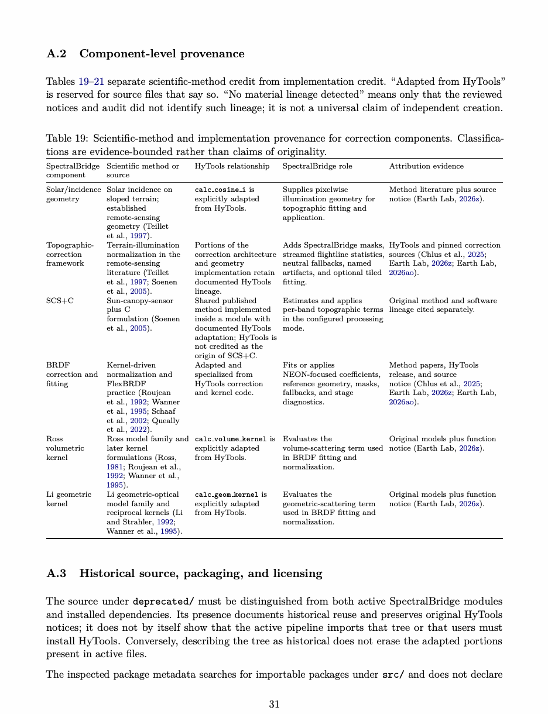

Table 20: Scientific-method and implementation provenance for input/output and sensor-translation components.

| SpectralBridge component | Scientific method or source | HyTools relationship | SpectralBridge role | Attribution evidence |
| --- | --- | --- | --- | --- |
| NEON HDF5 | NEON product | Portions of NeonCube | Provides bounded NEON | File notice and pinned |
| reading and | structure and | are explicitly adapted | array, metadata, mask, | source (Earth Lab, 2026n). |
| ancillary access | metadata (National | and simplified from | wavelength, and ancillary |  |
|  | Ecological Observatory | HyTools open neon | access for staged processing. |  |
|  | Network, 2026). | and related access |  |  |
|  |  | logic. |  |  |
| ENVI header | ENVI representation | Portions of header and | Writes canonical | File notice and pinned |
| and writing | and NEON-derived | writer logic are | source-product and | source (Earth Lab, 2026ae). |
|  | metadata handling; | explicitly adapted | corrected raster/header |  |
|  | not a new scientific | from HyTools. | pairs with SpectralBridge |  |
|  | algorithm. |  | naming and stage contracts. |  |
| Target-band | Normalized | Early workflows used | Implements the tested | History and current source |
| weighting / | response-weighted | HyTools resampling. | discrete weight-matrix | cited without an independence |
| spectral | spectral | The reviewed | contract and records | claim (Earth Lab, 2025a; Earth |
| resampling | integration (Chander | resample.py citation | configured target products | Lab, 2025b; Earth Lab, |
|  | et al., 2013; Roy et al., | does not itself | and subsequent | 2026aa). |
|  | 2016). | document current | adjustments. |  |
|  |  | adapted code; material |  |  |
|  |  | current lineage is |  |  |
|  |  | therefore uncertain. |  |  |
| Sensor | Empirical affine | No material HyTools | Maintains reviewed | SpectralBridge documentation |
| translation | relationships fitted | implementation lineage | coefficient registries and | and bulk records (Earth Lab, |
|  | among same-source | was detected in the | applies configured affine | 2026m; Earth Lab, 2026b). |
|  | configured | reviewed evidence. | relationships as a distinct |  |
|  | representations; not a |  | state. |  |
|  | HyTools scientific |  |  |  |
|  | method. |  |  |  |
| Drone pipeline | UAV calibration and | Correction functions | Preserves drone identity, | Component-specific |
|  | correction | may traverse the | correction availability, | boundary (Earth Lab, 2026m; |
|  | requirements derive | HyTools-derived | native and configured | Earth Lab, 2026z). |
|  | from the UAV | correction components | products, extraction, and |  |
|  | remote-sensing | above; no material | QA. |  |
|  | literature (Aasen et al., | HyTools lineage was |  |  |
|  | 2018; Mamaghani and | detected for drone |  |  |
|  | Salvaggio, 2019; Cao | discovery, staging, |  |  |
|  | et al., 2019). | translation, extraction, |  |  |
|  |  | or campaign |  |  |
|  |  | orchestration. |  |  |

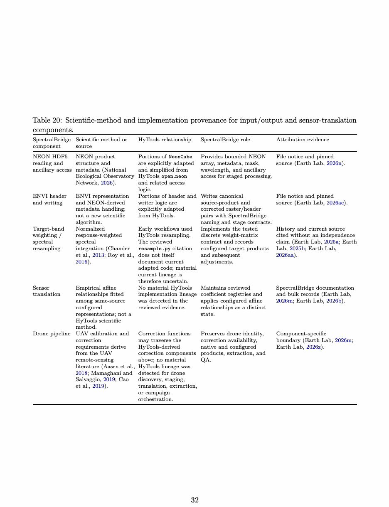

Table 21: Implementation provenance for workflow, analysis, and historical-source components.

| SpectralBridge component | Scientific method or source | HyTools relationship | SpectralBridge role | Attribution evidence |
| --- | --- | --- | --- | --- |
| Pipeline | File-mediated scientific | Earlier orchestration | Defines canonical paths, | Transition history and |
| contracts and | workflow design; no | interacted directly | required artifacts, | architecture (Earth Lab, 2025b; |
| restart | single | with HyTools; current | validation, reuse, and | Earth Lab, 2026p; Earth Lab, |
|  | correction-method | stage architecture was | restart boundaries. | 2026i; Earth Lab, 2026f). |
|  | source. | informed by that |  |  |
|  |  | history. No claim of |  |  |
|  |  | source independence is |  |  |
|  |  | made. |  |  |
| QA and | Scientific validation | No material HyTools | Produces machine-readable | SpectralBridge QA and |
| provenance | and research-object | implementation lineage | stage and combined reports, | validation records (Earth Lab, |
|  | principles (Morisette | was detected in the | diagnostic figures, evidence | 2026s; Earth Lab, 2026ap). |
|  | et al., 2006; Goble | reviewed evidence. | levels, and artifact |  |
|  | et al., 2020; |  | contracts. |  |
|  | Soiland-Reyes et al., |  |  |  |
|  | 2022). |  |  |  |
| Bulk analysis | Grouped regression, | No material HyTools | Streams completed products | Bulk source and |
|  | balanced summaries, | implementation lineage | into per-flightline statistics, | documentation (Earth Lab, |
|  | and held-out site | was detected in the | pooled and balanced fits, | 2026b; Earth Lab, 2026c; Earth |
|  | analysis as specified in | reviewed evidence. | site summaries, and | Lab, 2026g). |
|  | this study. |  | leave-one-site-out |  |
|  |  |  | diagnostics. |  |
| Historical | Original HyTools | Historical/vendored | Development and archival | Later repository audit and |
| deprecated/ | software and notices, | HyTools source with | context; not treated here as | current tree (Chlus et al., 2025; |
| source | not a distinct scientific | original authorship, | an active runtime | Earth Lab, 2026ac). |
|  | method. | copyright, and GPL | component. |  |
|  |  | information retained. |  |  |

HyTools as a dependency [@si_earthlab2026ag; @si_earthlab2026l]. However, the manuscript materials do not include an unpacked wheel and source distribution from the later provenance-audit revision. This supplement therefore does not make a final claim about whether every file under deprecated/ is absent from both distribution formats. That packaging question should be closed by recording the exact audit commit and listing the contents of the built wheel and source archive. HyTools 1.6.1 is distributed under GPL-3.0, and the inspected SpectralBridge revisions declare GPLv3 or GPL-3.0-or-later. Active files containing adapted portions retain HyTools attribution notices [@si_chlus2025; @si_earthlab2026ag; @si_earthlab2026l; @si_earthlab2026n; @si_earthlab2026ae; @si_earthlab2026z]. This is a concise record of the licenses and notices present in the cited software, not a legal interpretation.

## A.4 SpectralBridge contribution boundary

The package’s contribution does not depend on presenting established correction equations or adapted low-level components as newly invented. The evidence supports a contribution at the level of organization and application: explicit sensor and product handling; named intermediate artifacts; target-band construction and recorded translation states; drone preparation and extraction; restart and completion contracts; QA and provenance records; and campaign- and collection-scale analysis [@si_earthlab2026p; @si_earthlab2026i; @si_earthlab2026m; @si_earthlab2026s; @si_earthlab2026b]. These components combine established environmental remote-sensing methods and attributed prior software into an inspectable system built for a specific cross-sensor measurement problem.

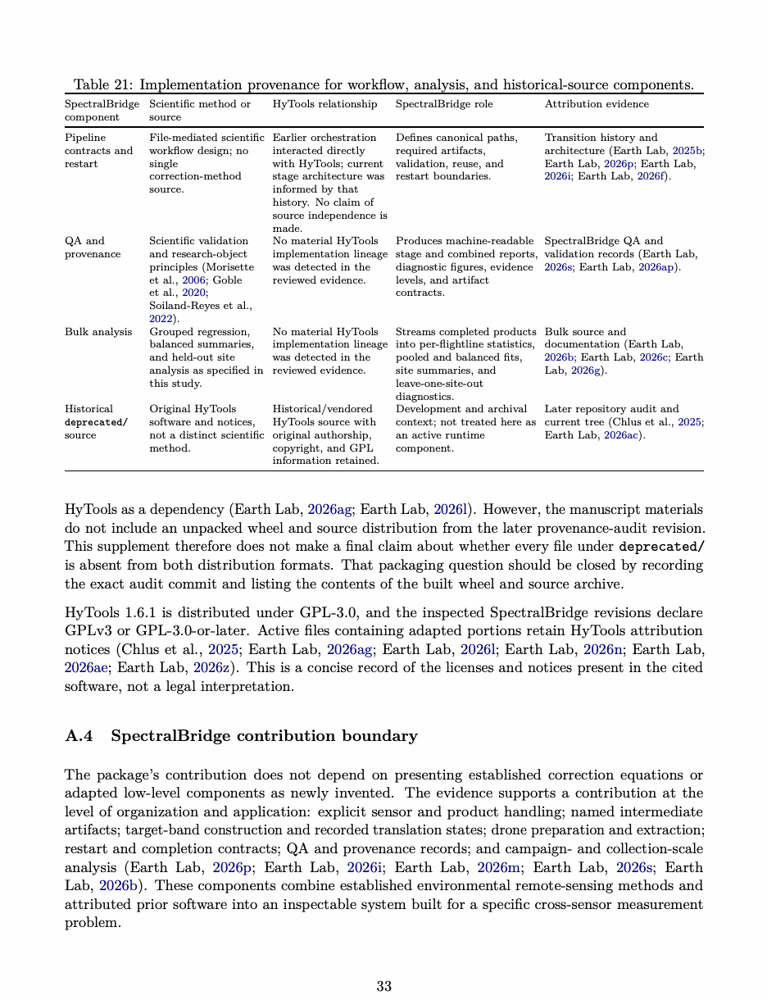

This distinction reinforces the manuscript’s broader evidential argument. Inspectable scientific software should expose not only input provenance, parameters, transformations, QA, and outputs, but also the lineage of important implementations used to perform those transformations. A reader can then distinguish the origin of a scientific method, the ancestry of its code, the package required at runtime, and the workflow contribution made by SpectralBridge without collapsing them into a single novelty claim.

# B Relationship to neighboring software

SpectralBridge overlaps several established software families, but the resemblance occurs at different layers. Table 22 distinguishes similarity in algorithms, scientific objective, data access, orchestra- tion, and scalable analysis. This comparison is important because the package’s contribution is architectural and evidential rather than a claim to have invented the underlying normalization or weighting methods.

Table 22: Relationship between SpectralBridge and neighboring correction, harmonization, and retrieval software.

| System | Important resemblance | Boundary relative to SpectralBridge |
| --- | --- | --- |
| HyTools | The enabling predecessor and closest | A general hyperspectral-processing library. |
|  | methodological relative: early | Current SpectralBridge does not require it at |
|  | SpectralBridge used it directly, and | runtime; the divergence is a specialized file |
|  | current components retain documented | contract, explicit measurement states, restart |
|  | adapted and algorithmic lineage (Chlus | pathway, tabular products, and staged QA |
|  | et al., 2025; Earth Lab, 2026n; Earth | evidence, not an absence of HyTools-derived code. |
|  | Lab, 2026ae; Earth Lab, 2026z). |  |
| Harmonized Landsat | Applies atmospheric correction, cloud | An operational harmonized satellite data product |
| and Sentinel-2 (HLS) | and shadow masking, co-registration, | at common spatial support. Its multi-step design |
|  | common gridding, BRDF normalization, | and evaluated bandpass methods clarify why |
|  | and spectral bandpass adjustment to | SpectralBridge’s configured representations or |
|  | operational Landsat and Sentinel-2 | affine variables are not, by themselves, a complete |
|  | observations (Claverie et al., 2018; Ju | harmonized satellite observation (Claverie, 2023). |
|  | et al., 2025). |  |
| Sen2Like | Generates Sentinel-2-like harmonized or | A satellite virtual-constellation processor whose |
|  | fused products from Landsat and | goal includes common geometry and resolution. |
|  | Sentinel-2 using geometric correction, | SpectralBridge instead uses NEON as a |
|  | atmospheric correction, spectral band | translating reference and deliberately leaves |
|  | adjustment, BRDF normalization, and | spatial reconciliation to downstream analysis. |
|  | optional spatial fusion (Saunier et al., |  |
|  | 2022). |  |
| FORCE | Mass-processes Landsat and Sentinel-2 | An operational archive-processing and data-cube |
|  | archives into analysis-ready data and | system. SpectralBridge is smaller in scope and |
|  | supports large-area time-series analysis, | emphasizes persisted intermediate measurement |
|  | including radiometric, topographic, and | states for diagnosing a cross-sensor comparison. |
|  | BRDF-related processing (Frantz, |  |
|  | 2019). |  |
| ISOFIT | Uses optimal estimation and | Solves an upstream atmospheric-retrieval problem. |
|  | radiative-transfer modeling to estimate | SpectralBridge inherits the reflectance state of the |
|  | surface reflectance and atmospheric | NEON directional-reflectance product rather than |
|  | state from imaging-spectrometer | retrieving reflectance from radiance. |
|  | radiance (Thompson et al., 2018). |  |

SpectralBridge is thus closest to HyTools in methods and portions of code, to HLS and Sen2Like

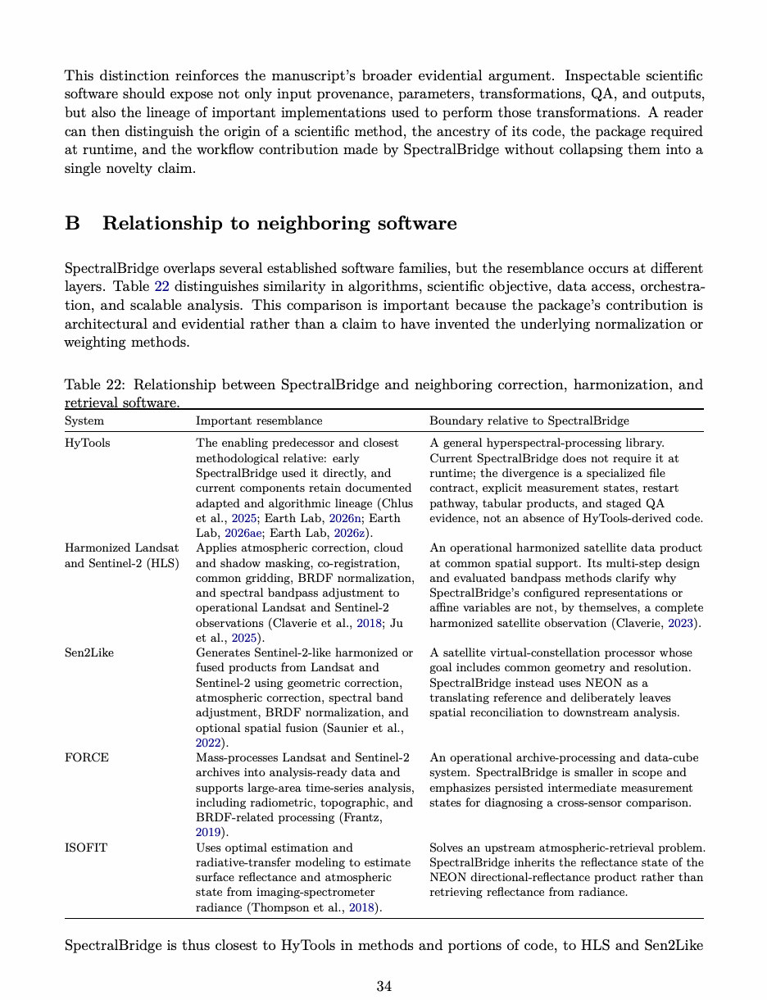

Table 23: Relationship between SpectralBridge and neighboring toolbox, workflow, and data- infrastructure software.

| System | Important resemblance | Boundary relative to SpectralBridge |
| --- | --- | --- |
| EnMAP-Box | Provides a broad environment for | A general QGIS-based imaging-spectroscopy |
|  | visualizing and processing multi- and | toolbox. It supplies interactive algorithms and |
|  | hyperspectral imagery, spectral profiles, | applications rather than SpectralBridge’s |
|  | and derived analyses (Jakimow et al., | opinionated cross-sensor sequence and evidence |
|  | 2023). | vocabulary. |
| NEON utilities | Tools such as neonUtilities support | Data-access and preparation utilities do not |
|  | discovery, download, stacking, and | themselves define the geometry normalization, |
|  | preparation of NEON data | target-band construction, staged artifacts, or |
|  | products (Lunch et al., 2026). | cross-sensor QA used here. |
| Snakemake and | Express file- or data-dependent | Domain-general workflow engines do not supply |
| Nextflow | computational workflows, manage | reflectance semantics, sensor transformations, |
|  | ordered execution, and support | spatial-support distinctions, or scientifically |
|  | reproducible restart across computing | interpreted QA. They could orchestrate |
|  | environments (K¨oster and Rahmann, | SpectralBridge but do not replace its domain |
|  | 2012; Di Tommaso et al., 2017). | model. |
| Open Data Cube | Organize and analyze large | Data infrastructure addresses cataloging, storage, |
| and Pangeo | Earth-observation or geoscience | and computation at scale. It does not specify how |
|  | collections and provide scalable access | cross-sensor reflectance comparability should be |
|  | to multidimensional data (Killough, | constructed or which intermediate measurement |
|  | 2018; Pangeo Community, 2026). | states should be retained. |

in scientific motivation, to FORCE in operational organization, and to workflow systems in its file-mediated execution. It does not replace any of them. Its narrower role is to preserve the stages of a cross-sensor construction, keep band space distinct from spatial support, and show where an unexpected pattern first appears. It is not a new correction algorithm, atmospheric-retrieval system, global harmonized product, spatial-fusion method, general workflow engine, or direct drone-to-Landsat calibration.

# C Prospective QA and resource protocol

An earlier study plan specified 100 NEON flightlines. We retain it as a prospective protocol rather than applying it retroactively to either the 122 accepted flightlines in the bulk collection or the separate 43-package drone attempt. Before NEON collections are combined, the selection rule, attempted-input list, configurations, and missing QA and resource records must be reconciled. These runs answer different questions and should remain separate records. The study treats each original source flightline as one operational unit for completion, QA prevalence, and resource reporting. Pixels are not pooled across flightlines for the primary summaries, because cube dimensions differ and pooled pixels would allow larger flightlines to dominate. Left and right processing halves, where used, remain paired partitions of one source flightline and are not counted as independent flightlines. Site is the highest unit for statements about out-of-site operational or diagnostic stability [@si_hurlbert1984]. The study record should define the sampling frame and selection rule; represented sites and years; attempted, completed, excluded, and repeated flightlines; processing partitions; publication commit and resolved configuration; execution environment; and missing or unreadable QA reports. Missing

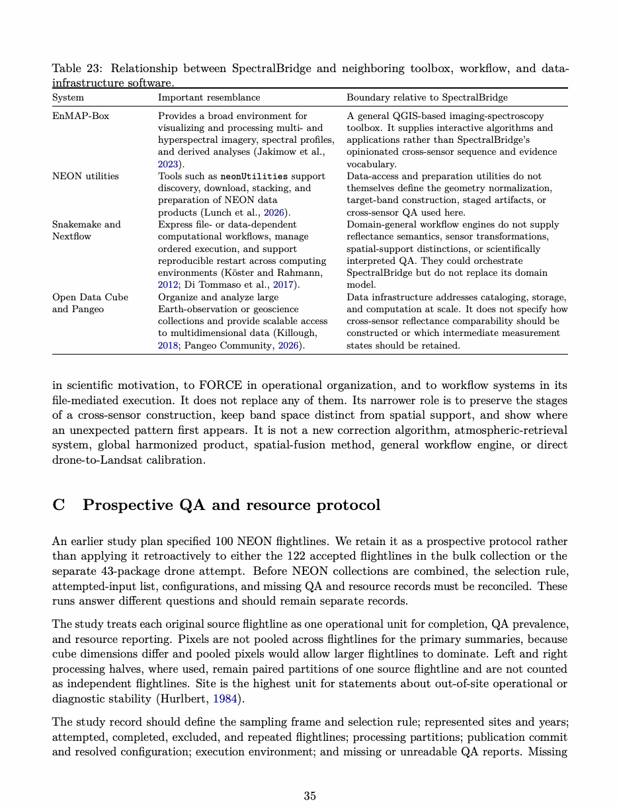

reports remain in the denominator. Runs combined in one summary must use the same response and brightness definitions, QA schema, and thresholds. If a run is replaced, the original attempt and the reason for replacement should remain in the archive. Completion and status outcomes will be reported as counts and percentages; continuous diagnostics will be summarized by median, interquartile range, and range. Balanced summaries will remain distinct from pooled pixel descriptions. The completed synthetic-translation results do not supply the missing upstream QA and resource measurements.

## C.1 Resource-use analysis

Hyperspectral processing is computationally demanding because hundreds of co-registered bands create high-dimensional data volumes, and useful analysis must also manage noise, calibration, dimensionality, and algorithmic scaling [@si_plaza2009; @si_bioucasdias2013]. SpectralBridge adds correction models, multiple target products, tabular extraction, and QA records to that baseline workload, making resource behavior part of the reproducibility evidence rather than a purely operational detail. Candidate source HDF5 files recorded for the study range from approximately 2.5–16 GB. Repository guidance notes that some production workflows may require roughly 250 GB of RAM, but that value is an operational planning estimate rather than a study result [@si_earthlab2026t; @si_earthlab2026ai]. On-disk HDF5 size is only one candidate predictor because compression, decoded dimensions, band count, data type, processing mode, and concurrency can alter memory demand. Resource reporting will therefore avoid a single unqualified memory requirement. For each run, the analysis will retain source size in bytes; raster lines, samples, bands, and data type; available compression metadata; complete-process-tree peak resident memory; wall time; worker count; backend; full- or half-flight mode and window; completion status; and host CPU and RAM information. Peak memory will be sampled for the parent process and descendants throughout each run, with the sampling interval and aggregation rule recorded. The primary resource figure will plot peak resident memory against both source file size and decoded cube size, identify failed or incomplete runs, and distinguish worker count and full- versus half-flight processing. Associations will be stratified or adjusted for these execution settings rather than pooled without qualification. Memory-aborted runs will be reported as right-censored operational observations, not treated as completed peak- memory measurements or silently excluded. The analysis will report rank associations with each size measure; a regression will be added only if its form and residual behavior are defensible. This describes operational scaling for the evaluated environment, not a hardware-independent complexity guarantee. For the updated bulk route, profile selected ENVI bytes and decoded dimensions, eligible observations, requested pair-bands, window size, concurrent readers, storage characteristics, process-tree peak RAM, and checkpoint/temporary/output bytes. Time cataloging, the statistics pass, aggregation, the second error-evaluation pass, and compact report generation separately. Compatibility and explicit dataset-materialization modes require their own measurements. A bounded representative workload can establish resource use for that workload; a claim of superior performance requires a stated comparator under matched conditions. The staged archive’s size does not establish a speedup or measured peak-memory reduction [@si_earthlab2026c; @si_earthlab2026u].

D     Availability and citation status

The historical 4 September metadata snapshot reports version 2.2.0 and Python 3.10 or newer. Its license and CI/release configuration are described by the pinned sources [@si_earthlab2026ag; @si_earthlab2026ab; @si_earthlab2026h; @si_earthlab2026k]. Those records remain the basis of the historical flightline source audit, not proof of the software configuration that generated either the supplied bulk run or the drone campaign attempt. The 4 September hardening audit identified metadata, licensing, provenance, dependency, and publication-configuration issues [@si_earthlab2026v]. The 9 September commit c86da6a prepares 2.3.0rc1, synchronizes metadata, and reports source and exact-distribution smoke checks. External publisher configuration, tag creation, and publication remain separate owner-controlled steps [@si_earthlab2026l]. As of 25 September 2026, the repository README documented candidate installation but the public GitHub release page listed no 2.3.0rc1 release; a live check on 12 October lists v1.0.0 as latest [@si_earthlab2026aj; @si_earthlab2026ah]. The exact revision used for the later 43-flight drone production attempt was not supplied, so neither f7e7ddd nor c86da6a is assigned to it. The completion-accounting defect is under investigation, but this manuscript cites no corrective commit and makes no claim that a fix has passed human review or campaign replay [@si_spectralbridgeprojectteam2026]. The public GitHub Pages validation record was last updated on 14 August 2026 and should not be read as a live summary of the later release-preparation or drone-campaign evidence. Its landing page also uses broader language about harmonization, Landsat referencing, and model transfer than the evidence reviewed here establishes. This supplement therefore uses the site for documented interfaces and recorded tests while retaining the manuscript’s narrower distinctions among configured representations, artifact completion, QA, and independent scientific validation [@si_earthlab2026al; @si_earthlab2026ad]. The DOI 10.5281/zenodo.11167877 identifies the 9 May 2024 pre-rename cross-sensor-cal archive [@si_earthlab2026j]. Submission should use a permanent post-rename software archive and a packaged results record linking the run manifest, inputs, software, configuration, executable examples, outputs, and exact numerical definitions [@si_smith2016; @si_soilandreyes2022]. The local bulk-bundle citation explicitly records that no permanent public identifier was supplied.

# References
