# Anatomy of a Red Artifact, Part II

## 1. Anatomy of a Red Artifact, Part II

How We Reconstructed the Goldhill Drone BRDF Correction | November 2026

The historical red line was a correction artifact. Recovering the numerical encoding and fitting population was necessary, but neither created missing angular information. Camera positions supplied an experimental directional design; it removed the historical pole without establishing physical calibration or true orthomosaic contributors.

This companion follows five separate questions: what the numbers mean, which pixels entered the fit, whether the model can be estimated, what the corrected image contains, and whether vegetation evidence improves.

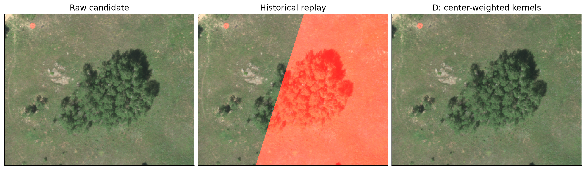

Diagnostic RGB = 650/560/475 nm. All images use black 0, white 0.25 and gamma 0.5, with display saturation only. Candidate units assume DN/32768; calibration remains HYPOTHETICAL_UNVERIFIED. Native crop: rows 573:974, columns 812:1313, 10 cm pixels.

## 2. A numerical inverse is not a calibration

The historical export removed a band minimum. Its inverse is an affine transformation, not a universal division by 10,000. The 862 nm minimum is 174 DN, so dropping the offset removes about 0.00531 candidate units. The clean source uses S = DN x 10000/65535 with zero offset. Its candidate multiplier is 0.0001999969482421875. Alpha-aware resampling is a separate repair that prevents transparent background entering interpolation.

The 10 cm inverse-forward round trip has maximum absolute residual 0.000299 stored units. A fresh comparison of the archived original and rescaled 25 cm H5 pair has maximum residual 0.000781 stored units. The H5 pair is the available archived equivalent, not a newly retrieved original TIFF. These errors are small numerical encoding residuals, not estimates of physical reflectance accuracy.

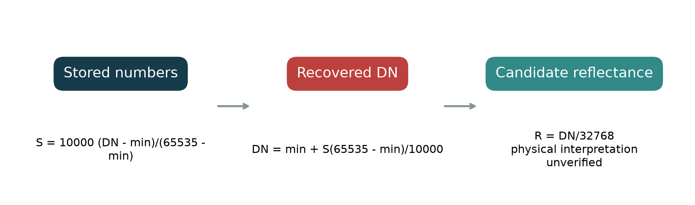

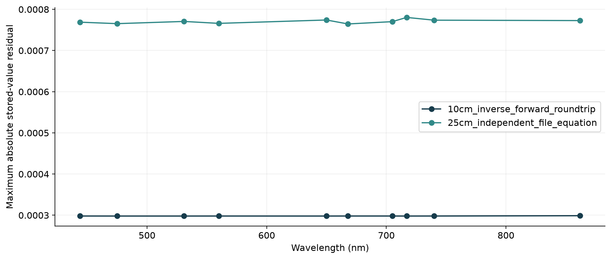

The stored-to-candidate contract is physical = scale x stored + offset. Numerical recovery is verified against paired source arrays; the final physical interpretation is conditional. Preserve per-band offsets and do not apply the decode twice. Sources: encoding_residuals.json and numerical_evidence.csv. Full finite H5 support is retained for encoding tests; the clean alpha footprint is used for image science. The independent-pair test name is recorded in the JSON ledger.

## 3. Ten bands expose the unit mismatch

A 0-2 eligibility rule applied to historical stored values selected only the extreme dark tail. It did not select a broad range of fractional reflectance. The ten-band distributions make the mismatch visible without treating plausible-looking values as calibration evidence.

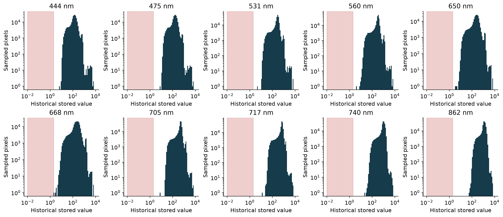

Deterministic sampled stored-value histograms; log axes. Red shading is the old stored-value 0-2 interval. Full-resolution counts are computed independently in eligibility_counts.json; histogram samples are not independent ecological observations.

## 4. Scaling changes spectral evidence before correction

Three fixed researcher polygons illustrate the representation change. Dividing the min-adjusted export by 10,000 produces a different numerical spectrum from recovering its original DN and applying the conditional physical interpretation. At 862 nm the missing offset is visible. Neither curve independently establishes which physical calibration was applied upstream.

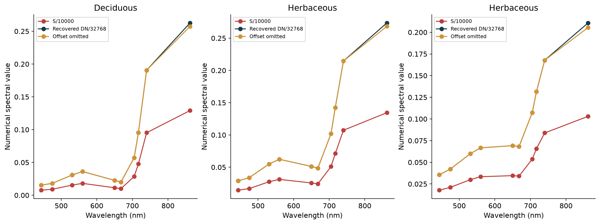

Median spectra from preselected polygons, with unchanged memberships. These representations are deliberately labeled separately; they are not interchangeable reflectance estimates.

## 5. Correct the units before deciding who can enter the fit

The controlled eligibility experiment increases the red-band sample from 14 to 6,678,404 pixels. The dots show the exact native locations because fourteen pixels can disappear in a reduced map. The core clean-source, zero-view branch separately contains 6,683,944 eligible pixels; the reconstructed terrain-valid native domain contains 6,683,905. These are distinct populations.

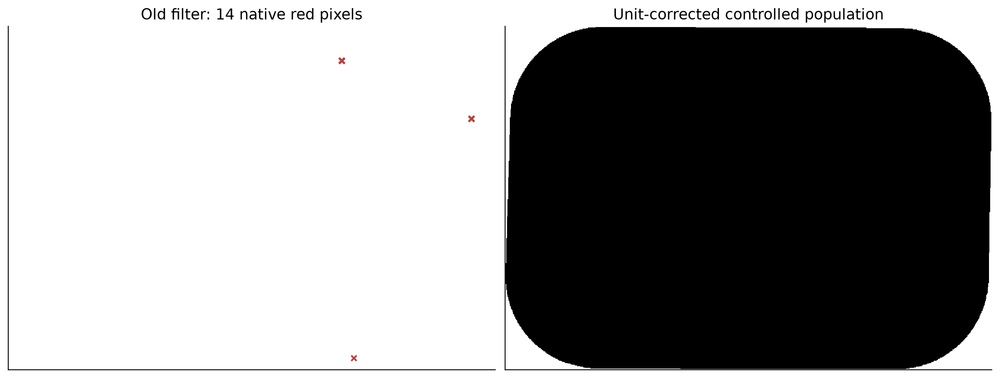

Maps are reduced for display only. Counts use native masks. The controlled population includes its own ancillary intersection; it must not be substituted for the native reconstructed domain.

## 6. Millions of observations do not create missing angles

Historical eligible counts range from zero to thirty across ten bands: 3, 1, 9, 13, 14, 30, 8, 4, 1 and 0. A larger fitting population repairs a severe sampling failure. With constant viewing geometry, however, the precision-aware stable rank remains one. Pixel count and the number of independently estimable directional terms are different quantities.

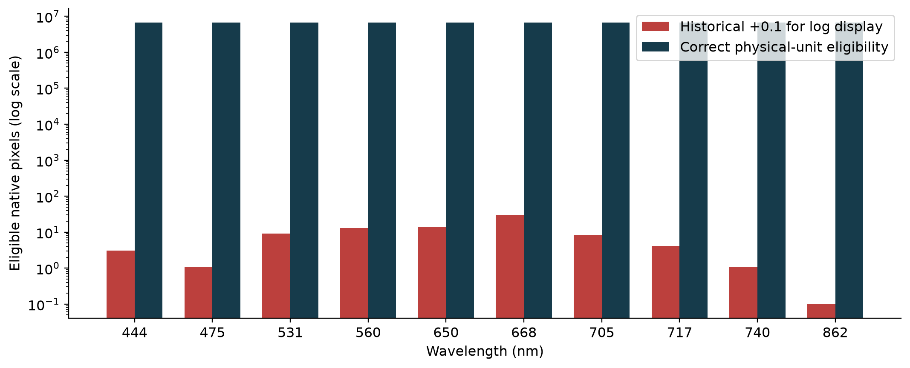

Exact counts from the controlled eligibility experiment. The +0.1 display offset makes a zero count visible on the log axis; it is never used in a fit.

## 7. Separate the kernel repair from identifiability

RossThick/LiDenseR mathematics had already been repaired and checked against independent equation-based fixtures. The shared kernel version is ross-li-reciprocal-f64-v1. Correct equations cannot recover missing observation geometry. An algebraic tiny singular value from numerical noise is not a second meaningful direction; the precision-aware rank test rejects that interpretation.

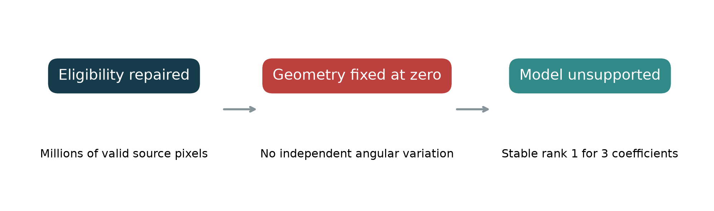

The fixed-geometry experiment is a negative control. Revised equations and corrected filtering are necessary repairs, but this control is not a supported BRDF correction.

## 8. Positions support rays, not contributor identities

Camera position and terrain define a candidate ground-to-camera direction. Nadir assumptions and nominal intrinsics determine eligibility and centering of footprints; they do not replace actual contributor maps. Orientation matrices and calibration rows exist, but their conventions, band bindings and vertical datum have not been verified. We therefore retain experimental assignments.

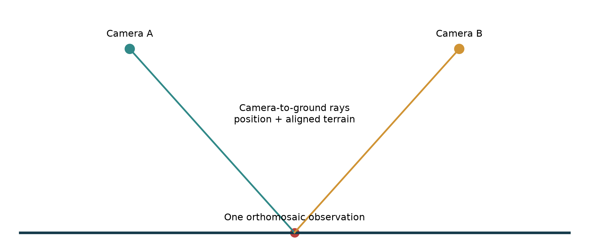

Conceptual ray diagram, not a recovered exposure pair. Each ground pixel still supplies one measured orthomosaic spectrum. Simulating multiple kernels never creates repeated measured directional observations.

## 9. 565 positions make a spatially varying angular design possible

The recovered table contains 5,650 band records at 565 camera positions. All positions fall within the scene when coordinates are interpreted in the project-reported NAD83 / UTM 13N system. Treating the conflicting CSV label EPSG:5070 literally displaces the cameras by about 2,874 km. The interpretation and the unchanged source label are both preserved.

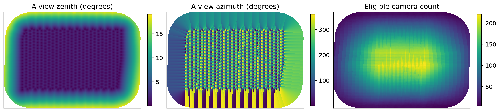

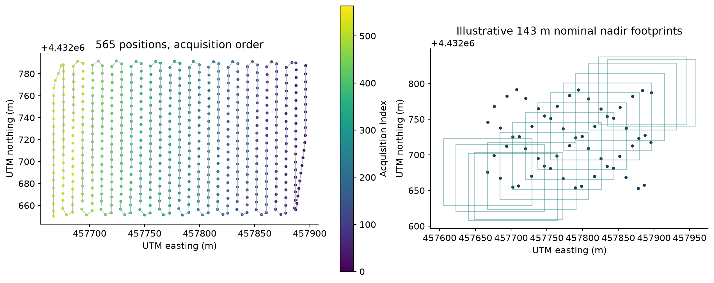

Angle and count maps use separate named quantities and scales. A zenith ranges about 0-19 degrees. Camera counts range 4-221, median 84. Ground-to-sensor azimuth includes the documented grid-to-true-north adjustment of about -0.3184 degrees. Supplemental panel: acquisition positions and illustrative nominal footprints (1280 x 960, 3.75 micrometre pitch, 5.5 mm focal length at 143 m); not actual image contributors.

## 10. Four assignments test assumptions rather than recover truth

Nearest eligible and most central assignments differ on 25.83% of terrain-valid pixels. Uniform and center-weighted approaches average kernels over eligible cameras. Averaging angles first would describe a different model. All four strategies use the same observed spectrum once, the same shared kernels, and the same reference-geometry mathematics.

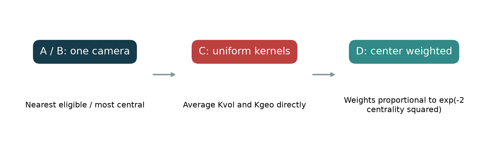

Publication labels C and D correspond to code names C_uniform and C_center. Center weights are simulated geometric weights, not recovered Metashape blend weights. Smoothness and ecological accuracy are diagnostics, not selection rules.

## 11. The reconstructed design has rank three, conditionally

All four full native designs pass the precision-aware rank-three test. Their condition numbers are roughly 98-182. This establishes a computationally estimable three-term regression under the assumed geometry. It does not establish that angular response, rather than spatially structured vegetation, explains the coefficients.

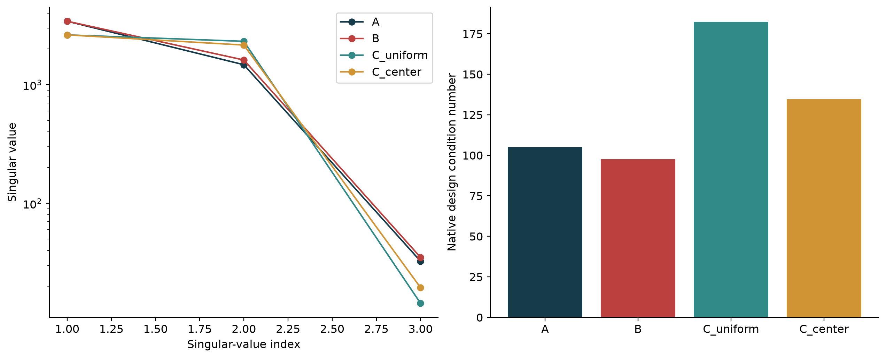

Full native terrain-valid domain: 6,683,905 pixels. Singular values and conditions are read from design_support.json, not inferred from reduced plot samples. Effective independent observation count is not estimated.

## 12. Kernel blending changes the design itself

Uniform and center-weighted kernels differ because eligible-camera geometry contributes with different weights. They are not additional radiometric observations. Angular support, reference prediction, prediction uncertainty and denominator positivity are checked before a model can be applied; no gain cap is used to create a visually acceptable result.

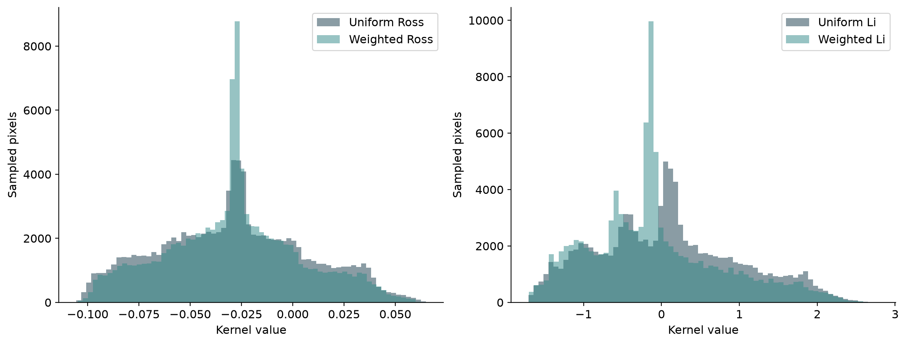

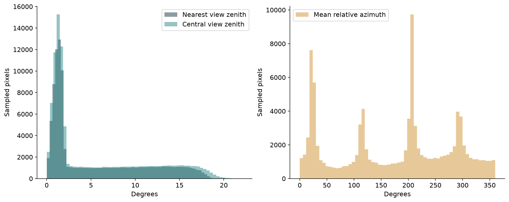

Deterministic stride-eight native kernel samples. Counts in these histograms describe the sample, not an effective independent sample size. Full designs and model diagnostics remain in the source investigation.

## 13. Hard assignments can introduce their own seams

Removing the historical pole does not make every reconstruction equivalent. At new assignment boundaries, the 99th-percentile red factor jump is about 0.498 for nearest and 0.589 for central assignments, compared with 0.0567 for uniform and 0.0265 for center-weighted kernels. These diagnostics favor continuity but cannot verify actual contributors.

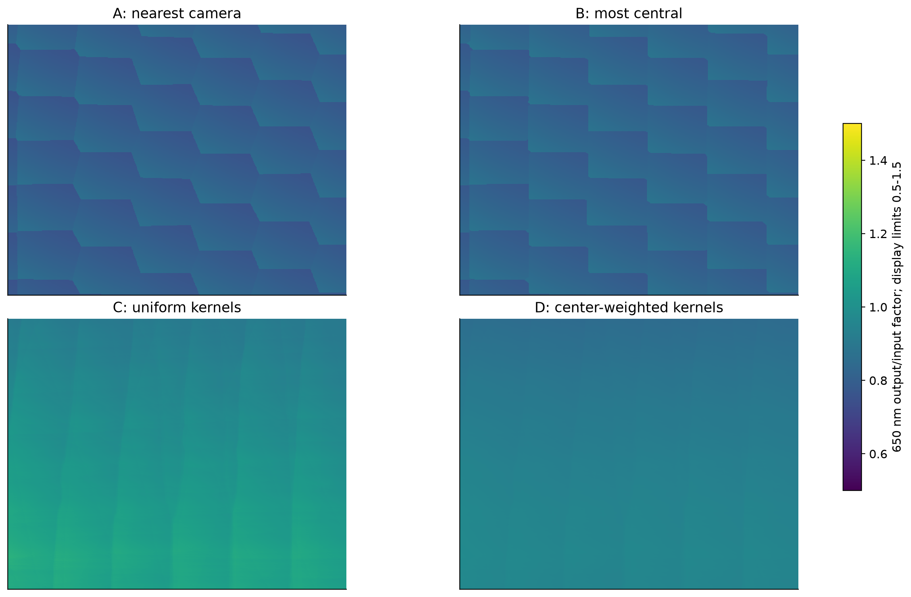

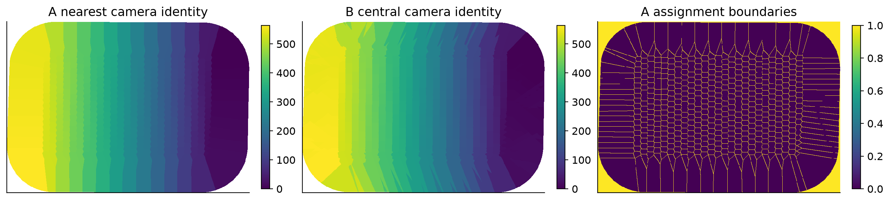

Identical native crop and factor display range. Out-of-range factors saturate only in this display. Exact distributions and seam metrics use uncapped native values; zeros in source are excluded from ratio diagnostics.

## 14. The full scene preserves the same display contract

The diagnostic red channel reveals the historical anomaly while reconstructed BRDF-only branches preserve broad spatial structure. The historical maximum applied red gain is 11,742,750 and the red-edge gain is about 115,554. A standard RGB using 668 nm can miss both damaged bands; wavelength selection must be explicit.

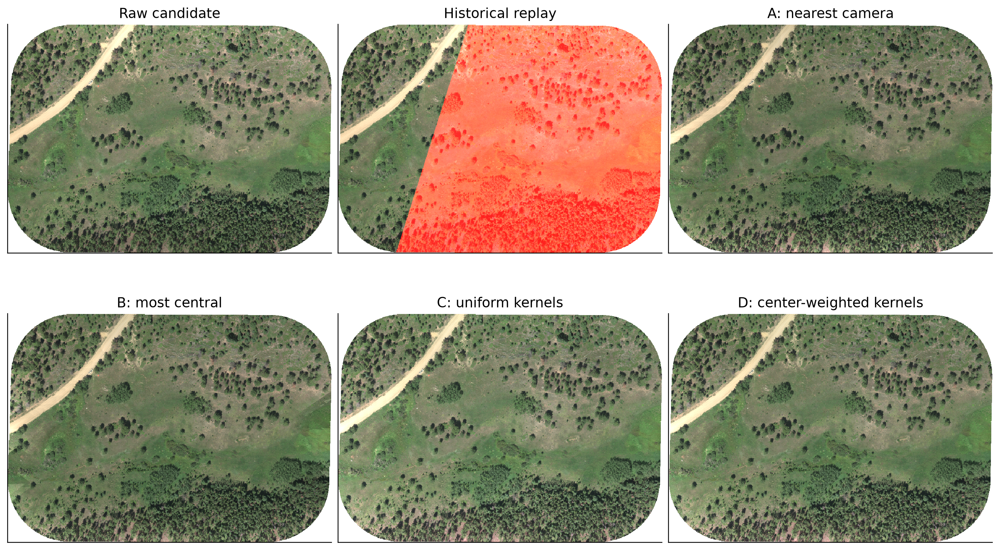

Full scene, deterministic stride-four display. RGB 650/560/475 nm with shared black 0, white 0.25, gamma 0.5. Historical saturation is deliberately visible. Statistics and correction factors are never clipped.

## 15. The historical boundary jump collapses in the experiments

At 2,936 fixed old-boundary edges, median red jump is 0.003079 in the raw image and about 630,821 in the historical replay. Reconstructed branches are approximately 0.00261-0.00348. The common location and native sampling isolate correction behavior from zoom or display choices.

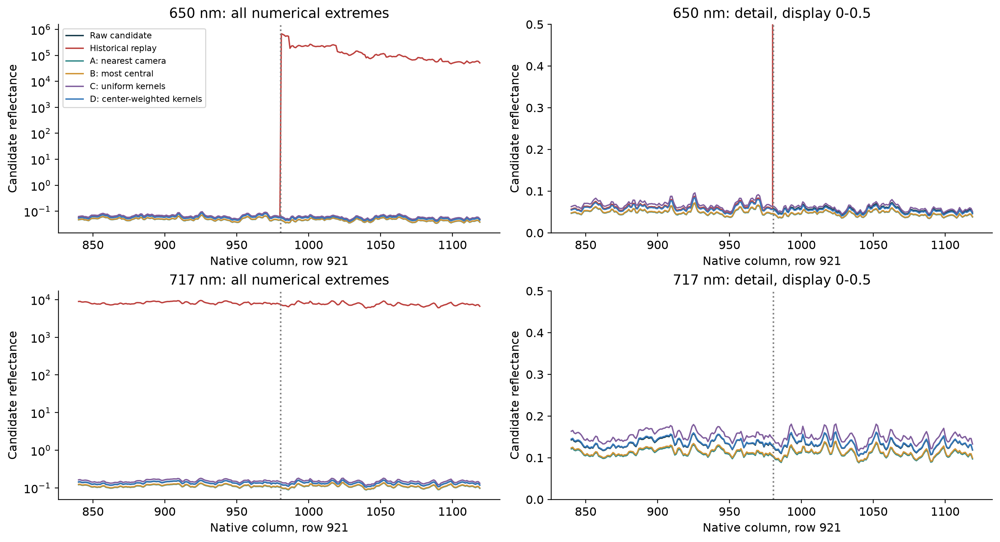

Left panels retain historical extremes on a symmetric log scale. Right panels deliberately show 0-0.5 detail and therefore omit the historical peaks from view; the full numerical trace remains alongside. No source values are clipped.

## 16. Check every band, not only the visible streak

The numerical ledger contains native factor and reflectance distributions for all ten wavelengths and all six branches. The historical red and red-edge multipliers are abnormal, but other wavelengths must also be inspected for spectral shape and preservation. Float32 output/input ratios can differ by one unit in the last place from the applied historical gain.

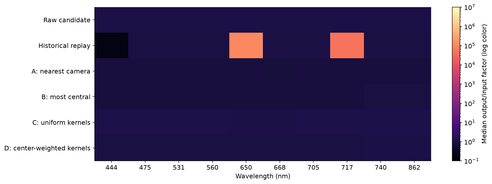

Median factors on logarithmic color. Exact minimum, maximum and quantiles are stored in factor_and_band_distributions.json. This plot summarizes the median; it does not replace extreme-value checks.

## 17. A fixed aspen polygon keeps its identity

The same Deciduous Populus tremuloides polygon crosses the established diagnostic area. Its 6,089 memberships are unchanged in this companion comparison. Median spectra and within-polygon interquartile bands show that removing the historical red/red-edge anomaly preserves the expected ordering of this observed spectrum under the candidate calibration.

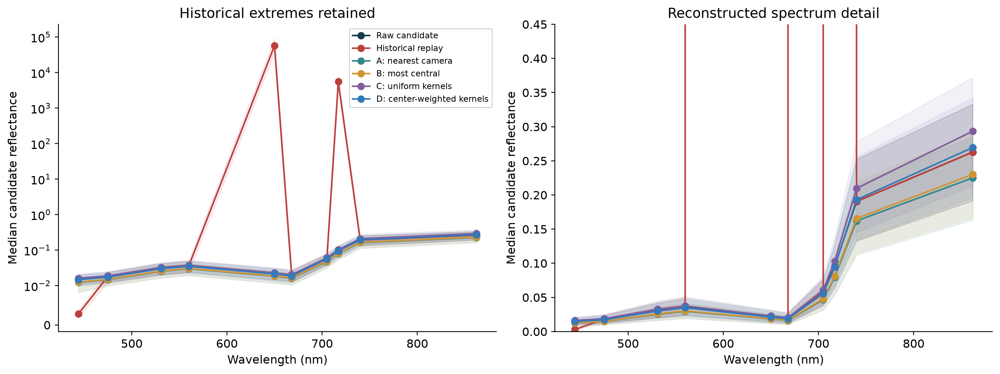

GlobalID {3A6D6E1D-3581-49B8-9321-397DFE5298C5}. Shading is pixel IQR within one polygon, not a confidence interval or independent replication. Classifier evaluations elsewhere use mean spectra, not these plotted medians.

## 18. Vegetation categories remain descriptive evidence

The researcher-assigned comparison comprises 157 identities: 98 Evergreen, 29 Woody shrub, 25 Herbaceous and only 5 Deciduous. Equal polygon summaries prevent the largest polygon from becoming the class profile. Between-polygon dispersion and the very small Deciduous sample limit generalization.

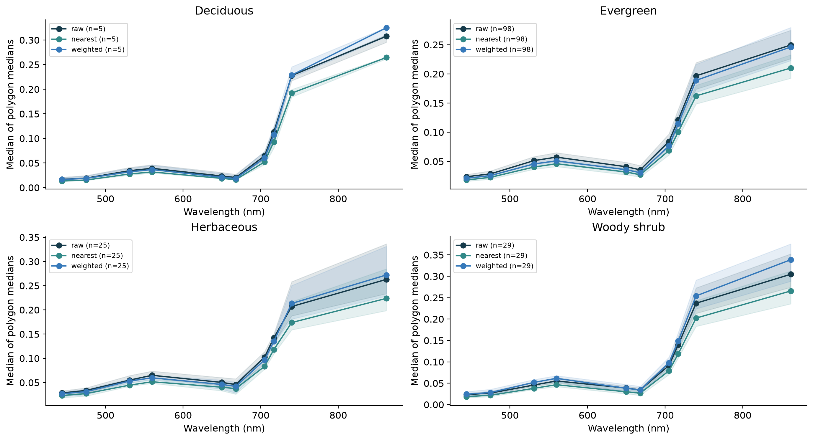

Lines are class medians of polygon median spectra; bands are the between-polygon IQR. These are descriptive spectral profiles, not corrected-output-selected training strata or tests of physical calibration.

## 19. The ecological gains are not decisive

Mean-spectrum PFT classification uses the same 157 identities, 144,406 memberships and frozen folds. Raw balanced accuracy is 66.83%; nearest and central are about 69.81% and 69.46%. Every reconstructed branch has a paired interval including zero. This is evidence of no demonstrated improvement at the present sample size, not proof of equivalence.

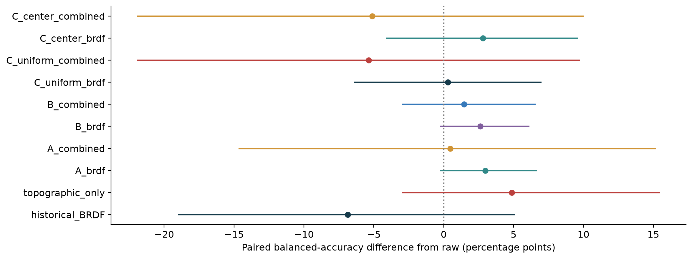

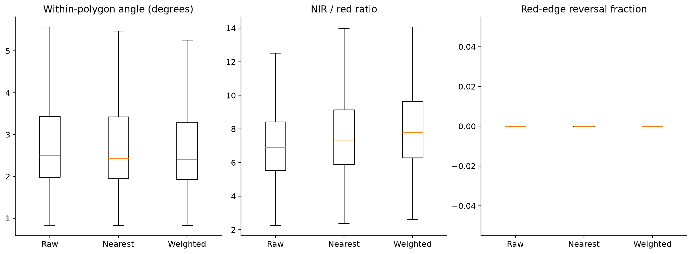

Class-stratified paired polygon bootstrap, frozen evaluation protocol. Directional rank, visual continuity and classification accuracy answer different questions. Neither smoothness nor the largest accuracy value selects a physically valid reconstruction. Supplemental integrity diagnostics are polygon distributions; outliers are omitted from box display only, retained in the CSV.

## 20. What is repaired, and what remains unresolved

The five-step causal chain is now explicit: a reversible encoding error distorted units; filtering selected almost no observations; fixed viewing geometry left the model unsupported; reconstructed rays supplied a conditional rank-three design; experimental images removed the historical pole without proving physical identifiability.

The subsequent integrated-reliability experiment retains SCS+C and introduces explicit unsupported-illumination masks. It reports both native and matched-domain extremes. It does not convert the reconstructed geometry or DN/32768 into verified physical inputs.

Reproduce from collect_evidence.py, build_publications.py and render_pdf.py. The 157-row numerical_evidence.csv records value, population, calculation, source path and hash. input_manifest.json binds frozen inputs. Original reports, labels and libraries remain untouched.

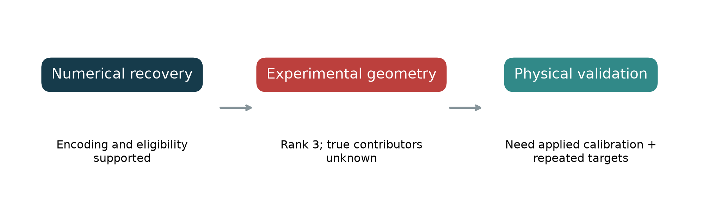

Companion baseline: November 4 viewing-geometry investigation. Subsequent engineering results are in Toward a Reliable Drone Correction Pipeline. Request the existing 40-photo/four-position subset, sensor/pose bindings, datum, calibration/export settings and contributor information; do not request an entire archive before testing that subset.

