# Anatomy of a Red Artifact

## How Missing Viewing Geometry and an Unsupported BRDF Model Corrupted the Goldhill Drone Orthomosaic

2026-11-03 · Read-only scientific reconstruction · SpectralBridge P165

## Act 1 — The observation: a boundary created after acquisition

The Goldhill red boundary is absent from the source image and appears in the historical BRDF-only replay. Applying the same unchanged BRDF model after topographic correction reproduces the combined artifact. The causal evidence is an exact numerical reconstruction, not a resemblance to a seamline.

At neighboring 10 cm pixels, the predicted 650 nm response changes from 0 to 0.0078125. The historical guard assigns factor 1 to the first cell; the positive ratio assigns 11,742,750 to the next. A smooth spatial predictor becomes an abrupt output boundary.

The full replay agrees with the saved Goldhill stages across all 70,832,700 values and their masks. The earlier investigation compared that combined replay directly with production, also with zero mismatches. The production raster is not currently local: this report freshly verifies cached-stage equality and explicitly reuses the earlier production comparison.

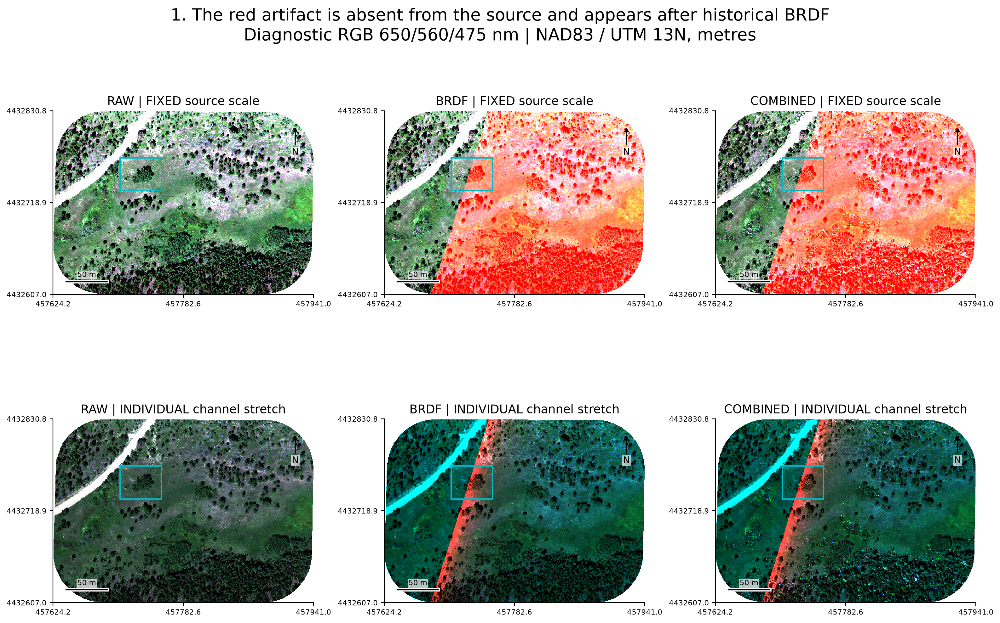

*Full scene on the repaired grid. Top: one source-DN-equivalent display scale. Bottom: independent per-stage 2-98% channel stretches reveal structure but cannot compare radiometric magnitude. Cyan box is the common native zoom. Gray is missing stage data; white is outside positive source alpha.*

## Watch the artifact emerge on the same pixels

Each row shows one geographic region and the same researcher-assigned Deciduous polygon. The first three rows are representations of the same source samples: changing the spatial metadata changes where pixels are placed, not their spectral values. No reflected historical export is used as a geographic reference.

The recovered 10 cm source values are inverse-encoded from the normalized product; they are not recovered native camera pixels or a new independent acquisition. Historically normalization preceded the H5 spatial repair; the first three rows use the requested explanatory order, not a claim of a different processing chronology.

Stored normalized S = 10000 × (DN − min)/(65535 − min). Spectral displays use the explicitly common DN-equivalent = min + S_stage × (65535 − min)/10000. Goldhill min is 174 at 862 nm and zero elsewhere. This inverse encoding is a display convention after correction, not physical reflectance calibration, and an affine offset does not generally commute with multiplicative correction.

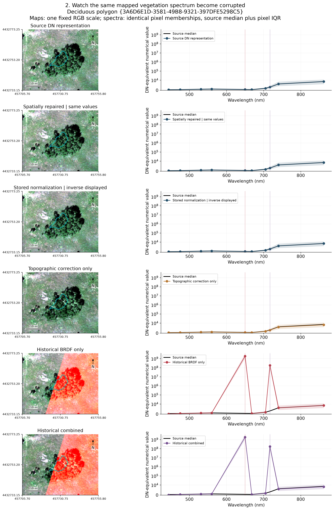

*Six requested views on one native 0.1 m grid and one extent. First three rows are encoding/spatial views of the same source, not new observations: spatial repair changes coordinates, not spectra. The actual historical order normalized before H5 spatial repair. Common display uses DN-equivalent = min + S*(65535-min)/10000 after each stage; this is not physical reflectance or native-camera recovery. Source-DN reference is black. Shading is within-polygon pixel IQR, not independent-replicate uncertainty. The 650 and 717 nm spikes are real historical numerical output.*

## Why the choice of RGB bands changes what we see

There is an important distinction between the earlier artifact diagnostic and the generic QA preview. The diagnostic uses 650/560/475 nm. Generic production QA targets 660/560/490 nm, whose nearest actual bands are 668/560/475 nm. The semantic band_map names red=650, green=560 and blue=444 for band-fidelity metrics; they do not select the generic RGB channels.

Both catastrophically amplified Goldhill bands, 650 and 717 nm, are omitted by that generic RGB. In the native zoom, its BRDF-only channel values have exactly zero changes relative to raw. The same damaged cube can therefore look normal in a default RGB. The 650 diagnostic turns red because its red channel explodes while 560 is guarded to identity and 475 retains neutral initialized coefficients.

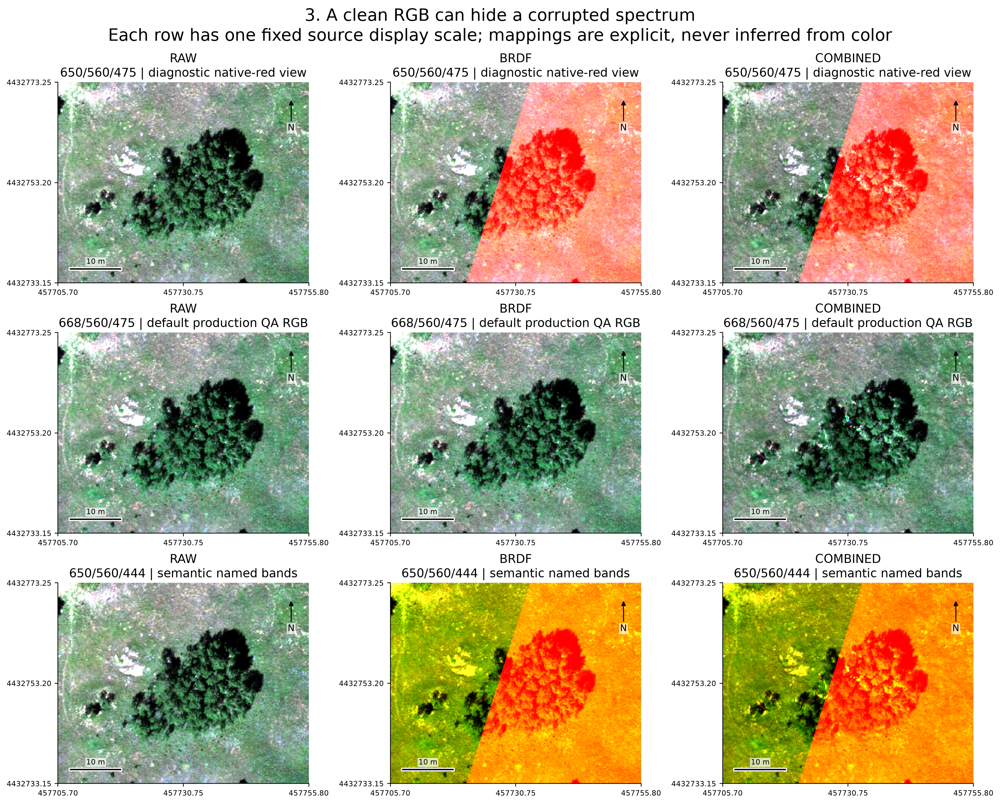

*The default QA targets 660/560/490 nm and resolves to 668/560/475 nm. The named band_map red=650, green=560, blue=444 belongs to band-fidelity metrics, not the RGB selector. The default RGB omits both catastrophically altered Goldhill wavelengths (650 and 717 nm). Diagnostic native-red RGB exposes the artifact; a normal-looking default RGB does not validate the cube.*

## Follow four real pixels through the correction

The four locations are actual row 921 pixels, columns 980, 981, 1000 and 830. Columns 980 and 981 are adjacent. Their projected centers are respectively (457722.55, 4432738.40) and (457722.65, 4432738.40) m in NAD83 / UTM zone 13N. All fall within the common native zoom. The reference is relatively unaffected at 650 nm; its 717 nm response is still corrupted.

At column 980 the 650 nm source S is 292.708191 and the observed prediction is zero, so BRDF copies the input. At column 981 source S is 287.127838 and the denominator is 0.0078125; reference prediction 91,740.234375 yields factor 11,742,750 and a BRDF output around 3.37 billion S. The discontinuity is produced by code applied to adjacent real measurements.

The CSV records all ten wavelengths, four stages, observed/reference predictions, individual model terms, branch/visit/fallback states and source validity. Negative and zero predictions are retained. Spectra use symlog where needed; logarithmic factor axes show only positive factors. No computed gain is capped.

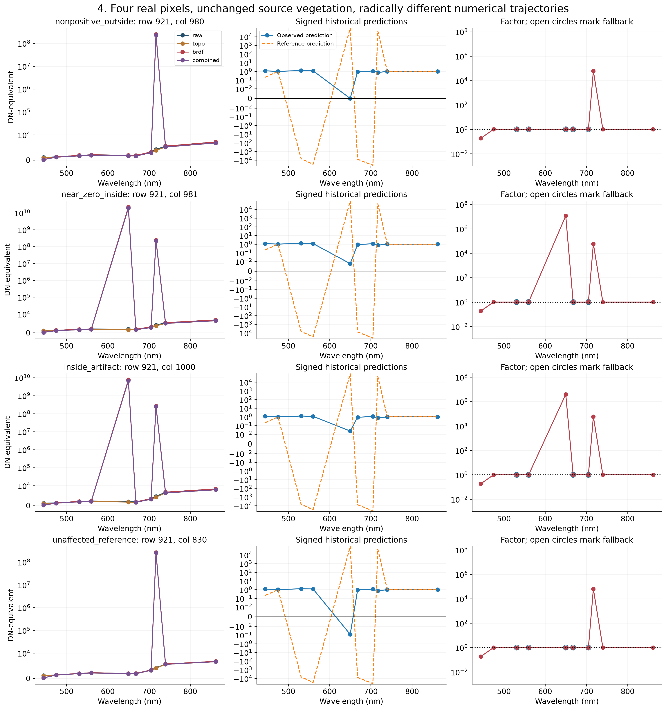

*Actual native row/column and projected coordinates are in pixel_trajectories.csv. Positive factors use a logarithmic axis; signed predictions and spectra use symlog, preserving zeros and negative values. No gains are capped in the calculations. The zero-denominator outside pixel and first positive-denominator neighbor are adjacent 0.1 m cells.*

## Act 2 — The missing viewing information

Sensor zenith and azimuth are both uniformly zero placeholders in all three working H5s. PLACEHOLDER — NOT MEASURED VIEWING GEOMETRY. Zero azimuth at nadir does not encode an independently meaningful viewing direction. Many spatial samples therefore do not establish multiple observations of directional reflectance.

The actual Goldhill solar grids span 27.763607–27.766270° zenith (median 27.764940°, range 0.002663°) and 204.691803–204.699860° azimuth (median 204.695816°, range 0.008057°). Increasing-gradient bearings are 24.93° and 107.57° clockwise from grid north. These are spatial NOAA calculations at one manifest time: DERIVED — ACQUISITION TIME UNVERIFIED.

The historical model uses scene-mean solar zenith while retaining the per-pixel azimuth. Its relative azimuth is numerically solar azimuth minus the zero sensor placeholder. Full-scene maps are point samples at stride 6; ranges, gradients, fits and boundary measurements use native arrays, not downsampled images.

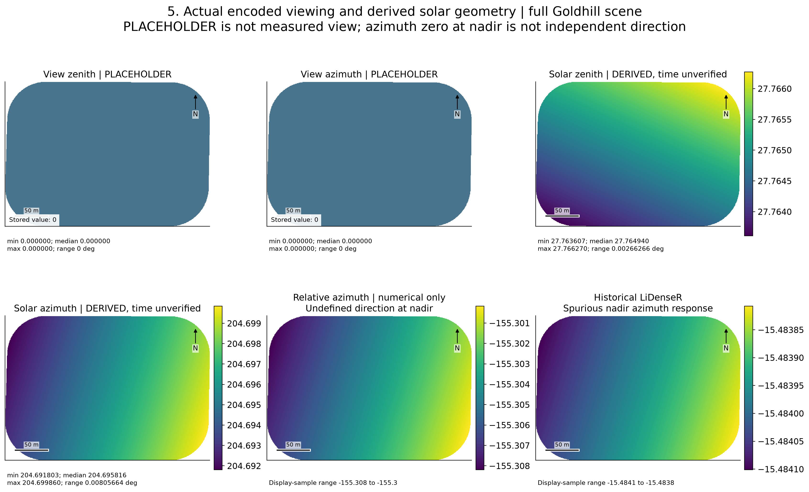

*Uniform zero view maps are shown with a single-value legend, not a misleading continuous scale. Numeric relative azimuth is stored solar azimuth minus placeholder zero. Solar fields are per-pixel NOAA calculations at one manifest timestamp, not camera observations; time remains unverified. Full-population ranges and projected gradient bearings are in geometry_statistics.csv. Images are native point samples, stride 6; all exact metrics use native arrays.*

## Terrain, illumination and camera direction are different quantities

Slope and aspect describe the terrain surface; they do not recover a camera ray. Solar incidence describes illumination relative to that surface. The stored terrain arrays are interpreted once in degrees then converted to radians for calculation, preserving the documented reader convention. Original surface/derivative provenance remains partly unverified.

cos(i) = cos(solar zenith) cos(slope) + sin(solar zenith) sin(slope) cos(solar azimuth − aspect). Incidence angle is arccos(cos(i)) only for finite values within [−1,1]. Negative cos(i) is retained and identified as back-facing; it is not silently replaced by a lit slope. Aspect is displayed cyclically.

P162 compared the configured Goldhill NOAA zenith 27.7649° with independent SPA 28.0396°. That tests the approximation at a configured time, not the correctness of the acquisition time. August 14 versus August 15 date conventions remain unresolved. The earlier near-89° unit/conversion defect is distinct from the current stored solar arrays used in this replay.

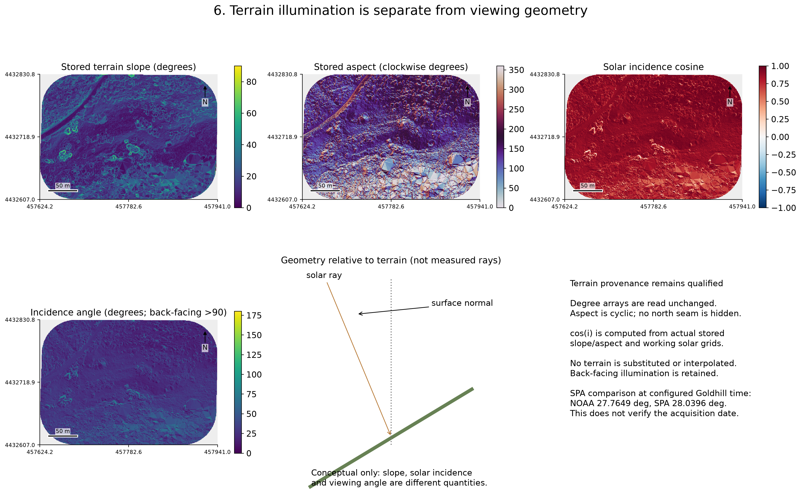

*Source slope/aspect grids and their degree interpretation are preserved. Physical source-surface/derivative and timestamp provenance remain unresolved. Incidence angle is arccos(cos(i)) only where finite and within [-1,1]; negative cosine is explicitly back-facing. The explanatory terrain diagram is conceptual, not recovered camera geometry.*

## The small, coherent angular gradient at the boundary

Every zoom uses the same EPSG:26913 native 0.1 m grid, north-up orientation, pixel centers and extent: easting 457705.70–457755.80 m, northing 4432733.15–4432773.25 m. The row/column window is [573:974, 812:1313]. The black contour is computed from the actual quantized historical red prediction.

A tiny smooth solar azimuth gradient is enough to move the defective historical geometric kernel. At scene zenith and nominal nadir, its Goldhill LiDenseR values span −15.48411655 to −15.48379230. The source pixels and vegetation do not jump there. Large fitted coefficients convert this small predictor variation into a zero crossing and the application branch creates the abrupt boundary.

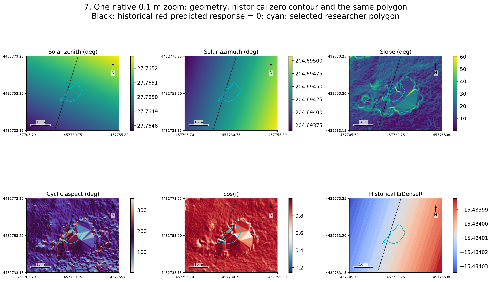

*All six panels use identical NAD83/UTM13N extent and native pixel centers. Black contours are based on the actual quantized historical 650 nm prediction, not a smoothed image edge. Sensor angles remain the same zero placeholders in this zoom. The incidence field is not substituted for sensor zenith.*

## The angular distributions and uniform RossThick map

The RossThick map is spatially uniform because the historical configuration uses scene solar zenith and zero sensor zenith. Its apparent lack of structure is evidence of the missing independent kernel direction, not an omitted diagnostic. The historical LiDenseR field varies only through its defective azimuth dependence at nadir.

Solar zenith and azimuth distributions below use the explicitly stride-6 display sample on positive source alpha. Exact native-population minimum, maximum, median, range and projected gradient statistics are in geometry_statistics.csv. Neither these spatial distributions nor the tiny LiDenseR spread establishes multiple camera-to-target observations.

Angles enter RossThick through the phase angle xi: cos(xi) = cos(theta_s)cos(theta_v) + sin(theta_s)sin(theta_v)cos(phi), with phi = solar azimuth minus sensor azimuth. K_Ross = {[(pi/2 − xi)cos(xi) + sin(xi)] / [cos(theta_s) + cos(theta_v)]} − pi/4. Here scene theta_s and zero theta_v make this column constant.

For the exact old LiDenseR code, D = sqrt(tan(theta_s)^2 + tan(theta_v)^2 − 2 tan(theta_s)tan(theta_v)cos(phi)); c = clip((h/b)/sqrt(1+D^2), −1, 1); O = [atan(D) − sqrt(1−c^2)c][sec(theta_s)+sec(theta_v)]/pi. The saved old K_Li = (b/r){O − sec(theta_s) − sec(theta_v) + 0.5[1+cos(phi)]sec(theta_s)sec(theta_v)}cos(theta_s)cos(theta_v). This reproduces the defective implementation, not the scientifically corrected LiDenseR equation. Its cos(phi) term spuriously varies even when theta_v=0.

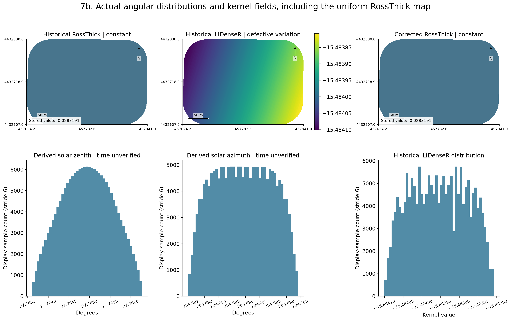

*Full-scene kernel fields use the same repaired grid as the overview. Histograms show the explicitly stride-6 positive-alpha display sample, not independent camera observations; exact full-population solar statistics and SVDs are tabulated separately. RossThick is uniform at scene zenith and zero view, so a single-value map legend replaces a continuous color bar. LiDenseR variation belongs to the defective historical implementation.*

## Act 3 — Millions of pixels, one effective angular direction

The fitted equation is R_pred = f_iso + f_vol K_Ross + f_geo K_Li. Each pixel supplies a row [1, K_Ross, K_Li]; estimating three independent coefficients requires informative independent column directions. Repeating essentially the same direction millions of times cannot supply the missing ones.

With the corrected kernels, every flight has angular rank 1 of 3 and zero supported band fits. Goldhill RossThick is constant −0.02831906 and corrected LiDenseR is constant −1 at this scene/nadir configuration. Goldhill singular values are 3760.64, 1.29e-9 and 1.69e-21; condition number 2.22e24. Tiny trailing values are rounding, not observation diversity.

The exact old implementation is retained for the artifact replay. It wrongly retains azimuth dependence at nadir, giving numerical rank 2, still short of 3 and extremely ill-conditioned. It uses relative-azimuth cosine in its geometric expression and an erroneous overlap/parameter formulation. The current repaired kernel is shown only as the identifiability comparison, never substituted into the historical reconstruction. A constant Ross column has undefined correlation with Li, rather than correlation zero.

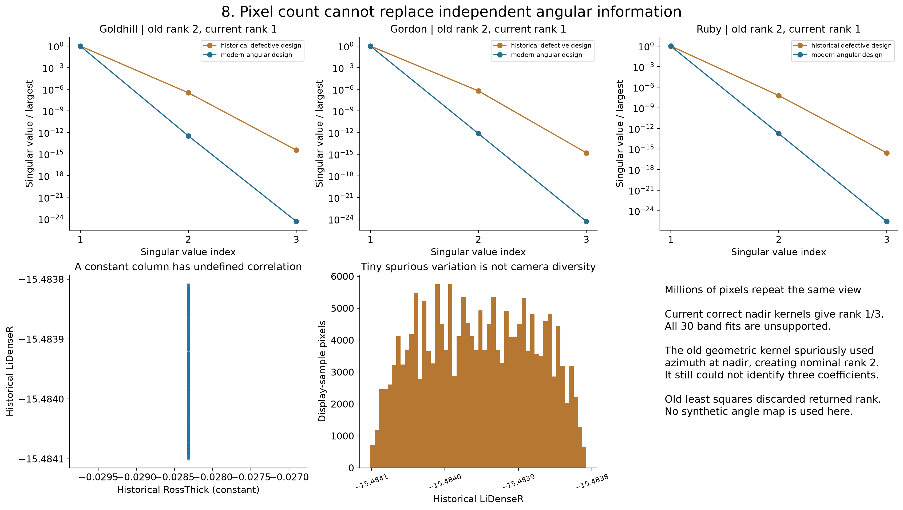

*Full native design SVD, not a sampled rank estimate. The old kernel manufactured a second numerical direction through erroneous nadir azimuth dependence; the repaired kernel is rank one. RossThick is constant, so its correlation with LiDenseR is undefined rather than zero. Tiny positive trailing singular values are numerical roundoff, not independent observations.*

## The historical fit produced large, cancelling coefficients

Historical fitting accepted source values in 0..2 while treating the range-normalized S encoding as scale one. Only 14 Goldhill 650 nm pixels and 13 green 560 nm pixels entered those fits. That selection mismatch is established numerically; it does not prove a physical reflectance divisor for the source product. Historical least squares returned rank 2 for both bands, and the workflow ignored that unsupported rank.

The saved red coefficients are f_iso=111863.5078125, f_vol=−3167.869384765625 and f_geo=7230.24609375. Reconstructing the historical eligible sample and float32 solve reproduces all seven non-neutral fitted-band coefficient vectors exactly. Bands 475, 740 and 862 have too few eligible samples and retain [1,0,0]. The 444 fit is itself rank 1.

Large terms nearly cancel at the observed geometry. At the reference geometry (solar zenith 45°, sensor zenith 0°, relative azimuth 0°), those same coefficients predict 91,740.234375 at 650 nm. This unsupported extrapolation is the correction numerator, not an observed reference measurement. Float32 cancellation quantizes the near-zero denominator; recomputing application in float64 would change the historical experiment.

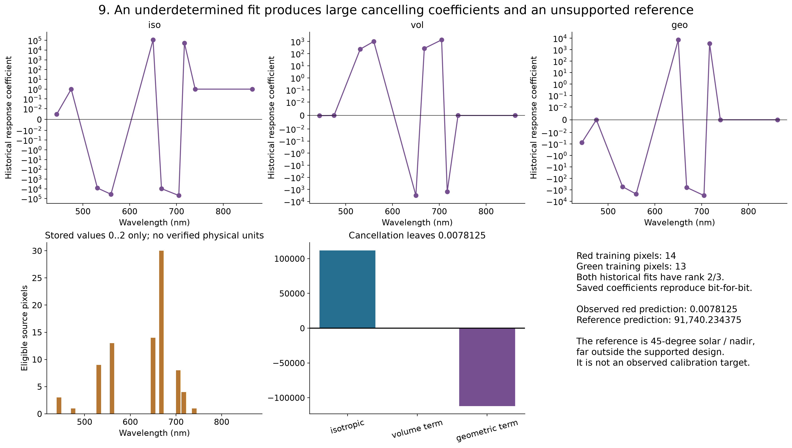

*Actual unchanged coefficient vectors. Historical fitting treated stored range-normalized numbers as scale-one unitless values and selected 0..2, leaving only 14 red and 13 green pixels. This is a numerical population mismatch, not verified physical reflectance calibration. Red/green least-squares reconstruction uses those exact source coordinates and matches saved float32 coefficients. The 650 nm reference prediction is 91,740.234375, not a measured signal.*

## Act 4 — The fitted prediction crosses zero

The historical factor is numerator/denominator only when both predicted responses are positive. Nonpositive responses take identity factor 1; nonfinite or nonpositive ratios also take identity. Unvisited NDVI bins copy the input. Small positive denominators are not guarded or capped merely because the resulting factor is enormous.

Measured output transitions and the full historical branch rule match on 2,937 native neighbor edges: Dice 1.0, zero XOR edges, maximum directed edge displacement 0 m. Restricting to visited-bin endpoints leaves 2,933 edges of the main streak, each matching the denominator-sign boundary exactly.

Four additional edges enclose a single distant cell at row 599, column 3012. Its NDVI668 equals the upper edge 1 exactly and digitization assigns an unvisited bin, leaving identity. This is a separate implementation branch, not part of the red streak. Denominator sign alone would miss these four edges. The half-cell 0.05 m zero-interpolation offset is a display convention, not surveyed boundary accuracy.

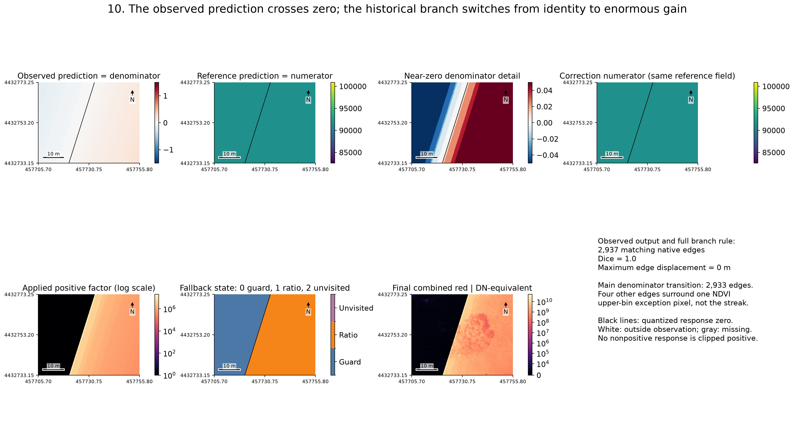

*Seven spatial fields on exactly the same native zoom. Observed response and denominator are the same quantity; reference response and numerator are the same quantity, shown explicitly rather than implying independent measurements. Signed fields use a zero-centered diverging scale. Positive factors use log color; nonpositive predictions remain visible and the fallback state is separate. Quantitative boundary comparison uses native neighbor edges, not raster color or interpolated contours.*

## One contiguous transect exposes the numerical discontinuity

The transect is contiguous row 921, not pixels sorted by a predictor. As the observed prediction reaches zero, the guard keeps the source value. One 0.1 m cell farther east the first positive prediction is 0.0078125 and the ratio is 11,742,750. The numerator is constant 91,740.234375 throughout.

Observed prediction → 0 from the positive side implies a very large ratio; observed prediction ≤0 invokes identity instead. This asymmetric rule explains the abrupt geographic contrast. Three saved transects (rows 881, 921 and 961) and the denominator-versus-factor scatter establish the same numerical mechanism without relying on RGB color.

The black map contour shows quantized prediction zero. Exact boundary testing uses neighboring native cells and the actual amplification state, excluding unsupported source background; it does not measure overlap of smoothed contours, stretched colors or hand-drawn lines.

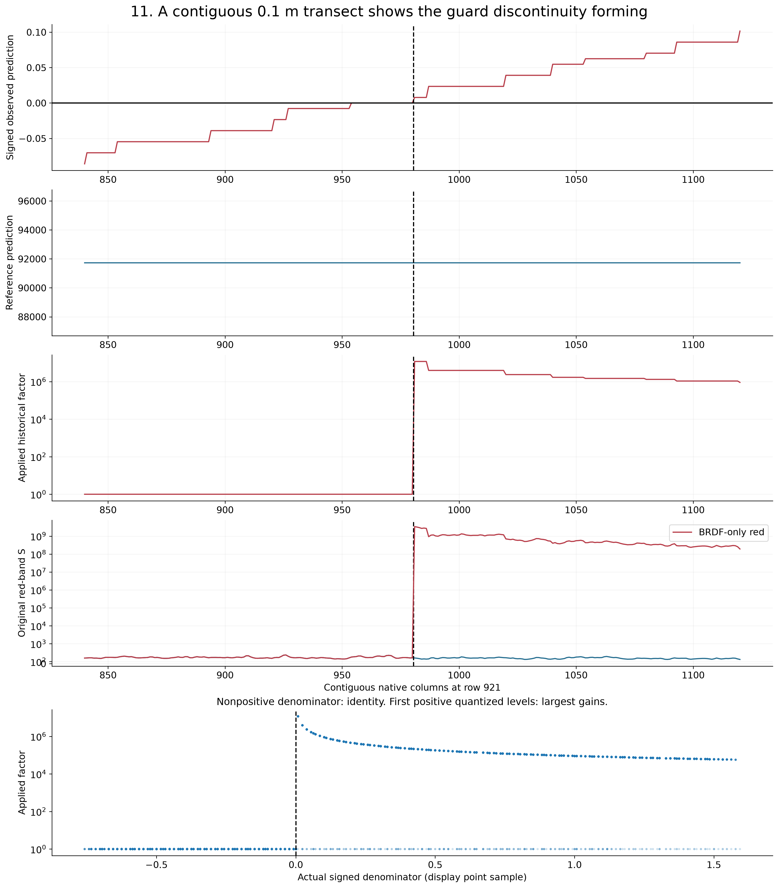

*Rows 881, 921 and 961 are available in the CSV; the main plot is actual contiguous row 921. The two neighboring cells 980/981 go from denominator 0 to 0.0078125 and factor 1 to 11,742,750. The reference prediction stays 91,740.234375. Signed predictions use linear or symlog axes, positive factors use log. The scatter is a deterministic display sample only; all metrics are full native arrays.*

## The failure is wavelength dependent

Goldhill 650 nm reaches factor 11,742,750. The 717 nm red-edge band also reaches about 115,554.3; therefore the failure is not unique to the visible red band. At 531, 560, 668 and 705 nm, negative reference predictions force identity throughout the finite population. 475, 740 and 862 are initialized neutral; 444 follows an attenuating response.

The wavelength-by-position heatmaps show the actual discontinuity and relative spectral damage along the same transect. Full coefficient vectors, predicted ranges, factor quantiles, nonpositive fractions, extreme-gain fractions, fallback/visit counts and raw/combined signal ranges are supplied for every band of all three flights in band_diagnostics.json and its compact CSV.

Red appearance is a combination of band-specific model behavior and RGB selection/scaling. Fixed scales demonstrate magnitude differences; independent stretches reveal structure but cannot compare radiometry. The default generic 668 RGB omits both severely amplified bands and can conceal the failure entirely.

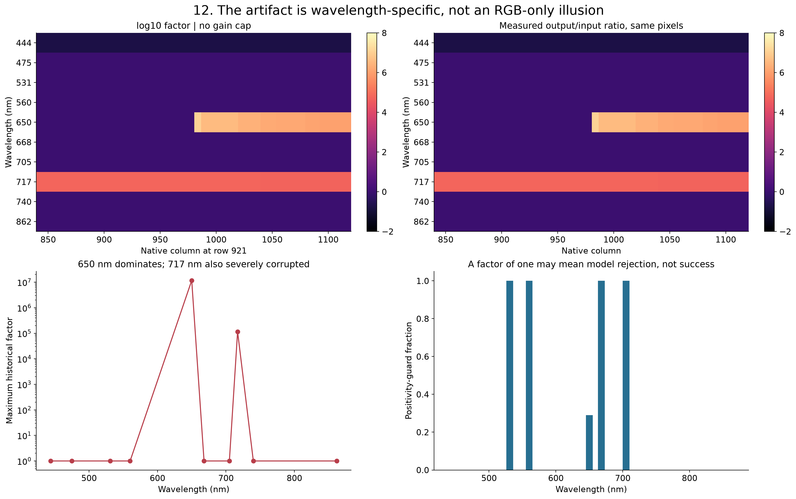

*All ten actual bands. 650 nm reaches 11.74 million gain; 717 nm reaches about 115,554. Green 560 and red 668 have negative reference predictions and fall back everywhere. 475 is initialized neutral. The default 668/560/475 RGB therefore hides the 650/717 corruption. Named blue 444 follows a separate loss response. Full per-band ranges, quantiles, masks, coefficients and fractions are in band_diagnostics.json.*

## A separate instability in topographic correction

Stage isolation identifies BRDF as the generator of the red boundary, while topographic correction has an independent denominator problem. At Goldhill 531 nm the historical SCS+C fit gives C=−0.2111247268. Its factor reaches 356.552704 and reproduces the cached topographic-only band bit-for-bit.

F_topo = [cos(solar zenith) cos(slope) + C] / [cos(i) + C], with the historical 0.001 denominator guard. Cancellation in cos(i)+C produces extreme topographic factors. This denominator is illumination plus fitted C; the BRDF denominator is a fitted directional response. Neither instability establishes the validity of the other correction.

The figure marks gains above 10 only as a descriptive diagnostic, never an acceptance threshold or clipping rule. Topographic-only results remain unapproved. A metadata repair or the removal of the BRDF streak would not, by itself, validate SCS+C radiometry.

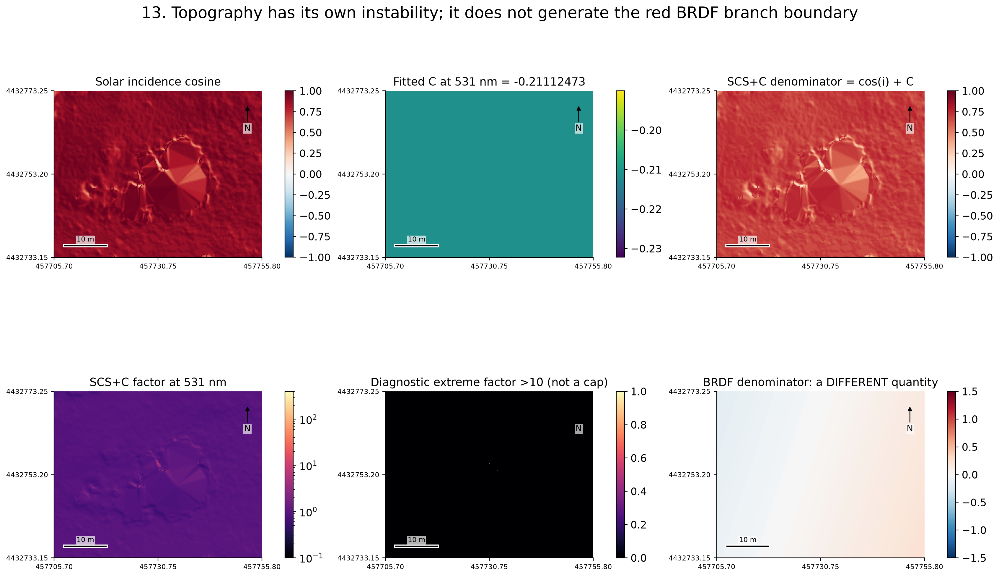

*Actual historical normalized-source 531 nm C=-0.21112473. Full-scene ratio reproduces cached topographic values bit-for-bit and reaches 356.55. The SCS+C near-zero denominator is cos(i)+C with guard 0.001; the BRDF denominator is the fitted directional response. They are different mechanisms. Threshold >10 is descriptive, never clipping or a scientific acceptance criterion. Topographic outputs remain unapproved.*

## Act 5 — The vegetation is unchanged; its spectrum is corrupted

The exemplar is researcher-labeled Deciduous, species Populus tremuloides, GlobalID {3A6D6E1D-3581-49B8-9321-397DFE5298C5}. Its 6,089 common observed pixels are the same in every stage. It was selected as the nearest eligible boundary-crossing polygon to the prior transect, requiring both branch states and at least 20 pixels, not selected because a correction improved its signature.

Its original median 650 nm S is 113.4245, rising to about 286.85 million under BRDF. Its median spectrum rotates 84.72° away from raw. NDVI using 650 nm changes from 0.8444 to approximately −0.999992; the 668 nm NDVI remains 0.8623 under BRDF-only because those constituent bands are neutral. A stable index can therefore coexist with severe spectral corruption.

Raw median within-polygon spectral angle is 3.03°, but BRDF-only dispersion about the altered median is 1.89°. That smaller number does not mean better calibration: the spectrum has collapsed toward artificial 650/717 dominance. Shading is the within-polygon pixel IQR, not an independent-plant confidence interval. The vegetation and acquisition are unchanged.

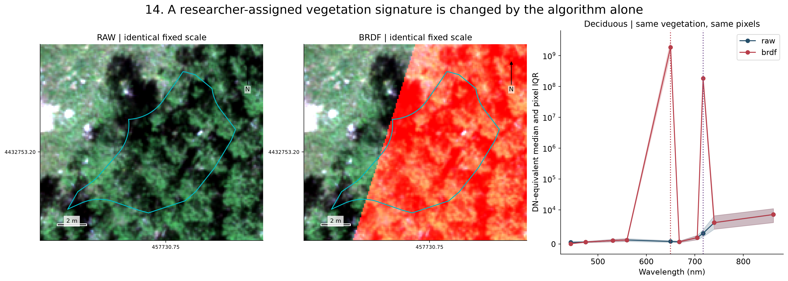

*Source and BRDF-only show the same Deciduous polygon, source grid and acquisition. No biological change occurred between panels. The curve uses common retained source-alpha-positive pixels; shading is their within-polygon IQR, not a confidence interval from independent plants. The 650 and 717 nm bands acquire artificial dominance. PFT label and GlobalID are preserved exactly.*

## The distortion propagates into researcher-assigned PFT signatures

All 157 Goldhill polygon identities use the same four-stage intersection: 144,411 positive-source-alpha pixel memberships per stage. These are memberships, not necessarily unique independent pixels. The source-alpha-positive raw membership count is 144,458; 47 memberships are lost to the common finite-stage requirement. No H5 mask or polygon geometry was rewritten.

Each polygon contributes one median spectrum. Deciduous, Evergreen, Herbaceous and Woody shrub are the actual Goldhill labels. No non-vegetated/dead polygon lies on this Goldhill footprint; source categories and their Gordon/Ruby context are preserved rather than inventing Goldhill examples. The supplied polygon file is the analysis-ready half-diameter file; no full-diameter dataset is asserted.

polygon_stage_spectra.csv reports within-polygon variance/CV, spectral angles, invalid counts, extreme-gain fractions and index changes. between_PFT_distortion.csv reports descriptive class-median angles, standardized differences and IQR overlap for groups with at least five polygons. These are distortion diagnostics, not new classification accuracy, independent pixel replicates, or evidence that reduced dispersion improves reflectance calibration.

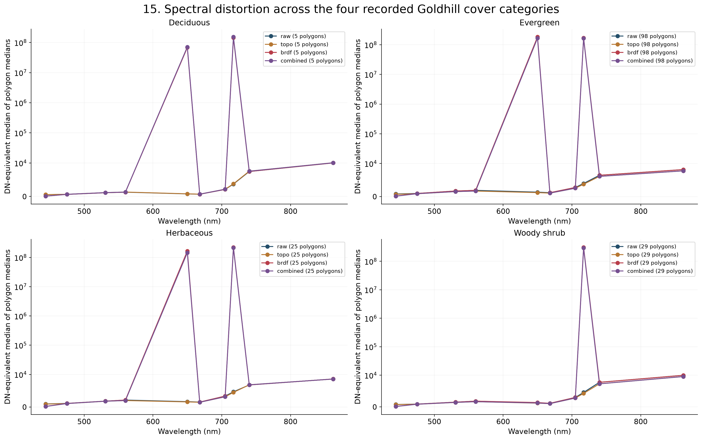

*One polygon median per identity, with exactly the same pixels compared across all stages. All 157 Goldhill polygons and 144,411 common memberships are retained. Goldhill has no non-vegetated/dead polygons on this footprint; that category remains present in the source and Gordon/Ruby comparisons, not invented for Goldhill. Descriptive within-polygon variability, spectral angles, index changes and between-PFT overlap are separate tables, not classification accuracy or correction efficacy.*

## Gordon and Ruby: no visible red streak does not mean valid correction

All three flights have the same missing-camera-information problem and rank 1/3 under corrected kernels. Their historical coefficient vectors and reference predictions differ, so the visible consequences differ. Gordon has large gains in other bands, including about 58,658 at 444 nm and 65,627 at 475 nm. Ruby mainly attenuates signal or follows identity guards; its 650 and 668 reference predictions are negative.

The comparison maps use the same columns and a shared red-factor scale, with fixed source-derived RGB limits within each flight. Those per-flight display limits do not imply calibrated cross-flight equivalence. An observed-negative mask is not the entire guard: a negative reference prediction can force identity even where the observed prediction is positive.

Goldhill reuses cached stages with fresh exact replay validation. Gordon/Ruby stages were isolated diagnostic replays from unchanged working inputs and recovered saved models, with all-band formula agreement; they were not freshly compared byte-for-byte to unavailable original corrected production rasters. Their lack of the Goldhill red streak cannot validate their correction.

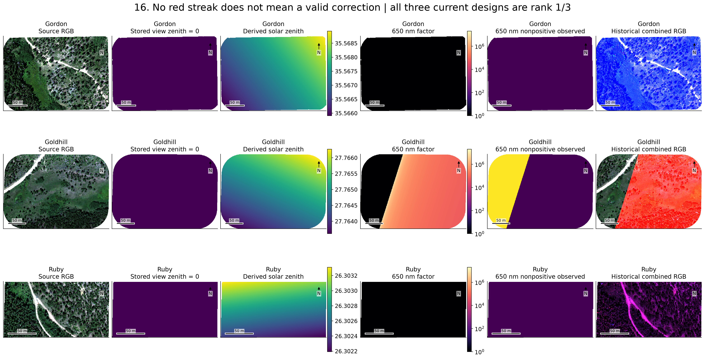

*Columns are matched across flights; RGB uses a fixed source scale within each flight, explicitly not a claim of calibrated cross-flight equivalence. 650 nm factors share a log scale from 1 to 20 million. In the observed-nonpositive mask, purple is false and yellow is true. Gordon has large gains in other bands (notably 444/475), while Ruby mainly loses signal or takes neutral guards. Negative reference predictions can force identity even when observed predictions are positive, so the full guard fractions must be read alongside the observed-negative mask. Every fit remains unsupported under the current corrected kernels.*

## Act 6 — Resolution: direct answers

Why did the red artifact appear? A rank-deficient fit to a tiny, encoding-mismatched eligible population produced large cancelling coefficients. The defective historical kernel and unsupported reference extrapolation made the observed 650 nm prediction cross zero. The guard assigned identity at nonpositive predictions but enormous ratios just above zero.

Why at that geographic location? The actual smooth, derived solar-azimuth grid drives the old kernel's spurious nadir dependence. Its fitted denominator sign transition matches all 2,933 main-streak native edges exactly. A separate unvisited NDVI upper-edge cell contributes four other edges.

Why red? At diagnostic red 650 nm the gain reaches 11.74 million while green 560 and blue 475 remain identity. The 717 nm band is also badly amplified. Default generic 668/560/475 RGB omits both damaged bands, so visibility depends on the actual band mapping and stretch.

Why did millions of pixels not solve it? They repeat effectively one angular direction. Corrected-kernel rank is 1/3 for Gordon, Goldhill and Ruby, with zero supported band fits. Spatial sample count cannot identify three angular coefficients without independent directional information.

Was drone wobble or a serpentine flight path responsible? Neither is required to generate this boundary: the exact downstream replay creates it from the same source. Real acquisition effects may exist in the original mosaic, but source-photo contributors, camera rays and directional radiometry have not been recovered, so their contribution cannot be assigned here.

Could Metashape have prevented it? Reports establish camera alignment and geometric calibration in Metashape 1.8.3. Orthomosaic TIFF/H5 conversion did not retain usable per-pixel source-photo camera rays and inserted zero views. Saving calibrated poses, contributing-image identities/blend weights, surfaces and verified timing would support a future reconstruction; geometric photogrammetry alone does not guarantee valid BRDF radiometry.

Would assuming another viewing angle fix it? A constant 5°, 10° or other angle supplies no independent angular diversity. P164 found zero of 93 constant-relative-angle cases passing angular conditioning. Synthetic spatial fields can manufacture rank without recovering measured observations. Neither is scientific evidence for a correction.

What is the justified current solution? Reject unsupported BRDF fits using the current gates, retain explicit uncorrected/unapproved status, and resolve source calibration, alpha eligibility, real viewing geometry and acquisition time. Future correction needs actual directional observations or independently validated, wavelength/kernel/reference-compatible external evidence. Do not cap gains, relabel placeholders or regenerate libraries as a substitute.

## Methods and reproducibility appendix

Repository snapshot: 577e619e28c797839cad88144699c65584b04dfb, with pre-existing working-tree investigations preserved. Pinned historical corrections: 1cb2cf3a6c34e6665f0c5b1661724428f46f80ea; SHA256 839cdf2b7264c5af53902c08994144c776f94f5a59f31dc42bd1574002998a42. Saved production QA records revision ecd0df27dc98ebe30e40bfad0e7d7e7c9d28b563. Full paths and SHA256 identities are in provenance.json and preservation.json; all protected sources are hash-checked before and after.

Goldhill array order is row,column,band, shape 2238×3165×10; Gordon 2088×2948×10; Ruby shapes are recorded in flight_comparison.json. Bands are 444,475,531,560,650,668,705,717,740,862 nm. Historical RossThick/LiDenseR uses b/r=10, h/b=2, scene zenith, reference 45°/0°/0°, one saved NDVI bin [−1,1], binning disabled. Historical fitting uses raw S; historical combined application applies that saved model to topographic output. This old fit/application distinction is preserved.

Exact equality means zero float32 value and mask mismatches, not a loose relative tolerance. Model coefficients are unchanged. Full finite-H5 prediction counts include historical background; displays and paired polygon analysis additionally require positive original source alpha and common finite stage support. This analytical filter does not modify source masks. White is outside observation; gray is missing retained stage data. No physical calibration, surveyed absolute location accuracy, or independent-camera count is inferred.

Run analyze.py using the repo scientific environment, then export_zoom.py, figures.py, write_report.py, make_pdf.py and verify.py. Large sources/cached stages remain external and immutable; their exact paths and hashes plus Data Store identity are recorded. Missing external inputs must be restored at those identities before full replay. Compact NPZs, copied diagnostic model JSONs, CSV/JSON tables and PNG/SVG figures support report regeneration without production writes. See reproducibility.md for commands and earlier evidence links.

Prior evidence: Goldhill stage isolation (2026-10-30); drone radiometric recovery and BRDF strategy (2026-11-02); P162 photogrammetry metadata investigation; P164 assumed viewing angles (2026-11-03). These local source reports, scripts and exact-array checks ground the causal claims. No new empirical calibration or literature-derived coefficient set was introduced.

### Goldhill saved model and measured application

| nm | eligible | fit rank | iso | vol | geo | reference prediction | maximum factor |
|---:|---:|---:|---:|---:|---:|---:|---:|
| 444 | 3 | 1 | 0.00482963352 | -0.000136770686 | -0.0747813135 | 0.214470401 | 1 |
| 475 | 1 | neutral | 1 | 0 | 0 | 1 | 1 |
| 531 | 9 | 2 | -8245.59082 | 233.507385 | -533.03125 | -6762.05273 | 1 |
| 560 | 13 | 2 | -35706.1484 | 1011.16455 | -2307.92554 | -29282.7148 | 1 |
| 650 | 14 | 2 | 111863.508 | -3167.86938 | 7230.24609 | 91740.2344 | 11742750 |
| 668 | 30 | 2 | -9508.18262 | 269.262787 | -614.615417 | -7797.57959 | 1 |
| 705 | 8 | 2 | -48316.5156 | 1368.27832 | -3122.98779 | -39624.5938 | 1 |
| 717 | 4 | 2 | 53938.5664 | -1527.4895 | 3486.24609 | 44235.625 | 115554.289 |
| 740 | 1 | neutral | 1 | 0 | 0 | 1 | 1 |
| 862 | 0 | neutral | 1 | 0 | 0 | 1 | 1 |

Full precision and populations: [band diagnostics](band_diagnostics.json), [fit reconstruction](historical_fit_reconstruction.json), [boundary proof](boundary_correspondence.json), [pixel trajectories](pixel_trajectories.csv), [polygon spectra](polygon_stage_spectra.csv), [preservation](preservation.json).
