# From H5 to Original Photographs: How Much Complexity Does a Reliable Drone Pipeline Need?

SpectralBridge architecture and simplification study · P186 · 6 November 2026

## 1. Executive summary

**Build a verified calibrated-data core, then add information only when a specific scientific limitation requires it.** A correctly described H5 or orthomosaic can support calibrated polygon extraction without Metashape or original photographs. Both topographic and BRDF correction remain intended scientific stages; neither becomes valid merely because an input file exists. Unsupported correction must remain explicit and must not be reported as successful identity correction.

The largest historical improvements were software repairs: georeferencing, radiometric interpretation, wavelength identity and numerical safeguards. Recovering larger source archives helped establish those facts, but future users should receive the repaired behavior without repeating the investigation. This task integrates verified source-encoding recognition into the actual production TIFF/H5 boundary, protects it with a real Ruby crop and end-to-end tests, and documents the contract. It does not change shared Ross/Li or SCS+C equations.

The strongest information simplification is **271,299 bytes of compact repeated observations replacing 5,590,183,604 bytes of sampled photographs for BRDF refitting**: about 20,605 times smaller. Ten-band coefficients agree with P184 to a maximum absolute difference of **6.44 × 10⁻⁷**. Read plus ten-band fitting took **0.398 seconds** on this Mac. This preserves the existing experiment's information, not independent physical validation. On 600 identical held-out target-band cases, median absolute variance ratio is **0.766**, while its mean is **1.158**; median CV² ratio is **0.838**, mean **1.132**. Typical improvement coexists with substantial failures.

Aggressive reduction is premature. Nested selection chose eight-target designs, but their outer-held-out mean CV² ratio rose to **1.343**, and **10/40** band/fold uncertainty checks failed versus **0/40** for the full packet. Retaining a 271 KB packet is a better default than declaring a universal minimum of eight targets.

A **66,716-byte public elevation crop** was cheap to obtain and useful for a terrain sensitivity check. It did not resolve Ruby's negative-C identification problem. Same-flight original photos mainly add viewing diversity, not new independent illumination; a different-Sun repeat can be more useful than recovering more photos from the same flight. **No full combined original-photo corrected mosaic was produced or approved**, so no numerical L5 mosaic-accuracy gain is claimed.

## 2. How the drone pipeline evolved

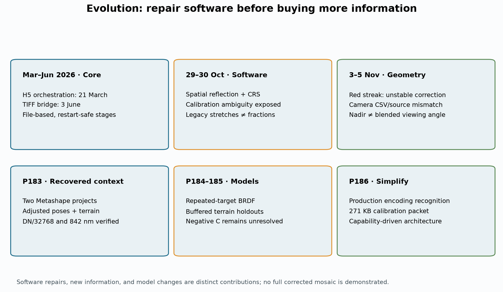

The Git history starts with the H5 drone pipeline on **21 March 2026**, commit `0198215`, and adds TIFF-to-H5 support on **3 June**, `5e88b8c`. The October–November investigations therefore extend an existing file-based system. The complete relevant commit listing is [git_drone_history.txt](git_drone_history.txt); report locations, hashes and excerpts are in [history_sources.json](history_sources.json).

| Investigation | Software correction | New information | Model/interpretation contribution |
| --- | --- | --- | --- |
| 29 October spatial integrity | Correct corner/center interpretation, y direction and CRS provenance | Paired original TIFF/H5 control points | Separate a reflected footprint from an ordinary translation |
| 30 October radiometry/BRDF audit | Shared scaling/export and kernel/eligibility defects audited; earlier AOP scaling rollback identified | Export histories and conversion records | Distinguish missing calibration from numerical instability |
| 3–4 November red-artifact investigations | Guard against unstable correction factors; distinguish clean source from processed stripe | Clean-source comparison and edge diagnostics | Red artifact is not established as a raw-image seam |
| Three-site camera rerun/stability | Input binding and unit checks | Camera tables, terrain and solar context | Actual metadata does not automatically make both corrections identifiable |
| P183 Metashape recovery | Resolve wavelength and export representation; identify wrong Goldhill project binding | Adjusted poses, intrinsics, panels, source assignment, terrain | Primary source is not effective blend geometry |
| P184 Ruby original photos | Exact ECEF/bilinear ray intersection; timestamp-unit diagnostic repaired | Repeated calibrated observations | Target-aware BRDF and conditional spatial/temporal validation |
| P185 Ruby topography | Experimental guard repaired to reject both-negative branches | Ground-classification/mesh/DTM context, field cover | Confounding and illumination limitation remain despite more views |
| P186 | Permanent typed production radiometry recognition | Compact packet and small public DEM comparison | Nested design comparison; capability-based architecture |

The spatial audit compared actual paired sources, with zero reported stored-value mismatches across their ten bands. Maximum legacy control displacement was approximately **447.50 m Goldhill, 417.50 m Gordon and 206.90 m Ruby**. These were metadata/software effects, not benefits of a better BRDF model. The historical positive-y export reflected locations about the top edge and could move the footprint outside the actual source; it was not simply a within-image vertical flip.

Original legacy H5 paths recorded in that audit are **not present now**. Three available November-4 H5 files were inspected, but they are later TIFF-derived working products, not the original baseline. [actual_h5_inventory.json](actual_h5_inventory.json) explicitly distinguishes these roles. We reuse the preserved paired audit and source replay instead of pretending a new full L0 processing run was executed.

P183's earlier blanket temporal-insufficiency diagnosis was partly a timestamp-unit bug: integer microseconds had been treated as nanoseconds. The corrected grouping finds usable calendar-minute structure in several earlier fits. This is a software repair, not new solar evidence. P185 also found a research guard that could accept a positive ratio of two negative SCS+C branches. Strict positive numerator/denominator support rejects that branch, matching production safeguards; it does not repair physical confounding.

## 3. What was actually broken

Three categories should stay separate throughout architecture decisions.

**Software defects:** wrong spatial interpretation, unjustified physical scaling, 862 nm metadata for a verified 842 nm source, timestamp units, and an experimental numerical-domain check. These can be repaired once and protected by tests. A project archive may establish the right interpretation, but it should not remain a routine dependency afterward.

**Missing information:** some H5 files do not establish calibrated radiometry, appropriate ground terrain, trustworthy solar time, actual view rays or blend weights. A different reader cannot recover absent measurements. Goldhill's old camera table matched the NOGCPS project, while its original mosaic matched WORKING; the recovered mismatch included about **19.23 m vertically** and **1.6 m east / −1.75 m north**. Correct units alone cannot fix wrong source identity.

**Physical/model limitations:** a single flight provides correlated surface brightness, terrain illumination, shadows and angular effects. Negative C can reflect that confounding. More equations or more same-flight samples need not identify an independent topographic response. P185's 660 synthetic cases recovered the expected positive C under homogeneous controls and produced negative estimates under plausible brightness/shadow confounding, without a shared formula/unit defect.

The Goldhill historical red gain boundary was not explained simply by primary-camera seams: among **528** inspected gain-edge cases, only **two** changed primary assignment. This does not rule out blending effects; it rules out treating every primary switch as the cause. Gordon lacks the recovered project/source evidence needed to inherit Ruby/Goldhill calibration conclusions automatically.

## 4. What additional information bought us

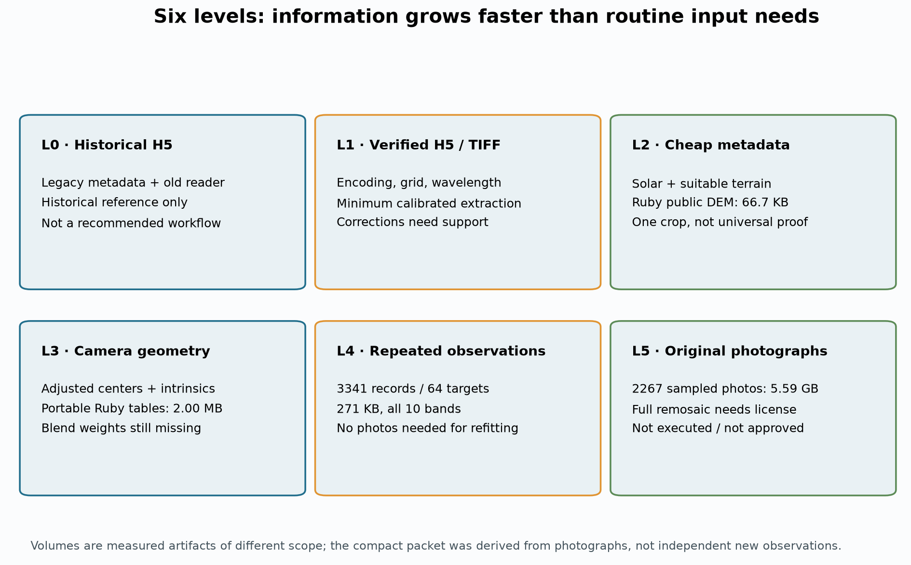

The levels describe available information, not six guaranteed successful correction products. Entries below compare only what was measured. A dash denotes an unmeasured increment, not zero benefit.

| Level and inputs | Spatial/radiometric value | Topographic value | BRDF and spectral-library value | Additional measured cost |
| --- | --- | --- | --- | --- |
| L0 historical H5 + old behavior | Historical displacements up to 447.5 m; physical encoding often ambiguous | Historical unstable/unsupported outputs | No defensible reference-quality corrected library | Existing files; original temporary sources now absent |
| L1 H5/TIFF with verified grid, wavelength and affine | Correct interpretation without recovering photos again; exact affine/golden roundtrip | Only if terrain/Sun and model support exist | Calibrated raw polygon extraction; corrections still gated | Existing raster plus small contract/sidecar |
| L2 suitable external metadata | No independent new radiometric truth | Ruby public DEM red C −0.473; holdout CV² mean 0.984 on its supported subset | Nominal view requires an explicit tested approximation | 66,716-byte DEM crop, plus documented metadata |
| L3 adjusted camera geometry | Source identity/coordinate reconciliation; no ground-control accuracy established here | Better viewing/terrain distinction, no new Sun diversity | Nadir separation median 16.97° Ruby /14.72° Goldhill; effective blend still unknown | Ruby portable camera/calibration tables 2,003,728 bytes; surfaces extra |
| L4 compact repeated-target packet | Preserves verified source representation/provenance | Extra same-flight views did not solve C | Ten-band fit coefficient difference <6.44e−7; 600-case median CV² 0.838, mean 1.132 | 271,299 bytes; 0.398 s read + fit |
| L5 photos + complete project + licensed reconstruction | Source-pixel calibration and exact rays demonstrated internally | Source-first interfaces investigated, joint correction unsupported | No executed full corrected mosaic; no incremental mosaic-accuracy estimate | 2267 sampled photos /5.59 GB; remote two-site inventory 96.11 GB |

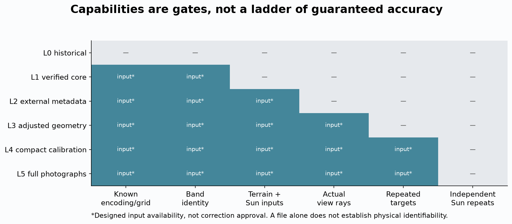

The first two columns in Figure 3 describe the **verified** L1 input contract; an arbitrary file named H5 is not L1. External metadata can be present yet fail suitability checks. Independent illumination is not supplied by moving to L5 within the same flight. Fields, dimensions and provenance from actual available H5 files are recorded rather than assumed common.

There is no fair six-row absolute-accuracy ranking: L0 lacks present original files; L3 cannot unmix mosaic blend observations; L4 validates conditional repeated-target consistency; L5 reconstruction was not executed. The table preserves these different evidence scopes.

## 5. How much did spectral quality improve?

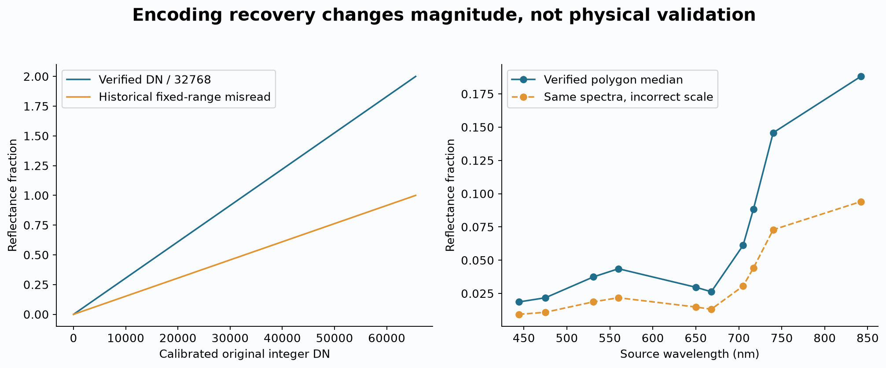

For the verified calibrated Ruby/Goldhill export, `ρ = DN/32768`. The historical **fixed-range** conversion stored `S = DN × 10000/65535`; interpreting `S/10000` gives only **0.50000763** of the correct fraction, an approximately **50% magnitude error**. This uniform factor leaves spectral angles and NDVI almost unchanged. Earlier per-band min/max stretches are distinct and require their actual offsets as well as scales. Neither convention follows merely from observing a 0–10,000 range.

The controlled polygon experiment uses the same Ruby calibrated 10 cm raster, wavelengths, **86 half-diameter field polygons** and **22,506 polygon-assigned pixel spectra** on the common finite intersection of native and reflected rasters. Overlapping field polygons are raster-assigned deterministically, not counted as independent replicated pixels. Field cover labels are research-assigned; automatically inferred classes are not used as validation truth.

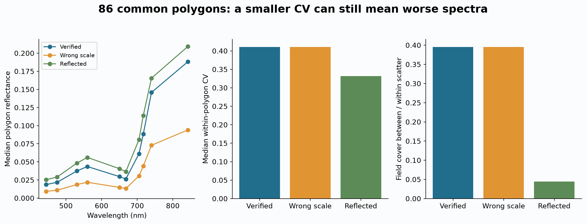

| Common-support control | Median within-polygon band CV | Median angle from calibrated spectrum | Median absolute NDVI difference | Field-cover between/within scatter |
| --- | --- | --- | --- | --- |
| Verified calibrated raw input | 0.410877 | 0° | 0 | 0.395636 |
| Fixed-range values misread as /10000 | 0.410877 | approximately 0° | 5.96e−8 | 0.395636 |
| Controlled within-footprint vertical reflection | 0.331452 | 10.0759° | 0.149734 | 0.044685 |

The reflection control yields a *lower* within-polygon CV while reducing descriptive field-cover separation about **8.85 times**. Smooth, homogeneous spectra can belong to the wrong location. This controlled reflection is **not** a replay of the historical positive-y, out-of-footprint affine defect. Both are spatial problems, but their pixel populations differ.

Mean absolute polygon reflectance error is **0.034331** for the wrong scale and **0.045696** for the controlled reflection. These are differences from verified calibrated raw spectra, not errors against independent physical reflectance measurements. Cover scatter is descriptive, not cross-validated PFT classification accuracy. Polygon retention is 86/86 under the common control; the available comparison cannot establish a corrected-library improvement for L3–L5 because those approved complete corrected products do not exist. Finite negative corrected reflectance must not be reclassified as nodata merely to make plots look cleaner.

## 6. How much complexity did we add?

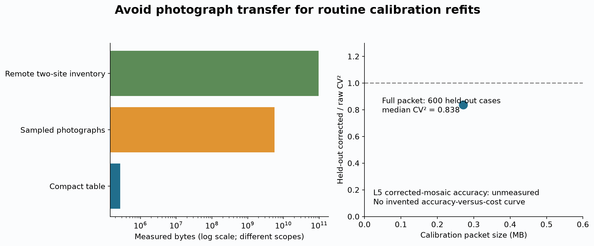

The remote Ruby/Goldhill inventory contains **11,665 unique objects in 121 collections, 96,106,111,162 bytes**. This is discovered archive size, not a claim that all bytes were transferred. Gordon's new project was not recovered. The sampled-photo experiment used 2267 unique photos, 5.59 GB; calibration packets greatly reduce subsequent transfer and fitting costs but do not erase the original effort required to create them.

Measured P184 completed-stage timings include 34.11 s sampling and 5.05 s analysis, excluding earlier transfers, source recovery and manual investigation. P185 full-frame calculation took 19.51 s on its existing prepared arrays. The new nested compact experiment took **65.37 s**, with peak process RSS **281.69 MB**, including libraries. These are different workloads on this Mac, not comparable end-to-end cloud benchmarks. Read-plus-ten-band compact fitting is 0.398 s; it excludes packet creation and bootstrap/nested evaluation.

No meaningful common transfer-time or manual-hours measurement was recorded, so no universal bandwidth or labor estimate is supplied. Full source-image mosaic generation also needs a licensed executable path and output validation; its runtime/memory/storage are **unmeasured**. The official Metashape API was used read-only for recovery, with no project save. This distinction matters more operationally than a guessed L5 runtime.

Minimum routine files should be one immutable calibrated raster/H5, a verifiable contract, and requested polygons; corrections add suitable scientific inputs. Compact checkpoints and manifests should scale with flightlines, models and validation summaries. Do not add a normal pixel-scale cache or merge pipeline state into an enormous dependency graph. The source rasters remain the authority.

## 7. Which assumptions are safe?

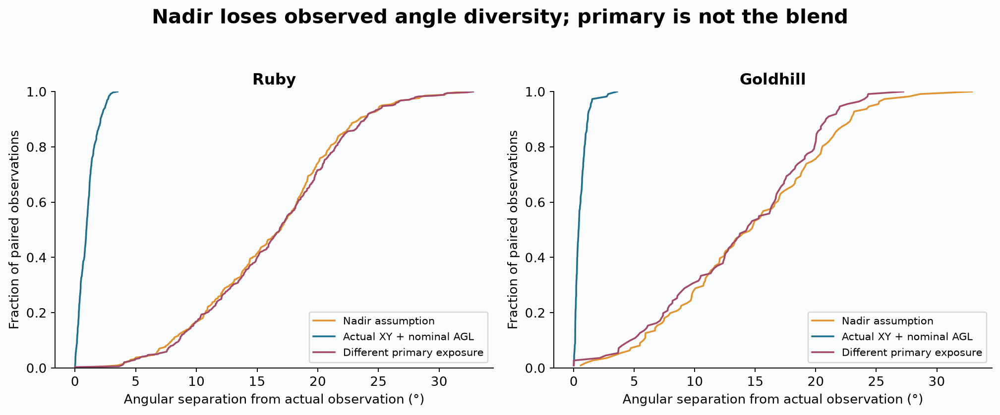

The paired geometry study uses **341 Ruby** and **111 Goldhill** red-band observations at known tracked ground points. Goldhill is an overlap-enriched historical sample, not a representative census. Adjusted reconstruction rays are an internal reference, not independent field geolocation truth.

| Approximation | Ruby median / maximum angular separation | Goldhill median / maximum |
| --- | --- | --- |
| Nadir | 16.970° /32.769° | 14.723° /32.909° |
| Actual camera XY + nominal median height above ground | 0.939° /3.509° | 0.410° /3.585° |
| Primary-source view compared with each repeated observation | 16.848° /32.807° | 14.324° /27.241° |

Actual XY plus nominal height is a promising low-cost approximation **once the correct camera and ground position are known**. It is not an H5-only substitute for missing positions/source assignments. At a known ground point, a camera-center vector defines view direction; camera orientation is essential when mapping an image pixel to that ground point. The nominal-nadir-pose tangent-plane diagnostic is explicitly geometric sensitivity, not an observed ground displacement.

The primary-source comparison measures different exposures. It does **not** show that the primary-camera metadata is erroneous. Blending combines unknown contributions; primary selection is not the effective angular observation. Missing blend weights block direct transfer of a source-photo normalization to a whole mosaic.

Other defensible routine choices are an explicit scalar/per-band affine with provenance, documented source wavelengths, corner-based georeferencing and immutable calibrated stored values. They are contracts rather than approximations. A coarse terrain surface may be more appropriate for ground illumination than a detailed canopy surface, but suitability must be tested on the actual site.

## 8. When do those assumptions fail?

Measurable warning conditions include large angle differences, off-nadir/edge observations, strong relief relative to altitude, weak Ross/Li rank or conditioning, extrapolated reference kernels, uncertainty intervals crossing invalid factor branches, poor held-out consistency, unknown mosaic blending, mismatched camera/source projects, shadows and support restricted to a small spectral subset. No universal safe nadir-angle threshold was established. Use the kernel/factor error under the actual fitted model and observed validation population, with declared tolerances.

### Terrain and illumination

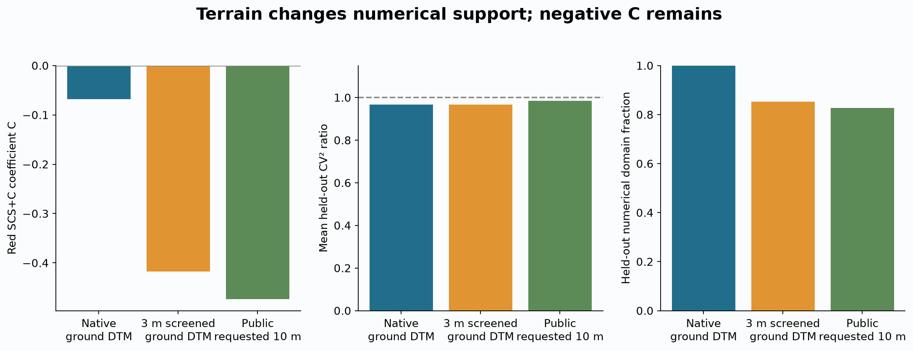

P185 distinguished a native viewing surface with roughly 35° slopes from a ground DTM around 18°. Its 3 m screened ground-DTM red SCS+C setting supported **76.2458%** of the full valid 10 cm source after its declared shadow/domain rules, with gains **0.622744–2.799237**, uncapped. Native-baseline support was about 83.5%, with much wider gains **0.146–6.593**. These settings do not share identical support and should not be interpreted as an accuracy ranking.

P186 tests a small public [USGS 3DEP dynamic bare-earth service](https://elevation.nationalmap.gov/arcgis/rest/services/3DEPElevation/ImageServer). It requests a 40×30 grid at 10 m in EPSG:26913. The dynamic service uses mixed-resolution sources; requested resolution is not a certified source vintage or uniform native resolution. Service metadata, exact URL, bytes and checksum are preserved in [external_dem_provenance.json](external_dem_provenance.json). Vertical datum agreement was not independently reconciled; no fitted vertical offset was applied.

All three P186 terrain models fit the same **13,797** eligible training-grid points, excluding spectral-dark/field buffers and requiring positive incidence and slope ≥5° in every terrain. Red C is **−0.06837 native ground DTM, −0.41717 3 m terrain, −0.47319 public DEM**. The full-fit numerical-domain fractions (about 99.8–100%) omit geometric cast-shadow approval and are not comparable with P185's full-resolution screened percentage.

Four geographic-quadrant holdouts give mean supported-subset CV² ratios **0.96707 native, 0.96724 3 m, 0.98377 public** across 40 band/fold cases each. Held-out numerical-domain coverage is approximately **99.94%, 85.27%, 82.66%**, respectively. These means use each model's own supported cases; the underlying eligible held-out population is shared, but unsupported predictions are retained as coverage loss rather than silently removed from a common-accuracy claim. Spatial CV changes mix surface heterogeneity and illumination and are not same-target reflectance truth. There is no independent test that the public DEM is sufficient for most applications.

P185's stricter matched original-photo experiment evaluated **328 identical target-band-fold cases**: mean CV² ratios **1.0514 SCS+C, 1.0512 C-correction, 1.03195 Minnaert** (medians about .868, .866, .859). All 80 canopy SCS+C class fits remained unsupported. More same-flight views did not solve the illumination problem. Independent Sun conditions and ground/reflectance checks should be requested before another large same-flight source recovery campaign. Two additional Sun conditions would permit an illumination holdout; adequacy remains to be tested rather than assumed.

## 9. The recommended out-of-the-box pipeline

Accept a correctly described local H5 or calibrated orthomosaic. Inspect encoding, source identity, wavelength, transform/CRS, validity, solar, terrain and viewing metadata before requesting expensive work. Reuse valid outputs via existing checkpoint contracts. Preserve source files and report failures at the narrowest responsible stage.

For calibrated raw extraction, require verified radiometry, valid spatial/band metadata and polygons in a known CRS. Return native physical-reflectance polygon Parquet with QA and provenance. Explicit raw diagnostic extraction is distinct from a completed corrected workflow.

For the intended corrected workflow, require **both** correction stages to meet their own scientific conditions: suitable terrain/Sun and identifiable supported topographic factors; actual or validated viewing approximation, sufficient angular information, supported reference and stable BRDF factors; joint supported pixels/bands. Missing or invalid support must block claiming a combined corrected product. A user explicitly disabling a stage may obtain a clearly labeled diagnostic, not automatic scientific success.

Do not ask users to choose a historical scaling factor by memory. Verified known products resolve automatically; unknown files request provenance, not guesswork. Do not require Metashape solely to decode already-established source representations.

## 10. Optional enhancements

### Compact original-photo calibration

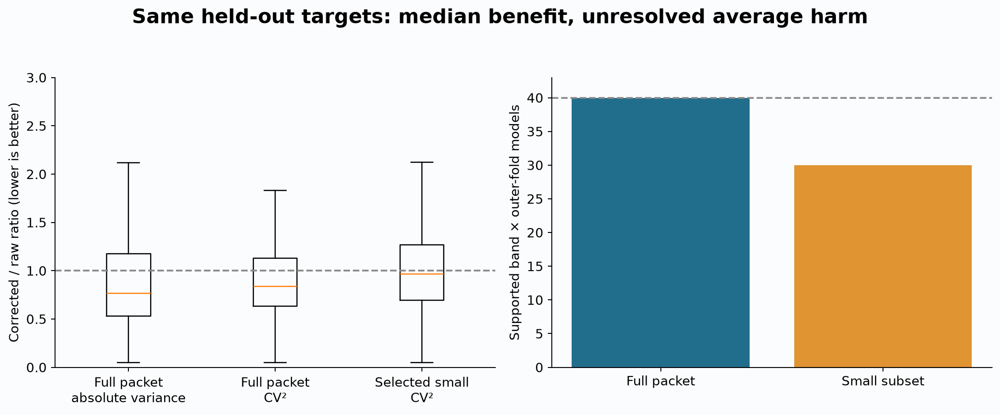

The packet contains target XYZ/identity, camera/master identities, source wavelength, observed calibrated center response, patch median/std, actual sun/view angles, Ross/Li kernels, quality/heterogeneity/reprojection flags, source-photo SHA, exposure/ISO/reflectance-factor/DLS context, terrain fields and spatial holdout/group identity. Metadata records physical units, vendor-calibrated **pre-topography/pre-BRDF** state, project identity and reference geometry. Preserve center response as primary; patch median is sensitivity, not the same observation. The original photo byte stream is unnecessary for refitting this model once those observations are exported.

At least repeated target response plus band, actual geometry, Sun, identity, quality and calibration provenance are needed; precomputed kernels alone are insufficient for future formula/reference changes. Retain the recipe/version for regenerating kernels and ground intersection. The packet is not a replacement for source imagery if re-extraction, alternative ground targeting, calibration repair or remosaicking is required.

The complete packet has **3341 records at 64 targets**, with 3120 quality-supported records. It reproduces all ten original-photo global fits within <6.44e−7 coefficient difference. In the four outer spatial folds, the full packet has 600 common held-out cases: absolute variance ratio median/mean **.766194/1.158145**, CV² ratio **.837601/1.131868**. These two metrics differ because normalization changes target means as well as scatter. The absolute variance result reproduces P184; it must not be relabeled as CV².

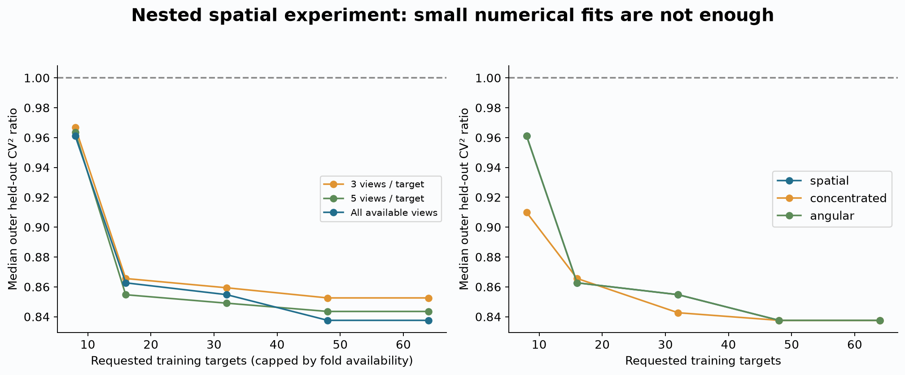

The predeclared experiment evaluates **45 configurations**: requested target counts 8/16/32/48/64 (capped by training-fold availability), view counts 3/5/all, and farthest-point spatial, concentrated, or angular-priority designs. Four outer geographic folds evaluate transfer. Three inner geographic holdouts choose a small design with ≥90% full-model case coverage and geometric-mean CV² no more than 10% worse than full. These are declared study selection tolerances, not universal approval thresholds. Target identities remain disjoint across training and evaluation. All candidate outer results remain visible, not only the winner.

Inner selection chose eight-target designs in all outer folds, with views 3/3/all/5 and inner training rows 240–393. Across the same 600 outer cases, selected-small median/mean CV² becomes **.968010/1.343247**. Per-case small/full relative CV² has median **1.064739**, mean **1.447754**. Sixty target-bootstrap replicates per model support **40/40** full packet band/fold models but only **30/40** selected-small models; the selected results should therefore not be promoted as a fully supported operational design.

Band-subset summaries use independently fitted bands, not multiband pooling: red-only (650 nm, 60 cases) median/mean CV² **.88646/1.09345**; five common bands (475,560,668,717,842 nm, 300 cases) **.80645/1.19617**; all ten (600 cases) **.83760/1.13187**. These different band populations cannot establish that fewer bands improve accuracy. A fixed heterogeneity sensitivity trains on patch CV ≤.25 versus >.25, retaining the original outer spatial folds. Full training yields 600 cases (median/mean .83760/1.13187); high-variability training also yields 600 (.84214/1.10742); low-variability training yields only 520 (.86828/1.21860), with 80 lost cases reported rather than suppressed. Removing heterogeneous observations did not provide a general improvement. Pairwise relative metrics remain in `compact_heterogeneity_paired.csv`; no universal “few bands suffice” or homogeneous-only rule follows. Surface heterogeneity is retained as measured patch CV and spectral strata, with spatial/concentrated designs exposing distribution sensitivity. Only **one calibration context** is available: independent calibration-context transfer and cross-season minimum designs are unmeasured. A minimum target count is not established. Keep the full compact packet and validate new datasets independently.

### Geometry and full sources

A portable geometry enhancement should carry adjusted camera centers, intrinsic/band calibration, source coordinate frames, surfaces and source assignments, without requiring all raw photos. It diagnoses binding and view assumptions but cannot invent blend weights or repeated reflectance observations.

Full source-image recovery is justified for changing calibration, collecting new target observations, recovering missing project information, or executing scientifically supported source-first correction/reconstruction. P184 demonstrated in-memory float-source replacement only after clearing already-applied reflectance/black/sensitivity terms and both camera/sensor vignetting. Licensed save/build/export was **not** executed. Both correction stages remain unsupported as a complete approved Ruby mosaic; no unexecuted interface is counted as L5 performance.

## 11. Radiometric calibration contract

**The permanent production repair is implemented, rather than isolated in this report's scripts.** See [drone_radiometry.py](../../src/spectralbridge/drone_radiometry.py), [radiometry.py](../../src/spectralbridge/radiometry.py), [production drone ingestion](../../src/spectralbridge/pipelines/drone.py), [golden tests](../../tests/test_drone_source_encoding.py) and the [user documentation](../../docs/vignettes/drone-processing.md#drone-radiometric-calibration-and-scaling).

Physical reflectance is `stored × scale + offset`, scalar or per-band. Supported typed encodings distinguish raw sensor DN, verified calibrated Metashape integer DN, historical fixed-range export, physical fraction, fraction×10,000 and other explicit calibrated affine representations. Raw DN remains unsupported until a calibration workflow is supplied. Unknown typed encodings, contradictory scale/wavelength metadata and requests to recalibrate an already calibrated source fail explicitly.

Recognition accepts embedded `spectralbridge_source_encoding`, a SHA-256-bound `<filename>.radiometry.json`, an explicit verified declaration or an exact curated source fingerprint. Five exact recovered original/prepared products are registered; this does not generalize their factor to Gordon, every MicaSense TIFF or an arbitrary legacy H5. Size filters avoid hashing every unrelated raster. Registry identity and sidecar inputs participate in working-stage restart signatures. The original input is immutable; a staged H5 receives provenance.

| Representation | Multiplier to physical fraction | Offset |
| --- | --- | --- |
| Verified original calibrated integer DN | 1/32768 | 0 |
| Verified historical fixed-range export | 65535/(10000×32768) = .0001999969482421875 | 0 |
| Newly prepared fraction×10,000 | .0001 | 0 |
| Physical fraction | 1 | 0 |
| Other calibrated affine | Explicit scalar/per-band coefficient | Explicit scalar/per-band offset |

Example: calibrated DN 8192 → fraction **.25**. The fixed-range historical value is **1250.019**, which must recover .25, not .125002. Newly prepared fraction×10,000 stores 2500. Values >1 (or >10,000 in corresponding storage) remain; zeros and negative finite values remain unless explicitly NoData/saturation. Masks and wavelength identity survive. Source-specific NIR is **842 nm**, while unrelated legacy defaults are not silently rewritten.

H5 and ENVI retain stored values and the full affine record. Compatible scalar zero-offset ENVI divisors reflect the correct scale; vector/offset contracts remain authoritative in the full metadata. Computations enter physical units once and invert once when writing storage-scaled rasters. Polygon Parquet stores physical fraction and `physical_reflectance_v1`, with source radiometry metadata. The checksum-protected 8×8 Ruby fixture tests automatic TIFF→H5→ENVI→polygon Parquet, exact known pixels, affine/CRS and band identity. It is a calibrated source crop, **not raw sensor imagery**.

### Documentation and version reconciliation

Primary manufacturer documentation, retrieved 6 November 2026:

- [MicaSense radiometric calibration model](https://support.micasense.com/hc/en-us/articles/115000351194-Radiometric-Calibration-Model-for-MicaSense-Sensors): raw pixels require black-level, sensitivity, exposure/gain and vignetting treatment to obtain radiance. This is not a raw-DN/32768 rule.
- [Calibrated reflectance panels](https://support.micasense.com/hc/en-us/articles/115000765514-Use-of-Calibrated-Reflectance-Panels-For-MicaSense-Data): panel reflectance and illumination context support radiance-to-reflectance conversion. DLS and panel processing must be documented, not applied twice.
- [MicaSense filter centers/bandwidths](https://support.micasense.com/hc/en-us/articles/214878778-What-is-the-center-wavelength-and-bandwidth-of-each-filter-for-MicaSense-sensors) and [camera comparison](https://support.micasense.com/hc/en-us/articles/1500007828482-Comparison-of-MicaSense-Cameras): the recovered dual-camera configuration has ten source centers 444,475,531,560,650,668,705,717,740,842 nm; sensor models must not be conflated.
- [MicaSense Atlas output units](https://support.micasense.com/hc/en-us/articles/215460518-What-are-the-units-of-the-Atlas-GeoTIFF-output): calibrated integer export convention with 32768 representing 100%. This source concerns Atlas exports, not every raw/export path.
- [Metashape RedEdge-MX reflectance workflow](https://agisoft.freshdesk.com/support/solutions/articles/31000148780-micasense-rededge-mx-processing-workflow-including-reflectance-calibration-in-agisoft-metashape-pro): calibrated export workflow, band-sensitivity normalization and the calibrated integer convention. [Metashape Altum workflow](https://agisoft.freshdesk.com/support/solutions/articles/31000148381-micasense-altum-processing-workflow-including-reflectance-calibration-in-agisoft-metashape-professi) is a distinct sensor workflow, not authority to relabel the recovered camera.

The recovered projects were saved by **Metashape 1.8.3**; the read-only recovery API was **2.3.2**. Recovered camera metadata includes RedEdge-M/MX dual configuration and firmware **7.3.2**; it does not establish that every unit/firmware behaves identically. Relevant [1.8.5 API reference](https://www.agisoft.com/pdf/metashape_python_api_1_8_5.pdf) is version-specific; current rolling support pages do not identify an exact immutable revision. Do not label them as 2023-versioned evidence.

Project calibration/panel metadata and original-source binding corroborate the export interpretation: bilinear source-pixel binding RMSE about **.286 DN Goldhill/.288 DN Ruby** across ten bands. That validates representation/source consistency, not independent physical accuracy. No discrepancy between this recovered encoding and the calibrated-output convention was found. Independent reflectance accuracy remains explicitly **UNVERIFIED** in the contract.

## 12. Proposed software architecture

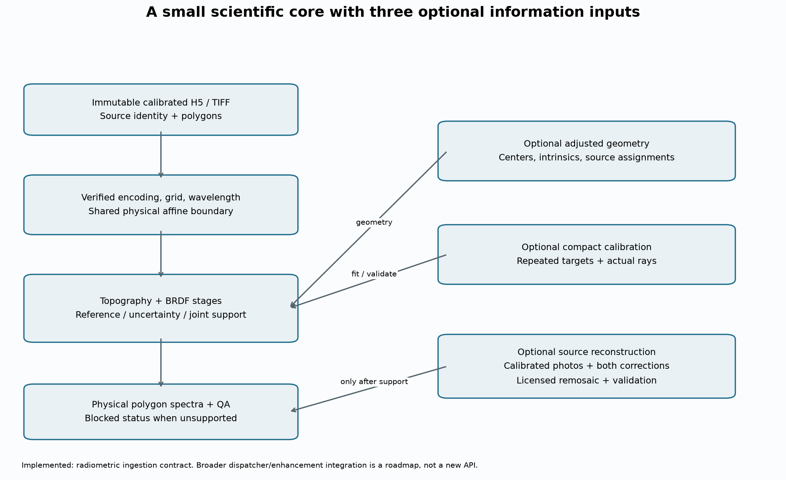

Keep the existing orchestrator and file naming contracts. Ingestion resolves source identity/encoding once into the shared affine representation. Independent input contracts carry geometry, terrain, Sun and spectral identity; consumers validate suitability instead of guessing values. Stage outputs contain their exact inputs, assumptions, fit/reference support, masks, status and uncertainty. Science gates operate per band and per application domain, with a joint-domain summary for requested combined products.

A proposed capability manifest should distinguish `AVAILABLE`, `VERIFIED`, `ESTIMATED`, `UNSUPPORTED` and `NOT_REQUESTED`, plus reason/source identity. Availability is not a scientific approval status. A “level” is a convenience summary of supplied information; the capability vector is authoritative. Compact calibration and geometry enhancement are optional inputs to scientific stages, not parallel raster pipelines.

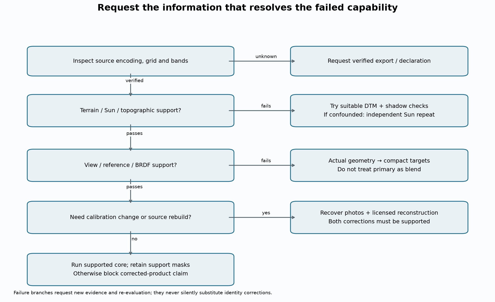

Escalation should follow the reason for failure: unknown encoding → declaration/export provenance; unsuitable terrain → appropriate public/site DTM and datum check; invalid view approximation → adjusted geometry; weak angular fit → compact repeated observations; required calibration/re-extraction/reconstruction → original photos; unidentifiable terrain response under one Sun → independent illumination observations. Recovering every photo is not the default answer to all failures.

Implemented here: typed ingestion recognition/validation, source-bound metadata, cache invalidation, golden tests and documentation. The full automatic capability dispatcher and source-first production architecture are **roadmap**, not claimed delivered APIs.

## 13. Implementation roadmap

1. **Unify capability and joint-support reporting.** Extend existing eligibility/provenance outputs into one compact manifest distinguishing inputs from physical support. Preserve explicit blocked combined products, source identity, full-band domain and reason-specific escalation. Add regression tests before orchestration changes.
2. **Stabilize portable compact calibration and geometry contracts.** Version schemas, kernel/reference recipe, source frames, quality/uncertainty and independent spatial/illumination holdouts. Accept packet refits without Metashape. Keep all ten bands/full 271 KB packet initially; validate additional contexts before reducing it.
3. **Obtain discriminating validation observations.** Prioritize independent illumination repeats and ground/reflectance checks over more same-flight views for Ruby's topographic limitation. Require supported both-stage source corrections and licensed remosaic validation before producing an approved corrected source mosaic.

Maintain shared NEON behavior and current production correction equations. Do not make a broad refactor, release or new full correction campaign a prerequisite to these narrow next steps.

## 14. Remaining scientific limitations and reproducibility

No independent full-mosaic reflectance truth, no recovered Gordon project, no verified effective mosaic blend weights, no multi-context compact transfer experiment, no full licensed remosaic and no demonstrated universally adequate public DEM. Spatial reconstruction precision is not external positional accuracy; a valid affine is not physical calibration validation; statistical consistency is not sensor interchangeability.

The new scientific calculations are scripts in this directory: `history_inventory.py`, `geometry_study.py`, `compact_study.py`, `compact_validation.py`, `compact_lossless.py`, `polygon_comparison.py`, `external_dem.py`, `external_holdouts.py`, `compact_sensitivity.py`, `build_figures.py`. Compact result CSV/JSON/Parquet files and figure manifests are retained. Geometry reruns need cached recovered project material/API; polygon/terrain reruns need the preserved local prepared raster/grid; full compact refits need only the packet and source helpers, not photos. `build_figures.py` reads completed compact outputs only. Paths/dependencies are deliberately explicit rather than suggesting every research step is portable without source data.

Verification completed: **184 targeted tests passed, zero failures/errors/skips** in the final run (Python 3.12). Focused Ruff and documentation links passed; strict MkDocs passed; **394 rendered API signatures** matched. The tests cover new encoding/golden integration, shared radiometric contracts, drone orchestration/spatial behavior, NEON reading, shared BRDF mathematics and original-photo/topographic helpers. Exact original Ruby and Goldhill files also resolved automatically through their packaged SHA-256 identities; see `real_source_recognition.json`. Wheel inspection confirmed the resolver and five-record registry are packaged. This is a development packaging check, not a release qualification across all Python versions.

Use `.venv/bin/python` with `OPENBLAS_NUM_THREADS=1 MPLCONFIGDIR=/private/tmp/spectralbridge-mpl`. Historical artifacts remain unchanged. [final_checks.json](final_checks.json) records current verification, source/script/figure hashes and the exact relevant test counts. Package tests are network-independent. Warning categories include existing deprecations and intentionally ungeoreferenced synthetic fixtures. No full-suite success is claimed from targeted checks.

## 15. Decisions

1. **How much better than historical H5?** Evidence: software repair removes documented hundreds-of-metres spatial errors and approximately half-amplitude misinterpretation for the verified fixed-range products. Information-driven evidence: repeated-target BRDF median variance .766 on common cases, mean 1.158. Unverified: a net full corrected-mosaic accuracy improvement; L5 mosaic does not exist.
2. **How much with correctly calibrated H5 alone?** Evidence: correct affine, grid, band identity and calibrated raw polygon extraction survive the production boundary. Inference: no need to repeat source recovery once these contracts are trustworthy. Missing terrain/view/illumination support cannot be repaired from H5 extension alone.
3. **What do actual camera angles add?** Evidence: replacing nadir by actual-XY/nominal-altitude reduces median angular separation from 16.97° to .94° Ruby and 14.72° to .41° Goldhill. Inference: portable geometry is useful. Unverified: a proportional increase in mosaic accuracy or effective blend-angle recovery.
4. **What do repeated photos add?** Evidence: target-aware angular response/holdout estimation unavailable from a single blended pixel; median CV² .838, mean 1.132 on 600 cases. No demonstrated resolution of Ruby's topographic identifiability.
5. **Can compact data reproduce it?** Evidence: the full 271 KB packet reproduces ten-band coefficients within 6.44e−7. Smaller nested designs fail 10/40 support checks. Inference: keep the complete compact packet; no universal minimum subset is established.
6. **Which simple assumptions are sufficient?** Evidence: explicit affine/storage contracts; promising actual-XY/nominal-height geometry at known points. Inference: calibrated core first. Unverified: universal nadir, public-DEM or single-Sun sufficiency.
7. **When do they fail?** Evidence: large angular differences, source/project mismatch, missing blend weights, uncertainty/domain failures, wrong polygon location and poor held-out mean behavior. Require observed support diagnostics; no universal fixed cutoff inferred here.
8. **Minimum for reliable raw polygon spectra?** Verified calibrated raster/H5, source scale/offset and validity, correct wavelengths/grid/CRS, known polygon geometry. Evidence: real-crop end-to-end test and common-polygon controls. Independent physical accuracy additionally needs external validation.
9. **Minimum for both corrections?** Suitable Sun/terrain with identifiable topographic response, actual or validated view approximation, angular/reference support, stable uncertainty-bounded factors and a joint spectral/pixel domain. Additional observations are required when those conditions fail; file presence is insufficient.
10. **When require photos?** Inference: only for source calibration/re-extraction, missing required source evidence, or supported source-first reconstruction. Compact refits do not require them. Licensed full corrected reconstruction remains unexecuted.
11. **When prefer new Sun observations?** Evidence: same-flight repeated views did not solve negative C; synthetic confounding and matched holdouts support the limitation. Inference: prioritize independent illumination repeats and ground checks; the number/conditions needed must be validated.
12. **Is scaling permanently implemented?** Yes: production TIFF/H5 typed recognition, exact source fingerprints, bound sidecars, conflict/double-calibration rejection, 842 nm source identity, golden TIFF→H5→ENVI→Parquet tests and user documentation. Scope: recognized verified encodings; unknown/raw products remain unsupported. Independent reflectance accuracy is not certified.
13. **Default pipeline?** Verified immutable calibrated core, both requested scientific corrections with explicit support gates, native physical spectral products/QA and restart-safe provenance. Inference: consolidate capability reporting without rewriting established orchestration.
14. **What stays optional?** Camera/project geometry, compact repeated-target calibration and full photo reconstruction. They activate for missing information, not as blanket requirements. No enhancement guarantees scientific approval.
15. **Next three priorities?** Unified capability/joint-support manifest; stable portable calibration/geometry schemas and holdouts; independent illumination/ground validation before licensed both-stage reconstruction. The first two are engineering work; the third requires additional scientific observations.
