# Toward a Reliable Drone Correction Pipeline

## 1. Toward a Reliable Drone Correction Pipeline

Radiometry, Viewing Geometry, BRDF, and Topography | Goldhill | November 2026

Seven actual experimental GeoTIFF products were generated with the package correction driver. New opt-in fitting masks, spatial-cluster uncertainty and conditioned SCS+C make unsupported observations explicit. Both topographic and BRDF stages remain active in the combined products.

This is partial engineering success. Physical calibration and actual orthomosaic contributors remain unverified; spatial controls show the global directional regression can capture vegetation structure. None of these products is approved for production or spectral-library extraction.

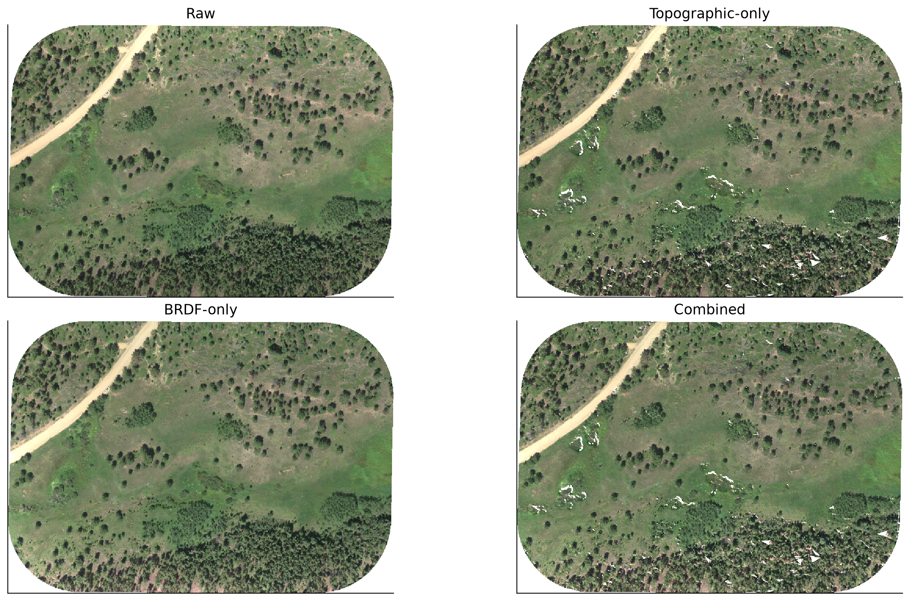

RGB 650/560/475 nm; fixed black 0, white 0.25, gamma 0.5. Identical full-scene extents, stride-four display; metrics use native pixels. Display saturation never changes the analysis.

## 2. Small reusable repairs preserve the existing workflow

The package now accepts explicit BRDF fitting subsets and optional spatial uncertainty groups, preserving the shared RossThick/LiDenseR equations and reference geometry. A new conditioned SCS+C model binds source identity, radiometry, wavelength order, policy and fit support. Default NEON behavior is unchanged. Experimental metadata survives ENVI serialization and prevents entry into approved spectral-library workflows.

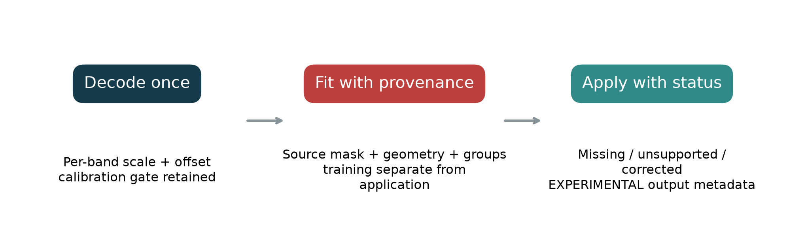

Implementation: topographic.py; surgical additions in corrections.py, pipelines/drone.py, envi_writer.py and radiometry.py. No separate drone kernel formulation or ordinary pixel-scale Parquet cache is introduced. Both correction stages remain ordered and file based.

## 3. Radiometry: preserve the uncertainty that metadata cannot resolve

Existing data-store collections, local project paths and calibration metadata were searched. The retrieved calibration sample is a 2021 TIFF, not the 2023 Goldhill source. Its MicaSense radiance and lens tags demonstrate available metadata types but cannot certify Goldhill calibration. No original Goldhill project or raw-photo collection was recovered in the searched locations. Their absence elsewhere is not established.

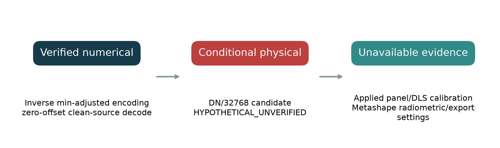

Radiometric validation: min-adjusted inverse VERIFIED numerically; clean alpha-aware resampling VERIFIED numerically; per-band affine application TESTED; DN/32768 INFERRED, not physically verified; applied Goldhill panel/DLS chain UNSUPPORTED by currently available records. See calibration_sample_metadata.json and input manifests.

## 4. Viewing geometry remains an explicitly reconstructed input

The four previous assignment strategies remain available, including hard assignment and direct kernel blending. Reported intrinsics and orientation matrices cannot be promoted to verified contributor geometry without sensor binding and convention checks. The integrated experiments use the previously declared center-weighted kernels as a fixed sensitivity scenario, not a recovered source-image solution.

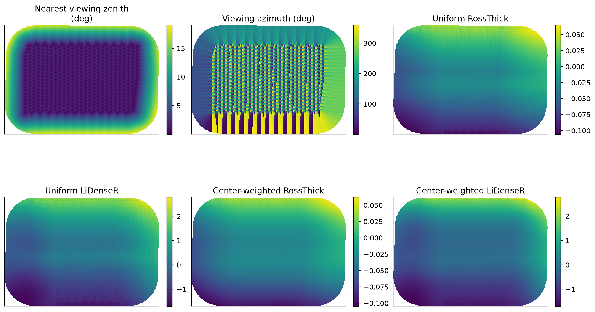

All panels use the same spatial extent. Named quantities have separate scales. Nearest/central seams and four-scenario conditioning are quantified in the companion and source investigation. No new actual-contributor strategy was fabricated.

## 5. Spatial and class subsets challenge the global fit

Twenty-seven sampled controls compare spatial blocks, flight legs, terrain and incidence strata, camera footprints, vegetation classes and raw-defined homogeneous areas. Flight-leg holdout 2, Herbaceous and camera footprint 241 are rejected. Unsupported fits are retained as diagnostics rather than forced into corrected products. Class-specific coefficients are never used in the evaluated image corrections.

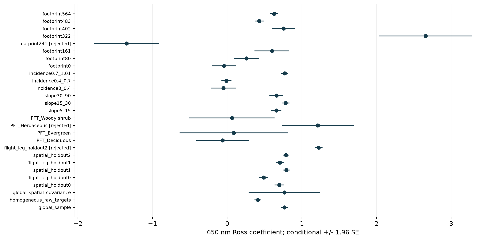

Native stride-ten sample, no averaging. Diagnostic coefficient estimates may be shown for rejected fits, but no usable correction coefficients are exported for them. Intervals describe conditional regression uncertainty, not a physically identified BRDF or independent pixel replication.

## 6. A displaced signal fits about as well as the original

The unshifted sampled regression has R-squared 0.1049. Displacing reflectance 25 m produces 0.1144, and 50 m produces 0.1105. Similar or better fit after displacing the signal is a warning that broad spatial vegetation structure can explain apparent angular relationships. This is a sensitivity control, not a permutation p-value or proof that every angular effect is spurious.

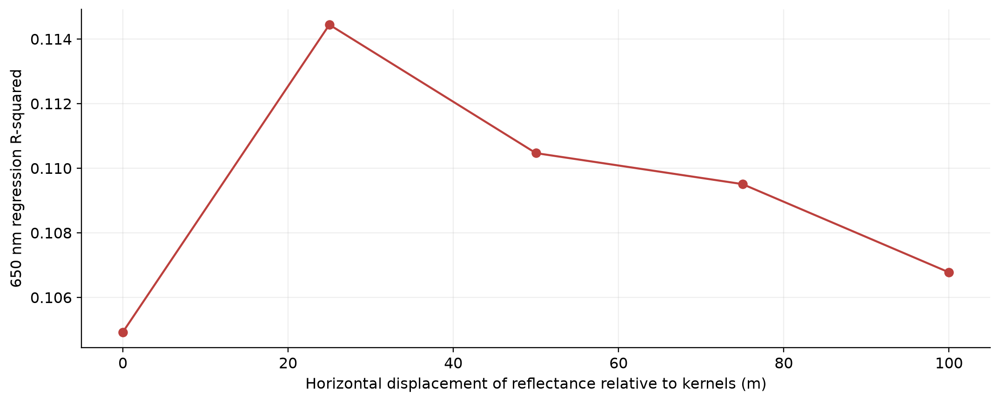

Whole-image horizontal displacement control; details in spatial_shift_controls.json and sampling_contract.json. Native shifts are 0, 250, 500, 750 and 1000 pixels at 10 cm. No corrected-output or classification tuning chooses the displacement.

## 7. Homogeneous training is a control, not a cure for missing repeats

Raw-defined homogeneous pixels support a separate full-native BRDF and combined run. The criterion is fixed before ecological evaluation and uses no corrected imagery or class labels. Evaluation polygons and a 20-iteration Manhattan pixel buffer are excluded from fitting. The buffer reaches 2 m along the axes; it is not a Euclidean-radius dilation.

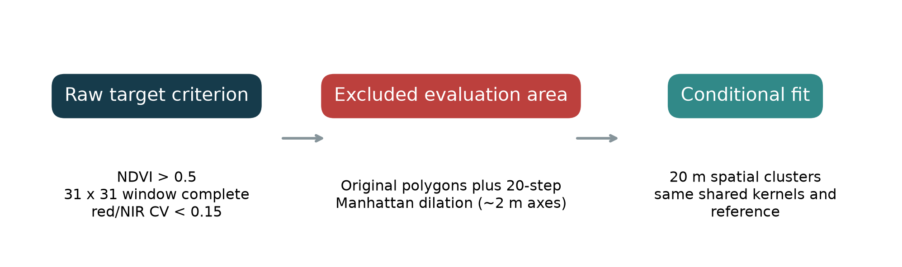

Both homogeneous products executed. Cluster covariance changes uncertainty, not the OLS point estimate; the controlled OLS and cluster variants produce identical corrections when both pass acceptance. Homogeneity does not supply distinct measurements of the same target from multiple angles.

## 8. Diagnose the SCS+C denominator before applying a gain

SCS+C multiplies observed reflectance by (cos(solar zenith) cos(slope) + C)/(cos(incidence) + C). Negative fitted C values can place a pole inside the illumination domain. An identity fallback below a threshold leaves a discontinuity and can retain huge gains immediately above it. We retain SCS+C and classify unresolved observations explicitly instead.

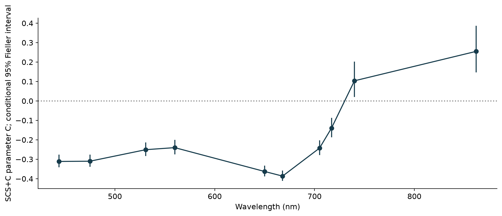

The new policy fits slopes at least 5 degrees and positive incidence with candidate source values 0-2. OLS intercept/slope gives C. Twenty-metre spatial cluster covariance and Fieller ratio intervals identify whether C is bounded. Policy choices are explicit experimental decisions, not universal terrain thresholds.

## 9. A resolved uncertainty interval defines the supported domain

Application requires positive incidence, fitted incidence support and positive numerator and denominator across the complete conditional C interval. The existing 0.001 numerical resolution floor remains explicit. Unsupported observations become NoData with status 1; missing or invalid source observations are status 0; corrected observations are status 2. No identity substitution or gain cap is used.

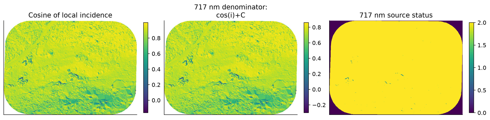

Denominator uses the fitted 717 nm C, not a display-derived value. Incidence uses the shared degree-to-radian convention. Status map is discrete. Flat terrain is handled analytically. These conditions bound numerical support; they do not independently verify DEM, illumination or calibration.

## 10. Retain both stages and expose unresolved observations

The combined image is a real topographic-then-BRDF product. All-band support is 6,613,717 pixels, about 98.95% of the 6,683,905 reconstructed native source domain. Per-band support differs, so a band-valid extreme may lie outside the all-ten-band domain. Large mathematically resolved gains remain possible and are covered by a regression test.

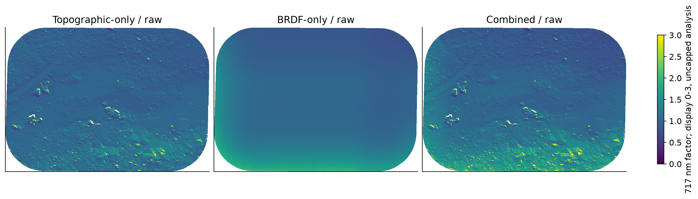

Correction factors are output/input ratios on finite nonzero source values. Display saturates at 3 only to keep the maps readable. Native maximum and exceedance diagnostics are computed without this display transform. Full per-band status counts are in topographic_coverage.json.

## 11. Native crops retain wavelength and location controls

Raw, topographic-only, BRDF-only and combined products are compared at the established crop and 10 cm sampling. The display scale is fixed across branches and both wavelengths. Unsupported cells remain absent rather than receiving an unchanged raw value. Numerical extremes are reported separately, so display saturation cannot masquerade as a successful repair.

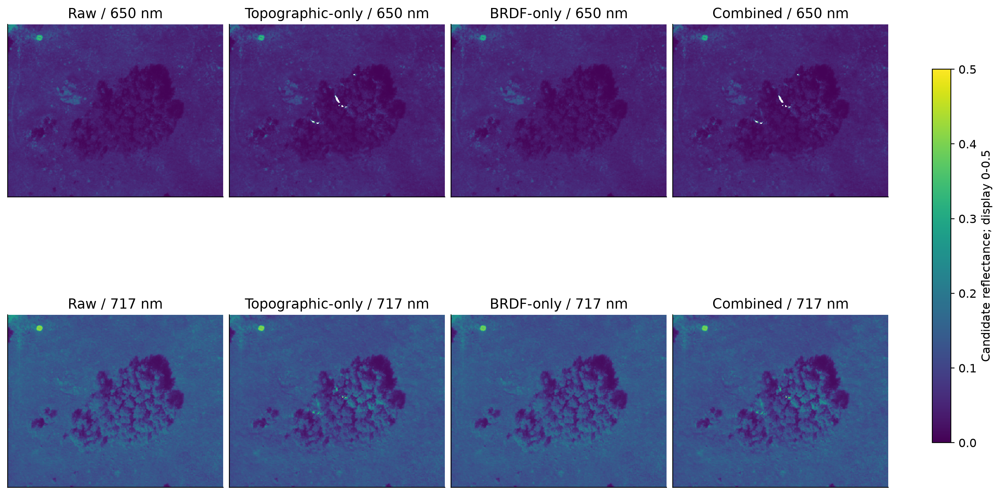

Rows 573:974, columns 812:1313, identical to the historical diagnostics. Candidate units remain conditional on DN/32768. The 650 and 717 nm bands are selected explicitly; substituting 668 nm would miss the historical red failure.

## 12. A lower native maximum partly reflects changed support

The previous center-weighted combined image reaches about 63.51 at 717 nm; the new conditioned combined image reaches about 1.78. On the shared all-ten-band valid domain the maxima are about 0.655 and 0.689, respectively. The native peak reduction is therefore largely an explicit support decision, not evidence of lower reflectance everywhere on unchanged observations.

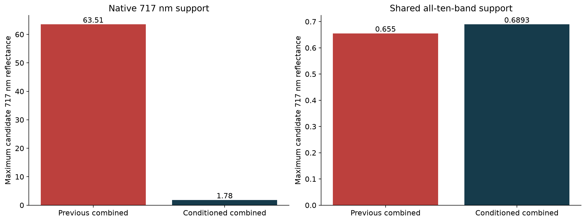

Both native per-band and matched all-ten-band maxima are freshly calculated in native_vs_common_extremes.json. The new native 717 nm peak can occur where another band is unsupported. No factors or reflectance values were capped to produce this comparison.

## 13. Compare vegetation on the intersection, not on changing samples

The integrated comparison preserves 157 original polygon identities and the same frozen folds, using 142,637 common memberships. The exemplar retains 5,956 common pixels. Spectral angle, red-edge reversal, NIR/red ratios, variance, separability and per-class outcomes are exported with all branch summaries. The smaller common support differs from the companion population and changes the raw classification baseline.

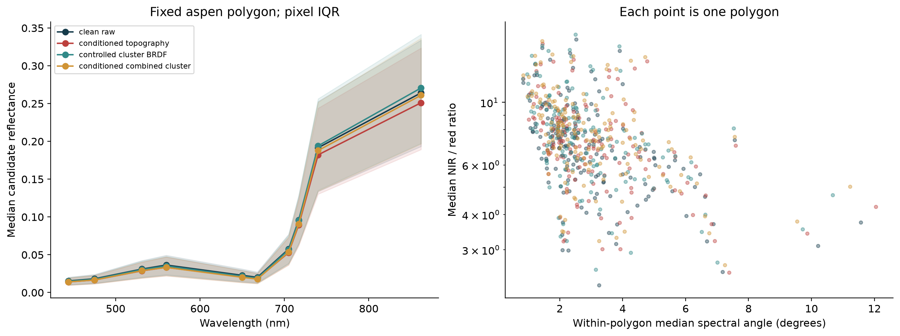

Left: median spectrum and within-polygon pixel IQR. Right: individual polygon diagnostics; spectral angles are descriptive, not physical calibration tests. Mean spectra remain the frozen classifier inputs. No correction parameter was tuned to maximize classification performance.

## 14. The ecological evaluation does not justify production promotion

On matched support, raw balanced accuracy is 68.30%, controlled BRDF is 69.39%, and conditioned combined is about 66.42%. All paired gain intervals include zero. Homogeneous fitting does not demonstrate an ecological gain either. Numerical acceptance and rejection of unstable illumination do not amount to improved PFT identification or independent physical validation.

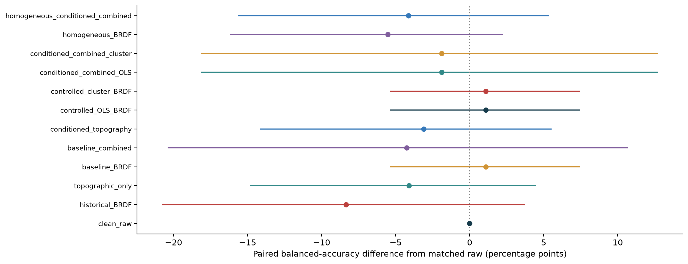

Paired class-stratified polygon bootstrap with fixed predictions/folds. Full class metrics, confusion matrices, separability pairs and predictions are retained. OLS and cluster point corrections agree when both models pass; changing covariance alone does not improve the image.

## 15. NEON controls and scientific status remain separate

The real NEON fixed-window regression reran both BRDF-only and combined corrections across ten selected wavelengths. Both remain numerically valid. The default source equations, reference geometry and acceptance path are shared; only explicitly supplied drone experiment options activate the new subset/cluster/conditioned-topography behavior. Sensor-specific calibration and sampling choices remain explicit.

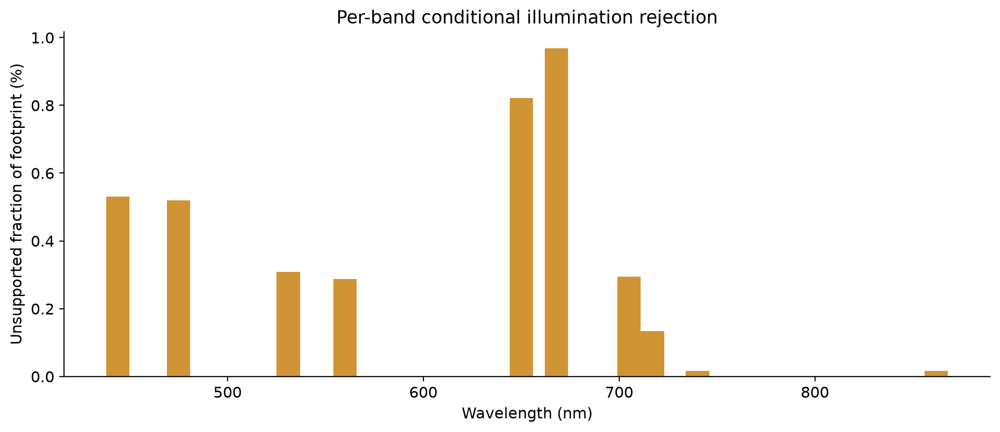

Source: NEON D10 R10C 2021-09-15 directional reflectance, 120 x 3000 pixels, ten bands. Native/serialized array equality and model status are checked in verification.json. Software tests cover calibration gates, affine units, masks, chunking and non-capped resolved gains; they do not certify drone calibration.

## 16. Outcome and next evidence

Problem -> evidence -> repair -> result -> status: stored/physical confusion -> paired encoding residuals -> affine contract -> numerical inversion verified -> physical calibration unverified. Missing angular design -> fixed rank one -> inferred camera rays -> rank three -> experimental contributors. Spatial confounding -> shift and subset sensitivity -> fitting masks, clusters and holdouts -> rejected unsupported cases -> no physical identification claim.

Topographic poles -> negative C and denominator crossings -> Fieller-resolved illumination support -> real combined products with explicit NoData -> numerically bounded support, not universal physical validity. Gordon and Ruby cannot be honestly extended to the full experiment without clean radiometry and comparable viewing evidence; their source and geometry limitations remain visible.

Reproduce using run_experiment.py, run_homogeneous.py, spatial_controls.py, evaluate.py, neon_control.py, build_publications.py and render_pdf.py. Existing source investigations and pre-edit snapshots are preserved. Exact inputs, hashes, plans and compact results accompany this report.

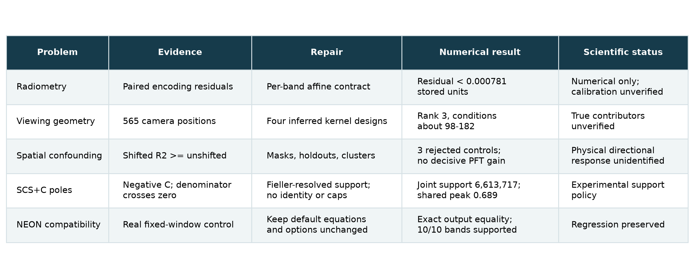

References: Soenen, Peddle & Coburn (2005), SCS+C, doi:10.1109/TGRS.2005.852480; Cameron & Miller (2015), cluster-robust inference, doi:10.3368/jhr.50.2.317; von Luxburg & Franz (2009), geometric Fieller intervals, arxiv.org/abs/0711.0198. Policy thresholds are conditional choices, not universal claims from these papers.

