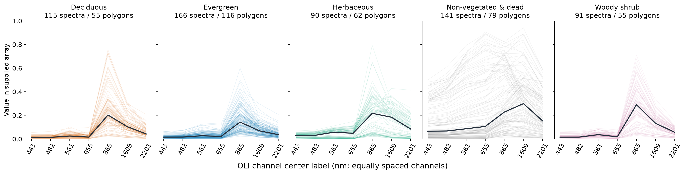
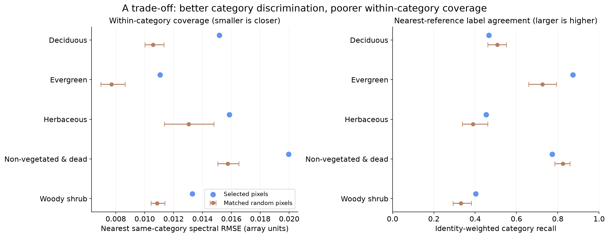
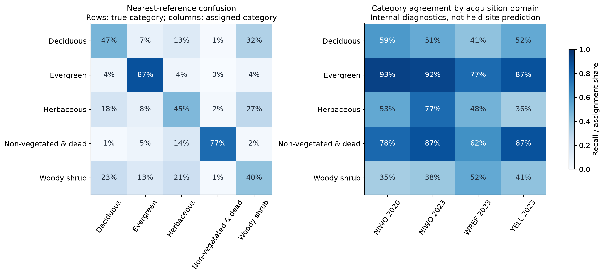
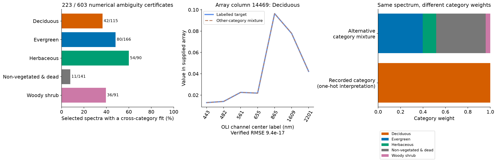
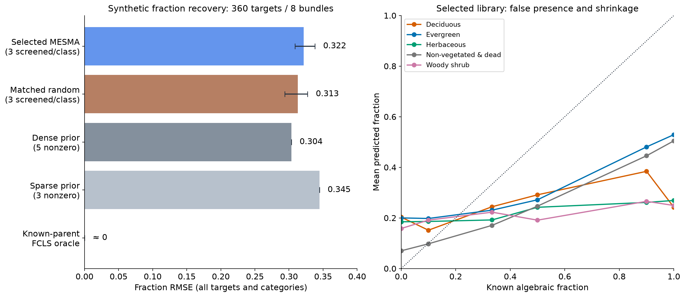
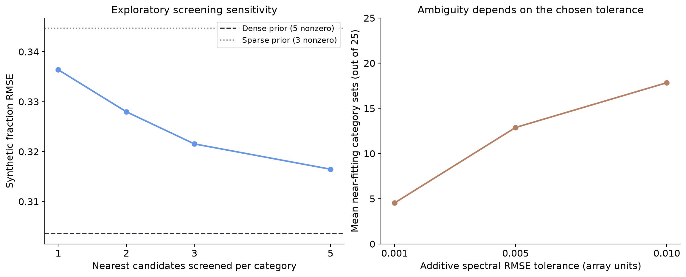

# How good are the 603 selected OLI endmembers?

19 October 2026 · **Internal fixed-library diagnostic; not independent validation**

## Assessment

**Useful category signal, but not an abundance-validated endmember library.**
The selected pixels improve nearest-reference category agreement compared with
random pixels from the same polygon footprints. However, they cover within-category variation
less closely, many selected spectra admit other-category reconstructions, and the
screened synthetic unmixing experiment beats a three-category prior but does not
beat a dense five-category prior.
This does not establish that an exhaustive MESMA search or every possible use of
the library would fail. It does identify substantial concerns before abundance use.

## What was supplied and verified

The array has **85,706 observations × seven undarkened OLI channels**. All values
are finite, none are negative and all five recorded categories are represented.
The CSV contains **603 unique zero-based column indices**, confirmed by the user.
Those references come from **367 polygon identities**; one polygon contributes
as many as 19 selected pixels. No selected spectra are exactly duplicated.

The label file stores category names. The user's numeric mapping is
preserved as the separate `class_code` field, never confused with array indexing:

| Code | Recorded category | Selected spectra | Selected polygon IDs | Nearest-reference recall | Cross-category hull matches |
|---|---|---:|---:|---:|---:|
| 1 | Deciduous | 115 | 55 | 46.6% | 42/115 |
| 2 | Evergreen | 166 | 116 | 87.3% | 80/166 |
| 3 | Herbaceous | 90 | 62 | 45.3% | 54/90 |
| 4 | Non-vegetated & dead | 141 | 79 | 77.3% | 11/141 |
| 5 | Woody shrub | 91 | 55 | 40.3% | 36/91 |

The supplied spectra align, in original row order, with the repository polygon
Parquet's undarkened OLI columns divided by 10,000 (maximum absolute difference
7.46e-8, compatible with numerical precision). Every category label matches.
This establishes usable numerical lineage; it does not independently validate
physical units, pure materials or native Landsat observations.

The `imagery_year` field differs from source acquisition dates on **18,399 rows**.
This report derives acquisition years from `flight_id`; it does not rewrite the
original field or assume that the field necessarily means acquisition year.



**What you see:** every selected trace, grouped by recorded category, with a dark median.
**What to notice:** there is considerable within-category variation and unequal
category/parent coverage. Segments connect discrete bands.
**What it means:** selecting 603 rows is not equivalent to sampling 603 independent plants.
**What it does not mean:** labelled polygons are verified pure materials or these
seven-band synthetic representations are independent Landsat measurements.

## 1. Coverage and category discrimination show a trade-off

For each polygon/site/acquisition-year, take within-flight medians, then the
median of those flight summaries. Exclude every one of the 367 candidate polygon
IDs globally. This leaves **3,272 polygon IDs / 4,261 summary curves**.
Repeated identity histories share total weight one in aggregate results.
These targets are disjoint from the chosen references, but **selection already
examined the entire library**, so they are not selection-blind holdouts.

The control draws **30 alternative libraries**. Each preserves exactly the
selected pixel count from **each same polygon ID**. Category counts, parent
identities and per-parent capacity are therefore matched; only the chosen pixels
change. Controls may by chance include supplied selected pixels. This comparison
isolates pixel selection within these polygon footprints, not selection of different polygon footprints.

- Mean nearest **same-category** spectral RMSE: selected **0.01507**;
  matched random mean **0.01159**. Selected distances are
  **30.0% larger** (worse coverage by this metric).
- Nearest **single-reference category agreement**, balanced across categories:
  selected **59.4%** versus random mean
  **55.6%**. Random-draw central 95% spread is
  **53.2–57.3%**.
- Evergreen recall is **87.3%**, whereas Woody shrub is **40.3%** and Herbaceous
  **45.3%** under this particular raw-band nearest-reference rule.

A stricter follow-up also preserves the selected pixel count from **each same
polygon and flightline**, preventing changes in acquisition composition. Its 30
random controls average **0.01256**
for same-category RMSE and **54.8%**
for nearest-reference balanced agreement. The broad coverage/discrimination
trade-off remains; both sets of controls are saved. This does not make either
comparison selection-blind.

Spectral RMSE is in supplied-array units. This is a descriptive proximity rule,
not the earlier nested classifier, not MESMA abundance and not deployment accuracy.
The result is compatible with selecting more discriminating references at the
cost of representing typical within-category variation. The selector's exact
objective/script was not supplied, so its intended optimization cannot be judged.



**What you see:** selected pixels versus 30 matched random libraries, by category.
**What to notice:** selection improves some category recalls while coverage worsens.
**What it means:** quality depends on whether the goal is discrimination or reconstruction.
**What it does not mean:** the random-draw ranges are population confidence intervals
or this internal comparison is independent confirmation.



**What you see:** confusion between recorded labels and performance by acquisition domain.
**What to notice:** category difficulties differ; the overall average hides failures.
**What it means:** all categories and domains should remain visible during evaluation.
**What it does not mean:** these are held-site models: the original selection saw all sites.

## 2. The selected library contains concrete category ambiguity

For each selected spectrum, exclude **every reference with its own category**.
Solve a full-library linear feasibility problem: can a nonnegative, sum-one
combination of the other categories reconstruct the same seven-band vector?
Numerical certificates are accepted only after separately checking spectral RMSE
≤1e-8, nonnegativity and sum-one constraints.

**223 of 603 (37.0%)** have verified alternatives.
Herbaceous has **54/90 (60.0%)**, Evergreen **80/166 (48.2%)**, and background/dead
**11/141 (7.8%)**. Thus even a perfect reconstruction can disagree with the recorded
one-hot category interpretation of a reference.

This feasibility diagnostic permits multiple references per category and as many
as eight active references in seven-dimensional affine space. It is **broader
than three-component, one-reference-per-category MESMA**. Failure to find such a
certificate does not prove uniqueness, especially for mixed targets or noisy data.
All 223 certificates and their actual reference indices/weights are saved.



**What you see:** certificate counts and one concrete target/alternative reconstruction.
**What to notice:** the spectra overlap, while the category weight vectors differ.
**What it means:** this dictionary does not guarantee unique category composition.
**What it does not mean:** the LP alternative is known biological truth or is admitted
by the more restrictive screened MESMA experiment.

The selected library's affine spectral rank is seven. With 603 references, unique
individual-reference fractions cannot generally be recovered from seven bands
and one sum constraint. That dimension argument alone does not prove category
ambiguity; the explicit certificates supply the category-level evidence here.

## 3. Synthetic recovery improves on a matched sparse prior

Use **eight disjoint parent bundles**, two in each observed site/acquisition-year
cell, with one distinct parent per category. No generating parent occurs in the
selected library or another bundle. Generate 45 mixtures per bundle: ten category
pairs at fractions 0.1/0.5/0.9, ten equal-third triples, and five pure-parent targets.
This gives **360 known algebraic mixtures**, not 360 independent plants or field plots.

For each target, screen the three closest references **per category** from all
603 selected spectra using spectral RMSE only, never the known fractions. The
existing numerical solver then searches **375 admitted models**, at most three
categories, with nonnegative sum-one fractions. A full unfiltered search would
have **16,918,447** such candidate models per target and was not run.
Consequently this tests a **screened inference configuration**, not exhaustive
full-library MESMA. Solver rank/interior/update tolerances remain those of the
existing `spectralbridge.mixtures.fit_models` implementation.

| Model / control | Fraction RMSE |
|---|---:|
| Selected screened MESMA | 0.322 |
| Matched random screened MESMA | 0.313 |
| Uniform design prior | 0.304 |
| Sparse design prior | 0.345 |
| Known-parent FCLS oracle | 0.000 |

The oracle is approximately **3.6e-14**: correct generating parents recover the
synthetic truth. The selected configuration's **0.322** does not beat the uniform
**0.304** prior. The prior is fixed at 0.2 per class from the symmetric design,
not fitted using test fractions. One matched random library gives **0.313**;
that is one draw, not a population-level claim about random selection superiority.

RMSE above is `sqrt(mean squared error over targets and categories)`. For clarity,
mean per-target RMSE gives selected **0.293**, random **0.283**, prior **0.292**:
aggregation matters, but it does not reveal a selected-library advantage over the
dense prior in this experiment. These values are not directly interchangeable with
previous mean-fold synthetic-study headline RMSEs.

Whole-bundle bootstrap intervals are conditional on eight sampled bundles and
this synthetic recipe. Resampling uses the observed domain mixture and does not
model spatial correlation between nearby polygons. Treat these intervals as
internal sensitivity summaries, not independently validated population coverage. The selected-minus-prior RMSE difference is
**0.018**, with conditional 95% percentile interval
**0.004 to 0.034**.
The selected-minus-one-random-draw difference is
**0.009**, interval
**-0.007 to 0.025**.
These are internal sensitivity summaries, not geographic/field validation.



**What you see:** selected and control errors plus calibration by true fraction.
**What to notice:** the oracle succeeds, whereas the selected configuration does
outperforms the sparse prior but not the dense prior; absent classes receive positive predictions.
**What it means:** accurate spectral reconstruction is insufficient for fraction recovery.
**What it does not mean:** every MESMA configuration must fail or any result validates field cover.

### A constraint-matched prior changes what we can conclude

MESMA outputs at most three nonzero category fractions. The dense prior uses all
five. A follow-up fairness control therefore assigns **1/3 each to the first
three predefined categories** and zero to the others, without inspecting any target
spectrum or selecting categories from outcomes. Under this balanced synthetic
recipe any fixed triple has the same aggregate error. Its fraction RMSE is
**0.345**. MESMA's **0.322** improves on that sparse baseline,
so the spectra add some quantification information under the same sparsity limit.

The stronger dense prior predicts the design expectation, while MESMA searches
for a spectrally fitting sparse composition. These are different objectives and
output constraints. Failing to beat the dense prior alone is **not** evidence of a
broken solver or proof that the selected library contains no useful information.
Neither comparison establishes accurate, unique biological abundance. The sparse
control was added after reviewing this potential confound, not presented as a
preregistered experiment.

### Detection and quantification are different failures

At the explicit comparison threshold **predicted fraction ≥0.10**, absent-class
false detections are common. A low positive fraction is defined as `0 < truth ≤0.20`.
Thresholds are comparison rules, not independently measured physical detection limits.

| Category | Fraction RMSE | False positive when truly absent | Miss at low positive fraction |
|---|---:|---:|---:|
| Deciduous | 0.337 | 53.8% | 62.5% |
| Evergreen | 0.303 | 63.0% | 46.9% |
| Herbaceous | 0.362 | 46.2% | 62.5% |
| Non-vegetated & dead | 0.247 | 30.8% | 62.5% |
| Woody shrub | 0.345 | 45.2% | 50.0% |

### Screening and near-fit sensitivity

After the primary run, repeat with 1, 2 and 5 screened candidates per class.
Fraction RMSE is **0.336 / 0.328 / 0.316**, respectively, versus the primary
three-candidate **0.322**. More candidates improve fit and some fraction error,
but none beats the dense design prior here; all improve on the sparse prior. These exploratory checks do not establish
what the full 16.9-million-model search would do.

At additive near-fit tolerance 0.01 array RMSE, the primary search has mean
**17.8 near-fitting category sets** (out of 25), with median maximum category
fraction range **1.0**. Reducing tolerance to 0.001 gives mean **4.5** near sets.
These tolerances are illustrative, not calibrated sensor noise. The existing
solver saves one best solution per category set: ranges are **restricted candidate
ambiguity**, not exhaustive feasible or biological uncertainty.



**What you see:** fraction error as screening expands, and near-set count as tolerance expands.
**What to notice:** conclusions depend on the evaluated search and tolerance.
**What it means:** both inference design and library ambiguity must be reported.
**What it does not mean:** a selected operating point is universally optimal or
near-set ranges are confidence intervals.

## Recommended next step

Keep this as a candidate reference dictionary, but **do not describe it as validated
for category abundance**. Obtain the selector script/objective and repeat selection
inside training-only polygon/site folds. Evaluate unmixing on parent-disjoint target
curves, compare matched parent/library capacities, and retain failed controls.
For the frozen whole-library selection, independent new observations are needed
for selection-blind performance. Field abundance additionally requires independent,
contemporaneous fractions at matched spatial support and verified reference meaning.

## Reproducibility and limits

`preflight.py` records the initial ambiguity before the user clarified indexing;
`summary.json` is the current confirmed analysis. `run_analysis.py` reads the three
original files and the existing Parquet in place. No source file is changed or copied.
`selected_members.csv` and `target_coverage.csv` preserve reference/target IDs.
Figures are regenerated from compact results by `build_report.py`. Input/code
hashes, the 30 controls, every LP certificate, synthetic parent memberships,
predictions, per-class errors and bootstrap summaries are retained in this packet.
No earlier scientific outputs, production algorithms or coefficients were changed.

From repository root:

```bash
OPENBLAS_NUM_THREADS=1 OMP_NUM_THREADS=1 MPLCONFIGDIR=/tmp/spectralbridge-mpl .venv/bin/python provenance/endmember-quality/2026-10-19/v1/run_analysis.py
MPLCONFIGDIR=/tmp/spectralbridge-mpl .venv/bin/python provenance/endmember-quality/2026-10-19/v1/build_report.py
.venv/bin/python -m pytest -ra tests/test_selected_endmember_quality.py tests/test_mixtures.py
```
