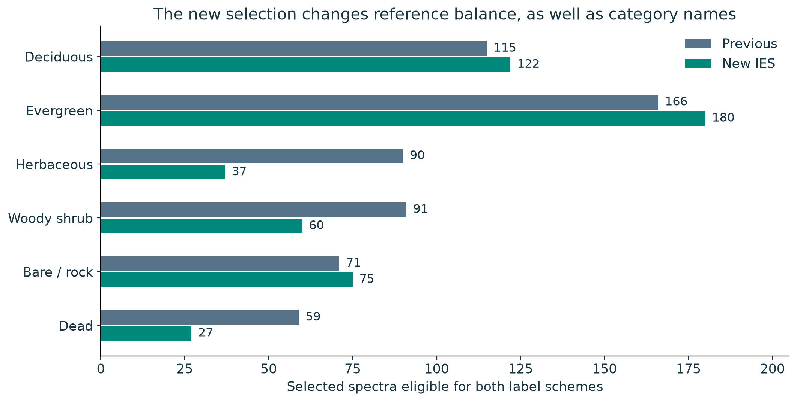
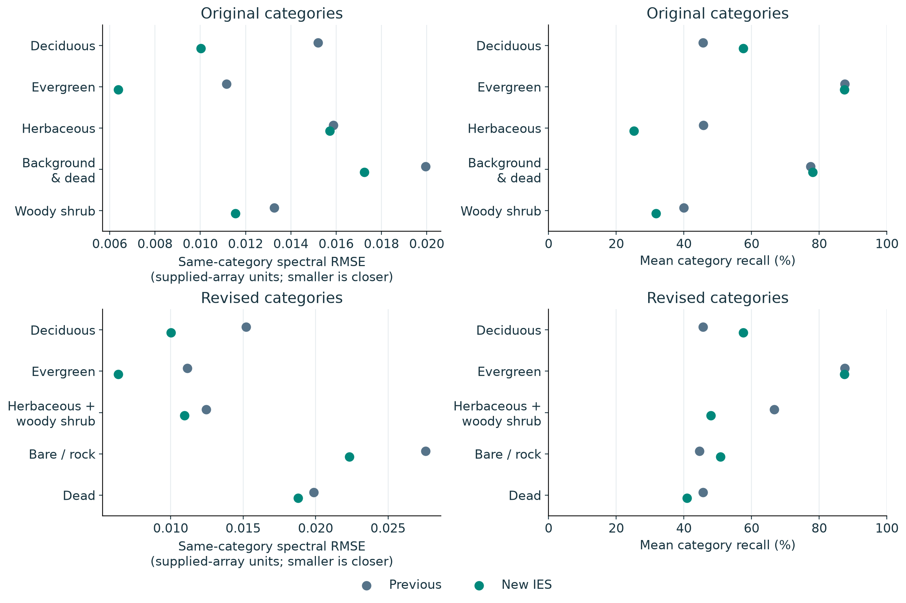
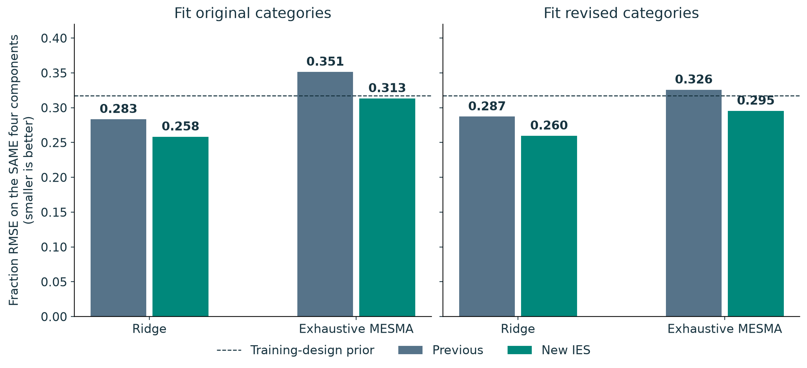
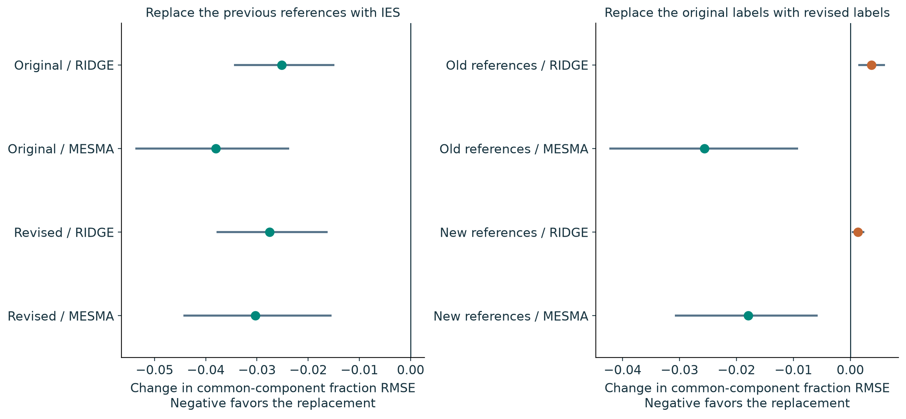
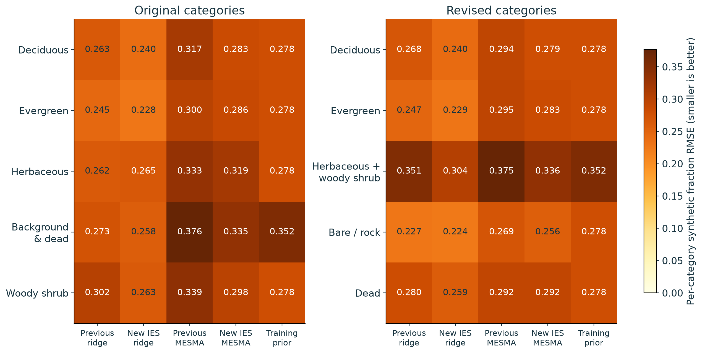
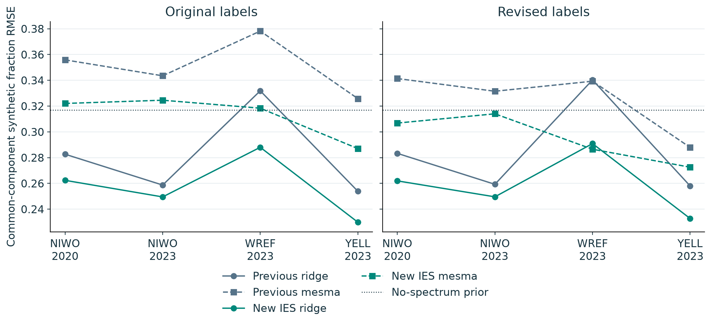
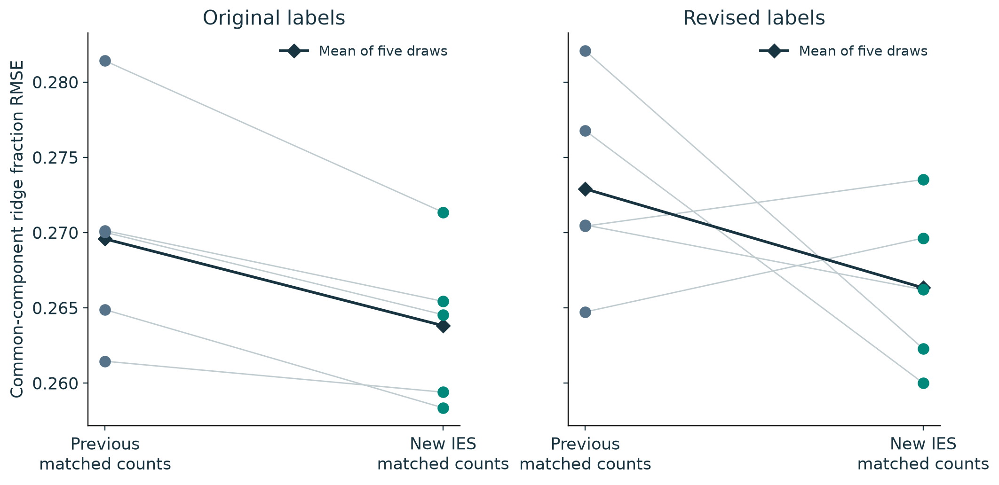
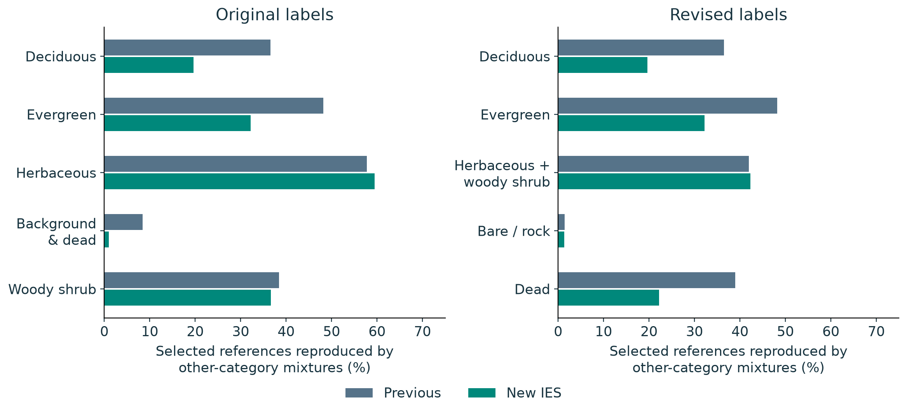

# Are the new IES endmembers and categories better?

**Internal matched-library readiness comparison | 22 October 2026**

The new selection and the new category scheme are two separate changes. This experiment tests each one, with both methods seeing exactly the same target spectra and known synthetic weights. Read the point estimates together with the category-specific errors, paired intervals and geographic limits below.

## Short answer

**The new references improve synthetic fraction recovery in this matched experiment, but they are not better on every diagnostic.** With original labels held fixed, common-component RMSE changes from **0.283 to 0.258 for ridge** and **0.351 to 0.313 for exhaustive MESMA**. Smaller is better; these are fraction errors, not percent accuracies.

**The revised categories help MESMA more than ridge.** With the new reference spectra held fixed, changing labels moves MESMA's common-component RMSE from **0.313 to 0.295**, while ridge changes from **0.258 to 0.260**. The revised scheme trades separate herbaceous/shrub estimates for separate dead/bare estimates. It is a different scientific target, not a universally better PFT classification.

**Use the new selection as a stronger candidate for the next validation stage, not as a validated field abundance product.** Ridge has lower point error than MESMA in these configurations, but their training information, priors and output constraints differ. The equal-count control shrinks the ridge selection gain. Dead-material recovery remains a specific weakness for MESMA, despite improved pooled performance.

## What changed, and what was held fixed?

The new files contain **501 spectra from 324 polygon IDs**. Their labels are Deciduous (122), Evergreen (180), Herbaceous_woody_shrub (97), Bare_Rock (75) and Dead (27). The merged herbaceous/shrub class consists of 37 originally herbaceous references and 60 originally shrub references.

The previous library has 603 spectra from 367 IDs. Eleven references have mixed/unspecified backgrounds that cannot be labelled bare/rock or dead. To isolate relabelling on the same usable references, the primary previous library is therefore **592 spectra from 359 IDs**. The archived 603-member results remain untouched.

Figure 1. Counts in six source groups before relabelling. The primary previous library has 592 eligible references (11 of the original 603 have mixed/unspecified backgrounds); the new library has 501. Revised labels merge herbaceous/shrub and split bare/rock from dead. Counts are references, not independent plants.

The CSV and new NumPy spectra agree exactly. A one-to-one flight/GlobalID/pixel/row/column join verifies that the new CSV row numbers are **one-based**; the old selection is **zero-based**. No shifted-row assumption is used. The NumPy class list agrees exactly with the new CSV's `new_class` labels. The supplied numerical values retain the earlier array scale, not independently validated physical reflectance units.

The common observed target set contains **3,904 polygon/year curves from 3,021 IDs**. It excludes all **540 IDs** selected by either library, and mixed/unspecified backgrounds. The latter account for **930 archive rows from 86 IDs**; they are not guessed into a new category. This is still an **internal** evaluation: excluding selected parents does not retroactively make archive-wide selection blind.

## 1. Typical spectral coverage improves; category recognition is mixed

Under the original five labels, macro same-category distance changes from **0.01509 to 0.01218**, while mean category recall changes from **59.3% to 56.0%**. Under the revised labels, recall is **58.0% versus 56.9%**. Recall means the proportion of a labelled category recovered correctly, averaged equally across categories; it is not precision.

Figure 2. Both libraries predict the same 3,904 observed polygon/year targets from 3,021 IDs, excluding all 540 selected parent IDs. Annual scores are weighted so each ID contributes equally within its category. New references cover typical spectra more closely, but nearest-reference category recognition does not improve uniformly. This is an internal nearest-reference diagnostic, not the earlier trained NEON classifier.

The revised new library recognizes **Evergreen well**, but **Dead** and the merged **Herbaceous + woody shrub** category remain difficult. Merging herbaceous and shrub prevents confusion *between those two labels* by definition; it also removes the ability to recover their separate abundances. Splitting background adds a new question that must be supported by actual dead/bare examples, rather than by a better-looking pooled score.

Supplementary paired-ID coverage intervals are in `tables/paired_coverage_comparisons.csv`. They resample IDs within true categories after averaging annual scores. They are exploratory, conditional on sampled IDs, and assume identity-level independence; they do not account fully for geographic clustering.

## 2. Synthetic fraction recovery: direct method and category comparisons

**Primary score:** fraction RMSE on the same four components: deciduous, evergreen, herbaceous+shrub, and background. Both five-label predictions are explicitly coarsened to those components. This makes cross-taxonomy comparisons meaningful; comparing two different five-category RMSEs alone would not.

Figure 3. The exact same 568 synthetic observations are scored after both output schemes are reduced to four common components: deciduous, evergreen, herbaceous+shrub and background. This avoids comparing errors in incompatible category spaces. MESMA searches all one-to-three-category models; ridge is tuned using polygon-disjoint training groups. The dashed prior uses training-design fractions, with no spectral information. These are known algebraic weights, not field cover.

| References | Fit labels | Method | Native five-class fraction RMSE | Common four-component fraction RMSE | Mean spectral RMSE |
| --- | --- | --- | --- | --- | --- |
| old | original | ridge | 0.2698 | 0.2834 | - |
| old | original | mesma | 0.3340 | 0.3513 | 0.0015 |
| old | original | prior | 0.2943 | 0.3170 | - |
| new | original | ridge | 0.2511 | 0.2583 | - |
| new | original | mesma | 0.3047 | 0.3133 | 0.0006 |
| new | original | prior | 0.2943 | 0.3170 | - |
| old | revised | ridge | 0.2778 | 0.2872 | - |
| old | revised | mesma | 0.3073 | 0.3257 | 0.0014 |
| old | revised | prior | 0.2943 | 0.3170 | - |
| new | revised | ridge | 0.2530 | 0.2596 | - |
| new | revised | mesma | 0.2902 | 0.2954 | 0.0005 |
| new | revised | prior | 0.2943 | 0.3170 | - |

MESMA uses the unchanged active-face kernel to search **every permitted one-to-three-category model**, with one reference per active category. The four model counts are recorded in `models/*_mesma_metadata.json`; no target-specific shortlist is substituted. Ridge uses identical 71-recipe designs within each selection and parent-disjoint three-group tuning over five fixed penalties. The same training spectra are used for both output label schemes within each library. All target parents are absent from every training library.

Synthetic targets include six atomic source groups, allowing the same observation to contain two parents that one scheme merges into a single category. This is intentional: the geometry and output restrictions change when categories merge. The 568 mixture rows share **48 generating parents in eight disjoint six-parent bundles**; they are not 568 independent plants. Each bundle includes six pure spectra, 45 pair mixtures (10/50/90%) and 20 equal-third triple mixtures. The recipe is controlled and cannot establish performance on arbitrary physical mixtures.

## 3. Does the improvement come from references or category names?

Figure 4. Each interval resamples the same eight whole parent bundles (1,999 paired bootstrap draws). Left isolates the supplied reference selection within one label scheme. Right compares the label scheme within one fixed selection. These conditional intervals describe sensitivity to eight sampled parent bundles, not independent geographic validation or population confidence guarantees.

| comparison | baseline | alternative | common_RMSE_delta | conditional_2_5 | conditional_97_5 |
| --- | --- | --- | --- | --- | --- |
| selection | old/original/ridge | new/original/ridge | -0.0252 | -0.0345 | -0.0149 |
| selection | old/original/mesma | new/original/mesma | -0.0380 | -0.0538 | -0.0237 |
| selection | old/revised/ridge | new/revised/ridge | -0.0275 | -0.0379 | -0.0162 |
| selection | old/revised/mesma | new/revised/mesma | -0.0303 | -0.0443 | -0.0154 |
| category_scheme | old/original/ridge | old/revised/ridge | 0.0037 | 0.0014 | 0.0061 |
| category_scheme | old/original/mesma | old/revised/mesma | -0.0256 | -0.0423 | -0.0091 |
| category_scheme | new/original/ridge | new/revised/ridge | 0.0014 | 0.0003 | 0.0025 |
| category_scheme | new/original/mesma | new/revised/mesma | -0.0179 | -0.0308 | -0.0057 |

The ridge relabelling check is especially informative: all four primary fits choose penalty 10, and raw predictions of the four shared components agree across schemes to numerical precision. Their small displayed score differences arise when fractions are projected onto the five-category simplex (nonnegative weights summing to one) *before* coarsening. This is a constraint-geometry effect, not added spectral information. `tables/ridge_relabelling_geometry.csv` also records projection directly in the common four-component space, where both label schemes give the same prediction.

For MESMA, the revised labels change admissible combinations: a model may now contain both bare/rock and dead references, but cannot contain separate herbaceous and shrub categories. The score change therefore reflects a changed model family as well as a changed ecological question.

Negative changes favor the replacement. A range entirely below zero supports a consistent gain across these sampled parent bundles; it is not proof of field abundance accuracy. New-reference versus old-reference comparisons hold the label space fixed. Revised versus original label comparisons hold reference membership fixed, so an apparent benefit cannot be attributed simply to changing both at once.

## 4. Which categories and acquisition settings remain difficult?

Figure 5. Per-category fraction errors expose the costs of the chosen categories. Compare old versus new references within a panel and method. Errors across the two panels represent different biological targets and are not directly interchangeable. The revised scheme cannot estimate herbaceous and shrub separately; the original scheme cannot estimate bare/rock and dead separately. The last column is the no-spectrum training-design prior.

Figure 6. These are site/year breakdowns of common targets under global fixed libraries, not held-site experiments. The dotted line is the no-spectrum training-design prior. Each cell has two independent parent bundles; repeated mixture rows are not additional independent plants. Domain differences qualify any pooled improvement.

For the new revised library, dead-material fraction RMSE is **0.259 for ridge** and **0.292 for MESMA**, compared with **0.278 for the no-spectrum prior**. This is why the new split should not be treated as already validated. Its 27 selected dead references represent only 21 polygon IDs.

The three sites and four site/year cells do not separate geography from year. These plots evaluate targets from each cell using reference libraries that include those sites. They are **not leave-one-site-out validation**. Category annotations are retrospective 2023/2024 labels reused across imagery years, and labelled polygons are not certified pure materials.

## 5. Does the ridge comparison survive matching library size?

Figure 7. Five draw pairs match the exact reference count in each of six atomic source groups (476 references per draw). The gain in ridge becomes smaller. Parent and site distributions are not matched, and five draw outcomes are not a population uncertainty interval. Full-library results therefore describe these supplied libraries, not proof that IES is intrinsically superior.

| scheme | old_mean | new_mean | mean_new_minus_old | new_better_draws | draws |
| --- | --- | --- | --- | --- | --- |
| original | 0.2696 | 0.2638 | -0.0058 | 5 | 5 |
| revised | 0.2729 | 0.2663 | -0.0066 | 3 | 5 |

These controls reduce the attribution problem but do not eliminate it: the selected parent identities, sites and within-parent pixel distributions still differ. The result concerns these supplied libraries, not a general proof that the IES algorithm is a better selector.

## Supporting diagnostic: are selected spectra compositionally unique?

Figure 8 (supporting diagnostic). Verified nonnegative sum-one cross-category reconstructions at RMSE <=1e-8. Candidate counts and target reference points differ between libraries, so lower certificate frequency alone does not prove a better selector. The certificate family allows multiple references/category and is broader than three-category MESMA. Missing certificates do not prove uniqueness.

The original-label certificate rates are **37.2%** in the previous eligible library and **25.3%** in the new library. The revised-label rates are **37.5%** and **25.9%**. These are different sets of target spectra and different candidate hulls; their sizes and sampled positions contribute to this diagnostic.

The known-parent positive control recovers the six atomic weights at RMSE **8.94e-15**. The solver can recover the constructed weights when the actual generating references are supplied. Failure with an operational library therefore cannot automatically be blamed on the solver. Conversely, a perfect reconstruction does not establish unique composition or physical field accuracy.

## What “ready” means here

Use three separate decisions: whether the supplied references improve synthetic fraction recovery; whether the revised ecological categories answer the intended research question; and whether independent field data validate the predictions. The first two can be assessed internally. The third is still missing.

Do not describe these tests as validated field cover, independent actual Landsat observations, or a universal sensor calibration. OLI channels are derived from NEON. Physical reflectance scaling, material purity, spatial alignment and independent contemporaneous fractional-cover measurements remain unresolved validation needs. Freezing the candidate library and evaluating independent observations is the next decisive step.

This target set differs from the October 19 360-target experiment: it has six atomic parent groups, excludes the union of both selections, and omits unresolved background categories. Historical scores must not be compared directly with these new scores as though the targets and recipes were identical.

## Reproducibility

Input hashes, source identity alignment and exclusions: `input_audit.json`. Frozen comparison design, code/kernel fingerprints and label maps: `protocol.json`. Exact reference IDs, target memberships, predictions, category/domain errors and paired summaries: `tables/`. Ridge preprocessing/coefficient values and tuning memberships: `models/`. Exhaustive class-set checkpoints: `checkpoints/`. Figure/source links: `figure_manifest.json`. Numerical and synthetic regression checks: `VALIDATION.md` and `validation.json`.

Original files were read in place. No raw spectral library or Parquet copy was made. Only compact identity/score tables, synthetic targets, model parameters and search winners were saved. No historical report, package algorithm or production default was changed. The earlier collaborator PDF remains based on the previous evidence; this experiment is a separately versioned update.
