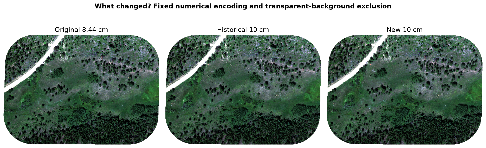
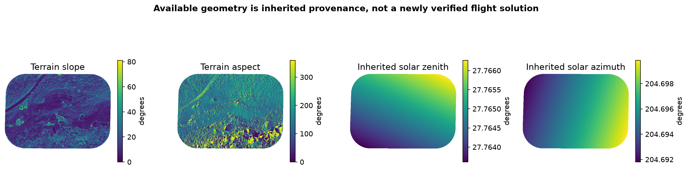
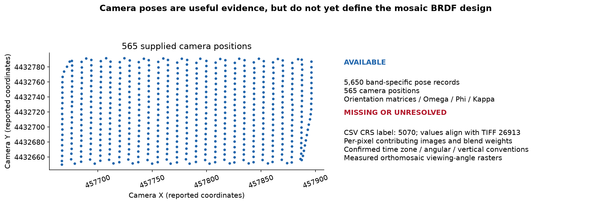
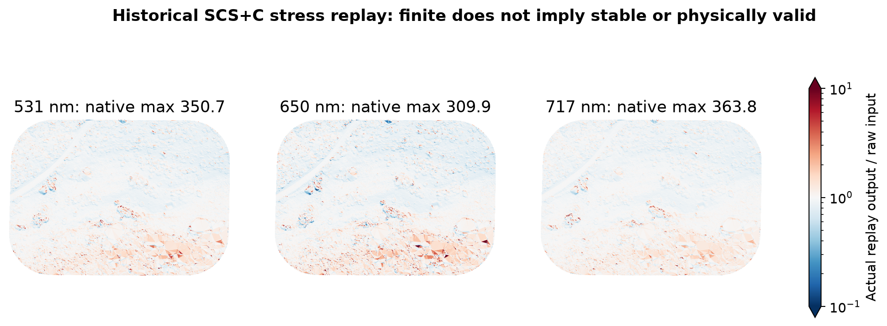
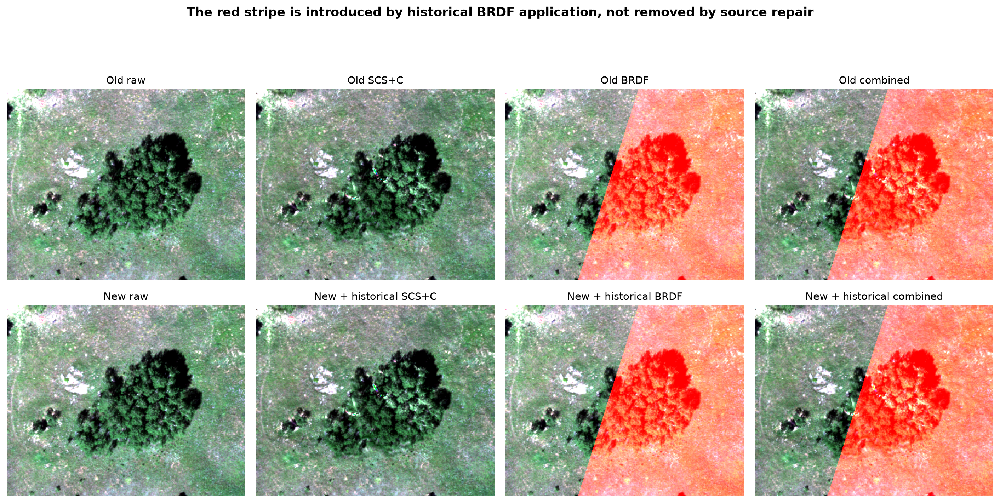
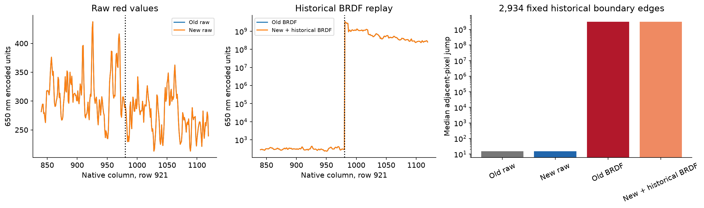
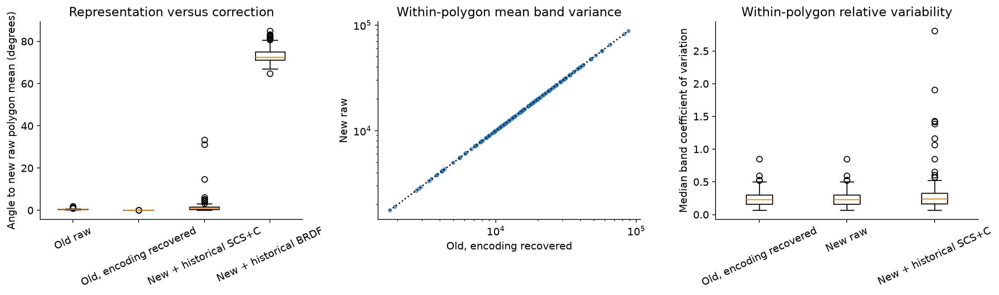
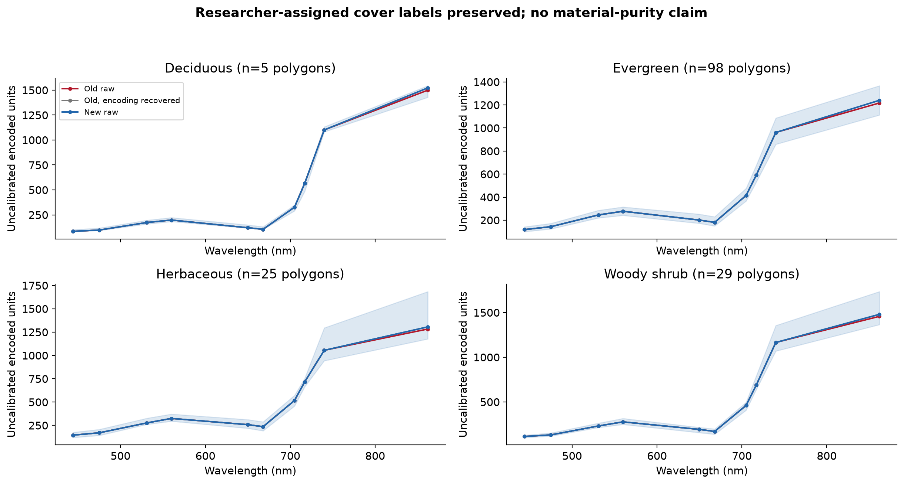
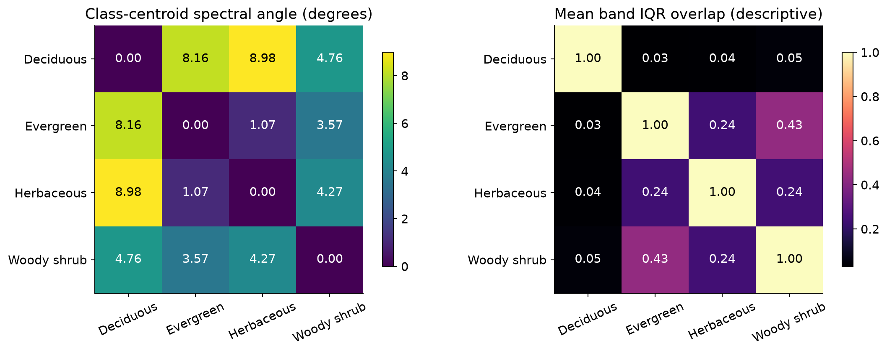

# Goldhill Reprocessing: End-to-End Validation of Corrected Drone Imagery

November 3, 2026. P169 experimental validation; no production overwrite/upload.

## 1. Goldhill Reprocessing: End-to-End Validation of Corrected Drone Imagery

The new source is a more faithful numerical preprocessing input. It does not yet support an approved physical correction or official spectral library.

| Decision area | Outcome |

| --- | --- |

| Source preprocessing | READY as documented uncalibrated 10 cm / fixed-10K numerical input |

| Raw numerical export and membership | EXECUTED: exact finite values, masks, CRS and orientation preserved |

| Physical topographic / BRDF / combined | UNSUPPORTED: calibration missing; sensor views not assigned; time-zone/per-pixel timing still unverified |

| Landsat physical translation / official library | UNSUPPORTED: physical-input safeguard correctly blocks execution |

| Native MicaSense subsets | EXECUTED as wavelength-selected numerical diagnostics only |

| Research-category recognition | 157 polygons, four recorded classes, 66.8% raw balanced accuracy before and after |

| Abundance / physical accuracy | NOT VALIDATED: no independent abundance or physical-reflectance reference |

- The report separates actual production calls, unsupported stages and unchanged historical replays. No scientific safeguard was disabled.

- The red stripe persists in the historical BRDF replay. A visually improved source does not repair an unsupported correction model.

November 3, 2026 | P169 | SpectralBridge science-team experiment

No production imagery, official library or CyVerse object was overwritten or uploaded.

## 2. A better numerical source, with the physical question still open

The original approximately 8.44 cm UInt16 orthomosaic was converted directly to 10 cm using S = DN x 10000 / 65535. There is no band-minimum subtraction, clipping or integer quantization.

Actual raw sources, RGB=650/560/475 nm. A common new-raw 2-98% RGB stretch is applied to all three after the explicit original-to-fixed numerical encoding. White is missing/transparent; no corrected image or physical calibration is implied.

- The declared original alpha mask excludes transparent samples before bilinear interpolation. The new file has ten spectral bands and an internal GDAL validity mask.

- Nominal encoding 0-10,000 does not force each observed band to fill that interval. Physical reflectance calibration remains UNVERIFIED.

## 3. Background is no longer treated as observed signal

All 537,552 occurrences of 65,535 in each original band lie in transparent background. None is a measured saturated pixel. The historical interpolation allowed this background to mix into boundary pixels.

All maps use the same grid/extent. Left codes: 0 missing both, 1 old-only, 2 new-only, 3 both. Middle uses the recovered fixed encoding, separating minimum normalization from interpolation/masks. The >2 display flag is a diagnostic threshold, not a scientific approval rule.

- New source support: 6,683,944 pixels. Historical finite-H5 support: 7,068,376 pixels. These counts are not equivalent observation masks.

- Within the new footprint, 3,244 old red-band values exceed the original observed maximum under the same fixed encoding. The new source excludes transparent samples during interpolation; no value clipping is used.

## 4. Aligned inputs do not establish correct solar provenance

Actual TIFF-to-H5 and H5-to-ENVI package functions preserved all finite values and missingness, EPSG:26913, the affine grid, band order and source footprint. Sensor viewing datasets were deliberately not created.

Terrain/solar grids align with the new TIFF. Original photo tags now support the inherited August 15 scene timestamp despite the nominal August 14 package note/name. Explicit time-zone/clock validation and per-pixel camera assignments remain unresolved.

- Wavelengths: 444, 475, 531, 560, 650, 668, 705, 717, 740, 862 nm. FWHM: 28, 32, 14, 27, 16, 14, 10, 12, 18, 57 nm, inherited from the established source H5.

- Inherited solar metadata says 2023-08-15T19:53:07; original package notes identify 2023-08-14 at 13:41 local. The original photo metadata supports August 15: all 5,650 linked cameras match unique August 15 tags; the inherited solar time is 5.5 seconds from their midpoint. Explicit time-zone/clock and per-pixel time assignments remain unverified.

## 5. Camera orientations arrived; the per-pixel observation model did not

The supplied CSV contains camera locations and band-specific rotations, which improves the available provenance. It does not identify the camera observations or blend weights contributing to each mosaic pixel.

Points are shown in the reported coordinate numbers without silently relabeling the CRS or assigning footprints. Current source H5 deliberately has no sensor-view datasets. Historical zero-view controls are not treated as measured observations.

- The CSV states CRS 5070, while its coordinate values fall with the TIFF in UTM 13N / EPSG:26913. The CRS and angular/vertical conventions need confirmation.

- Actual production BRDF receives no per-pixel sensor angles. The direct fit reports missing sensor_zn; the correction driver reports UNSUPPORTED. The known legacy zero-view control has rank 1 of 3, but is not treated as measured viewing geometry.

## 6. Photo metadata supports August 15 and the inherited scene midpoint

The nominal August 14 package name/note conflicts with the original photo tags. All 6,095 raw metadata rows are dated August 15; all 5,650 supplied camera records join uniquely, without missing or ambiguous IDs.

Matched camera records span 19:42:38-20:03:47 on August 15. The midpoint is 19:53:12.5, only 5.5 seconds from the inherited solar timestamp. Numerical agreement supports that timestamp; explicit clock/time-zone accuracy and mosaic pixel contributors are not established.

- Matched timestamps span 19:42:38-20:03:47. Their midpoint is 19:53:12.5; the inherited solar computation used 19:53:07. This is positive source evidence for that scene timestamp, not a reason to discard it based only on the package name.

- The CSV does not state the time zone or independently verify camera clock accuracy. Per-photo times are now recoverable by ID, but each orthomosaic pixel still needs its contributing images/weights before those times and views can be assigned scientifically.

## 7. Production functions executed; refused stages stay refused

Each result below comes from an actual package call. A raw export or native-band subset is an uncalibrated numerical product, not a physical correction.

| Actual function / stage | Final status | Meaning |

| --- | --- | --- |

| convert_drone_tiff_to_h5 / export_h5_to_envi | EXECUTED | Exact grid, finite values, NoData and mask checks pass |

| apply_drone_corrections: no correction | EXECUTED | Raw numerical baseline; calibration remains UNSUPPORTED |

| apply_drone_corrections: topographic | UNSUPPORTED | Authoritative physical scale, offset, units and provenance absent |

| fit_scs_c_coefficients: direct current API | UNSUPPORTED | Same physical-radiometry safeguard |

| apply_drone_corrections: BRDF / combined | UNSUPPORTED | Physical calibration missing; no valid combined result produced |

| fit_and_save_brdf_model: direct current API | UNSUPPORTED | Per-pixel sensor_zn unavailable |

| apply_drone_translation: Landsat 5/7/8/9 | UNSUPPORTED | Physical-input requirement; no coefficients or units fabricated |

| ensure_matched_source_product: two MicaSense sets | EXECUTED | Native wavelength selection only, unverified-unit metadata retained |

| build_polygon_pixel_index | EXECUTED | 144,749 memberships, 158 intersecting identities |

| extract_polygon_parquet_from_envi | UNSUPPORTED | Approved physical-library requirement |

- The caller initially omitted output directories for the raw-copy and matched-subset helpers. Those setup errors were corrected and the actual calls rerun successfully; initial outcomes and both logs are retained.

- No alternate correction algorithm, neutral current coefficient set or fabricated calibration was substituted. The normal drone route uses native MicaSense band selection and versioned bulk-affine Landsat plans; no hyperspectral SRF convolution was fabricated from ten sparse bands.

## 8. Historical SCS+C is a stress test, not approval

The unchanged historical fit/application functions were replayed with the new encoded source and inherited terrain/solar arrays. Their model guards are retained and all output magnitudes remain uncapped.

Only the unchanged historical implementation is replayed here; current production SCS+C is blocked by calibration. Color under/over triangles expose values beyond 0.1-10; analytical maxima are retained. The red maximum is 309.9 near a 0.001 denominator.

- Red factor maximum: 309.9 at row 1178, column 1533. Slope is 41.89 degrees, illumination cosine 0.34826, fitted C=-0.34725, denominator 0.001005. This is near cancellation of model terms, not proof of a valid 310-fold physical illumination adjustment.

- On common support, 11,305 red pixels receive factors above 10. Current production SCS+C was blocked. Missing calibration, unverified time-zone/per-pixel timing and this numerical instability prevent a defensible production recommendation.

## 9. Source repair does not repair the historical BRDF denominator

The unchanged saved model and historical code were applied only inside the explicitly marked replay namespace. The source change leaves the old geometry/model mechanism in place.

Same previously selected 50.1 x 40.1 m ROI, same RGB=650/560/475 nm and display limits. Historical corrections are unsupported diagnostics. Extremely large red values saturate this display; uncapped values and jumps are reported numerically.

- The new raw image has no comparable algorithmic red discontinuity. The historical replay still turns ordinary red-band values into billions of encoded units.

- Saved neutral coefficients in historically under-supported bands remain historical evidence, not successful new fits. Current package safeguards do not silently replace the missing fit with neutral coefficients.

## 10. Measure the discontinuity on a fixed boundary

A previously defined row/ROI and 2,934 boundary edges fixed from the historical red factor were reused. All branches share the same valid comparison support.

The raw fixed edge jump is 5.586 encoded units; the new historical-BRDF replay jumps 3.372 billion. Boundary edges were fixed from the old factor before new-branch evaluation. This is a mechanism replay, not a valid new BRDF fit.

- At row 921, columns 980-981: new raw jump 5.586; new historical-BRDF replay jump 3.37e+09 encoded units.

- Median absolute edge jump: new raw 15.383; historical replay 3.15e+09. The source cleanup does not remove a pathological model/reference prediction.

## 11. The main raw spectral-angle change is an encoding effect

Old native encoding, old data recovered to the fixed encoding, and the new source were kept separate. Comparisons use the same pixel memberships, so coverage changes cannot create an apparent quality improvement.

All 157 polygons use identical valid pixels. Recovering the old encoding accounts for most raw spectral-angle change; the remaining median pixel angle is about 0.00077 degrees. Variance and CV are descriptive numerical metrics, not physical validation.

- On 144,406 matched polygon pixels, median angle from old raw to new raw is 0.4743 degrees. After recovering the old encoding, it is only 0.000773 degrees. This residual does not establish physical accuracy.

- Median within-polygon band CV is 0.232002 for new raw versus 0.231988 for the old fixed-encoding control: essentially unchanged, with a tiny increase. Median mean-band variance is 15,618 versus 15,617 encoded-unit squared. Do not call that improved homogeneity.

## 12. Keep the researcher labels and the sampling unit

The canonical package index supplies membership. Experimental numeric spectra retain GlobalID, cover_category, species, flight identity, source hash, branch and pixel count. Approved physical extraction remains blocked.

Class medians and new-raw polygon IQR on matched support. The gray inverse-encoding control nearly overlays the new source; NIR differences versus old raw mainly reflect the removed band-specific offset. Non-vegetated & dead is absent, not reassigned.

- Matched sample: 157 non-overlapping polygon representatives and 144,406 memberships. Recorded classes are Evergreen 98, Woody shrub 29, Herbaceous 25 and Deciduous 5. Non-vegetated & dead is absent and is not invented or reassigned.

- All-band scene comparison uses 6,678,404 common pixels. Raw-only comparison uses 6,683,944. Native mask changes affect 277 canonical polygon memberships before matching; common sampling removes this coverage confound.

## 13. Separation and identification answer different questions

The package spectral_separability function ran 499 synchronized permutations with explicit equal weights on the ten discrete bands. It provides conditional pairwise tests, not physical purity or abundance. Polygon exchangeability is assumed; fine spatial confounding is untested, Holm adjustment is within branch, and across-branch comparisons are exploratory.

New-source polygon diagnostics: Evergreen/Herbaceous centroid shapes are only 1.07 degrees apart; Evergreen/Woody shrub has substantial IQR overlap. Distinct centroids or significant permutation tests do not establish reliable individual identification.

- Evergreen versus Herbaceous centroid angle is 1.07 degrees; Evergreen versus Woody shrub has mean band-IQR overlap 0.432. These are descriptions of the retained single-flight researcher categories.

- Woody shrub remains difficult to identify. The new-raw held-polygon recalls are Deciduous 4/5, Evergreen 73/98, Herbaceous 17/25 and Woody shrub 13/29. Five deciduous identities are too few for a precise generalization claim.

## 14. No detected identification gain from the new raw source

The actual evaluate_identifiability API used identical three-fold polygon-disjoint splits, training-only scaling, fixed C=1, and no pixel-level replication as training samples. All branches use the same 157 identities.

157 non-overlapping polygon identities, three identical grouped folds, training-only standardization and fixed C=1. Old and new raw produce identical predictions and 66.8% balanced accuracy. Corrected bars are unsupported historical experiments; a higher score does not approve a correction.

- Old raw, old recovered encoding and new raw all score 66.829% balanced accuracy, with identical out-of-fold predictions. A conditional bootstrap of those fixed predictions has zero paired difference, but omits training/model uncertainty and does not establish population equivalence.

- Historical topographic replay scores 71.7%, while historical BRDF replay scores 60.0%. These remain unsupported corrections. A higher classification score cannot establish correct physical reflectance or justify near-singular correction factors.

## 15. Spectral structure is largely retained; abundance stays unvalidated

PCA summarizes the paired spectral distributions after bringing old data to the same numerical encoding. It is a descriptive figure, separate from the classifier training and test splits.

One descriptive pooled standardized PCA basis on paired polygon means; this visualization is not part of classifier training. Both representations retain nearly the same structure. No independent physical accuracy, species purity or abundance claim follows.

- The nearly coincident paired structure is consistent with little change in interior polygon spectra after the encoding control. It does not establish transfer to another flight, site or year.

- Abundance estimation is NOT_EVALUATED: no independently verified physical endmember library, fractional-cover ground truth or abundance-validation design was supplied. Category recognition is not an abundance-accuracy test.

## 16. Direct answers for production decisions

The source repair succeeds as numerical preprocessing. It does not make the complete physical correction pipeline ready.

| Question | Answer |

| --- | --- |

| 1. More reliable numerical/spatial source? | YES: common fixed encoding, original alpha honored, exact ingestion grid/value/mask checks. Physical accuracy remains unverified. |

| 2. Background contamination eliminated? | YES for transparent-source contribution in the new derivative: alpha=0 is excluded before interpolation. Edge/field validity still needs normal source QA. |

| 3. Topographic correction stable and defensible? | NOT ESTABLISHED. Current API is blocked; historical stress factors reach 310x in red near a vanishing denominator, before physical and illumination validation. |

| 4. BRDF supported by available geometry? | NO. Camera poses are not mapped to mosaic pixel contributors; actual sensor angles are unavailable and calibration is missing. |

| 5. Does the historical red stripe persist? | YES in the historical replay on the new source. It is introduced by old BRDF application; no approved new BRDF result exists. |

| 6. Are PFT spectra more consistent? | NO material improvement detected on matched interior polygon support after controlling the old encoding; variability changes are tiny or mixed. |

| 7. Improved separability/identifiability? | NO identification gain in this experiment: identical raw predictions / 66.8% balanced accuracy. Some classes remain overlapping or poorly identified. |

| 8. Safe for future production? | READY for documented numerical preprocessing/raw QA; NOT READY for approved physical correction, translated physical products or an official spectral library. |

| 9. Before official library regeneration? | Recover physical calibration, confirm acquisition time and camera/CRS conventions, recover per-pixel view/contributor information or a justified independent model, validate correction stability, then regenerate in fresh versioned outputs. |

Do not upload or replace the official library with any diagnostic replay or numeric-only experimental Parquet.

A separate empirical reference/independent domain test is still needed before claiming physical or abundance accuracy.

## 17. What ran, what is retained, and what passed

All artifacts belong to a new dated experiment. Reproduction preserves source bytes and logs every scientific refusal rather than converting a failed stage into apparent success.

| Reproducibility item | Record |

| --- | --- |

| Evidence folder | provenance/goldhill-end-to-end/2026-11-03/ |

| Large experimental rasters and numeric tables | /private/tmp/goldhill-end-to-end-20261103/ |

| Source identity | input_manifest.json: new/original/historical sources, poses, polygons, saved model and code hashes |

| Software revision | 2444902440a48453ed14855473d3250020ba8bb3 |

| Production API outcomes | production_stage_results.json; per-stage audit JSON; ingestion.json; both execution logs |

| Scientific measurements | Stage masks/counts; native/common scene distributions; boundary jumps; factors; polygon/PFT tables; fixed grouped-fold memberships |

| Diagnostic isolation | Historical code/model hashes unchanged; no current safeguard bypass and no invented physical coefficients or viewing angles |

| Tests | 134 targeted unit/integration tests pass, including new uncalibrated-mask/zero/grid/guard contracts |

| Figure/PDF QA | 13 actual-data figure pairs; PDF pages rendered and visually reviewed; source/production-code preservation verified |

| Production writes | None: no CyVerse upload, source edit, official corrected raster replacement or library replacement |

- Use run_pipeline.py, audit_photo_times.py, analyze.py and figures.py, then write_report.py, make_pdf.py and verify.py. Paths and source identities are explicit; restore the documented local inputs before running elsewhere.

- This report deliberately contains no approved physical corrected Goldhill branch. That is the scientific eligibility result of the end-to-end exercise.

