# From spectral exploration to scientific readiness

A curated visual story for the SpectralBridge lab group

## Figure 1. The sampling structure sets the limits of every result

What counts as replication, and which cohorts dominate?

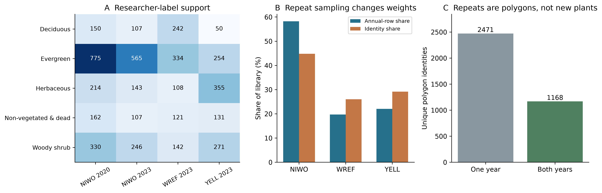

**How to read:** A: category counts by site and image year. B: annual-spectrum share versus unique-polygon share. C: polygons observed in one or both years. NIWO, WREF and YELL are the three source-site codes.

**What to understand:** The library contains 85,706 extracted pixel records, 3,639 polygon identities and 4,807 polygon/year spectra. All 1,168 repeated-year identities are at NIWO. Counting annual rows equally increases NIWO weight: 58.2% of annual spectra versus 44.8% of unique identities.

**Limits:** GlobalID identifies a polygon footprint, not a verified individual plant. Field annotations dated 2023/2024 were reused across image years. Native coordinate spacing is 1 m; median extracted support is two pixels per polygon/acquisition. Three sites cannot represent all regions.

Evidence: provenance/scientific-closure/2026-10-15/tables/observational_support.csv, provenance/scientific-closure/2026-10-15/tables/sampling_weight_effect.csv, provenance/scientific-closure/2026-10-15/tables/annotation_year_audit.csv, provenance/scientific-closure/2026-10-15/tables/native_spatial_support.csv

## Figure 2. Species have recognizable shapes, with substantial overlap

What did the first trace plots actually show?

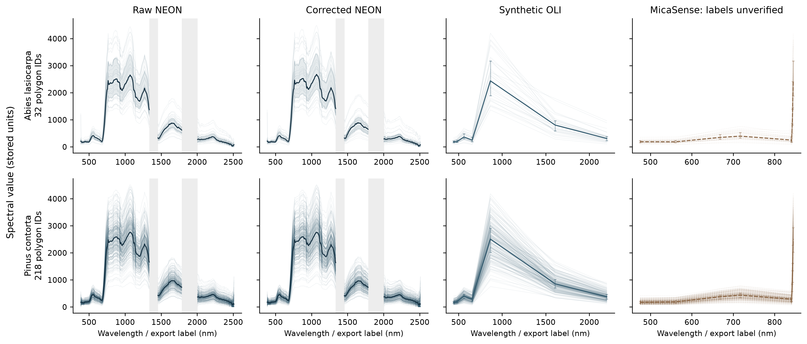

**How to read:** Rows are selected named species; columns separate raw NEON, corrected NEON, derived OLI and archive MicaSense values. Thin curves show polygon summaries; the heavy curve is the displayed central summary. Use the original axis labels: these are stored spectral values, not verified unitless reflectance.

**What to understand:** The red-edge rise, high near-infrared signal and shortwave-infrared structure are visible, but spectra within a species span a broad range. Correction changes magnitudes; OLI retains only a few channels. This motivated distribution plots rather than one representative line per species.

**Limits:** These are illustrative species, not the whole cohort. Traces join measured channels for readability and do not create extra bands. MicaSense coordinates are unverified: the sharp right-edge pattern cannot be interpreted biologically. Derived OLI and MicaSense are not independent satellite/drone observations.

Evidence: provenance/plot-report/2026-10-13/README.md, output/pdf/plant_spectral_review/report_evidence.json

## Figure 3. Corrections and darkening are distinct operations

How much did processing change the observed values?

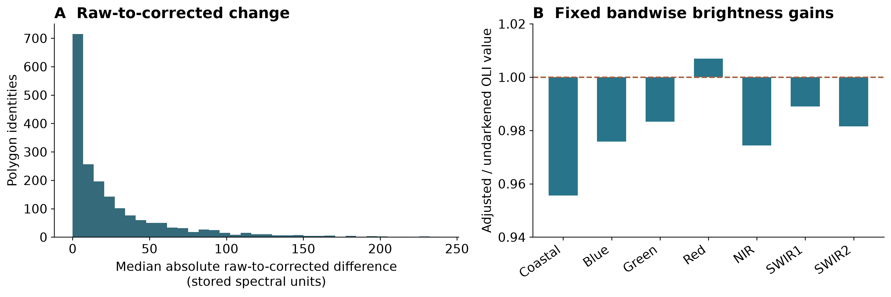

**How to read:** A: the histogram counts selected polygon identities by median absolute raw-to-corrected difference. B: saved per-band ratios show the OLI adjusted/undarkened gain; the dashed line is no change. Values below one reduce a band and values above one increase it.

**What to understand:** Most selected polygons have smaller correction differences, with a long tail. The operation called darkening is a fixed bandwise brightness adjustment, not a guarantee that every band gets darker. Its standardized matched group effects change by less than 8.8e-8, consistent with positive scale invariance.

**Limits:** The histogram uses 1,886 selected labelled identities and stored units; it does not validate the physical correction. Scale-invariant tests cannot decide whether absolute radiometry improved. That question is addressed by the separate real-sensor pilot.

Evidence: output/pdf/plant_spectral_review/report_evidence.json, provenance/sensor-pft-transfer/2026-10-14/brightness_audit.csv, provenance/sensor-pft-transfer/2026-10-14/RESULTS.md

## Figure 4. Quantile fans describe variation, not independent plants

Can a family of curves describe more than a species mean?

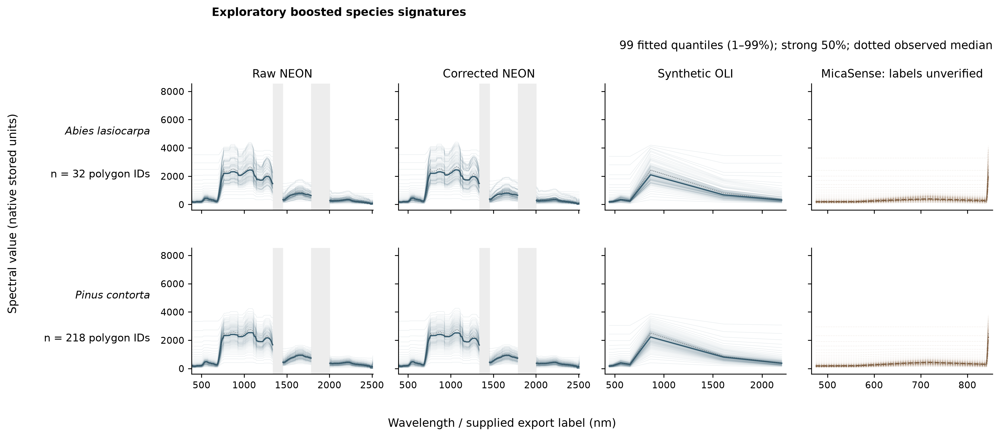

**How to read:** Rows are selected species; each sensor representation has its own column. Thin lines are boosted regressions for percentiles 1 through 99; the heavy line is the fitted median and the dotted reference is the empirical median. Gaps remain excluded rather than interpolated.

**What to understand:** We fitted both species-level and individual-polygon signatures. A fan can represent central and tail behavior and makes curve variability easier to compare. The final exploratory run used 99 quantiles, not an exact 100th percentile or 100 independent observations.

**Limits:** 7,960 fitted signatures are model outputs, not the sample size. Individual signatures can have very little acquisition support; 62 selected polygons have only one observation. A fitted quantile fan is neither a confidence band nor a calibrated probability distribution over new plants.

Evidence: provenance/quantile-models/2026-10-13/VALIDATION.md

## Figure 5. A dramatic upper tail was a fitting warning

Are the outer fitted curves faithful to the observations?

**How to read:** Left: fitted outer curves and empirical reference curves for NIWO Abies lasiocarpa. Right: at 425 nm, compare the fitted and empirical value at each percentile. The upper fitted curve diverges while the empirical tail remains much lower.

**What to understand:** At the 99th percentile and 425 nm, the fitted value is about 3,529 stored units versus an empirical value of about 287. The discrepancy is model behavior. It explains why a dense, visually impressive fan cannot be accepted without empirical checks.

**Limits:** This is a selected failure diagnostic, not the error rate across all wavelengths/species. It does not prove all quantiles fail. The project did not adopt experimental tail-repair pilots as validated replacements.

Evidence: provenance/quantile-models/2026-10-13/VALIDATION.md

## Figure 6. Simple quantile matching did not establish identification

Did the early curve-matching idea recognize held-out species?

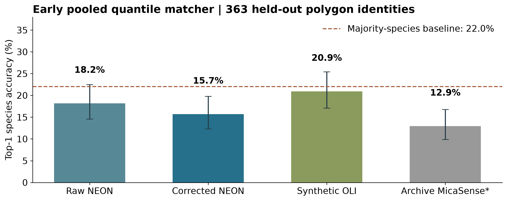

**How to read:** Bars show ordinary top-1 species accuracy for 363 held-out polygon identities in the pooled early benchmark. Error bars are saved Wilson intervals. The dashed line is the majority-species baseline, not random equal-class chance.

**What to understand:** Corrected NEON achieved 15.7% and synthetic OLI 20.9%, below the 22.0% majority baseline. The earlier matching rule was not a useful general species identifier on this split. That motivated explicit class models, balanced metrics and structured holdouts.

**Limits:** This benchmark uses a different task, class cohort, matcher and metric from the later logistic models. Do not subtract these accuracies from later balanced accuracy or attribute the difference to one processing change. MicaSense is shown only as an archived-label diagnostic.

Evidence: output/pdf/plant_spectral_review/accuracy_intervals.csv, provenance/quantile-models/2026-10-13/matching_baselines.csv

## Figure 7. Site-specific plots exposed an uneven comparison

Are the same species equally represented at all sites?

**How to read:** Columns are NIWO, WREF and YELL in image year 2023; rows are selected species. Read n in each panel and the explicit missing/low-support panels before comparing curve shapes. Lines are exploratory boosted quantiles, with an empirical median reference.

**What to understand:** Some species are absent or below the display threshold at a site, while others occur across all three. Geographic composition and spectral change are entangled. This is why a pooled species plot alone cannot answer regional transfer.

**Limits:** Displayed curve shifts may combine environment, acquisition and population composition, as well as fitting error. These selected panels are not a statistical site effect. Year-specific interpretation later uses complete paired NIWO identities and holds test histories out of training.

Evidence: provenance/plot-report/2026-10-13/README.md, provenance/quantile-models/2026-10-13/VALIDATION.md

## Figure 8. There are two different five-group label systems

What does PFT mean in these analyses?

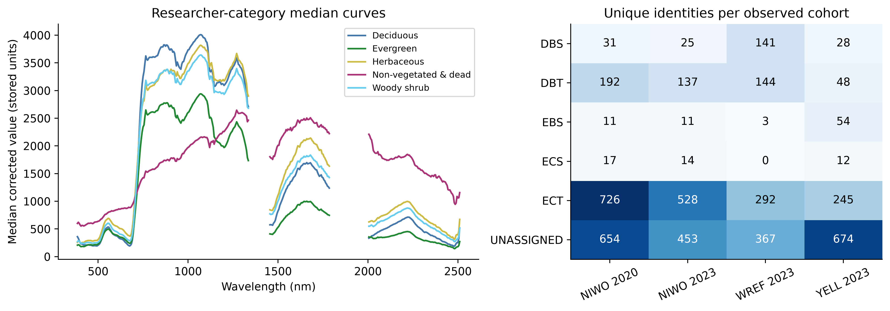

**How to read:** Left: full-cohort median spectra for the five researcher cover categories. Right: inferred woody-PFT identity counts by observed cohort. DBS/DBT are deciduous broadleaf shrub/tree; EBS is evergreen broadleaf shrub; ECS/ECT are evergreen conifer shrub/tree. UNASSIGNED is a missing inferred label, not a sixth PFT.

**What to understand:** Researcher categories use all 3,639 polygon IDs: Deciduous, Evergreen, Herbaceous, Non-vegetated & dead, Woody shrub. Species-derived woody PFTs use 1,944 assigned IDs. These populations answer different questions; the missing-species polygons are still useful for researcher-category analysis.

**Limits:** Non-vegetated & dead is heterogeneous, not a pure soil or dead-material endmember. A species-to-PFT lookup aliases species composition with traits. Neither label system is an independently measured causal physiological treatment. Full-cohort medians are not acquisition-matched contrast estimates.

Evidence: provenance/researcher-pft/2026-10-14/RESULTS.md, provenance/spectral-library-analytics/2026-10-14/tables/library_summary.csv

## Figure 9. Strong and weak woody-PFT contrasts coexist

Which inferred PFT pairs differ, within observed cohorts?

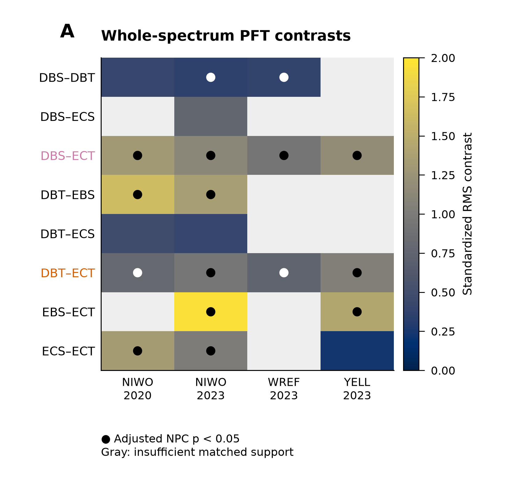

**How to read:** Rows compare PFT pairs; columns are site/year cohorts. Color is standardized root-mean-square curve contrast, not percent accuracy. Dots mark adjusted whole-spectrum test support. Blank cells lack matched support. Use the code definitions on the preceding page.

**What to understand:** Sixteen of 21 eligible NEON contrasts are supported in the fixed family. DBS versus ECT and DBT versus ECT are strong across cohorts; DBT versus ECS is weak in the NIWO years. Differentiation is contrast- and cohort-specific, not a universal statement that every PFT pair is separable.

**Limits:** An acquisition-history-matched permutation test asks whether the sampled group curves differ under its exchangeability assumption. It does not establish nonoverlap, causal trait effects, equal distributions or reliable assignment of a new polygon. Species and site composition remain observational constraints.

Evidence: provenance/sensor-pft-transfer/2026-10-14/RESULTS.md, provenance/publication-figures/2026-10-14/plotted_effects.csv

## Figure 10. The five researcher categories differ, by varying amounts

Does using the researchers' own category field change the answer?

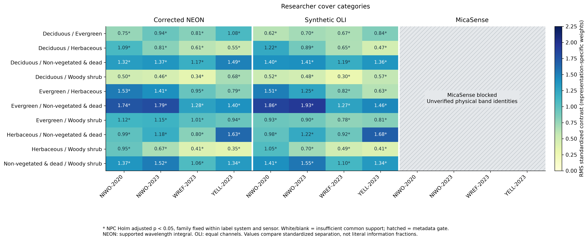

**How to read:** Rows are the ten category pairs, with four site/year cohorts in each representation. Colors/numbers show standardized RMS separation; stars indicate Holm-adjusted combined-test support. Hatched MicaSense cells mean metadata-blocked, not a zero effect.

**What to understand:** All 40 eligible NEON comparisons and all 40 corresponding synthetic OLI comparisons are supported. NEON standardized effects span 0.336 to 1.795. Smaller differences include Deciduous versus Woody shrub at WREF; a uniform significance decision hides large variation in magnitude.

**Limits:** The combined test integrates maximum and distributed curve evidence, with family correction. Primary adjusted p=0.004 is a permutation-resolution floor, not identical effects. An energy-statistic sensitivity supports 38/40, so distribution-wide evidence is less consistent for two comparisons.

Evidence: provenance/researcher-pft/2026-10-14/RESULTS.md, provenance/researcher-pft/2026-10-14/methods_and_effects.csv, provenance/sensor-pft-transfer/2026-10-14/sensor_contrasts.csv

## Figure 11. Differentiation occupies broad spectral regions

Where along the spectrum do two strong contrasts occur?

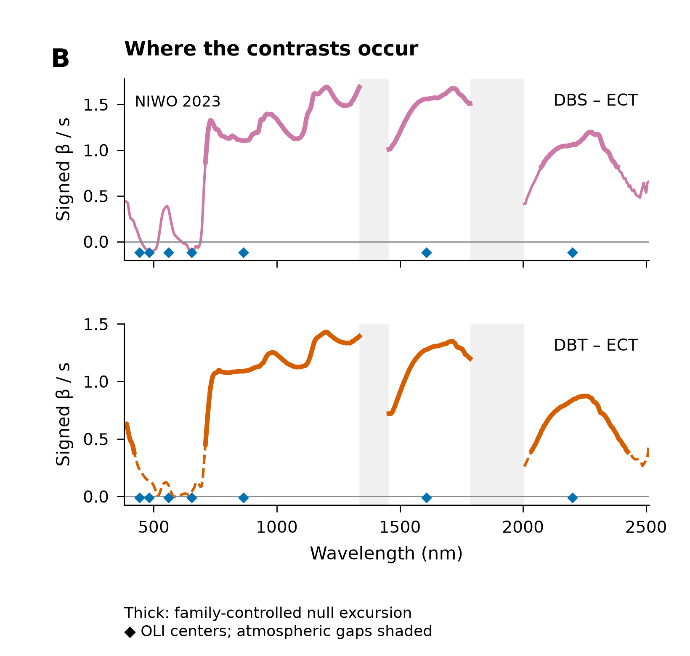

**How to read:** The two NIWO 2023 examples plot signed adjusted group differences divided by pooled spectral SD. Positive values mean the first named group is higher. Thick segments mark family-controlled null exclusion; thin/dashed segments do not. Gray areas are atmospheric gaps; diamonds locate OLI bands.

**What to understand:** For these strong deciduous-versus-evergreen-tree contrasts, substantial differences extend across near-infrared and shortwave-infrared regions. This offers a spectral explanation for broad contrast retention after OLI convolution, while finer regions are averaged or absent.

**Limits:** Localization is statistical evidence in these sampled curves, not a unique biochemical diagnosis. Correlated wavelengths can carry redundant information. Selected strong examples do not describe every pair, and no optimal universal band set follows from them.

Evidence: provenance/publication-figures/2026-10-14/plotted_localization.csv, provenance/sensor-pft-transfer/2026-10-14/neon_region_coverage.csv

## Figure 12. Synthetic OLI retains much of the contrast structure

What survives seven-band spectral reduction on identical polygons?

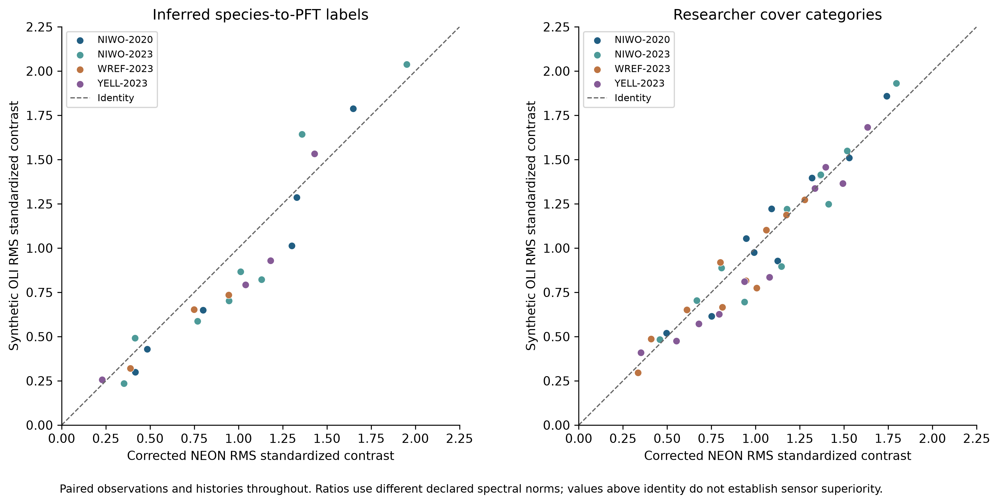

**How to read:** Compare each paired NEON and OLI standardized effect; the identity reference means equal numerical effect. The two panels keep inferred PFTs and researcher categories separate. Samples and acquisition-history matching are identical across these sensor representations.

**What to understand:** OLI retains 15 of 16 NEON-supported inferred-PFT contrasts and all 40 researcher-category contrasts. The inferred-PFT median effect ratio is 0.824, with conditional paired-bootstrap interval 0.801-0.889. A borderline NIWO 2023 DBS/DBT contrast loses support.

**Limits:** The 0.824 ratio is not 82.4% of all biological information: wavelength-integrated NEON and equal-channel OLI use different metrics. Shared-source convolution has no independent sensor noise or 30 m spatial mixing. MicaSense ecological inference remains blocked by unverified physical coordinates.

Evidence: provenance/sensor-pft-transfer/2026-10-14/effect_retention.csv, provenance/sensor-pft-transfer/2026-10-14/retention_summary.csv, provenance/sensor-pft-transfer/2026-10-14/RESULTS.md

## Figure 13. One real Landsat pilot is encouraging, with structured error

Does the synthetic spectrum agree with an independent satellite observation?

**How to read:** A-B: matched image views. C: synthetic-minus-real near-infrared residual. D: NIR scatter around the identity line. E: bandwise error before/after brightness adjustment. F: spectral angles. SR denotes unitless surface reflectance; image axes are matched grid positions.

**What to understand:** At R10C on 15-16 September 2021, one NEON flight and one next-day Landsat 8 scene yield 3,583 matched 30 m footprints in 56 spatial bootstrap blocks. Pooled seven-band RMSE is 0.01477 and median spectral angle is 2.089 degrees. Broad agreement coexists with spatially and spectrally structured discrepancies.

**Limits:** The lag is about 22.37 h conditional on the legacy timestamp basis. Overall brightness-adjustment RMSE change is -0.000184, with interval [-0.000440, +0.000041], spanning zero. This single acquisition pair validates a constrained comparison, not universal calibration or multi-site interchangeability.

Evidence: provenance/real-landsat-validation/2026-10-14/RESULTS.md, provenance/real-landsat-validation/2026-10-14/band_metrics.csv, provenance/spectral-library-analytics/2026-10-14/tables/real_landsat_flight_metrics.csv

## Figure 14. The evaluation target changes the scientific claim

What did we do to avoid training on the answer?

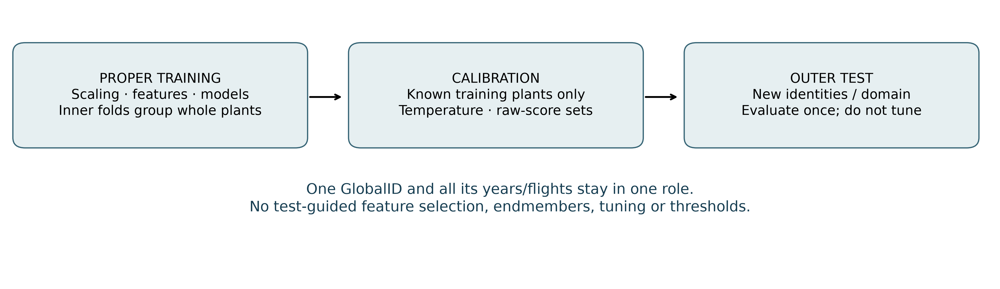

**How to read:** Proper training learns scaling, features and model parameters. Calibration uses other training identities for temperature/threshold/set choices. The outer test evaluates unseen identities or a held-out acquisition, year or site. An entire GlobalID history stays in one role.

**What to understand:** A new-polygon test measures familiar-domain recognition. A held-site test asks a harder geographic-transfer question; a year test asks a temporal/domain question. Feature and endmember selection use training data only. Results are reported for supported class targets, not silently extrapolated to unseen labels.

**Limits:** A polygon split is not complete ecological independence. Nearby footprints, shared species and environmental confounding can remain. Held-site tests have only three sites. Global year holdouts change site composition; the later paired NIWO test isolates the repeated-footprint comparison more directly.

Evidence: provenance/spectral-library-analytics/2026-10-14/DESIGN.md, provenance/spectral-library-analytics/2026-10-14/OBSERVATIONAL_STRUCTURE.md, provenance/scientific-closure/2026-10-15/manifests/numerical_validation.json

## Figure 15. More complicated classifiers were not consistently better

Do flexible models earn their added complexity?

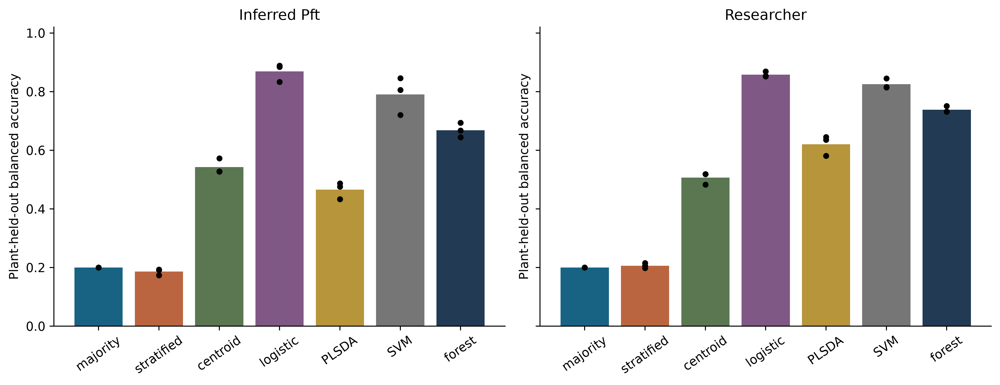

**How to read:** Bars compare mean new-polygon balanced accuracy for two label systems. Dots show fold scores. Majority/stratified baselines precede centroid, logistic, partial-least-squares discrimination, support-vector and forest models. Balanced accuracy is mean recall across classes.

**What to understand:** On this task logistic regression is a strong reference, while several more elaborate alternatives do not consistently improve it. Class information is real, but model complexity alone is not the limiting factor. This justified focusing the final closure on interpretable, grouped logistic comparisons.

**Limits:** The figure is a familiar-domain model comparison, not a geographic transfer ranking. Fixed grids and available sample size constrain conclusions. These results do not establish that nonlinear models can never help, nor do they motivate a deep-model branch without new evidence.

Evidence: provenance/spectral-library-analytics/2026-10-14/STAGE3_ML_GENERALIZATION.md, provenance/spectral-library-analytics/2026-10-14/tables/ml_generalization.csv

## Figure 16. Biological resolution governs how well recognition transfers

What can be recognized, at which label and sensor resolution?

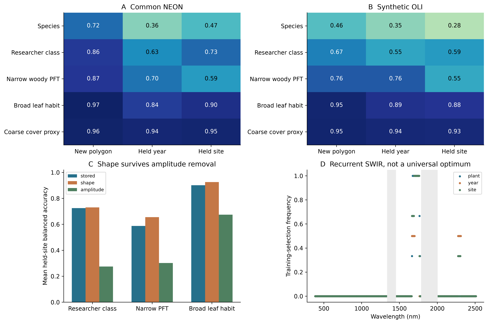

**How to read:** A-B: mean fold balanced accuracy for supported labels under new-polygon, held-year and held-site tests, for common NEON and synthetic OLI. C: held-site stored spectra, unit-norm shape and one-amplitude models. D: frequency of training-selected coordinates; it is not a causal importance map.

**What to understand:** NEON new-polygon/held-site scores are 71.7/47.4% for species, 85.8/72.5% for researcher categories and 96.7/90.1% for broad woody leaf habit. Broad shape-only held-site accuracy is 92.6%, versus 67.4% for amplitude alone: recognition is not explained solely by brightness.

**Limits:** Broad leaf habit is a two-class deciduous/evergreen woody subset, not all five researcher classes. Label counts, chance and eligible populations differ. Species target coverage at WREF is only 24.3%; scores are conditional on supported labels. Normalization is a sensitivity, not a production change.

Evidence: provenance/scientific-closure/2026-10-15/tables/biological_generalization.csv, provenance/scientific-closure/2026-10-15/tables/closed_set_coverage.csv, provenance/scientific-closure/2026-10-15/tables/brightness_sampling_sensitivity.csv

## Figure 17. A handful of neighboring bands is not an optimized sensor

Can a compact wavelength subset reproduce full-spectrum prediction?

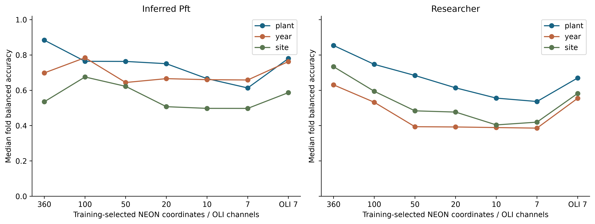

**How to read:** Each curve links separately evaluated feature budgets; x is a discrete budget, not a continuous wavelength scale. Coordinates are selected using proper training only. The last OLI point is a different broad-response representation, not seven of the same narrow channels.

**What to understand:** Reducing channels changes prediction, and the outcome depends on transfer domain and label system. Seven selected narrow NEON coordinates yield about 63.2% new-polygon narrow-PFT balanced accuracy versus 76.4% for synthetic OLI. OLI can outperform this particular narrow-coordinate selection.

**Limits:** The narrow-PFT top-20 site selections concentrate at 1695-1760 nm, demonstrating repeated but highly correlated information. These experiments do not separate band number, placement and width; univariate selection is not a globally optimized sensor design.

Evidence: provenance/spectral-library-analytics/2026-10-14/STAGE4_WAVELENGTH_INFORMATION.md, provenance/spectral-library-analytics/2026-10-14/tables/wavelength_selection.csv, provenance/spectral-library-analytics/2026-10-14/tables/spectral_resolution_performance.csv

## Figure 18. A single average does not span a heterogeneous class

How many reference spectra should represent each group?

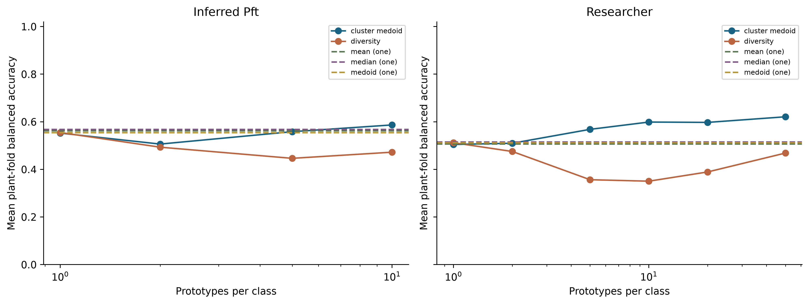

**How to read:** The horizontal axis is prototype count per class. Curves compare observed cluster representatives, diversity-selected observations and central summaries. Dashed references indicate the plotted baseline. Only training spectra supply prototypes; outer tests remain held out.

**What to understand:** Several observed prototypes can improve coverage relative to one center, but gains depend on selection rule and label system. Increasing coverage does not guarantee correct class attribution: flexible libraries can also explain spectra using the wrong classes.

**Limits:** A prototype is a selected observed reference, not a verified pure endmember. Keep all valid raw repeats and their provenance; derive compact references separately. Optimizing a library on the final test set would erase the distinction this experiment is designed to preserve.

Evidence: provenance/spectral-library-analytics/2026-10-14/STAGE5_CLASS_REPRESENTATION.md, provenance/spectral-library-analytics/2026-10-14/tables/class_prototype_coverage.csv

## Figure 19. Synthetic fraction recovery is a harder task than classification

Can the library recover how much of a class is present?

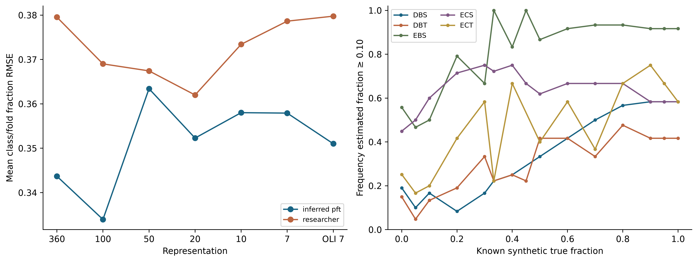

**How to read:** Left: class/fold-averaged fraction RMSE for selected narrow-coordinate budgets and OLI. Right: fraction of inferred-PFT trials estimated above the 0.10 presence cutoff versus known synthetic fraction. At a true fraction of zero, positive detection is a false detection.

**What to understand:** The reused full-spectrum primary inferred-PFT fraction RMSE is about 0.344 in NEON and 0.351 in OLI. Errors and detections vary greatly by class. Some zero-fraction trials are falsely positive, while some truly present classes are missed even at higher fractions.

**Limits:** Mixtures are constructed from saved observed parents under a controlled linear model; there is no independent field-cover truth. Dependent parent trajectories cannot be treated as independent population detection replicates. No universal 50/80/95% detection limit or calibrated abundance interval is established.

Evidence: provenance/spectral-library-analytics/2026-10-14/STAGE7_MIXTURE_RECOVERY.md, provenance/spectral-library-analytics/2026-10-14/tables/mixture_recovery.csv, provenance/spectral-library-analytics/2026-10-14/tables/detection_limits.csv

## Figure 20. A good spectral fit can have the wrong biological explanation

Is a class spectrum uniquely identifiable against mixtures of other classes?

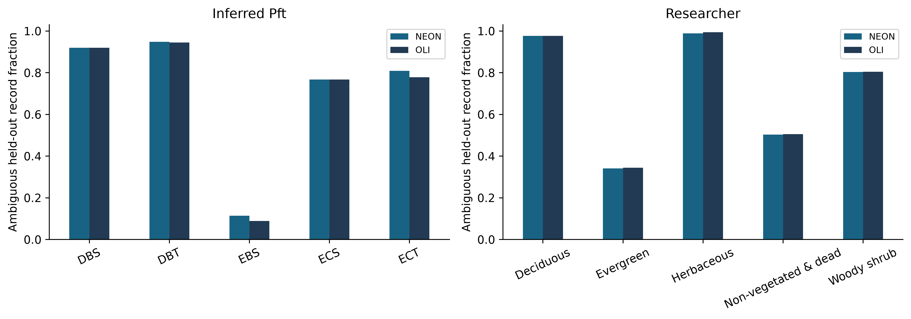

**How to read:** Bars show the proportion of held-out class spectra admitting a close fit using candidates from other classes. NEON and OLI are paired. The declared tolerance is 0.01 in a training-normalized analytical metric, not 0.01 absolute reflectance.

**What to understand:** Many class spectra have other-class convex alternatives; NEON and OLI show similarly serious ambiguity. EBS has a lower observed rate but is rare. This explains how low residual error can coexist with poor fraction recovery or wrong class allocation.

**Limits:** Ambiguity depends on candidate library, normalization, tolerance and parent support; it is not proof that nature makes all PFTs intrinsically indistinguishable. More endmembers can improve approximation while increasing ambiguity. Classification success does not solve this inverse problem.

Evidence: provenance/spectral-library-analytics/2026-10-14/STAGE6_MIXTURE_IDENTIFIABILITY.md, provenance/spectral-library-analytics/2026-10-14/tables/mixture_identifiability.csv

## Figure 21. Confidence is not a reliable detector of unfamiliar biology

Will a model know when a class is absent from its training library?

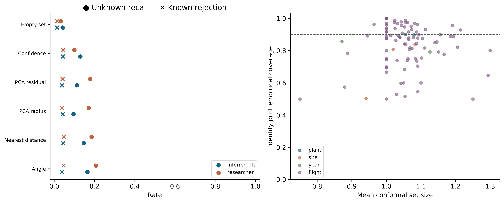

**How to read:** Left: circles are unknown-class recall; crosses are rejection of known classes, for thresholds chosen with known calibration only. Higher recall is desirable, but higher known rejection is costly. Right: empirical prediction-set coverage versus mean set size, with 90% nominal coverage marked.

**What to understand:** For inferred PFTs, nearest-angle rejection detects only 16.5% of omitted-class challenges while rejecting 3.7% of known cases. Ordinary 90% conformal sets attain roughly 88.4-90.2% joint-identity coverage in new-polygon tests but only 50.3-83.7% at held sites.

**Limits:** Omitted ecological labels are proxies for unknowns, not verified new physical materials. The coverage dots span methods/domains; they are not independent populations. Temperature scaling and small prediction sets do not guarantee reliable uncertainty after geographic shift.

Evidence: provenance/spectral-library-analytics/2026-10-14/STAGE8_UNKNOWN_MATERIALS.md, provenance/spectral-library-analytics/2026-10-14/STAGE9_UNCERTAINTY.md, provenance/spectral-library-analytics/2026-10-14/tables/unknown_material_detection.csv, provenance/spectral-library-analytics/2026-10-14/tables/uncertainty_calibration.csv

## Figure 22. Repeat observations reveal a substantial temporal penalty

Does a label remain recognizable in a different image year?

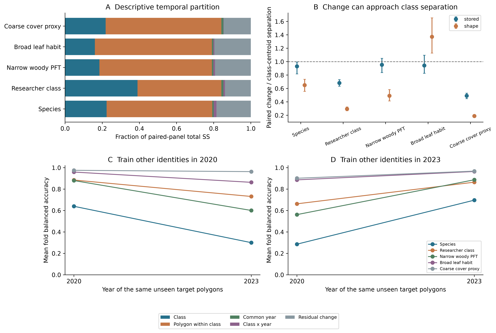

**How to read:** A partitions complete-pair spectral sums of squares. B compares paired temporal change with class-centroid separation; a ratio of one means similar magnitudes. C-D train on other identities in one year and evaluate the same unseen target IDs in both years; curves average three folds.

**What to understand:** For species, 2020-trained balanced accuracy drops from 63.9% on 2020 targets to 30.0% on their 2023 counterparts. Broad woody leaf habit drops from 95.9% to 86.3%; the coarse-cover proxy is more stable. Temporal change can be comparable to class-centroid separation.

**Limits:** All complete pairs are NIWO footprints. Labels come from reused 2023/2024 annotations; there is no independent annual biological verification. The partition is exact descriptive accounting, not causal variance components. Species/classes/populations differ across rows; centroid separation and prediction accuracy are different quantities.

Evidence: provenance/scientific-closure/2026-10-15/tables/paired_temporal_recognition.csv, provenance/scientific-closure/2026-10-15/tables/paired_temporal_accuracy_change.csv, provenance/scientific-closure/2026-10-15/tables/paired_temporal_partition.csv

## Figure 23. Readiness must be decided separately for each intended use

What should the lab use now, and what requires more evidence?

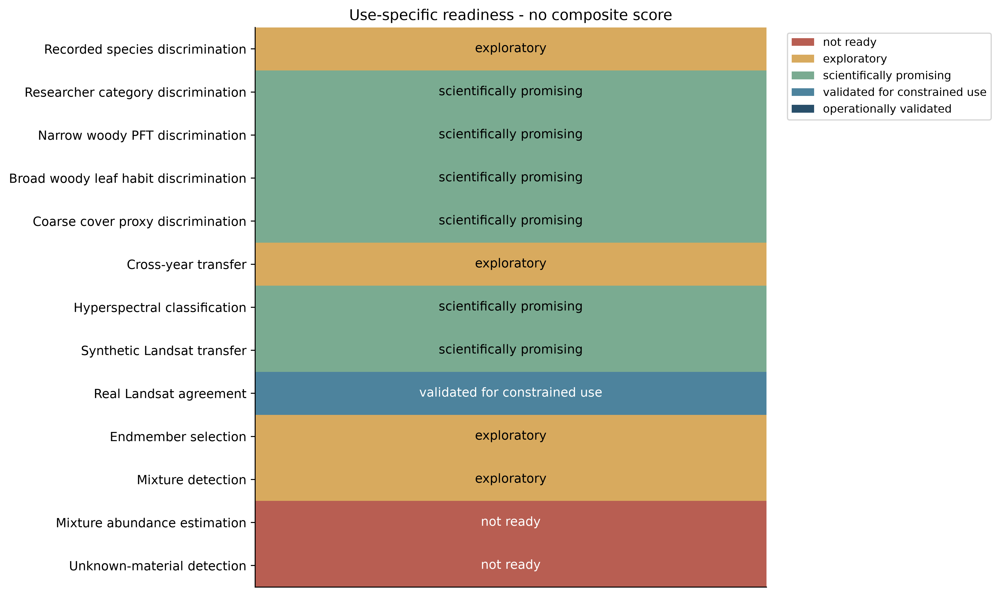

**How to read:** Each row is a separate use case. Colors are explicit evidence-based readiness categories, not an averaged score. Scientifically promising means conditional evidence merits further use/review; constrained validation applies only within the stated experiment.

**What to understand:** Use the library to characterize sampled spectra, compare researcher categories and investigate conditional label recognition. Broad woody leaf habit is the strongest transfer result. The one real-Landsat pilot supports its constrained radiometric comparison. Mixture abundance and dependable unknown detection are not ready.

**Limits:** No row is operationally validated. Species and cross-year use remain exploratory. Synthetic sensor transfer is not field validation, and good classification is not evidence of unique unmixing. Future claims need independent labels, physical metadata, balanced domains and independent fractional-cover truth.

Evidence: provenance/scientific-closure/2026-10-15/tables/FINAL_READINESS_MATRIX.csv, provenance/scientific-closure/2026-10-15/DESIGN.md, provenance/scientific-closure/2026-10-15/NEXT_DATA_NEEDED.md
