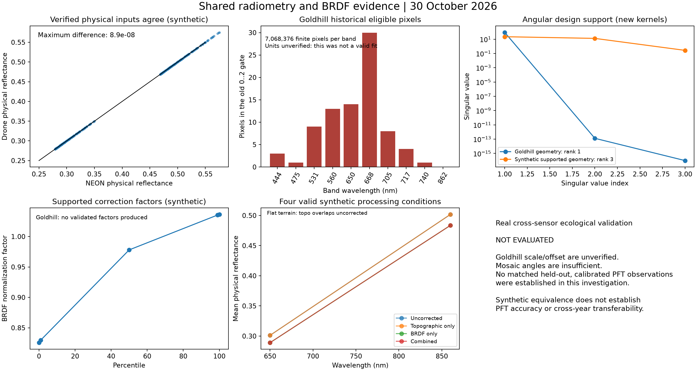

# AOP/drone radiometry and BRDF audit

Date: 2026-10-30. Starting revision: `ecd0df2` on `main`; implementation is an uncommitted working-tree change alongside the earlier spatial/cloud work. This report describes code and reproducible evidence, not an empirical calibration release.

## Findings and recovery decision

Both production routes shared a radiometric bug and an inadequate BRDF acceptance rule. NEON's documented storage divisor was being multiplied into its data after the October 26 rollback. Drone TIFF conversion declared a scale of one without establishing physical units. Least squares accepted rank-deficient angular designs and substituted neutral coefficients when fitting was unsupported. A nonpositive-prediction guard then switched abruptly between identity and extreme gains.

The revised shared boundary uses `physical = scale * stored + offset` with explicit direction, provenance and validity. Both production drivers use the same repaired Ross/Li implementation and validate their fits. Unsupported or invalid models have diagnostics but no usable coefficient arrays. Nodata-only bands are explicitly NOT_APPLICABLE and are preserved without claiming a fit. Library extraction, bulk discovery and raster statistics require the new scientific contract. Historical artifacts are preserved and require review before reuse.

**Goldhill is blocked, not radiometrically recovered.** The real flight was passed through the new fitting and drone correction entry points in a fresh evidence directory. Both report `UNSUPPORTED`; no new corrected Goldhill raster was produced. Its scale and offset remain unknown. Independently of calibration, the sampled mosaic geometry has rank **one** with the repaired kernels: scene solar zenith and nadir viewing leave no independent kernel variation. The historical rank-two result came from the earlier incorrect geometric kernel. Neither rank can identify three coefficients.

## Actual production paths: before and after

The AOP path is `pipelines/pipeline.py` → `build_correction_parameters_dict()` / `apply_brdf_topo_core()` → `NeonCube` / `io/neon.py` → shared `corrections.py` → configured convolution → raster-backed extraction / Parquet and compact bulk analysis. The drone path is `run_drone_pipeline()` → signed source working copy or `convert_drone_tiff_to_h5()` → `NeonCube` → `apply_drone_corrections()` → shared corrections → optional wavelength-matched affine translation and extraction. Drone does not enter NEON download or convolution.

| Operation | AOP before this repair | Drone before this repair | Shared repaired behavior / intentional differences |
|---|---|---|---|
| Original units/storage | NEON integer-like stored reflectance; source metadata describes divisor | TIFF/H5 numeric values; Goldhill typically hundreds; units unverified | Original arrays remain stored values. No distribution-based calibration. |
| Scale/offset source | `Scale_Factor`, no offset handling | Converter wrote `Scale_Factor=1`; TIFF identity scales and missing units | Documented NEON divisor; explicit affine calibration record for drone. Offset supported, normally zero for the inspected NEON convention. |
| H5 interpretation | Raw scale read, default one if missing | Same reader, though H5 schema alone does not prove NEON radiometry | NEON identity and scale metadata establish the NEON convention; renamed/derived/ambiguous inputs need an explicit record. Drone native TIFF identity tags never establish physical units. |
| Physical conversion | Production multiplied raw scale, bypassing an existing normalization helper | Same multiplication, often by one | Exactly one `s*x+b` on entry to scientific calculations; inverse `(rho-b)/s` for storage-scale corrected rasters. |
| Topographic stage | SCS+C, normally scene-wide streamed C; explicit tile mode also existed | Same formula, full-scene local fit | Same physical units/formula. When fitting combined correction, fit C once and reuse it during both BRDF fitting and correction. Tile-local application cannot stand in for a scene-trained combined model. |
| BRDF fitting input/range | Uncorrected data; raw-scale multiplication; 0 ≤ rho ≤ 2 | Same | Physical values with unchanged eligibility bounds. Combined models fit topographic-only observations, matching their application stage. BRDF-only fits remain explicit. |
| Volume kernel | RossThick, phase equation matches pinned HyTools apart from precision/finite guards | Same function | Shared RossThick; frozen upstream numerical vectors test parity. |
| Geometric kernel | Named LiDenseR but different overlap, phase and b/r equations | Same function/config | Repaired to pinned HyTools LiDenseR / LiSparseReciprocal equations. Production remains LiDenseR, b/r=10, h/b=2. Old coefficients are not portable to this implementation. |
| Solar/view angles | Ancillary degree arrays converted to radians; scene solar mean for fitting; application could recompute mean by strip | Source angles or explicit/manifest geometry; mosaic often constant nadir; full-scene application | Same angular units and scene mean persisted with the model. Application uses that saved mean, independent of strip size. Actual mosaic viewing diversity remains sensor-specific evidence, not something to fabricate. |
| Reference | Solar 45°, view 0°, relative azimuth 0° | Same | Existing common reference retained and stored. Reference prediction, leverage, uncertainty and extrapolation flag recorded. This differs from HyTools tutorial scene-mean-solar normalization and is not a claim of identical full FlexBRDF methodology. |
| NDVI/sampling | Single bin by default; opt-in 25 bins, range .05–1, 10th–95th percentile clipping; all eligible pixels | Same shared defaults and optional flag | Same wavelength-based NDVI and realized edges. Populated unsupported strata and out-of-strata application are rejected, not assigned neutral/bin-zero coefficients. No-finite-observation bands/strata are explicitly NOT_APPLICABLE, keep nodata and have null coefficients. No new random or fabricated observations. |
| Coefficient estimation | Three-term OLS; rank ignored; neutral defaults when too few samples | Same | At least four eligible observations (three parameters plus residual assessment), rank three, precision-based conditioning check and prediction checks. Report counts and exclusion reasons per band/stratum. |
| Correction factor | `R_reference / R_observed`; invalid/nonpositive predictions silently got factor one | Same | Only validated saved models apply. Nonpositive/nonfinite predictions raise; no identity guard discontinuity or arbitrary gain cap. Factors and predictions summarized across the application domain. |
| Output scale/metadata | Converted back to stored units; raw ENVI scale only | Same; audit said applied even for neutral/unsupported fits | Stored raster representation preserved, explicit physical multiplier/offset/provenance and BRDF status in headers. Raw and topo-only are distinguished. Table extraction converts once to physical reflectance and records its units in Parquet metadata. |
| Translation/library | Convolution tables and bulk read stored numbers without a common affine boundary | Affine registry trained on old numerical values; extraction also retained counts | New raster-derived tables and compact raster statistics use physical values. Historical tables/rasters without the contract are rejected for approved processing. Legacy translation coefficients with unverified training units are blocked; numerical similarity is not calibration evidence. |

The sources of truth are the edited modules and focused tests. The earlier spatial corner convention, NAD83 WKT, north-up validation, masks and exact pixel-index contracts remain covered by the existing regressions.

## NEON scaling history and October 26 rollback

The earlier [scale audit](../../audits/reflectance-scale-factor/report.md) established that the R10C source stores `1172` at approximately 662 nm with `Scale_Factor=10000`, meaning physical reflectance **0.1172**. The [official NEON tutorial](https://www.neonscience.org/resources/learning-hub/tutorials/neon-refl-h5-py) explicitly divides stored data by that attribute.

- `37207cff` (2025-12-05) introduced multiplication by the raw attribute in correction paths.
- `09853825` (2026-07-22) introduced neutral invalid-factor behavior; it did not establish the right physical units.
- `c511efe1` (2026-09-17) normalized divisor-style versus multiplier-style values in the shared helper.
- `1cb2cf3a6c34e6665f0c5b1661724428f46f80ea` (2026-10-26) restored multiplication in NEON reading and BRDF/topo. Its commit message says difference maps did not improve. That is a visual justification, not evidence that NEON's metadata changed conventions.

After the rollback, the helper still normalized scales, but the actual reader, topographic fitter/application, and BRDF fitter/application bypassed it. For the documented NEON example, multiplication produces 11,720,000 rather than 0.1172: a **100,000,000-fold** unit error. Multiplying and dividing around a ratio can sometimes cancel numerically; the absolute fit-eligibility gate does not cancel. A prior inspected 426-band artifact had zero volume/geometric terms throughout; it is evidence of a collapsed fit, not an interchangeability result.

The repair uses the explicit NEON divisor convention, rather than guessing direction from magnitude. The old convenience helpers accepting both numerical styles remain for compatibility but do not authorize scientific production. The ordinary inspected NEON data have no nonzero offset and use zero. A nonzero source offset without an established convention is rejected; its direction must be supplied in an authoritative affine record. No undocumented offset direction is inferred from an attribute name. Drone affine metadata is explicit and separate.

## Methodology verification

Pinned upstream: [HyTools kernels at 31286d64541791a9815d29443a33726fa4d54031](https://github.com/EnSpec/hytools/blob/31286d64541791a9815d29443a33726fa4d54031/src/hytools/brdf/kernels.py). Its source SHA256 and independently generated reference vectors are in `tests/data/brdf/hytools_pinned_kernels.json`. The existing GPL notices and author attribution remain.

RossThick's equation was substantially equivalent. The old Li implementation was not: b/r multiplied the final kernel rather than transforming zenith angles, overlap used a different expression, relative azimuth replaced the phase cosine, and LiDenseR was formed by multiplying a sparse-like result by cosines. Restoring the upstream equations is an evidence-supported scientific change, not a fitted adjustment to Goldhill. A nadir-azimuth invariance test specifically protects against artificial geometry at zero viewing zenith.

The [HyTools FlexBRDF tutorial](https://github.com/EnSpec/hytools/blob/master/examples/FlexBRDF_tutorial.md) describes topographic correction before BRDF, grouped compatible acquisitions, NDVI stratification, and scene-mean-solar nadir normalization. Both SpectralBridge production routes already shared the same kernel *names* and defaults. They now also share physical units, validated equations and combined-model fit/application order. This change does **not** implement grouped fitting, change default NDVI policy, or claim equivalence to every FlexBRDF mask/reference choice. The existing fixed-45° reference remains explicit; its support is reported rather than assumed.

NEON-produced bidirectional mosaics are also not automatic ground truth: [NEON's upstream 2025 correction notice](https://www.neonscience.org/impact/observatory-blog/brdf-and-topographic-corrections-not-properly-applied-reflectance-data) documents a separate eligibility-filter failure. That provider issue is distinct from this package's scaling rollback. Source product level/version must be established before an empirical comparison.

## Validation and status semantics

A v2 model records source/window identity, radiometric convention and provenance, fit input stage, topographic C where used, kernel configuration, reference geometry/design, saved scene solar zenith, angular distributions, per-band/stratum populations and exclusions, rank, singular values, condition number, coefficient standard errors, reference leverage/extrapolation, prediction and factor quantiles, and status. Missing calibration is explicitly unsupported, so no physical fitting population is invented.

- `VALID`: passes the shared computational support checks. This does **not** establish empirical calibration, PFT performance or ecological transferability.
- `UNSUPPORTED`: calibration, population or angular support is inadequate, or a legacy model lacks the contract. No usable coefficients are published.
- `INVALID`: supported fitting was attempted but predictions are nonpositive, nonfinite, cancellation dominated or uncertainty dominated. No usable coefficients are published.
- `EXTERNAL`: a potential coefficient source requiring independent validation and provenance. No unvalidated external-coefficient bypass is implemented.

Conditioning uses `1/sqrt(float32 epsilon)` (approximately 2896), reflecting the precision of the input kernels, not a scene-specific gain threshold. Observed and reference predictions must remain positive above rounding error and approximately 95% standard-error bounds. Rank/conditioning and uncertainty checks are safeguards, not universal scientific approval criteria. Reference extrapolation is surfaced explicitly; a small conditional OLS standard error cannot establish a physically correct extrapolation.

Application reads the small model record, checks its source/calibration, uses saved geometry and refuses nonpositive predictions. A path-only coefficient cache cannot conceal changed model files. Source identity is computed once per immutable loaded cube in bounded row views. Unsupported drone BRDF with verified radiometry can retain clearly labelled topographic-only output, but raises scientific-blocked status before translation/library extraction. Unknown calibration retains native storage values; it cannot authorize physical topo or BRDF. Explicit `apply_brdf=False` is an unnormalized alternative, not a validated BRDF result.

Old models are found without renaming or overwriting them. Old corrected headers or table footers do not silently qualify for reuse. Use a fresh output directory for scientific review runs. Bulk statistics schema v2 invalidates old raw-unit compact checkpoints; compact-results reporting remains a read-only view of completed reports.

## Original Goldhill acquisition: what was actually found

Read-only Data Store inventory: `datastore-inventory.txt`. Original package:

`i:/iplant/home/shared/earthlab/macrosystems/field-data/uas-packages/AOP-GOLDHILL-08-14-23-ExportPackage/`

The package contains an original orthomosaic, terrain products, LAS, processing report and metadata folder. The PDF reports **6,090 cameras / 5,650 aligned**, ten spectral channels, and yaw/pitch/roll orientation conventions. These are camera/band records, not proof of 6,090 independent angular observations of the same target. Its calibration tables concern lens intrinsics, not reflectance scaling.

The metadata folder contains acquisition notes, `SD1_image_metadata.csv`, `SD2_image_metadata.csv`, GCPs, mapping KML, area polygons and sky photos. The two CSVs contain **3,045 and 3,050 rows**, respectively, with only timestamp, software version and filename columns. They reference `aop/.../RawData/M300/SD1` and `SD2`; they do not supply camera coordinates, orientations, image footprints, panel measurements or irradiance. The original images and Goldhill photogrammetry project were not found in the inspected exported collections. The parent Data Store inventory did not expose the referenced raw `aop` tree. This does not establish their absence elsewhere.

The notes say August 14 / 13:41, but image timestamps span **August 15, 19:38:14–20:06:58** without an embedded timezone in these CSV fields. This is an acquisition/timezone provenance issue to resolve, not a reason to fabricate solar geometry. The referenced field Google Sheet could not be accessed through the public retrieval tool. Source-document hashes and exact CSV columns/ranges are recorded in `original-metadata-summary.json`; the original notes are preserved alongside it.

`field-data/calibration_TM/calibration` contains Table Mountain/2021 photogrammetry materials and other calibration reports. Their existence does not establish a Goldhill 2023 export gain. Likewise collection names containing `rescale` or `10k` are not calibration certificates. Inspected Goldhill source H5 dataset attributes are empty; the orthomosaic has identity TIFF scales/zero offsets and no physical-unit declaration. No factor of 100, 1,000 or 10,000 was assigned to Goldhill.

The simplest supported current policy is to omit BRDF explicitly **after** physical radiometry is independently verified, retaining its unnormalized status. A defensible recovery investigation would obtain original overlapping calibrated images, camera poses/intrinsics and surface geometry, image footprints, panel/DLS calibration records, timestamps/timezones, and the orthomosaic export scaling/blending settings. Those could support a new multi-angle analysis; mosaic nadir metadata cannot. Grouped or external fits require their own comparability/validation evidence and are not implemented here.

## Scientific figures and evaluation boundary



`scientific_evidence.png` separates historical Goldhill evidence from a known synthetic calibration experiment. Synthetic NEON-style and drone-style representations recover physical values within **8.95e-8** in the recorded experiment. Its four processing conditions use flat terrain, so topo-only overlaps raw, and combined overlaps BRDF-only. They demonstrate consistent mechanics, not improvement in vegetation inference.

The earlier [Goldhill stage-isolation figure](../../goldhill-correction-diagnosis/2026-10-30/stage_isolation.png) remains the real-data artifact diagnosis: raw/topo-only are clean; BRDF-only produces the boundary; combined replay matched production exactly. Those invalid BRDF spectra are not relabelled as valid comparisons.

| Requested empirical outcome | Evaluation here |
|---|---|
| Physical spectral shape / four real processing conditions | Not evaluated for Goldhill: authoritative calibration absent and BRDF unsupported. |
| Within-PFT variability / between-PFT separability | Not established on a calibrated, independent matched drone/AOP population. |
| Cross-flight / cross-year consistency | Not established; dates, units, geometry and vegetation conditions are unresolved. |
| Drone–AOP agreement | No valid paired calibration result claimed; sensor responses, footprints and dates must be controlled. |
| Downstream PFT identification accuracy | Not evaluated; no held-out labelled empirical experiment was established. |

The Table Mountain/2021 materials and the three 2023 mosaics do not, by themselves, supply that controlled held-out experiment. Numerical equality of synthetic convolutions from one source is diagnostic evidence, not independent sensor calibration.

## Production impact

| Classification | Products / reason |
|---|---|
| Confirmed invalid BRDF interpretation | The diagnosed Goldhill corrected raster/model and direct dependent translated/library/bulk contributions: rank-deficient fit, unverified units, reproduced boundary. Source data remain recoverable. |
| Confirmed unit defect; derived impact needs provenance review | AOP correction fits using raw multiplication of documented NEON divisor metadata in the affected revisions, especially after the October 26 rollback. The earlier audited neutral 426-band fit is concrete failure evidence. Do not infer which entire archives used that code solely from folder dates. |
| Requires review | Other historical AOP/drone BRDF models using the old Li equations or without rank/unit/reference provenance; Gordon/Ruby and their derived tables; old numerical-scale translation registries; compact statistics computed on stored units. |
| Unaffected by this repair's arithmetic | Original source raster bytes; wavelength definitions and response data; corrected spatial metadata/affines/pixel membership; read-only historical compact-report viewing. They are not thereby endorsed for ecological calibration. |
| Cannot yet assess | Unsurveyed production archives, original camera projects/images not located, and ecological performance without calibrated matched/held-out data. |

No historical archive/library was regenerated, replaced, uploaded or promoted. The real Goldhill validation records before/after hashes of its historical corrected pair and model and asserts equality. This is not a certification of every remote historical object.

## Reproduction, tests and scaling

Run focused regressions with the repository environment and a writable Matplotlib cache. Actual-entry tests use `build_correction_parameters_dict()` / `apply_brdf_topo_core()` and `convert_drone_tiff_to_h5()` / `apply_drone_corrections()`. They cover NEON divisor vs verified drone multiplier, affine offsets, populations/coefficients/factors/results, insufficient geometry, stale-cache rejection, physical extraction and compact bulk input. Existing spatial, AOP, SCS+C, convolution, drone orchestration and restart regressions are also exercised. Final counts and command outcomes are in `verification.json`. The separate source-checkout smoke (`source-smoke.json`) completed the real normal pipeline, seven target products and seven stage-QA reports, then proved restart reuse; it also completed corrected/translated drone full and polygon extraction with explicit synthetic physical-unit coefficients. This is not a built-wheel, Linux-container or multi-Python release certification. The legacy Parquet test module installs global import stubs and is run separately; that pre-existing test-isolation issue remains a limitation of combined test invocation.

Reproduce the real-data rejection and figure without changing historical data:

```bash
MPLCONFIGDIR=/tmp/spectralbridge-mpl python scripts/audit_radiometry_brdf.py \
  --goldhill-dir /path/to/immutable/AOP_GOLDHILL_20230814 \
  --output /path/to/new/evidence-directory
```

The audit script uses repository synthetic fixtures and requires the test dependencies. The production package has no new dependency. It creates no pixel Parquet cache. Physical raster conversion and bulk/extraction operate within existing bounded windows. BRDF fitting retains the existing full-cube architecture and adds compact diagnostics per band/stratum, not per-pixel JSON. It hashes loaded source rows/geometry once, not a second archive read; application converts only the requested angular window and uses the saved scene mean. Fit validation requires per-band domain arrays and quantiles, so it adds O(pixels) temporary memory; it does not solve the existing full-cube AOP memory requirement. Band progress is logged every ten bands. Full-archive production and large-VM throughput were not benchmarked in this local investigation.

## Follow-up: numerical export scaling traced

The subsequent user-authorized [scaling investigation](../../drone-scale-confirmation/2026-10-30/README.md) confirms original-band-extrema normalization into 0–10,000, including different offsets for Goldhill NIR and three Ruby bands. This resolves how the archived 25 cm intermediates were numerically rescaled, with strong supporting 10 cm comparisons. It does not establish that 10,000 represents 100% physical reflectance. The exact export implementation and original Metashape calibration settings remain unverified, so no uniform divisor or conditional vendor calibration was applied to production.
