# Ruby original-photo correction recovery

6 November 2026 | P184 | Experimental pipeline, not production approval

## Outcome

A working, restart-safe experimental pipeline now performs explicit radiometric preparation, adjusted-camera ray checks, spatial-grid repeated-observation extraction, target-aware RossThick/LiDenseR estimation, SCS+C surface comparisons, training-only matched topographic/BRDF fitting and held-out diagnostics. Reusable functions and regression tests were added in `src/spectralbridge/drone_original.py`; no production correction defaults or NEON mathematics were changed.

Original photos substantially improve BRDF identifiability. They do **not yet establish an acceptable combined Ruby product**. The ground-DTM red fit still has negative C and unsupported denominator locations; matched original-photo topographic fits retain uncertainty/application failures. No corrected original flight photos or regenerated corrected orthomosaic are claimed. Synthetic export and in-memory replacement controls test the interface separately.

## Frozen baseline and radiometry

`baseline.json` records the complete P183 composite project fingerprint, source identity, original grid, previous model, scale, bands and production source hashes. Ruby WORKING chunk 0 is the export-matching reconstruction. Its absolute DEM is the viewing surface; chunk 3 is a distinct saved DTM candidate with the same chunk transform. Relative canopy-height surfaces are excluded from ray intersections. Independent ground/DTM accuracy remains unverified.

The new immutable input is `archive/local/ruby-correction-recovery-2026-11-06/ruby_vendor_fraction_x10000_10cm_v1.tif`. It preserves the established 1035 by 1960 processing grid and CRS, contains ten float32 bands, scale 0.0001, zero offset, explicit NaN NoData, mask, units, source checksum and calibration provenance. It uses source wavelengths 444, 475, 531, 560, 650, 668, 705, 717, 740 and **842 nm**. Values above 10000 are preserved. This is calibrated input, not a corrected mosaic.

The source conversion is vendor-calibrated original DN / 32768. Raw photo sensor values are distinct: Camera.image() applies retained project calibration; Photo.image()/PIL retain raw DN. Black level, exposure and vignetting must not be reapplied to the calibrated export. The old preparation was original DN * 10000/65535, so its physical multiplier is 0.0001999969482421875 rather than 0.0001. Old files remain unchanged. Project settings, panel resubstitution, controlled calibration application and original-mosaic binding support encoding; independent physical reflectance accuracy remains unverified.

Per-band new-input distributions (above-one values are retained, not automatically invalid):

| wavelength_nm | minimum | median | maximum | above_one | nodata |
| --- | --- | --- | --- | --- | --- |
| 444 | 0.00031303 | 0.021725 | 0.16464 | 0 | 35128 |
| 475 | 0.0003625 | 0.025984 | 0.1875 | 0 | 35128 |
| 531 | 0 | 0.044918 | 0.21076 | 0 | 35128 |
| 560 | 0 | 0.052335 | 0.25397 | 0 | 35128 |
| 650 | 0 | 0.035844 | 0.28283 | 0 | 35128 |
| 668 | 0 | 0.031805 | 0.30986 | 0 | 35128 |
| 705 | 0 | 0.07497 | 0.30538 | 0 | 35128 |
| 717 | 5.0705e-05 | 0.10859 | 0.31718 | 0 | 35128 |
| 740 | 5.9744e-06 | 0.15607 | 0.50712 | 0 | 35128 |
| 842 | 0.010659 | 0.19733 | 0.6783 | 0 | 35128 |

## Sampling and registration

The final fixed design contains **64 targets**, **3341 band-target records**, and **2267 unique original photos**. All 64 cells in an 8 by 8 grid supplied a repeated aligned track within 10 m. Selection required at least four master observations and retained at most eight evenly spaced chronological indices, with all ten source bands. It did not optimize angular diversity or successful correction. Exact policy and transfer checksums are retained.

Track availability favors image features and does not constitute an unbiased ecological census. Forest canopy, herbaceous plants and bare soil lack independent class labels. NDVI, height, brightness and local variability are descriptive strata. 2552 records exceed local 9 by 9 patch CV 0.25, showing how frequently heterogeneous texture could confound patch comparisons. This threshold is a sensitivity choice, not a universal physical rule.

The primary response is the calibrated pixel at the projected tracked feature. A 9 by 9 median and homogeneous-patch sensitivity are evaluated separately. This avoids presenting medians over different image footprints as exactly the same physical patch. Master-feature reprojection checks are internal, and other bands use the calibrated rig rather than independent per-band feature matches. Shadow/darkness and saturation are flagged; no observation is declared sunlit solely because its value is positive.

## Viewing geometry repair

Actual adjusted calibration, camera transforms, chunk-to-ECEF transformation and ground-to-sensor local frames define viewing angles. Camera-axis tilt is not substituted for pixel view zenith. Source band identity and CRS are explicit. The full original-photo sample spans measured geometry in `brdf_models.json`.

The official DEM pickPoint control produced several-pixel reprojection discrepancies. A new bracketed intersection follows the calibrated ECEF ray and bilinearly samples the absolute DEM, with a declared 0.1 m step in this validation. Among 64 checked targets, the maximum source-pixel round-trip discrepancy is 4.43e-08 pixels. This demonstrates numerical ray consistency only. The solver rejects missing surface coverage before intersection; finite step, DEM resolution, canopy/occlusion, first-hit versus tie-feature height and independent geolocation remain limitations. Viewing and ground surfaces are tested separately, not interchanged.

## Correction to the prior temporal diagnostic

The previous experiment divided integer datetime values by a nanosecond constant, but this pandas version parsed timestamps in microseconds. That collapsed real calendar-minute groups. A tested calendar-based UTC minute helper fixes the error. Historical P183 files were preserved; `prior_temporal_group_recheck.json` supersedes its blanket claim that every fit lacked sufficient minute groups.

The old sample actually contains 2 Ruby and 3 Goldhill target-band fits with four supported minute groups. The remainder still lack enough groups for that three-parameter covariance. The expanded sample spans 19 calendar minutes. Minutes are dependence groupings, not independently calibrated flights; neither the corrected count nor bootstrap creates independent field truth.

## Target-aware BRDF models and normalization

The shared production RossThick/LiDenseR kernels and unchanged 45 degree solar zenith/nadir reference are used. Additive target intercepts separate surface brightness from common angular differences by within-target residualization, with absorbed-target degrees of freedom in covariance. Such differences remain additive; they are never treated as multiplicative gains.

A second candidate fits rho_ij = a_i * (1 + b_vol Kvol_ij + b_geo Kgeo_ij) by variable projection. Target amplitude absorbs spatial brightness while the common Ross/Li shape permits multiplicative normalization. It remains an experimental shared-shape assumption. Red-band condition number is 71.47, reference shape 0.8899, and joint kernel-space reference support is True. Model support and coefficients are reported for all ten bands.

Four fixed geographic quadrants hold out complete targets. These tests avoid fitting each held-out target's brightness to improve its correction; photos/calibration can still be shared across folds. Spatial-block and calendar-minute bootstrap provide conditional uncertainty. The initial time-pairs bootstrap produced too few successful replicates because resampling left some targets with single observations. Missing time uncertainty is explicitly not a pass. A separate minute-cluster residual wild bootstrap retains the complete angular design; it is reported as a different conditional control, not substituted silently. Joint convex-hull support is evaluated rather than separate kernel minima/maxima alone. Alternative actual-sun/nadir and observed-medoid references are explicitly diagnostic in `reference_sensitivity.json`; NEON and the production reference are unchanged.

| Candidate | Held-out target-band comparisons | Median after/before variance | Mean ratio |
|---|---:|---:|---:|
| additive_target_effects | 600 | 0.942 | 4.032 |
| multiplicative_target_amplitudes | 600 | 0.766 | 1.158 |

| Sampling sensitivity | Comparisons | Multiplicative median variance ratio | Mean ratio |
|---|---:|---:|---:|
| median_sensitivity | 600 | 0.649 | 1.077 |
| homogeneous_sensitivity | 136 | 0.752 | 1.408 |

Median and mean ratios can disagree: improvement at typical targets does not establish universal correction. Failed/unsupported predictions and strata remain visible. Pixel-center, patch-median and homogeneous sensitivity must be considered together. No candidate is selected just because it has a higher R-squared or passes a numerical guard.

## Topographic correction and matched processing

The absolute viewing surface has median local slope near 35 degrees, whereas the recovered DTM has median near 18 degrees over the saved tiles. That is a physically consequential surface distinction, not a camera-angle repair. SCS+C continues to use the shared formulation, existing fitting interval/slope policy, spatial covariance and Fieller uncertainty. C is fitted across target means so repeated photographs do not become independent terrain samples.

Dense common-grid orthomosaic controls provide a second check with many more spatial samples. They are labelled as mosaic-stage diagnostics and their coefficients are **not transplanted** into original-photo processing. The DTM red C is -0.17350, interval [-0.23058968704017324, -0.09842377868416148]; 109 sampled application locations fail illumination/uncertainty/denominator checks. Unscreened diagnostic gains include extreme values; those are not accepted corrected reflectance. Canopy-surface substitution does not constitute a validated remedy. Dense controls include explicit spectral strata and identical input units/grid across the two surfaces; they differ from the old investigation's training mask and are not an exact historical coefficient reproduction.

For combined evaluation, every spatial fold estimates SCS+C only on training-target means, checks its interval and application support, then fits the BRDF candidate in that same topographically corrected space. Held-out observations receive the same sequence. The experiment has {'UNSUPPORTED': 30, 'NUMERICAL_CANDIDATE_ONLY': 10} across ten bands and four folds. 136 target-band comparisons have sufficient matched-stage observations for conditional evaluation. Failures are not replaced by identity correction. Within-target CV is retained alongside SD because rescaling alone can reduce absolute variance.

Target fixed effects also expose the limitation of using one short flight for joint topographic estimation: local incidence changes very little within one target. Cross-target illumination response can remain confounded with surface ecology, and target intercepts do not identify a unique physical SCS+C C ratio. The recovered DTM improves input semantics but does not remove that statistical limitation or the observed negative-C tails.

## Source-image export and licensed mosaicking

`write_corrected_photo()` writes new float source planes with both stage masks, NaN for unsupported pixels, source identity and explicit already-calibrated units. Unit tests verify unchanged source dimensions, valid values above one, and no identity substitution. No real full-frame corrected source products were emitted because full-frame combined support has not been established.

An in-memory replacement control initially revealed unwanted additional calibration even with sensitivity normalization disabled. Clearing both sensor- and camera-level vignetting, black level, sensitivity and retained reflectance factors preserved a synthetic nonconstant float image exactly: maximum difference 0.0. Camera transform and geometric calibration stayed unchanged. This is a radiometric interface control, not a real correction result.

`licensed_reconstruct.py` is a gated prepared interface for accepted source images in a copied project. It requires source checksums, band/dimension identity, both accepted stages, validation evidence and reviewed mosaic settings. It preserves alignment/calibration and disables prior radiometric processing. The local API reports no active license. Save/build/export was not run; copied-project and final mosaic equivalence remain unvalidated. Source-first correction and post-mosaic correction are not claimed equivalent, especially with nonlinear ratios and unrecovered blending weights.

## Acceptance and remaining work

Encoding, immutable grid representation, source-specific wavelengths and numerical ray construction are verified within the stated limits. Original observations improve local/shared BRDF estimation and support reproducible conditional comparisons. Topographic uncertainty/domain failures, incomplete full-frame support, ecological/registration/illumination ambiguity and untested licensed reconstruction prevent approving a corrected Ruby orthomosaic.

Next: independently label stable canopy/ground/soil validation targets; test common ground footprints and band registration; obtain independent illumination/calibration observations or stronger physically justified topographic evidence; validate a supported terrain model on held-out surfaces. Then evaluate full-frame mask/gain/spectral support, export only justified corrected source images and execute the copied-project workflow in a licensed environment. Do not weaken current safeguards or substitute an identity stage.

## Reproduction and tests

Run `run_experiment.py` from the repo root as documented in README.md. Stages record signatures, output hashes and meaningful progress; valid completed stages are reused, changed completed experiments require a new run directory. The retrieval manifest proves physically downloaded photos rather than relying on project references. Temporary cache must be preserved or rehydrated. Unit/integration tests cover scaling, target-effect identifiability, multiplicative amplitudes, joint reference support, datetime resolution, ray intersection, immutable GeoTIFFs and masked dual-stage export; focused existing drone/NEON contracts are rerun. Final check counts and source hashes are recorded separately.

## Acceptance checklist

| Criterion | Status | Evidence |
|---|---|---|
| Original-image encoding | VERIFIED_PROJECT_ENCODING | Independent physical accuracy pending |
| Actual reconstructed camera geometry | VERIFIED | Adjusted band-specific poses/calibration |
| Ground registration | PARTIAL | Internal feature/ray checks; independent accuracy unverified |
| Topographic support | FAILED | Unbounded original-target C and dense red denominator instability |
| BRDF angular information | SUPPORTED_CANDIDATE | Target-aware original-photo model; mixed held-out errors |
| Normalization reference | CONDITIONALLY_SUPPORTED | Joint kernel support and conditional bootstrap; no independent calibration |
| Matched application | IMPLEMENTED_EXPERIMENTALLY | Train-only topo then BRDF; not all folds supported |
| No hidden extrapolation | EXPLICITLY_REPORTED | Unsupported cases are retained, not identity-filled |
| No unexplained extreme artifacts | UNRESOLVED | Topographic tails remain; no full corrected raster |
| Spectral relationships | PARTIAL | All-band inputs and candidate diagnostics; no accepted corrected product |
| Held-out improvement | MIXED | Median improved; average degradation and failures remain |
| Corrected orthomosaic alignment | NOT_TESTED | No corrected orthomosaic regenerated |
| Reproducibility | VERIFIED_EXPERIMENT | Source checksums, checkpoint reuse and scripts |
| NEON stable | VERIFIED_TARGETED | Unchanged source hashes and targeted equivalence tests |

## Figures

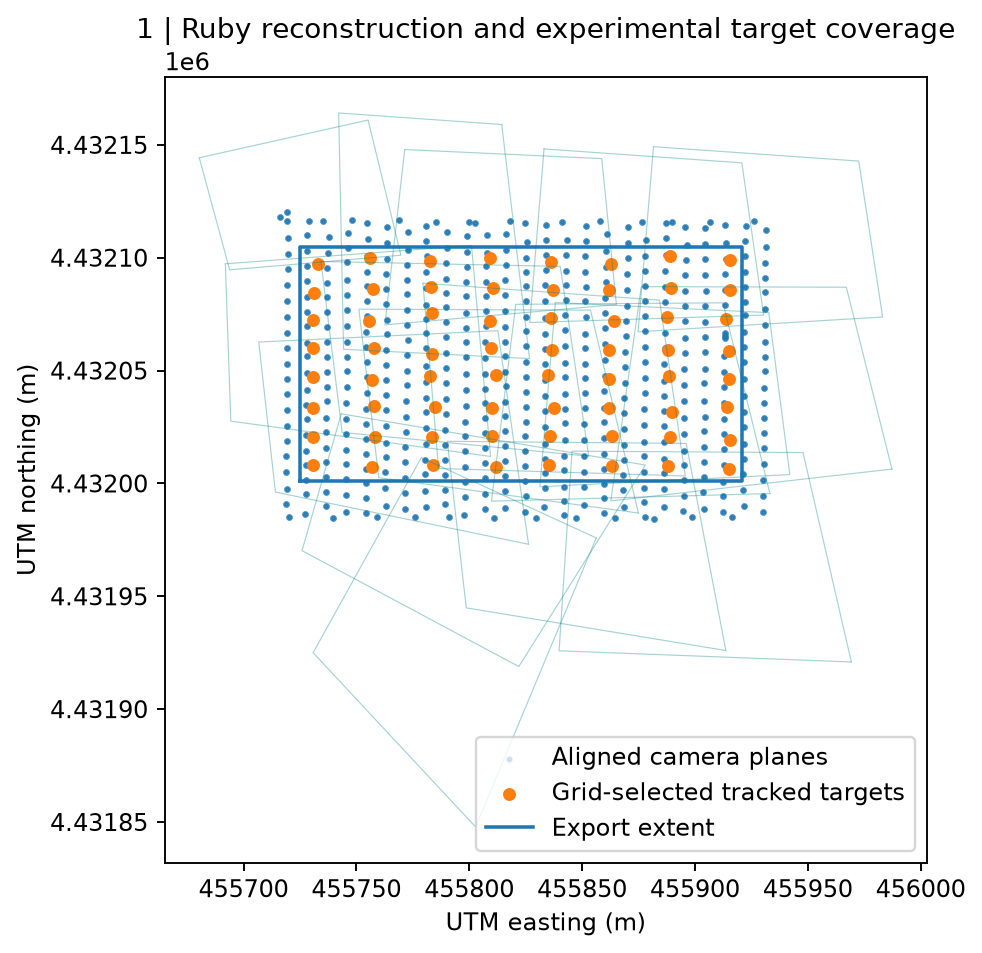

Recovered camera locations and sampled orientation-dependent footprints with the unchanged export extent; footprint corners use the earlier official DEM intersection and are approximate. Independent geolocation accuracy is not established.

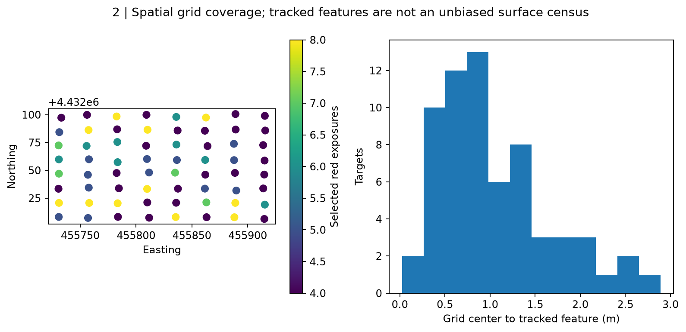

Fixed-grid targets and selected exposure counts. Four-to-eight repeated views and small grid displacements improve coverage, but tracked features remain a biased sample.

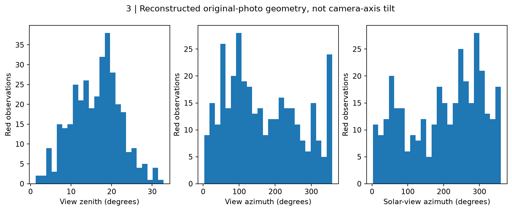

Actual original-photo view and relative azimuth distributions; these are ground-to-camera directions, not optical-axis tilt.

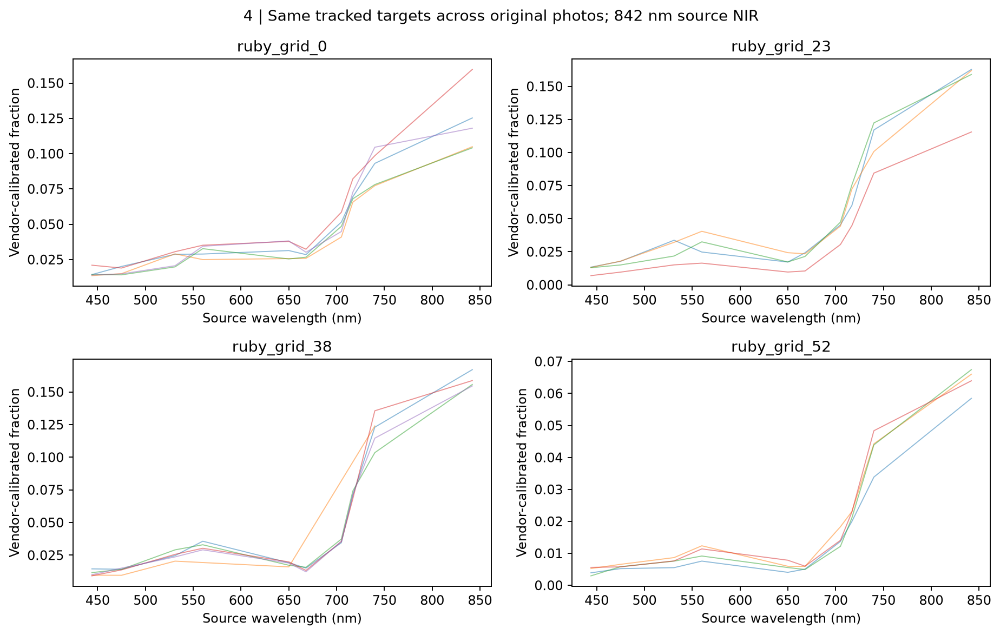

Calibrated source-pixel spectra for repeated tracked features, sorted by verified wavelength; cross-band/footprint registration and shared calibration remain limitations.

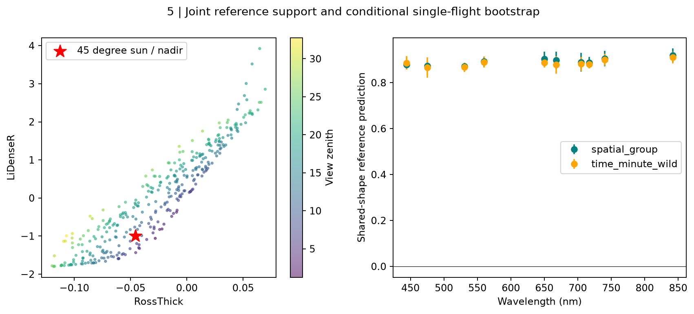

Observed joint kernel space and unchanged reference; spatial and wild-time bootstrap intervals are conditional single-flight shape uncertainty. Missing time-pairs uncertainty is reported separately.

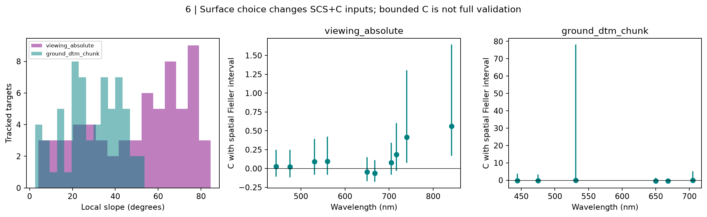

Local surface slopes and target-mean Fieller intervals. Very wide or absent intervals retain uncertainty; a finite interval alone is not physical validation.

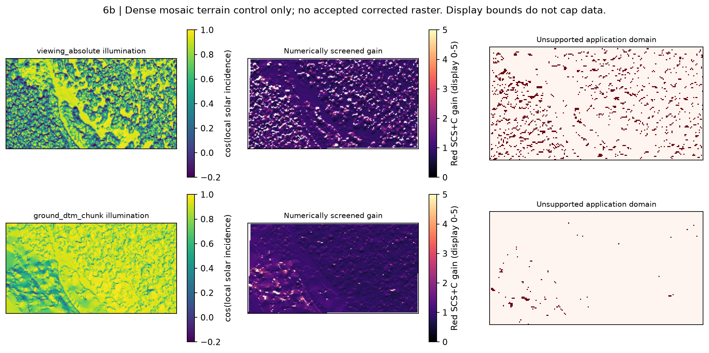

Dense common-grid incidence, screened red gains and unsupported masks. These are mosaic-stage controls, not accepted corrected imagery; display bounds do not alter data.

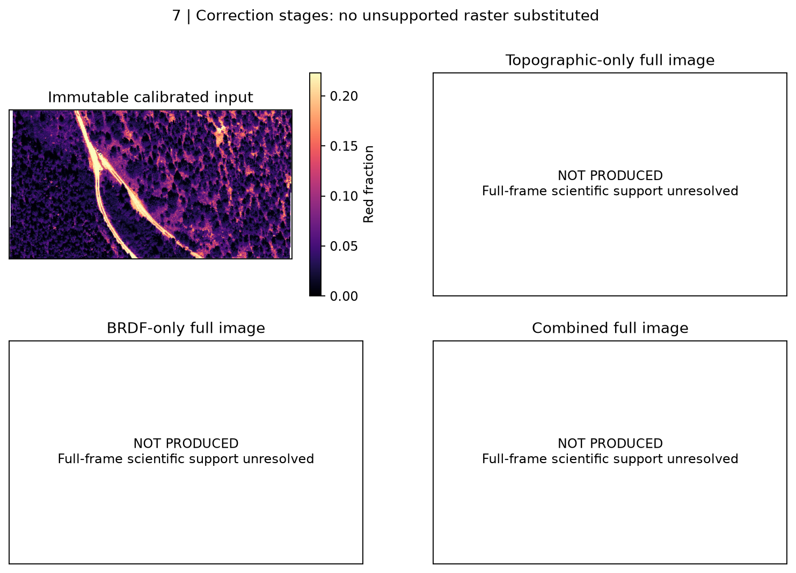

The new immutable calibrated input and explicit missing full-image correction stages. Blank panels mean not produced, not zero or identity corrections.

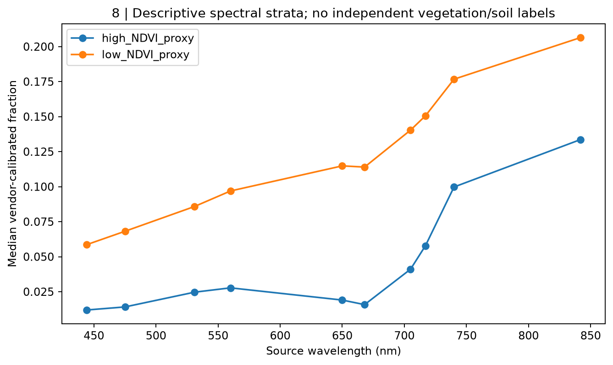

Descriptive spectral strata at original-photo targets. NDVI groups do not establish forest, herbaceous or soil class truth.

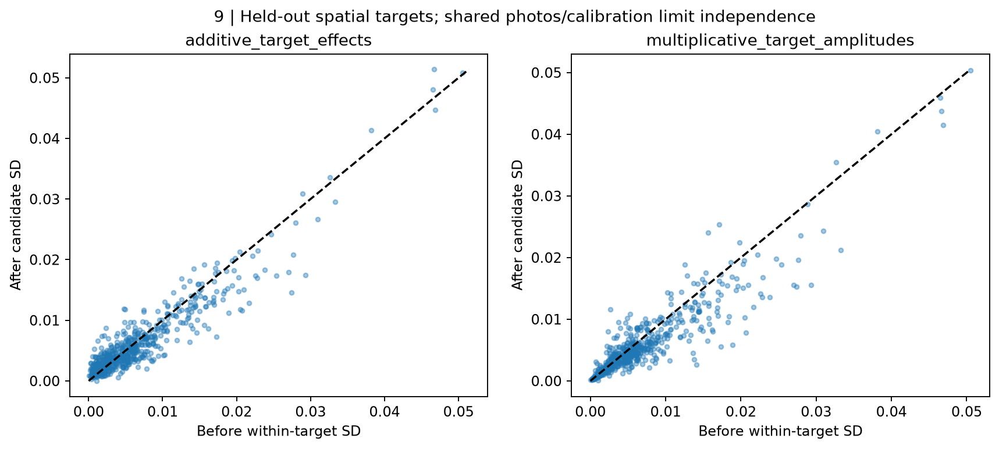

Held-out spatial target scatter; points above the diagonal get worse. Shared photographs/calibration limit validation independence.

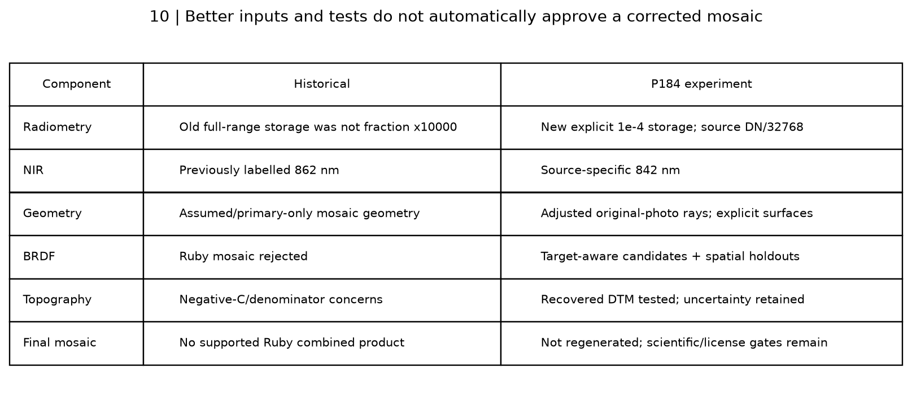

Comparison of historical and new workflow evidence. Improved inputs and local fits do not approve a complete corrected orthomosaic.

## Technical references

- [Official Metashape API](https://www.agisoft.com/pdf/metashape_python_api_2_3_1.pdf): calibration, camera and surface interfaces.
- [Official reflectance workflow](https://agisoft.freshdesk.com/support/solutions/articles/31000148780-micasense-rededge-mx-processing-workflow-including-reflectance-calibration-in-agisoft-metashape-pro): calibrated integer interpretation.
- [FlexBRDF research article](https://pmc.ncbi.nlm.nih.gov/articles/PMC9286663/): grouped airborne correction and overlap validation context. This does not independently validate the Ruby candidates.

## Final answers

- Did original photos solve Ruby's BRDF problem? They improve identifiability and permit target-aware fits with held-out evaluation; a full validated Ruby correction is not yet established.
- Are extreme topographic factors resolved? No. The recovered ground DTM still yields negative red C and unsupported denominator locations.
- Can a defensible corrected Ruby orthomosaic be delivered now? No; the combined scientific and licensed reconstruction steps have not passed.
- What prevents production adoption? Matched topographic support, robust full-frame/held-out validation, registration/calibration limits and an executed licensed copied-project reconstruction.
