# Ruby topographic correction recovery

6 November 2026 | P185 | Experimental, source-preserving investigation

## Decision

Ruby's negative C is reproduced. The shared SCS+C formula and angle conventions pass independent mathematical checks. The strongest explanation supported by the controls is confounded fitting information: surface brightness, canopy/shadow and terrain covary, while the repeated photographs add little independent illumination variation. Terrain representation and derivative scale materially change estimates. The observations do not uniquely identify a physical cause or a universally valid correction.

We implemented a safer, explicit partial-domain experimental workflow and compared SCS+C, C-correction and Minnaert. Ground-DTM smoothing and sunlit/spectral screening yield a numerically stable red domain covering about 76% of valid Ruby pixels without forcing C positive or capping gains. That is useful progress, not a validated production correction. Independent field-label checks and matched original-photo tests retain degradation and multiband support failures. **No corrected Ruby orthomosaic is approved or generated. Both corrections remain required.**

## Reproduced baseline and numerical audit

P184's dense red C = -0.17350, interval approximately [-0.23059, -0.09842], and 109 unsupported sampled locations are preserved. The new audit reproduces C = -0.1734966213, differing by -3.58e-09. Later candidate refits exclude field polygons plus a 2m buffer; their coefficients are deliberately not asserted to be identical to the old population.

SCS+C uses F = (cos(solar zenith) cos(slope) + C) / (cos(i) + C), with C = regression intercept / slope. Angles, metric north-up gradients, downslope clockwise-from-north aspect, solar azimuth and coefficient ordering are checked. An independent surface-normal/sun-vector dot product matches shared incidence to 1.73e-07, consistent with the shared float32 calculation. No shared unit, radians/degrees, sign or coefficient-order defect was demonstrated. Uniform positive reflectance scaling does not fix C; an unsupported additive offset is not introduced.

The audit did identify an **experimental P184 domain-check defect**: some absolute-distance checks could accept two negative numerator/denominator branches because their ratio was positive. There are 20 such model/observation combinations in its recorded candidates, not that many unique pixels. P185 requires the entire C interval to leave a positive denominator and numerator, matching the production uncertainty-aware path. Old evidence remains unchanged; the audit is in `numerical_audit.json`. The legacy internal ratio's identity behavior is not used as an experimental fallback, and production NEON code is unchanged.

Negative C is not itself rejected. It is acceptable numerically only where the positive-domain, confidence and training-support checks hold. Near-zero, negative, unknown and extrapolated cases remain NaN with explicit support status. Large supported gains remain uncapped and visible for scientific review.

## What the surfaces actually contain

The source is the same composite-fingerprinted Ruby WORKING project and vendor-calibrated 10cm input from P184. The absolute viewing DEM and ground-DTM candidate have approximately 0.333m native pixels; 10cm reflectance does not create 10cm terrain information. Active relative canopy height is not used as absolute elevation.

Saved metadata records depth-map downscale 4, filter mode 2 and a roughly 1.96-million-point reconstruction. Ground classification used 50m cells, 10-degree maximum angle, 1m maximum distance and zero erosion radius. The DTM chunk retains a ground-class model (`BuildModel/classes=2`) and DEM interpolation/source codes. `surface_provenance.json` preserves exact versioned metadata; these codes are not substituted with guessed modern enum meanings. The saved DTM is an interpolated reconstruction candidate, not a surveyed bare-earth truth. Ground-point support under closed canopy and the accuracy of each classified point remain unverified.

Native local slopes differ markedly (about 35 degrees viewing surface versus 18 degrees ground DTM in the prior tile summaries). A canopy-height surface or DSM is not a measured crown/leaf normal. Ground terrain is more plausible for exposed soil/low vegetation and for the existing SCS canopy geometry, but its interpolation and occlusion matter. Neither surface is automatically valid for every target.

We predeclared Gaussian sigmas 0, 1, 3 and 10m, representing native detail through local-crown/landform scales. Sigma is not pixel resolution. All scales are retained; none was selected to make C positive. Curvature, roughness, elevation, slope, aspect and incidence use common extents. Registration shifts of +/-0.5m, correlated 0.1/0.5m elevation-error scenarios and solar-angle +/-0.25-degree scenarios are explicit sensitivities, not estimated sensor errors. `input_sensitivity.json` records their C intervals. Smoothing cannot recover unseen ground or manufacture independent illumination observations.

## Shadows, heterogeneity and field context

Solar visibility is ray-sampled toward the sun to a declared 100m radius at 0.5m steps. A missing surface segment is unknown, never sunlit. The common-grid analysis samples approximately 1m-spaced exact input centers; full-frame diagnostics repeat visibility on the 10cm source grid. Finite-radius visibility does not exclude more distant obstructions and a photogrammetric surface cannot represent every leaf shadow.

The ground terrain predicts only 5 obstructed common-grid locations, versus approximately 3,250 for the canopy viewing surface. These are different physical hypotheses. Spectral darkness (visible mean below 0.01), low incidence/self-shadow, geometric obstruction, patch heterogeneity and saturation proxies are separate flags. Dark sunlit surfaces are not automatically shadow, and positive reflectance does not prove direct illumination.

Descriptive strata use raw NDVI, viewing-minus-ground height and brightness: elevated high-NDVI canopy proxy, low-height high-NDVI herbaceous proxy, low-height/low-NDVI exposed-surface proxy, and mixed/other. Texture uses a physical 0.5m patch. CV <=0.25 is the predeclared homogeneous sensitivity, not a universal purity threshold. Difficult observations and lost area are reported rather than silently discarded.

There are 86 overlapping existing half-diameter field polygons; 78 contain valid 1m-spaced samples. All are withheld from fitting with a 2m buffer. Their June 2023 cover/species labels provide independent context but not measured reflectance, August leaf state or independent ground elevation. Co-registration and temporal differences remain limitations.

| Field cover label | Sampled polygons | Mean fraction mapped to canopy proxy |
| --- | --- | --- |
| Evergreen | 56 | 95.6% |
| Herbaceous | 5 | 0.0% |
| Non-vegetated & dead | 14 | 9.5% |
| Woody shrub | 3 | 16.7% |

The high canopy-proxy agreement in field-labelled evergreen polygons supports that descriptive stratum locally; the small herbaceous/shrub samples do not establish a full ecological classification. Per-polygon and within-species red diagnostics are in `field_holdout_predictions.csv` and `field_holdout_summary.csv`. Equal species labels do not guarantee equal reflectance, so reduced dispersion/correlation is not proof of correction accuracy.

## Fitting candidates and uncertainty

We tested 630 predeclared candidates and 2,520 buffered spatial fits. Red spans both surfaces, four scales, nine fitting populations and OLS/spatial-balanced/Huber sensitivities. The five main screening populations and all ten bands are compared on native and 3m ground DTM with SCS+C, C-correction and Minnaert. Existing/sunlit/spectral/combined/homogeneous populations, coverage and rejected cases are explicit in the plan and model files.

Spatial covariance uses 20m blocks; equal-block WLS changes weighting without declaring neighbouring pixels independent. Huber is a declared outlier sensitivity with cluster estimating-equation covariance, not a coefficient constraint. Fieller intervals retain ratio uncertainty and unbounded cases. Four geographic quadrants, with a 2m training boundary buffer, are held out. Domains remain restricted to the corresponding population and fitted illumination range. Proxy-specific corrections are evaluated only in that proxy domain.

| DTM sigma m | Fitting population | C | Spatial Fieller interval | 1m-spaced domain fraction |
| --- | --- | --- | --- | --- |
| 0 | existing | -0.1951 | [-0.2526192640815768, -0.11929128526238139] | 99.3% |
| 0 | combined_screened | -0.0591 | [-0.15154601194312076, 0.07008321446690911] | 75.9% |
| 0 | homogeneous_sunlit | -0.0781 | [-0.18197360386861955, 0.07387860279705408] | 44.8% |
| 3 | existing | -0.5279 | [-0.5897731696987106, -0.43387586210417944] | 99.1% |
| 3 | combined_screened | -0.4205 | [-0.523668837295262, -0.23776072455490888] | 76.0% |
| 3 | homogeneous_sunlit | -0.3483 | [-0.4985958250569151, -0.021181466668807058] | 44.8% |

Screening generally changes C but does not justify forcing it positive. The 3m screening result can have a more negative C while a safer denominator domain, demonstrating why sign alone is not an acceptance test. Robustness, balanced weights, scale, canopy/soil proxies and leverage are reported rather than selected by convergence or R-squared.

## Identifiability and controlled truth

The original-photo solar zenith range is [25.842430114746097, 26.301219940185547]; repeated targets have median within-target incidence standard deviation about 0.00026. They provide viewing diversity, not a new independent topographic experiment. Raw red values at adjacent 1m sample locations have correlation 0.666. There are 60 declared spatial uncertainty blocks, four folds and one flight calibration context. These counts are not certified effective independent observations.

Synthetic controls use Ruby's actual terrain, incidence and spatial-block geometry with 60 replicates per scenario (660 total). The exact linear-response control recovers C=+0.2; a genuinely negative C is also recovered without a sign constraint. Ecological amplitude correlated with illumination can create strongly negative estimated C from known positive truth. Spatial autocorrelation, shadow attenuation, incidence error, noise, narrow ranges and density are varied separately. A forward SCS+C constant-flat-reflectance scenario also shows that varying the slope-reference term can violate the simpler common linear-regression population assumption.

| Synthetic scenario | Median estimated C | Known C |
| --- | --- | --- |
| homogeneous_positive_C | 0.200 | 0.2 |
| known_negative_C | -0.100 | -0.1 |
| ecological_gradient_0.5 | -0.448 | 0.2 |
| ecological_gradient_1.0 | -0.544 | 0.2 |
| spatial_heterogeneity | 0.225 | 0.2 |
| shadow_contamination | -0.027 | 0.2 |
| incidence_error | 0.303 | 0.2 |
| radiometric_noise | 0.200 | 0.2 |
| narrow_illumination | 0.201 | 0.2 |
| sparse_sample | 0.200 | 0.2 |
| forward_SCSC_flat_surface | 0.641 | 0.2 |

These controls demonstrate possible mechanisms; they do not prove which mechanism supplies every actual Ruby intercept. The negative-C baseline is consistent with confounding/shadow and surface-model limitations rather than a shared formula bug. Narrow illumination, heterogeneous surface amplitudes and interpolation prevent a unique physical attribution from this flight alone.

## Alternatives and topographic-only validation

C-correction uses (cos(solar zenith)+C)/(cos(i)+C): it shares the fitted C and denominator problem, but has a different reference than SCS+C's canopy geometry. Minnaert fits log(rho)=intercept+k log(cos(i)) and applies (cos(solar zenith)/cos(i))^k, on strictly positive inputs. It has a different non-Lambertian power-law assumption, not a guaranteed physical cure. Unconstrained k and its spatial interval are retained. Richter/other modified-Minnaert variants are not conflated with this named model or silently introduced.

Topographic-only spatial holdouts report dispersion, illumination dependence, parameter intervals, application coverage, source strata and prediction RMSE versus a training constant. All use the same input units/terrain/solar/fold and population definitions. Method-specific supported domains are explicit. Corrected reflectance may lose apparent incidence dependence by erasing ecological structure; no candidate is approved solely on that criterion, positive C or bounded gains.

Field-labelled comparisons retain both improvement and degradation; proxy-specific model boundary diagnostics are in `class_boundary_control.json`. No piecewise class model is applied to production imagery. The proxy boundary uncertainty and unsupported class fits make smooth-looking class mosaics unjustified.

## Matched original-photo topographic plus BRDF evaluation

We do not transplant dense-mosaic coefficients into original photographs. Each original-photo fold fits topography from training-target means, evaluates its parameter/domain support, corrects training observations and refits the P184 target-amplitude RossThick/LiDenseR candidate in that exact space. Target bootstrap requires a resolved positive prediction/reference and joint kernel support. Both stages must pass. The unchanged 45-degree sun/nadir BRDF reference is explicit. Failed stages remain missing, not identity corrections.

There are {'CONDITIONAL_MATCHED_CANDIDATE': 384, 'UNSUPPORTED_TOPO': 325, 'UNSUPPORTED_BRDF': 11} across 720 original-photo band/fold/model configurations. The raw, topo-only, BRDF-only and combined stages are compared on held-out targets. Parameter endpoint products plus BRDF target-bootstrap factor bounds form a conservative conditional envelope, not independent physical truth. Common support is essential: Minnaert supports more cases, so its unpaired averages are not used to claim superiority.

| Method, identical paired support | Target-band-fold cases | Median combined/raw CV-squared | Mean ratio |
| --- | --- | --- | --- |
| scsc | 328 | 0.868 | 1.051 |
| c_correction | 328 | 0.866 | 1.051 |
| minnaert | 328 | 0.859 | 1.032 |

These are **CV-squared ratios**, not the absolute variance statistic in P184; they must not be directly substituted for its 0.766 result. Medians improve, while means remain above one even on identical paired support. On complete spectra, 944 setting/exposure combinations have all ten bands, all from Minnaert candidate branches; these are repeated configurations, not that many independent flights. SCS+C/C-correction do not deliver complete ten-band original-photo support in this experiment. Spectral angles, NDVI change, negatives and above-one values are retained in `complete_spectral_validation.csv`, not inferred from a few attractive spectra.

The alternative improves numerical availability but has not demonstrated a uniformly better or physically validated combined correction. Topography can degrade a previously useful BRDF fit. Original-photo masks use the common-grid shadow context; full-frame diagnostics below evaluate the source grid directly.

## Original-photo class-specific follow-up

To test whether pooling surfaces concealed a usable correction, we ran an additional 600 original-photo class-specific fits across canopy, herbaceous and exposed proxies at the same native/3m scales. These use the same sun/spectral/registration and uncertainty rules, not hand-selected positive C. Their statuses are {'UNSUPPORTED_TOPO': 432, 'CONDITIONAL_MATCHED_CANDIDATE': 158, 'UNSUPPORTED_BRDF': 10}. All 80 canopy SCS+C band/fold fits remain unsupported topographically. The exposed proxy has too little supported information; limited herbaceous cases do not generalize.

Canopy Minnaert provides 375 held-out target-band cases, median CV-squared ratio 0.890, mean 1.008. That availability improvement does not demonstrate a reliable scientific replacement or solve SCS+C identifiability. The class-specific tables are retained under `class_specific/`, separate from the base matched comparison and its complete-spectrum counts. This follow-up argues against solving the problem simply by choosing the field-supported canopy proxy.

## Full-frame partial-domain diagnostics

The new outputs are **factor, interval and support diagnostics**, not corrected reflectance. Input scale remains 0.0001 (fraction times 10000), source NIR 842nm and the established 10cm grid/CRS. Work is bounded in 64-row windows. All ten bands receive coverage/extrema summaries; red gains/intervals/support are retained as GeoTIFFs under `archive/local/ruby-topographic-recovery-2026-11-06/`.

| Full 10cm diagnostic | Supported red fraction | Red gain range | Cast-shadow pixels | Unknown sun visibility |
| --- | --- | --- | --- | --- |
| dtm_sigma0_existing_scsc | 83.5% | 0.146 to 6.593 | 317424 | 3278 |
| dtm_sigma3_combined_screened_scsc | 76.2% | 0.623 to 2.799 | 317424 | 3278 |
| dtm_sigma3_combined_screened_c_correction | 76.2% | 0.826 to 4.290 | 317424 | 3278 |
| dtm_sigma3_combined_screened_minnaert | 76.2% | 0.830 to 2.511 | 317424 | 3278 |

These fractions use valid source pixels as denominator. Cast shadows and unknown visibility are reported separately, not filled. Support includes numerical parameter/domain and declared sun/spectral checks; it is not a claim of verified physical reflectance accuracy. A useful correction need not cover every pixel. Here the approximately 76% red domain is a meaningful candidate, but its scientific sufficiency depends on intended polygons/surfaces and successful multiband matched validation, which is still incomplete.

Native SCS+C retains larger supported gains; 3m screened candidates reduce their range without clipping. This alone is not a win: smoothing and screening change the population/domain, and paired held-out degradation remains. All unsupported pixels stay missing. Maps use common display bounds only; analytical extrema and uncertainty are unchanged.

## Recommended approach and production decision

Keep the shared uncertainty-aware SCS+C method as baseline. Carry the explicitly typed ground DTM, physically declared scale, separate geometric shadow/darkness flags, field-context validation, spatial uncertainty and positive-domain checks into the experimental original-photo workflow. Treat the 3m screened SCS+C branch as a **partial-domain research candidate**, not a selected universal terrain scale. Keep Minnaert as the strongest availability comparison; do not replace SCS+C merely because Minnaert avoids an intercept/slope pole.

Production readiness remains **unsupported**. The formula, domain machinery and reusable utilities are verified; terrain/leaf illumination truth, population transferability, full ten-band SCS+C original-photo support and consistent held-out combined improvement are not. No complete corrected raster or licensed mosaic is generated, and none of the missing stages is bypassed. NEON correction mathematics/defaults and P183/P184 products remain unchanged.

The smallest useful next acquisition is the same stable, independently labelled patches under a substantially different solar geometry, with matched panel/irradiance calibration and a small independent ground-elevation/normal check across the relevant slopes and canopy gaps. One additional flight can improve identification; **two additional distinct sun conditions** would allow fitting across conditions and holding one illumination condition out. Suggested targets should span several spatial blocks and exposed/low vegetation/canopy strata; exact sample counts must follow measured variability rather than an invented universal minimum. Existing field polygons can anchor this design. A second viewing-only repeat at nearly the same sun angle will not supply the missing illumination information.

## Reproduction and implementation

`src/spectralbridge/drone_topography.py` contains opt-in terrain derivatives, degree-explicit incidence, finite-radius sun visibility, spatial/robust regression, uncertainty-aware SCS+C/C/Minnaert factors and buffered folds. It is not wired into production defaults. Tests independently cover axes, planar terrain, shadow versus unknown, known positive/negative C, ratio poles, large uncapped gains, spatial groups, Minnaert recovery and existing NEON equivalence. `README.md`, `run.py`, manifests and `final_checks.json` document execution and verification. Source paths and checksums remain authoritative.

## Figures

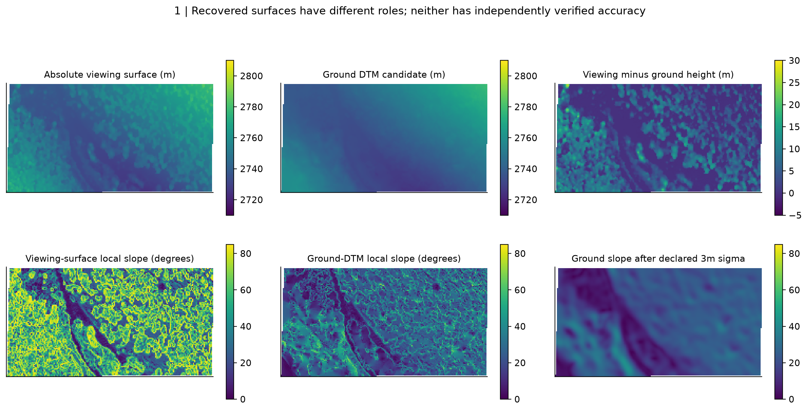

Surface roles, elevation/slope scale and canopy-minus-ground differences; independent terrain accuracy remains unverified.

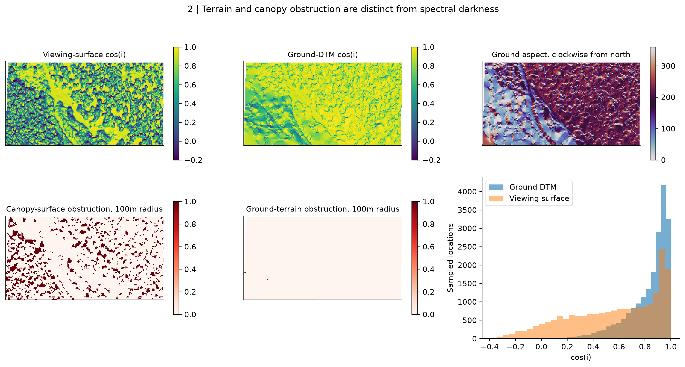

Common-extent illumination and finite-radius geometric obstruction. Darkness is not used to predict these shadows.

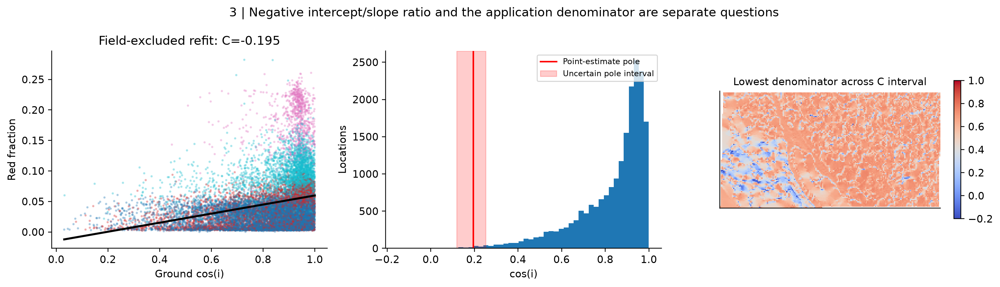

Regression heterogeneity, uncertain denominator pole and its spatial domain. The plotted refit excludes field buffers; the original baseline is reproduced separately.

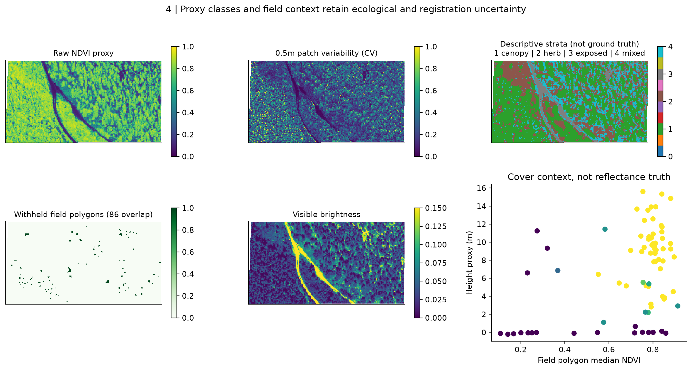

Descriptive spectral/height/texture strata and withheld field context. Proxy names do not imply universal ecological truth.

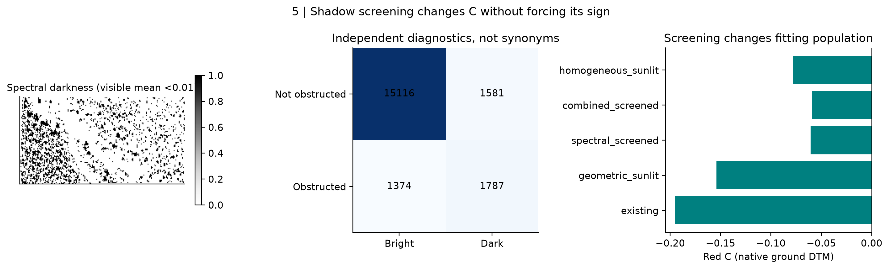

Geometric obstruction and spectral darkness disagree; population screening changes C without forcing its sign.

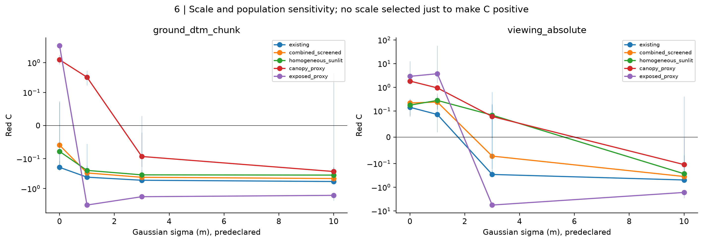

Predeclared scale/population C sensitivity with spatial Fieller intervals; symlog is a display scale only.

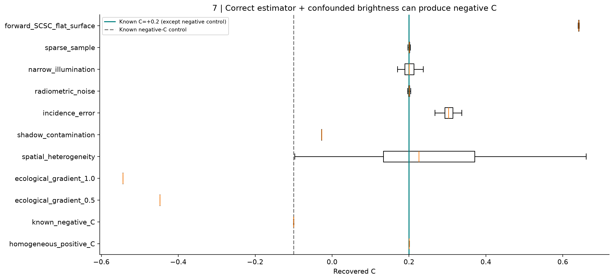

Known-truth synthetic recovery: confounding can produce negative estimated C despite a correct implementation. Boxplot outliers are omitted for display; all replicates remain in the statistics.

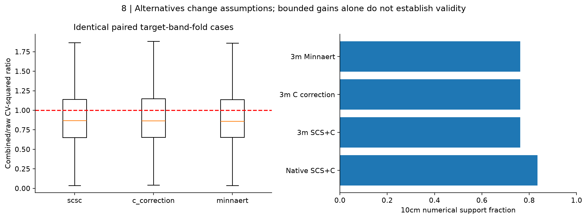

Alternative models on identical paired original-target support, with full-frame domain sizes shown separately. Boxplot outliers are omitted; the reported means retain them.

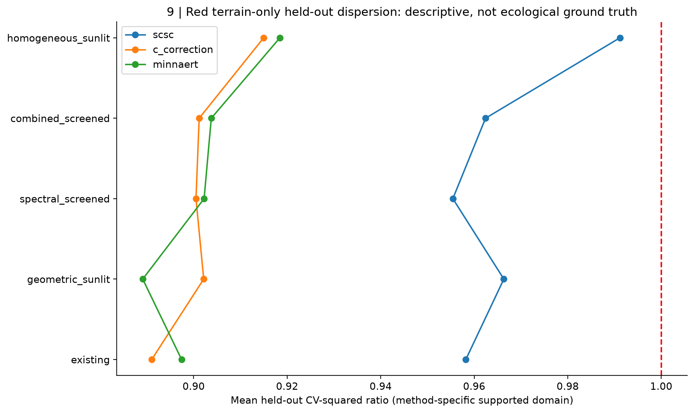

Terrain-only spatial validation. Lower dispersion alone does not establish ecological preservation.

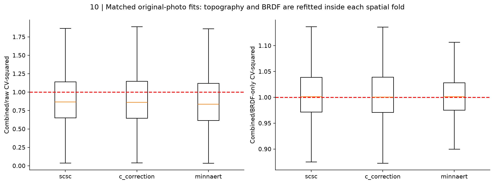

Raw/BRDF/combined comparisons on matched original-photo support; outliers are omitted from boxplot display but retained in all analytical summaries.

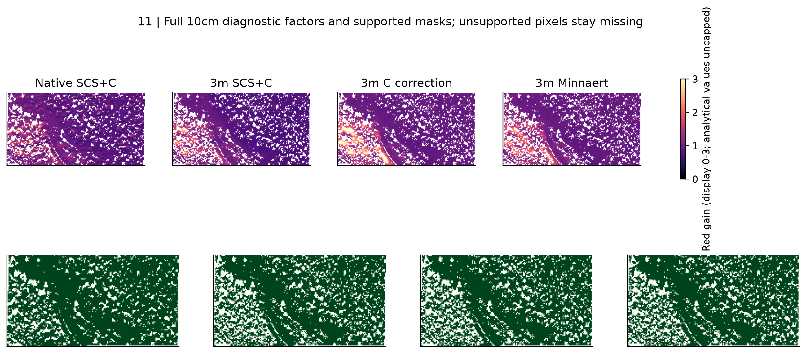

Full-frame red factors and masks. Display limits never cap analytical gains; unsupported regions remain missing.

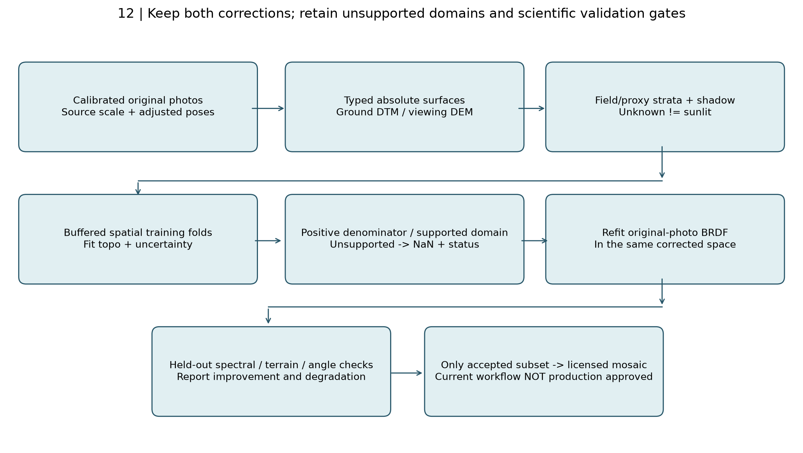

A reproducible workflow retaining both correction stages, explicit masks and physical validation gates.

## Primary technical references

- [Soenen, Peddle and Coburn (2005), SCS+C](https://ieeexplore.ieee.org/abstract/document/1499030/), DOI 10.1109/TGRS.2005.852480: forest canopy correction context.
- [Ediriweera et al. (2013)](https://www.mdpi.com/2072-4292/5/12/6767): empirical comparison of established C, Minnaert and canopy methods.
- [Evaluation and Intercomparison of Topographic Correction Methods (2021)](https://www.mdpi.com/2072-4292/13/20/4120): real/synthetic comparison and limits of validation criteria.
- [Agisoft ground-classification parameters](https://agisoft.freshdesk.com/support/solutions/articles/31000160729-parameters-for-ground-point-classification): classification settings are project-dependent, not ground-truth guarantees. Saved Ruby settings predate current API features.

Local numerical measurements and validation claims derive from the machine-readable evidence in this directory. Literature supports method definitions/context, not approval of Ruby.

## Final answers

**Why negative C?** The fitted intercept-to-slope ratio reflects a confounded population of terrain, surface brightness, canopy and shadow. Correct synthetic estimators can show the same sign change. The actual contributions cannot be uniquely separated in this single illumination context.

**Implementation, terrain or information?** No shared SCS+C equation/angle defect was demonstrated. A P184 experimental negative-branch domain error was repaired in the isolated helper. Terrain scale/ground interpolation and insufficient/confounded illumination information remain important physical limitations.

**Can better fitting be stable and defensible?** A stable explicit partial numerical domain is demonstrated, including negative C where its denominator interval stays positive. Universal physical validity is not established; screening/smoothing alone are insufficient.

**Does it improve original-photo BRDF?** Some targets improve, but matched means remain worse than raw on common support, and SCS+C lacks complete ten-band original-photo support. The combined workflow is not approved.

**Can both-corrected Ruby imagery be approved now?** No. Neither identity filling nor a switch to Minnaert based only on coverage is justified.

**Smallest additional experiment?** Repeat stable labelled patches at substantially different sun geometry with cross-flight calibration and independent ground/normal checks. One extra flight improves identification; two extra sun conditions enable an illumination holdout.
